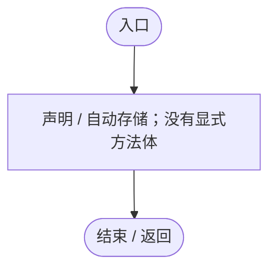
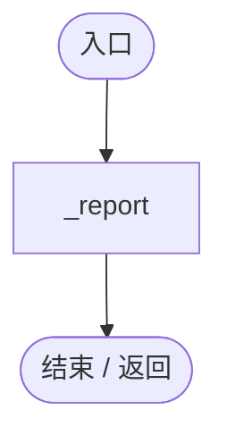
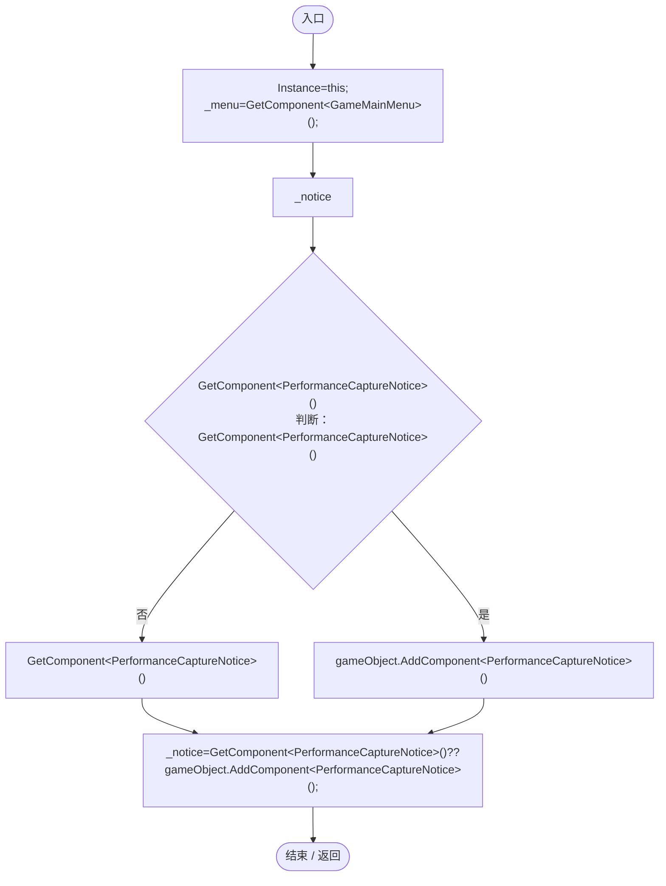
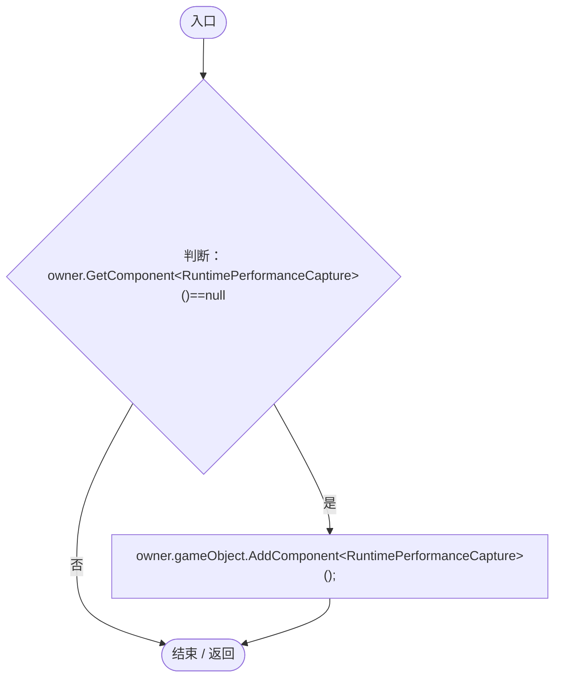
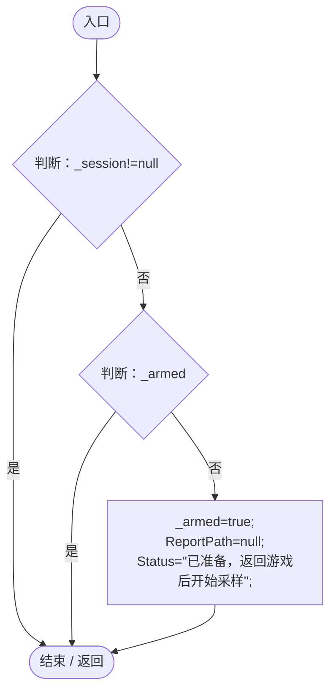
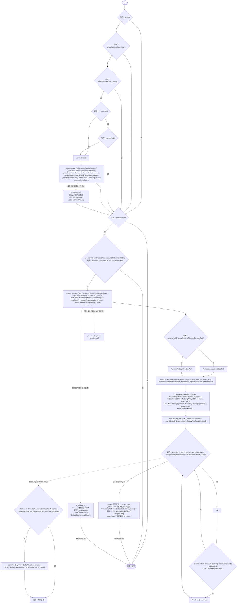
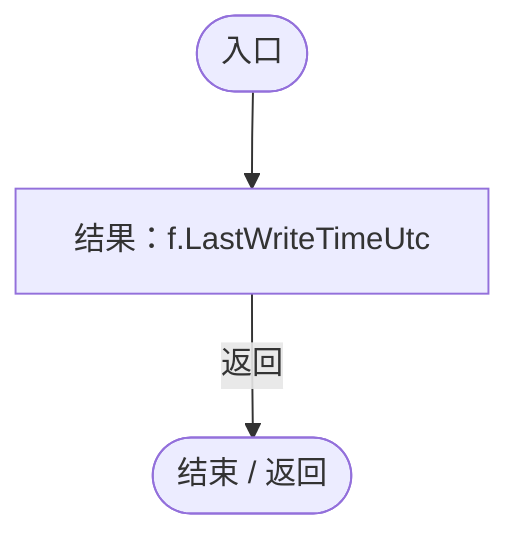
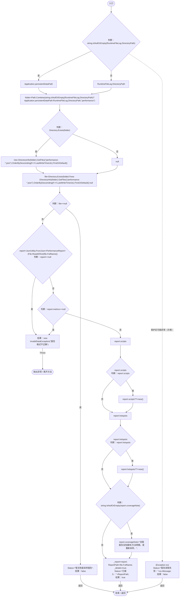
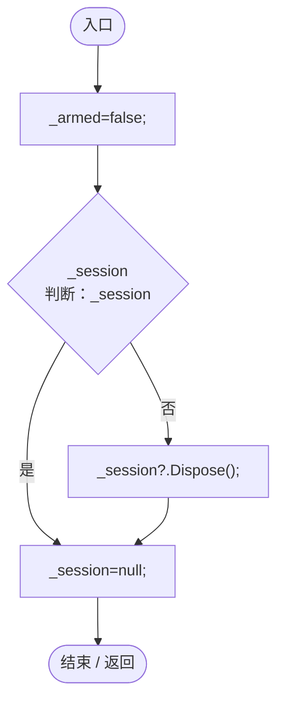
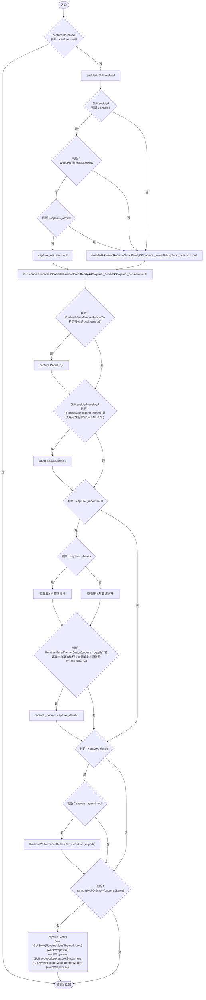

# RuntimePerformanceCapture.cs

[返回总索引](../README.md) · `Runtime` · `Assets/DarwinPark/UI/RuntimePerformanceCapture.cs`

[源文件](../../../Assets/DarwinPark/UI/RuntimePerformanceCapture.cs) · 源码校验：`7db9428c98dba03ea1daa356343986ad4d2fa1ebcda2dcd2ebc0736652943d0d`

方法按源文件位置排列。事件/回调引用不表示立即执行；分支与异常说明见总索引。完整源码与可点击关系图请打开离线手册。

## Instance.get · L13

`get`

### Editor / Player · 语法控制结构 / 声明（非CFG）

## Instance.set · L13

`private set`

### Editor / Player · 语法控制结构 / 声明（非CFG）

## Status.get · L14

`get`

### Editor / Player · 语法控制结构 / 声明（非CFG）

## Status.set · L14

`private set`

### Editor / Player · 语法控制结构 / 声明（非CFG）

## ReportPath.get · L14

`get`

### Editor / Player · 语法控制结构 / 声明（非CFG）

## ReportPath.set · L14

`private set`

### Editor / Player · 语法控制结构 / 声明（非CFG）

## LastReport.get · L19

`public PerformanceReport LastReport`

### Editor / Player · 语法控制结构 / 声明（非CFG）

## Awake · L20

`private void Awake()`

### Editor / Player · Roslyn编译器控制流

项目内调用/回调引用：

- [RuntimePerformanceCapture.Instance.set · L13](8709e073518085cd.md#m3cc7d799c14c1301)（访问器）

## Ensure · L21

`public static void Ensure(GameMainMenu owner)`

### Editor / Player · Roslyn编译器控制流

## Request · L22

`public void Request()`

### Editor / Player · Roslyn编译器控制流

项目内调用/回调引用：

- [RuntimePerformanceCapture.ReportPath.set · L14](8709e073518085cd.md#mad3908f9da3376a7)（访问器）
- [RuntimePerformanceCapture.Status.set · L14](8709e073518085cd.md#mac0e08101c494b88)（访问器）

## LateUpdate · L23

`private void LateUpdate()`

### Editor / Player · Roslyn编译器控制流

项目内调用/回调引用：

- [PerformanceSampleSession.PerformanceSampleSession.ctor · L43](a8403a4c7503726d.md#me5d389942b484c2b)（构造函数）
- [ColonyFoodQueryCache.Hits.get · L16](63cd90165719dbff.md#m871ae7a0cf96f22d)（访问器）
- [ColonyFoodQueryCache.Searches.get · L16](63cd90165719dbff.md#m2faafc4a4fd9a504)（访问器）
- [ResourceCoordinates.Rebuilds.get · L24](93d731ac01e3af48.md#m8d7daf91ba26e421)（访问器）
- [CorpseInstanceRenderer.InstanceWrites.get · L47](29964f1f6c300ac9.md#m9330ca4e2a209288)（访问器）
- [RuntimePerformanceCapture.Status.set · L14](8709e073518085cd.md#mac0e08101c494b88)（访问器）
- [PerformanceCaptureNotice.Show · L12](9586755aef05e502.md#me4c6989a5b377bd5)（方法）
- [RuntimePerformanceCapture.Status.get · L14](8709e073518085cd.md#mcd3802a7cb34e000)（访问器）
- [PerformanceSampleSession.RecordFrame · L51](a8403a4c7503726d.md#me7cce52503c9c701)（方法）
- [PerformanceSampleSession.Finish · L55](a8403a4c7503726d.md#m9dc62c92dc25c06a)（方法）
- [FramePacingSettings.Limit.get · L11](8a946f816b77d4b6.md#m30a0a118e57b6343)（访问器）
- [CorpseInstanceRenderer.LastInstances.get · L50](29964f1f6c300ac9.md#mc48fbcf8c606dd25)（访问器）
- [CorpseInstanceRenderer.PreviousFrameBatches.get · L52](29964f1f6c300ac9.md#m2dab089a4ae815ce)（访问器）
- [RuntimePerformanceCapture.ReportPath.set · L14](8709e073518085cd.md#mad3908f9da3376a7)（访问器）
- [RuntimePerformanceCapture.ReportPath.get · L14](8709e073518085cd.md#m97ef8f0e87bc3653)（访问器）
- [RuntimePerformanceDetails.Markdown · L16](64a9a186be88560e.md#m8636abf39bbd1838)（方法）
- [RuntimePerformanceDetails.Summary · L14](64a9a186be88560e.md#m353e898bab8610f1)（方法）
- [PerformanceSampleSession.Dispose · L66](a8403a4c7503726d.md#m21c6ebc8351edbcf)（方法）
- [RuntimePerformanceCapture.回调@33 · L33](8709e073518085cd.md#m88e6bc1fd4465af4)（回调/委托）

## 回调@33 · L33

`f … => 回调`

### Editor / Player · Roslyn编译器控制流

## LoadLatest · L40

`public bool LoadLatest()`

★ 新增：重启后按需载入最近报告，不在每帧扫描日志目录；旧版报告明确缺少脚本明细。

### Editor / Player · Roslyn编译器控制流

项目内调用/回调引用：

- [RuntimePerformanceCapture.Status.set · L14](8709e073518085cd.md#mac0e08101c494b88)（访问器）
- [RuntimePerformanceCapture.ReportPath.set · L14](8709e073518085cd.md#mad3908f9da3376a7)（访问器）
- [RuntimePerformanceCapture.ReportPath.get · L14](8709e073518085cd.md#m97ef8f0e87bc3653)（访问器）
- [RuntimePerformanceCapture.回调@42 · L42](8709e073518085cd.md#m0119de80be2b4adf)（回调/委托）

## 回调@42 · L42

`f … => 回调`

### Editor / Player · Roslyn编译器控制流

## OnDisable · L46

`private void OnDisable()`

### Editor / Player · Roslyn编译器控制流

项目内调用/回调引用：

- [PerformanceSampleSession.Dispose · L66](a8403a4c7503726d.md#m21c6ebc8351edbcf)（方法）

## OnDestroy · L47

`private void OnDestroy()`

### Editor / Player · Roslyn编译器控制流

项目内调用/回调引用：

- [RuntimePerformanceCapture.Instance.get · L13](8709e073518085cd.md#me90ed541f78af673)（访问器）
- [RuntimePerformanceCapture.Instance.set · L13](8709e073518085cd.md#m3cc7d799c14c1301)（访问器）

## Draw · L48

`public static void Draw()`

### Editor / Player · Roslyn编译器控制流

项目内调用/回调引用：

- [RuntimePerformanceCapture.Instance.get · L13](8709e073518085cd.md#me90ed541f78af673)（访问器）
- [RuntimeMenuTheme.Button · L90](b9d8455882f2a532.md#mc7e1580ab0f51b0b)（方法）
- [RuntimePerformanceCapture.Request · L22](8709e073518085cd.md#mc9d7871ccd40c51d)（方法）
- [RuntimePerformanceCapture.LoadLatest · L40](8709e073518085cd.md#m1d4a4677a2c0faa7)（方法）
- [RuntimePerformanceDetails.Draw · L27](64a9a186be88560e.md#m4197bfcd6af4591f)（方法）
- [RuntimePerformanceCapture.Status.get · L14](8709e073518085cd.md#mcd3802a7cb34e000)（访问器）
- [RuntimeMenuTheme.Muted.get · L13](b9d8455882f2a532.md#meeaba271eb4ad2ed)（访问器）
