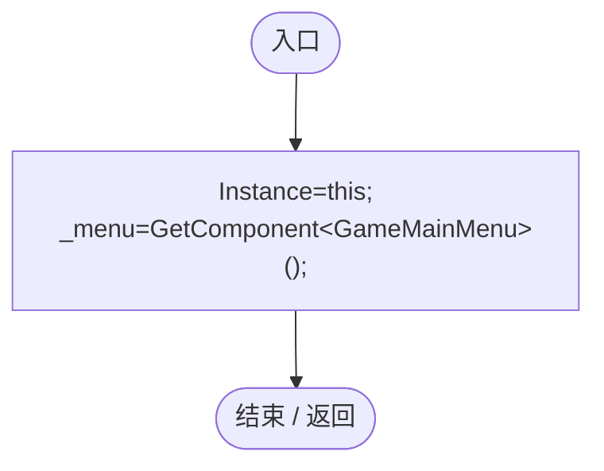
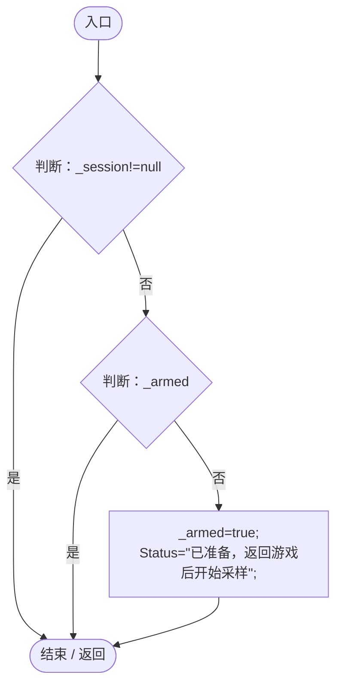
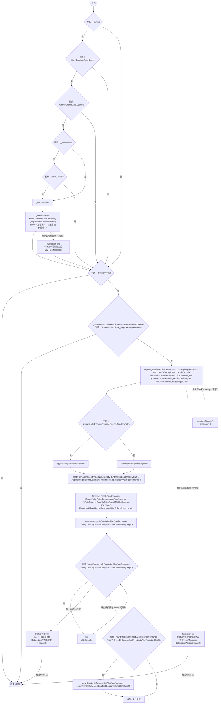
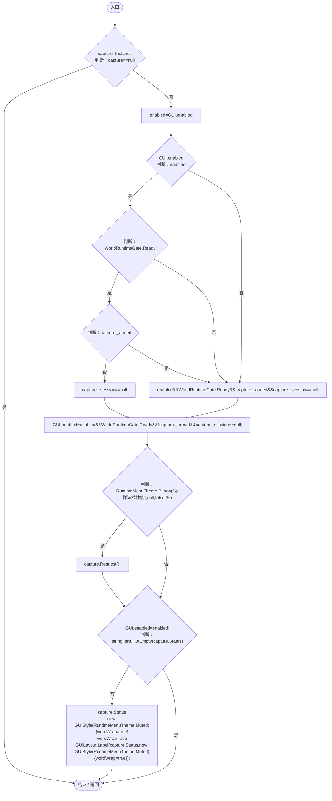

# RuntimePerformanceCapture.cs

[返回总索引](../README.md) · `Runtime` · `Assets/DarwinPark/UI/RuntimePerformanceCapture.cs`

[源文件](../../../Assets/DarwinPark/UI/RuntimePerformanceCapture.cs) · 源码校验：`8442a1fd63d691489e9b6073b3b26eda2c1f53e04c5c26cf85e4019f3ed8e4c7`

方法按源文件位置排列。事件/回调引用不表示立即执行；分支与异常说明见总索引。完整源码与可点击关系图请打开离线手册。

## Instance.get · L13

`get`

### Editor / Player · 语法控制结构 / 声明（非CFG）

## Instance.set · L13

`private set`

### Editor / Player · 语法控制结构 / 声明（非CFG）

## Status.get · L14

`get`

### Editor / Player · 语法控制结构 / 声明（非CFG）

## Status.set · L14

`private set`

### Editor / Player · 语法控制结构 / 声明（非CFG）

## ReportPath.get · L14

`get`

### Editor / Player · 语法控制结构 / 声明（非CFG）

## ReportPath.set · L14

`private set`

### Editor / Player · 语法控制结构 / 声明（非CFG）

## Awake · L16

`private void Awake()`

### Editor / Player · Roslyn编译器控制流

项目内调用/回调引用：

- [RuntimePerformanceCapture.Instance.set · L13](8709e073518085cd.md#m3cc7d799c14c1301)（访问器）

## Ensure · L17

`public static void Ensure(GameMainMenu owner)`

### Editor / Player · Roslyn编译器控制流

## Request · L18

`public void Request()`

### Editor / Player · Roslyn编译器控制流

项目内调用/回调引用：

- [RuntimePerformanceCapture.Status.set · L14](8709e073518085cd.md#mac0e08101c494b88)（访问器）

## LateUpdate · L19

`private void LateUpdate()`

### Editor / Player · Roslyn编译器控制流

项目内调用/回调引用：

- [PerformanceSampleSession.PerformanceSampleSession.ctor · L42](a8403a4c7503726d.md#m7edb727de35dd4e0)（构造函数）
- [RuntimePerformanceCapture.Status.set · L14](8709e073518085cd.md#mac0e08101c494b88)（访问器）
- [PerformanceSampleSession.RecordFrame · L50](a8403a4c7503726d.md#md8103bcb92ec1d0b)（方法）
- [PerformanceSampleSession.Finish · L54](a8403a4c7503726d.md#mbe1d31dc542eeb76)（方法）
- [FramePacingSettings.Limit.get · L11](8a946f816b77d4b6.md#m30a0a118e57b6343)（访问器）
- [RuntimePerformanceCapture.ReportPath.set · L14](8709e073518085cd.md#mad3908f9da3376a7)（访问器）
- [RuntimePerformanceCapture.ReportPath.get · L14](8709e073518085cd.md#m97ef8f0e87bc3653)（访问器）
- [RuntimePerformanceCapture.Status.get · L14](8709e073518085cd.md#mcd3802a7cb34e000)（访问器）
- [PerformanceSampleSession.Dispose · L65](a8403a4c7503726d.md#m45ae04d3f5af8b68)（方法）
- [RuntimePerformanceCapture.回调@28 · L28](8709e073518085cd.md#m5253817c66c10a54)（回调/委托）

## 回调@28 · L28

`f … => 回调`

### Editor / Player · Roslyn编译器控制流

## OnDisable · L34

`private void OnDisable()`

### Editor / Player · Roslyn编译器控制流

项目内调用/回调引用：

- [PerformanceSampleSession.Dispose · L65](a8403a4c7503726d.md#m45ae04d3f5af8b68)（方法）

## OnDestroy · L35

`private void OnDestroy()`

### Editor / Player · Roslyn编译器控制流

项目内调用/回调引用：

- [RuntimePerformanceCapture.Instance.get · L13](8709e073518085cd.md#me90ed541f78af673)（访问器）
- [RuntimePerformanceCapture.Instance.set · L13](8709e073518085cd.md#m3cc7d799c14c1301)（访问器）

## Draw · L36

`public static void Draw()`

### Editor / Player · Roslyn编译器控制流

项目内调用/回调引用：

- [RuntimePerformanceCapture.Instance.get · L13](8709e073518085cd.md#me90ed541f78af673)（访问器）
- [RuntimeMenuTheme.Button · L90](b9d8455882f2a532.md#mc7e1580ab0f51b0b)（方法）
- [RuntimePerformanceCapture.Request · L18](8709e073518085cd.md#me1be78347a642319)（方法）
- [RuntimePerformanceCapture.Status.get · L14](8709e073518085cd.md#mcd3802a7cb34e000)（访问器）
- [RuntimeMenuTheme.Muted.get · L13](b9d8455882f2a532.md#meeaba271eb4ad2ed)（访问器）
