# LanTransport.cs

[返回总索引](../README.md) · `Runtime` · `Assets/DarwinPark/UI/LanTransport.cs`

[源文件](../../../Assets/DarwinPark/UI/LanTransport.cs) · 源码校验：`6c3e0c7e0b64483e03771ff9c4511bb4d5655f3845cc2325b5ada9939ce40b3e`

方法按源文件位置排列。事件/回调引用不表示立即执行；分支与异常说明见总索引。完整源码与可点击关系图请打开离线手册。

## Id.get · L19

`get`

### Editor / Player · 语法控制结构 / 声明（非CFG）

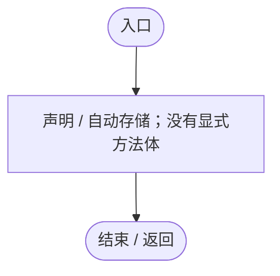

## Connected.get · L20

`public bool Connected`

### Editor / Player · 语法控制结构 / 声明（非CFG）

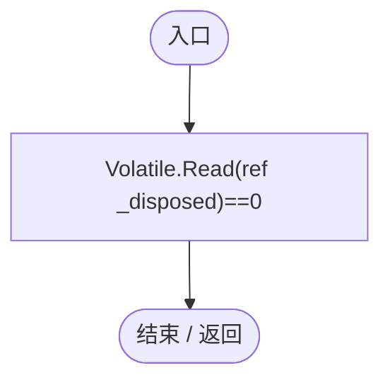

## LanConnection.ctor · L21

`public LanConnection(TcpClient client,int maxBytes,int maxQueue,Action<LanConnection,string> received,Action<LanConnection> closed)`

### Editor / Player · Roslyn编译器控制流

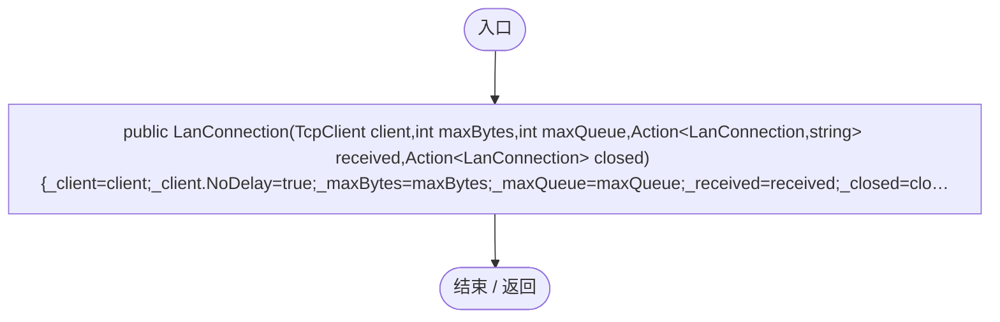

## Start · L23

`public void Start()`

### Editor / Player · Roslyn编译器控制流

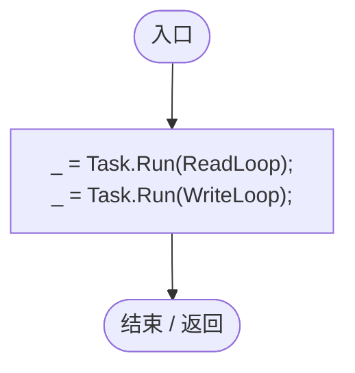

项目内调用/回调引用：

- [LanConnection.ReadLoop · L28](872c2b8da417200e.md#m3c4d6c5f50879e4f)（方法）
- [LanConnection.WriteLoop · L45](872c2b8da417200e.md#mc4592c96f402fdc0)（方法）

## Send · L24

`public void Send(string json)`

### Editor / Player · Roslyn编译器控制流

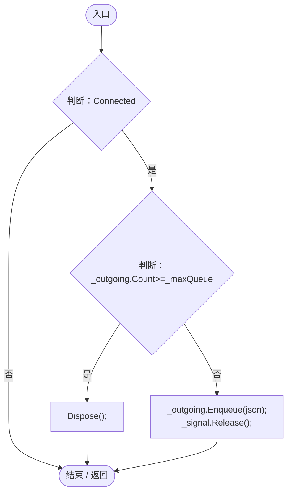

项目内调用/回调引用：

- [LanConnection.Dispose · L62](872c2b8da417200e.md#mcbbf7592b2503d1f)（方法）

## ReadLoop · L28

`private async Task ReadLoop()`

### Editor / Player · Roslyn编译器控制流

```mermaid
flowchart TD
  b0(["入口"])
  b1["stream=_client.GetStream()<br/>header=new byte[4]"]
  b2{"判断：Connected"}
  b3{"await Exact(stream,header);<br/>length=header[0]&#124;header[1]&lt;&lt;8&#124;header[2]&lt;&lt;16&#124;header[3]&lt;&lt;24<br/>判断：length&lt;=0"}
  b4{"判断：length&gt;_maxBytes"}
  b5["结果：new InvalidDataException(&quot;网络数据包长度无效&quot;)"]
  x5(["抛出异常 / 离开方法"])
  b6["bytes=new byte[length]<br/>await Exact(stream,bytes);<br/>_received(this,Encoding.UTF8.GetString(bytes));"]
  b7{"(Exception ex)<br/>判断：ex is IOException"}
  b8{"判断：ex is SocketException"}
  b9{"判断：ex is ObjectDisposedException"}
  b10{"判断：ex is InvalidOperationException"}
  b11["连接 / 离开区域"]
  b12["Dispose();"]
  b13(["结束 / 返回"])
  b0 --> b1
  b1 --> b2
  b2 -->|"是"| b3
  b2 -->|"否 · 经过finally 12"| b13
  b3 -->|"否"| b4
  b3 -->|"是"| b5
  b4 -->|"是"| b5
  b4 -->|"否"| b6
  b5 -->|"Throw"| x5
  b6 --> b2
  b7 -->|"否"| b8
  b7 -->|"是"| b11
  b8 -->|"否"| b9
  b8 -->|"是"| b11
  b9 -->|"否"| b10
  b9 -->|"是"| b11
  b10 -->|"是"| b11
  b11 -->|"经过finally 12"| b13
  b1 -. "退出保护区时 finally（示意）" .-> b12

```

项目内调用/回调引用：

- [LanConnection.Exact · L43](872c2b8da417200e.md#m8b2bd7deebe8e076)（方法）
- [LanConnection.Dispose · L62](872c2b8da417200e.md#mcbbf7592b2503d1f)（方法）

## Exact · L43

`private static async Task Exact(NetworkStream stream,byte[] bytes)`

### Editor / Player · Roslyn编译器控制流

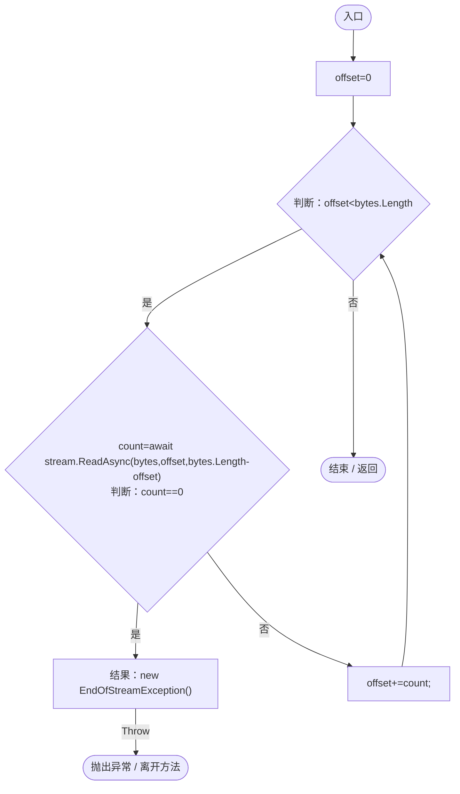

## WriteLoop · L45

`private async Task WriteLoop()`

### Editor / Player · Roslyn编译器控制流

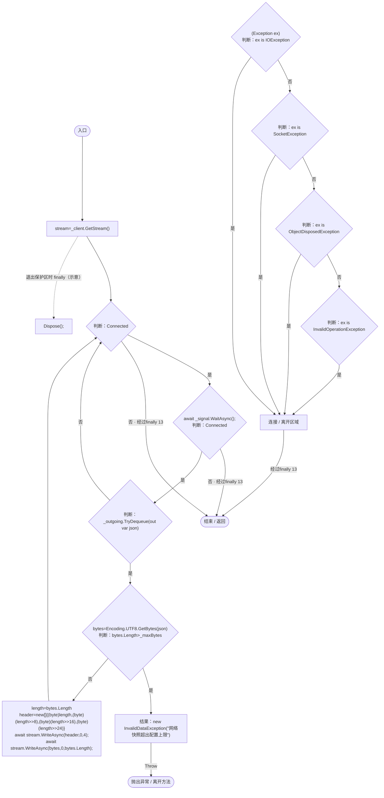

项目内调用/回调引用：

- [LanConnection.Dispose · L62](872c2b8da417200e.md#mcbbf7592b2503d1f)（方法）

## Dispose · L62

`public void Dispose()`

### Editor / Player · Roslyn编译器控制流

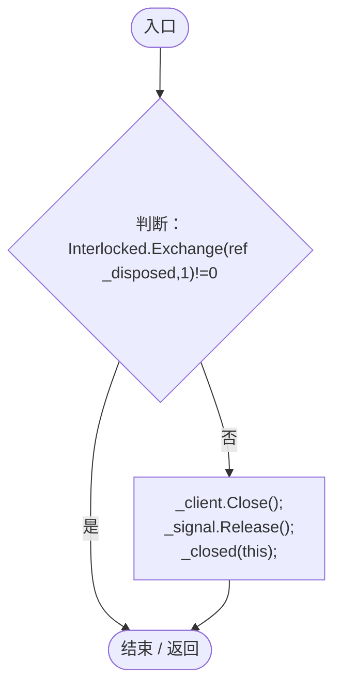

## Port.get · L67

`public int Port`

### Editor / Player · 语法控制结构 / 声明（非CFG）

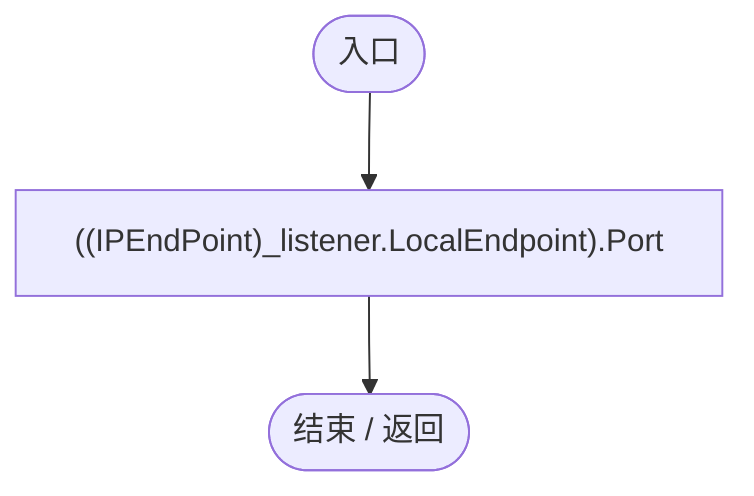

## LanListener.ctor · L68

`public LanListener(int port,Action<TcpClient> accept)`

### Editor / Player · Roslyn编译器控制流

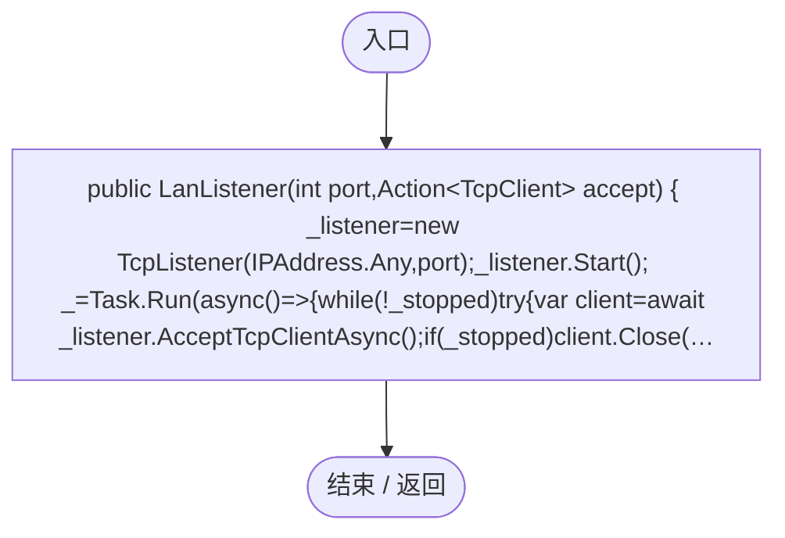

项目内调用/回调引用：

- [LanListener.回调@71 · L71](872c2b8da417200e.md#m73f3d2bfb9a6383f)（回调/委托）

## 回调@71 · L71

`async async … => 回调`

### Editor / Player · Roslyn编译器控制流

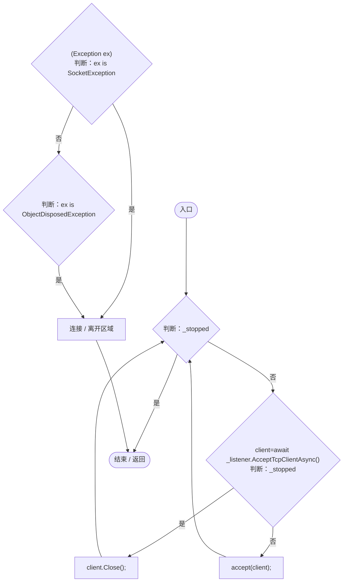

## Dispose · L73

`public void Dispose()`

### Editor / Player · Roslyn编译器控制流

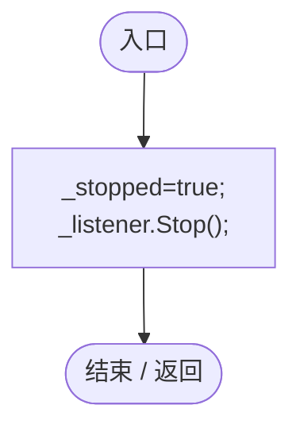
