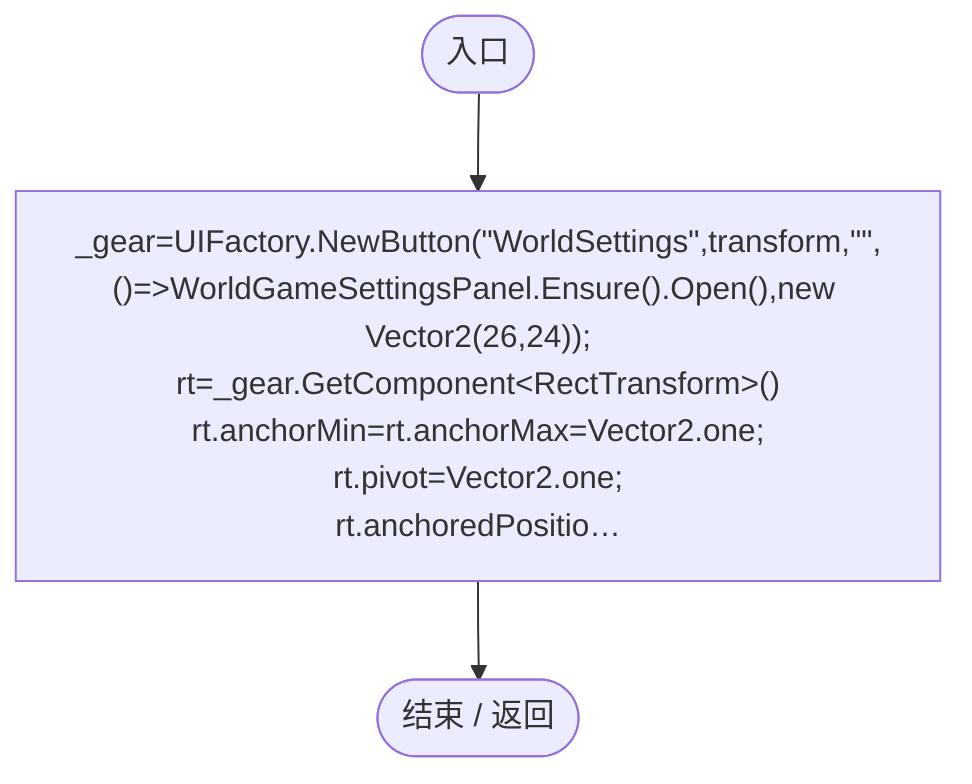
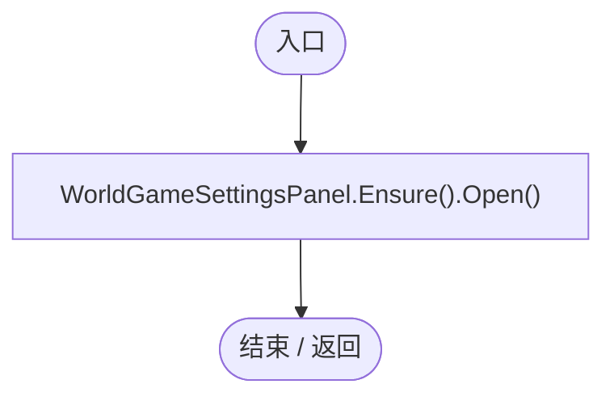
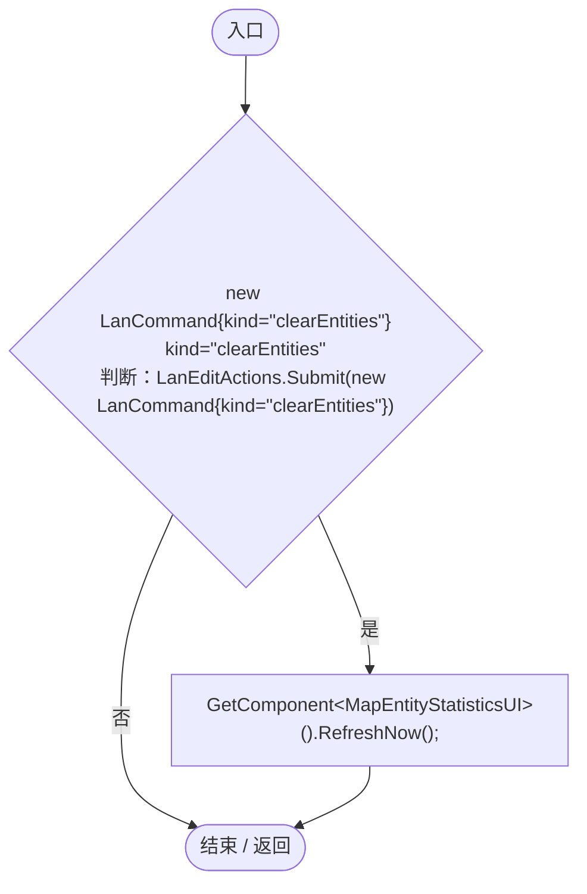
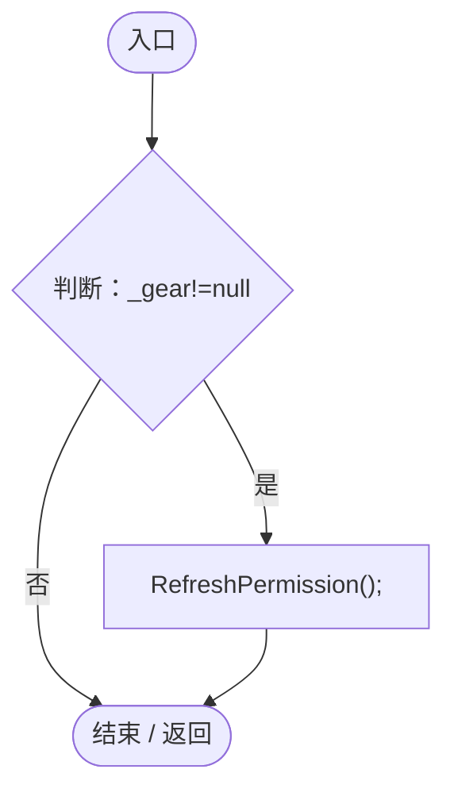
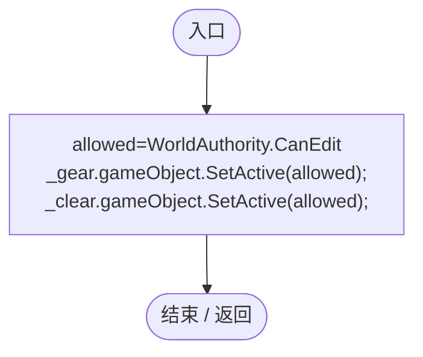

# MapEntityActions.cs

[返回总索引](../README.md) · `Runtime` · `Assets/DarwinPark/UI/MapEntityActions.cs`

[源文件](../../../Assets/DarwinPark/UI/MapEntityActions.cs) · 源码校验：`9612a16680b773cebcde1aa1ae5541586847fefc8544230785280373f3b643ef`

方法按源文件位置排列。事件/回调引用不表示立即执行；分支与异常说明见总索引。完整源码与可点击关系图请打开离线手册。

## Start · L11

`private void Start()`

### Editor / Player · Roslyn编译器控制流

项目内调用/回调引用：

- [UIFactory.NewButton · L73](dd1096a6995423db.md#m5896f1b097c8bdde)（方法）
- [UIVisualTheme.AddIcon · L79](ca525a798a08f966.md#mcae965e84a38acc6)（方法）
- [MapEntityActions.RefreshPermission · L21](8771182d89246414.md#md9e965e77034d362)（方法）
- [MapEntityActions.回调@13 · L13](8771182d89246414.md#m9a39649b44e795d9)（回调/委托）
- [MapEntityActions.回调@16 · L16](8771182d89246414.md#m57dd39e56434182d)（回调/委托）

## 回调@13 · L13

`( … => 回调`

### Editor / Player · Roslyn编译器控制流

项目内调用/回调引用：

- [WorldGameSettingsPanel.Open · L17](6df051f7f7177d08.md#m0ff6ac01bffac6d1)（方法）
- [WorldGameSettingsPanel.Ensure · L16](6df051f7f7177d08.md#m0a32c6bb826c2a96)（方法）

## 回调@16 · L16

`( … => 回调`

### Editor / Player · Roslyn编译器控制流

项目内调用/回调引用：

- [LanEditActions.Submit · L16](2816321496f6360e.md#m5411c4b97ac4c898)（方法）
- [MapEntityStatisticsUI.RefreshNow · L74](da03211264cb6014.md#ma30ab70fe8c10f4f)（方法）

## Update · L20

`private void Update()`

### Editor / Player · Roslyn编译器控制流

项目内调用/回调引用：

- [MapEntityActions.RefreshPermission · L21](8771182d89246414.md#md9e965e77034d362)（方法）

## RefreshPermission · L21

`private void RefreshPermission()`

### Editor / Player · Roslyn编译器控制流

