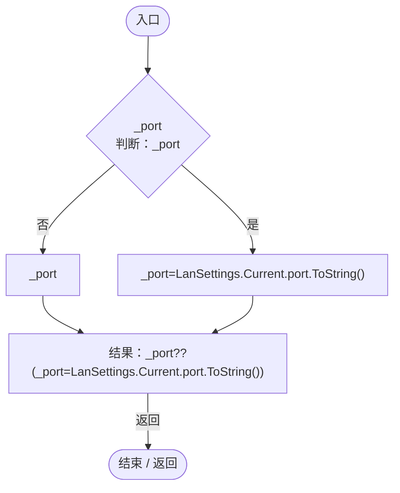
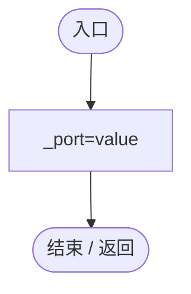
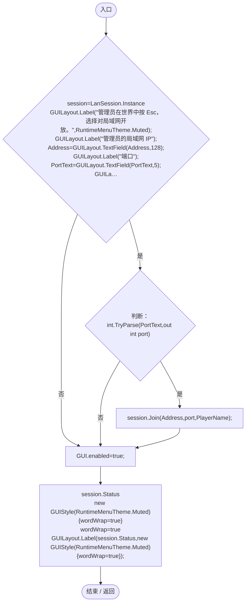
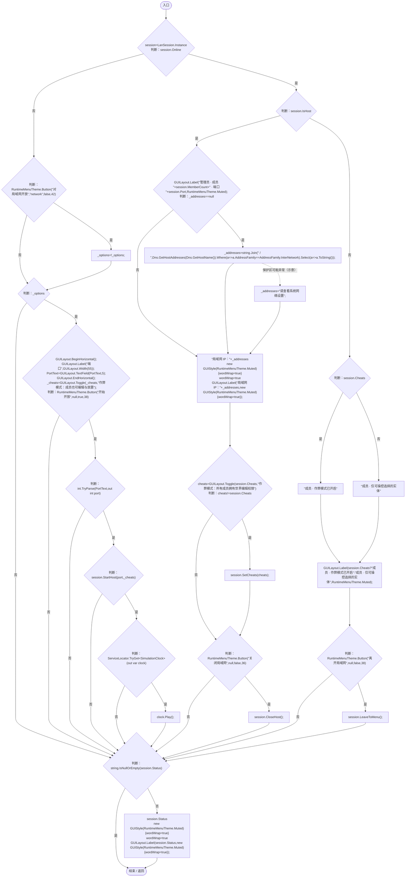
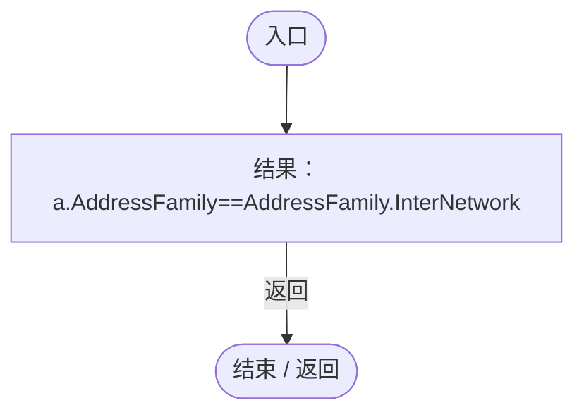
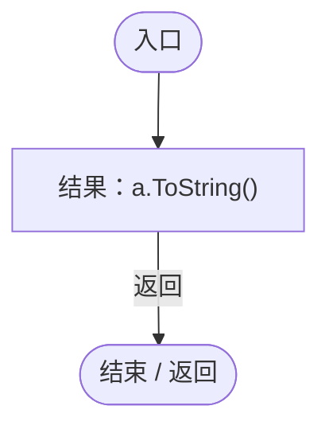
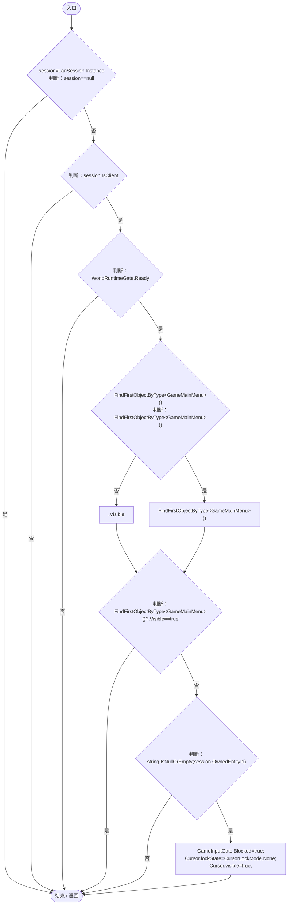
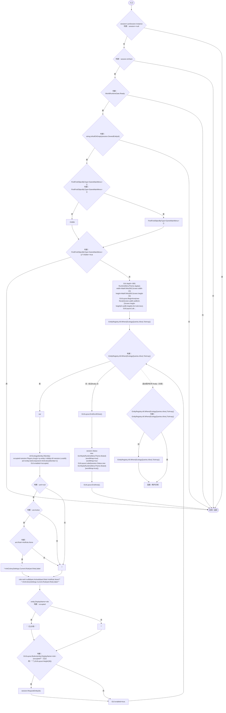
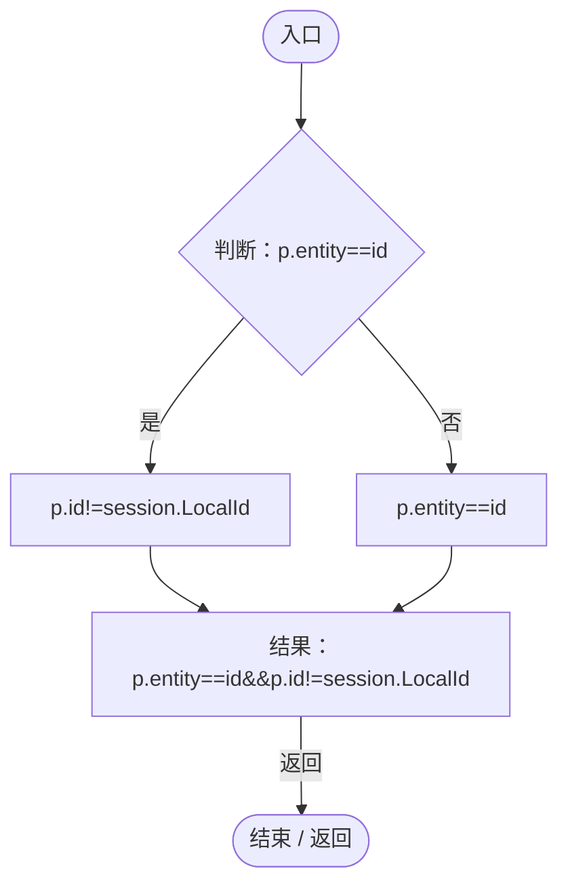

# LanLobbyUI.cs

[返回总索引](../README.md) · `Runtime` · `Assets/DarwinPark/UI/LanLobbyUI.cs`

[源文件](../../../Assets/DarwinPark/UI/LanLobbyUI.cs) · 源码校验：`2ccc7d22709f5c0cb83e09280eb422c1654a5ac9e30d27afc00d5342aced7d53`

方法按源文件位置排列。事件/回调引用不表示立即执行；分支与异常说明见总索引。完整源码与可点击关系图请打开离线手册。

## PortText.get · L16

`get`

### Editor / Player · Roslyn编译器控制流

项目内调用/回调引用：

- [LanSettings.Current.get · L15](b87827166724b44d.md#m237a85bb88e296ff)（访问器）

## PortText.set · L16

`set`

### Editor / Player · Roslyn编译器控制流

## DrawJoin · L17

`public void DrawJoin()`

### Editor / Player · Roslyn编译器控制流

项目内调用/回调引用：

- [LanSession.Instance.get · L23](9fb633eebffe669c.md#mbf83306994878383)（访问器）
- [RuntimeMenuTheme.Muted.get · L13](b9d8455882f2a532.md#meeaba271eb4ad2ed)（访问器）
- [LanLobbyUI.PortText.set · L16](8878a8bd4aace59a.md#m16d0b03fb807deac)（访问器）
- [LanLobbyUI.PortText.get · L16](8878a8bd4aace59a.md#m908c2449671331cf)（访问器）
- [RuntimeMenuTheme.Button · L90](b9d8455882f2a532.md#mc7e1580ab0f51b0b)（方法）
- [LanSession.Join · L66](9fb633eebffe669c.md#m24b68938916764ee)（方法）
- [LanSession.Status.get · L31](9fb633eebffe669c.md#md8607b7380abb030)（访问器）

## DrawPause · L24

`public void DrawPause()`

### Editor / Player · Roslyn编译器控制流

项目内调用/回调引用：

- [LanSession.Instance.get · L23](9fb633eebffe669c.md#mbf83306994878383)（访问器）
- [RuntimeMenuTheme.Button · L90](b9d8455882f2a532.md#mc7e1580ab0f51b0b)（方法）
- [LanLobbyUI.PortText.set · L16](8878a8bd4aace59a.md#m16d0b03fb807deac)（访问器）
- [LanLobbyUI.PortText.get · L16](8878a8bd4aace59a.md#m908c2449671331cf)（访问器）
- [LanSession.StartHost · L54](9fb633eebffe669c.md#mb6561d391b5d5c24)（方法）
- [ServiceLocator.TryGet · L26](f2fdbe9f9ccd93cb.md#m143b24e6d58471b0)（方法）
- [SimulationClock.Play · L78](a8f444aec9614b0a.md#m7aa9e64b7de60ed0)（方法）
- [RuntimeMenuTheme.Muted.get · L13](b9d8455882f2a532.md#meeaba271eb4ad2ed)（访问器）
- [LanSession.Cheats.get · L27](9fb633eebffe669c.md#m570973099b8f82d5)（访问器）
- [LanSession.SetCheats · L124](9fb633eebffe669c.md#mecda8c5ad1513e5b)（方法）
- [LanSession.CloseHost · L286](9fb633eebffe669c.md#m3103a146e52db72d)（方法）
- [LanSession.LeaveToMenu · L290](9fb633eebffe669c.md#m107974d8a60df554)（方法）
- [LanSession.Status.get · L31](9fb633eebffe669c.md#md8607b7380abb030)（访问器）
- [LanLobbyUI.回调@39 · L39](8878a8bd4aace59a.md#mbff9af0b049dea76)（回调/委托）
- [LanLobbyUI.回调@39 · L39](8878a8bd4aace59a.md#m97c559e04f805553)（回调/委托）

## 回调@39 · L39

`a … => 回调`

### Editor / Player · Roslyn编译器控制流

## 回调@39 · L39

`a … => 回调`

### Editor / Player · Roslyn编译器控制流

## Update · L48

`private void Update()`

### Editor / Player · Roslyn编译器控制流

项目内调用/回调引用：

- [LanSession.Instance.get · L23](9fb633eebffe669c.md#mbf83306994878383)（访问器）
- [LanSession.OwnedEntityId.get · L30](9fb633eebffe669c.md#m5adc535c48d20cbe)（访问器）
- [GameInputGate.Blocked.set · L8](52955daae7e592ab.md#m578697f6379686f4)（访问器）

## OnGUI · L53

`private void OnGUI()`

### Editor / Player · Roslyn编译器控制流

项目内调用/回调引用：

- [LanSession.Instance.get · L23](9fb633eebffe669c.md#mbf83306994878383)（访问器）
- [LanSession.OwnedEntityId.get · L30](9fb633eebffe669c.md#m5adc535c48d20cbe)（访问器）
- [RuntimeMenuTheme.Apply · L39](b9d8455882f2a532.md#m587a63eff5a85605)（方法）
- [RuntimeMenuTheme.Title.get · L14](b9d8455882f2a532.md#m0b3a4a9f7e8e69ae)（访问器）
- [RuntimeMenuTheme.Muted.get · L13](b9d8455882f2a532.md#meeaba271eb4ad2ed)（访问器）
- [EcologyIdentity.Of · L21](bdf7ccc2c9c0452f.md#m1143cf9570a93b72)（方法）
- [AntColonyMember.Role.get · L33](baebd85c05598377.md#mdf6df89f7116c7a3)（访问器）
- [AntColonySettings.Rule · L56](cb0a937e97c8fbb3.md#m46f80f7628c118a8)（方法）
- [AntColonySettings.Current.get · L31](cb0a937e97c8fbb3.md#mcd121159f407ccdf)（访问器）
- [LanSession.RequestEntity · L103](9fb633eebffe669c.md#m606c5e2a01315953)（方法）
- [LanSession.Status.get · L31](9fb633eebffe669c.md#md8607b7380abb030)（访问器）
- [LanLobbyUI.回调@61 · L61](8878a8bd4aace59a.md#maa78f3c30384e6e3)（回调/委托）
- [EcologyQueries.Alive · L38](bdf7ccc2c9c0452f.md#mb2877c487f449970)（方法）

## 回调@61 · L61

`p … => 回调`

### Editor / Player · Roslyn编译器控制流

项目内调用/回调引用：

- [LanSession.LocalId.get · L29](9fb633eebffe669c.md#me99d6c84140bddb3)（访问器）
