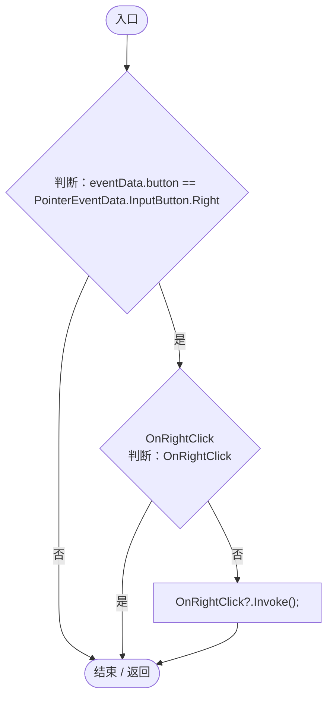

# RightClickHandler.cs

[返回总索引](../README.md) · `Runtime` · `Assets/DarwinPark/UI/RightClickHandler.cs`

[源文件](../../../Assets/DarwinPark/UI/RightClickHandler.cs) · 源码校验：`785998cfe8f62e5925aeb95ee6cc821f8de54535a24d4b3137bfc4a374d6a673`

方法按源文件位置排列。事件/回调引用不表示立即执行；分支与异常说明见总索引。完整源码与可点击关系图请打开离线手册。

## OnPointerClick · L11

`public void OnPointerClick(PointerEventData eventData)`

### Editor / Player · Roslyn编译器控制流

