# LayoutRandomSpawnRegression.cs

[返回总索引](../README.md) · `Editor` · `Assets/DarwinPark/Editor/LayoutRandomSpawnRegression.cs`

[源文件](../../../Assets/DarwinPark/Editor/LayoutRandomSpawnRegression.cs) · 源码校验：`d81f0227d5aea1647e898ad03a123929bfa8f80a89eab81255fd6eeb940de15d`

方法按源文件位置排列。事件/回调引用不表示立即执行；分支与异常说明见总索引。完整源码与可点击关系图请打开离线手册。

<a id="m6be48f92bda7d5ff"></a>

## Folder.get · L22

`private static string Folder`


### Editor · 语法控制结构 / 声明（非CFG）

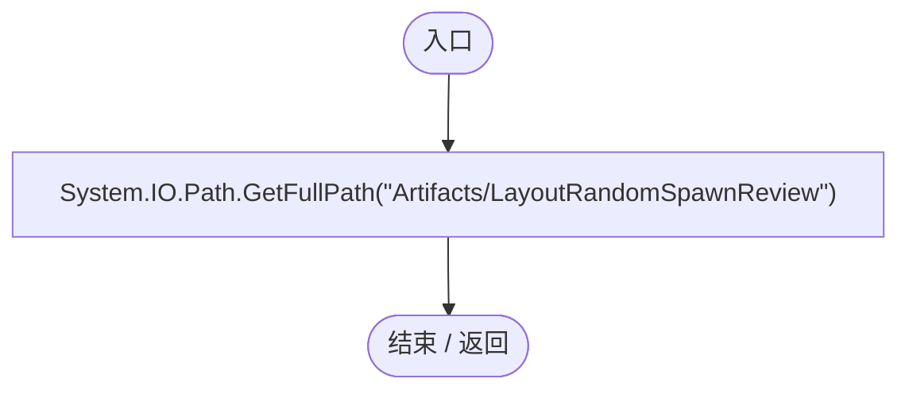

<a id="mb67782cca7a6e0e6"></a>

## Verify · L23

`public static IEnumerator Verify(DarwinEntity actor,PlanetTerrainMeshBuilder planet,Action<bool,string> check)`


### Editor · Roslyn编译器控制流

```mermaid
flowchart TD
  b0(["入口"])
  b1["System.IO.Directory.CreateDirectory(Folder);<br/>inspector=Object.FindFirstObjectByType&lt;GeneInspectorUI&gt;()<br/>inspector.ShowEntityInfo(actor);<br/>yield return null;<br/>Canvas.ForceUpdateCanvases();<br/>canvas=ServiceLocator.Get&lt;UIRoot&gt;().MainCanvas.trans…"]
  b2{"check<br/>判断：panel.rect.width&gt;420"}
  b3["panel.rect.height&lt;700"]
  b4["panel.rect.width&gt;420"]
  b5["check(panel.rect.width&gt;420&amp;&amp;panel.rect.height&lt;700,&quot;实体信息面板更宽且更矮&quot;);"]
  b6["VerifyEvolution(check);<br/>control=Object.FindFirstObjectByType&lt;SimulationControlPanel&gt;()<br/>page=typeof(SimulationControlPanel).GetMethod(&quot;SwitchPage&quot;,BindingFlags.NonPublic&#124;BindingFlags.Instance)<br/>page.Invoke(control,new object[]{1});<br/>yield r…"]
  b7{"check<br/>判断：ui!=null"}
  b8["ui.gameObject.activeInHierarchy"]
  b9["ui!=null"]
  b10["check(ui!=null&amp;&amp;ui.gameObject.activeInHierarchy,&quot;第二页实际显示随机生成栏&quot;);"]
  b11{"check<br/>判断：ui.preferredWidth==240"}
  b12["ui.GetComponent&lt;RectTransform&gt;().rect.width&lt;=241"]
  b13["ui.preferredWidth==240"]
  b14["check(ui.preferredWidth==240&amp;&amp;ui.GetComponent&lt;RectTransform&gt;().rect.width&lt;=241,&quot;随机生成栏实际宽度缩至原来一半&quot;);"]
  b15["bar=RtsSelectionInput.CommandBarRect"]
  b16{"check<br/>判断：RtsSelectionInput.IsOverCommandBar(new Vector2(bar.center.x,Screen.height-bar.center.y))"}
  b17["!RtsSelectionInput.IsOverCommandBar(Vector2.zero)"]
  b18["RtsSelectionInput.IsOverCommandBar(new Vector2(bar.center.x,Screen.height-bar.center.y))"]
  b19["check(RtsSelectionInput.IsOverCommandBar(new Vector2(bar.center.x,Screen.height-bar.center.y))&amp;&amp;!RtsSelectionInput.IsOverCommandBar(Vector2.zero),&quot;RTS命令栏命中坐标正确且不吞场景输入&quot;);"]
  b20["service=RandomPlanetSpawner.Ensure(ServiceLocator.Get&lt;SimulationClock&gt;().gameObject)<br/>count=ui.transform.Find(&quot;Quantity&quot;).GetComponent&lt;InputField&gt;()<br/>source=ui.transform.Find(&quot;Source&quot;).GetComponent&lt;Button&gt;()<br/>generate=ui.transform.Find(&quot;Gen…"]
  b21["ui<br/>new RandomSpawnRecipe{template=RandomSpawnRecipe.DefaultGenome()}<br/>template=RandomSpawnRecipe.DefaultGenome()<br/>ui.SetRecipe(new RandomSpawnRecipe{template=RandomSpawnRecipe.DefaultGenome()});"]
  b22["generate.onClick.Invoke();<br/>start=EditorApplication.timeSinceStartup"]
  b23{"判断：service.IsBusy"}
  b24{"判断：EditorApplication.timeSinceStartup-start&gt;30"}
  b25["结果：new TimeoutException(service.Status)"]
  x25(["抛出异常 / 离开方法"])
  b26["yield return null;"]
  b27["spawned=EntityRegistry.All.Where(e=&gt;!before.Contains(e)).ToArray()"]
  b28{"check<br/>判断：spawned.Length==16"}
  b29["service.Spawned==16"]
  b30["spawned.Length==16"]
  b31["check(spawned.Length==16&amp;&amp;service.Spawned==16,&quot;第二页按钮精确随机生成指定数量的默认实体&quot;);"]
  b32["check(spawned.Any(a=&gt;spawned.Any(b=&gt;Vector3.Angle(EcologyQueries.Up(a.transform.position),EcologyQueries.Up(b.transform.position))&gt;60)),&quot;随机实体分散到星球不同区域而非同一落点&quot;);<br/>check(spawned.All(e=&gt;(e.transform.position-planet.transform.position).magnitu…"]
  b33{"判断：service.IsBusy"}
  b34{"判断：EditorApplication.timeSinceStartup-start&gt;30"}
  b35["结果：new TimeoutException(service.Status)"]
  x35(["抛出异常 / 离开方法"])
  b36["yield return null;"]
  b37["copies=EntityRegistry.All.Where(e=&gt;!before.Contains(e)).ToArray()<br/>template=EntityTemplateManager.Templates.Single(t=&gt;t.templateName==name)"]
  b38{"check<br/>判断：copies.Length==3"}
  b39["copies.All(e=&gt;template.genes.All(g=&gt;e.Genes.Genome.Genes.Any(copy=&gt;copy.DefinitionId==g.definitionId&amp;&amp;copy.Value==g.value)))"]
  b40["copies.Length==3"]
  b41["check(copies.Length==3&amp;&amp;copies.All(e=&gt;template.genes.All(g=&gt;e.Genes.Genome.Genes.Any(copy=&gt;copy.DefinitionId==g.definitionId&amp;&amp;copy.Value==g.value))),&quot;模板随机投放保留全部遗传数值&quot;);"]
  b42["initial=copies[1].Genes.Genome.Genes[0].Value<br/>copies[0].Genes.Genome.Genes[0].Value=initial+1;<br/>copies[0].Genes.Recalculate();"]
  b43{"check<br/>判断：copies[1].Genes.Genome.Genes[0].Value==initial"}
  b44{"判断：template.genes[0].value==initial"}
  b45["!ReferenceEquals(copies[0].Genes.Genome,copies[1].Genes.Genome)"]
  b46["copies[1].Genes.Genome.Genes[0].Value==initial&amp;&amp;template.genes[0].value==initial&amp;&amp;!ReferenceEquals(copies[0].Genes.Genome,copies[1].Genes.Genome)"]
  b47["check(copies[1].Genes.Genome.Genes[0].Value==initial&amp;&amp;template.genes[0].value==initial&amp;&amp;!ReferenceEquals(copies[0].Genes.Genome,copies[1].Genes.Genome),&quot;随机模板副本互不共享基因或改写模板&quot;);"]
  b48["before=EntityRegistry.All.ToArray();<br/>GameInputGate.Blocked=true;"]
  b49{"check<br/>判断：service.StartBatch(null,10,true)"}
  b50["EntityRegistry.All.Count==before.Length"]
  b51["!service.StartBatch(null,10,true)"]
  b52["check(!service.StartBatch(null,10,true)&amp;&amp;EntityRegistry.All.Count==before.Length,&quot;覆盖菜单阻止启动随机生成&quot;);"]
  b53["GameInputGate.Blocked=false;"]
  b54{"check<br/>判断：service.StartBatch(null,service.maxCount,true)"}
  b55["!service.StartBatch(null,10,true)"]
  b56["service.StartBatch(null,service.maxCount,true)"]
  b57["check(service.StartBatch(null,service.maxCount,true)&amp;&amp;!service.StartBatch(null,10,true),&quot;生成任务运行中不叠加重复任务&quot;);"]
  b58["paused=EntityRegistry.All.Count<br/>GameInputGate.Blocked=true;<br/>yield return null;<br/>check(EntityRegistry.All.Count==paused,&quot;打开覆盖菜单暂停尚未完成的生成任务&quot;);<br/>GameInputGate.Blocked=false;<br/>ui.transform.Find(&quot;Cancel&quot;).GetComponent&lt;Button&gt;().onClick.Invoke();…"]
  b59{"check<br/>判断：service.IsBusy"}
  b60["EntityRegistry.All.Count==cancelled"]
  b61["!service.IsBusy"]
  b62["check(!service.IsBusy&amp;&amp;EntityRegistry.All.Count==cancelled,&quot;取消按钮停止剩余生成并保留已生成实体&quot;);"]
  b63["clearance=service.landClearance<br/>attempts=service.attemptsPerEntity<br/>service.landClearance=planet.radius*10;<br/>service.attemptsPerEntity=1;<br/>before=EntityRegistry.All.ToArray();<br/>service.StartBatch(null,2,true);"]
  b64{"判断：service.IsBusy"}
  b65["yield return null;"]
  b66{"check<br/>判断：service.Spawned==0"}
  b67["EntityRegistry.All.Count==before.Length"]
  b68["service.Spawned==0"]
  b69["check(service.Spawned==0&amp;&amp;EntityRegistry.All.Count==before.Length,&quot;没有合适陆地时有界结束且不把实体放入海底&quot;);"]
  b70["service.landClearance=clearance;<br/>service.attemptsPerEntity=attempts;<br/>service.StartBatch(null,service.maxCount,true);<br/>progress=service.Spawned<br/>page.Invoke(control,new object[]{0});<br/>yield return null;<br/>check(service.Spawned&gt;progress,&quot;切换底栏页面…"]
  b71["ui<br/>new RandomSpawnRecipe{template=RandomSpawnRecipe.DefaultGenome()}<br/>template=RandomSpawnRecipe.DefaultGenome()<br/>ui.SetRecipe(new RandomSpawnRecipe{template=RandomSpawnRecipe.DefaultGenome()});"]
  b72["count.text=&quot;10&quot;;<br/>inspector.ShowEntityInfo(actor);<br/>Canvas.ForceUpdateCanvases();<br/>yield return new WaitForEndOfFrame();<br/>ScreenCapture.CaptureScreenshot(System.IO.Path.Combine(Folder,&quot;panel-and-random-spawn.png&quot;));<br/>yield return null;"]
  b73(["结束 / 返回"])
  b0 --> b1
  b1 --> b2
  b2 -->|"是"| b3
  b2 -->|"否"| b4
  b3 --> b5
  b4 --> b5
  b5 --> b6
  b6 --> b7
  b7 -->|"是"| b8
  b7 -->|"否"| b9
  b8 --> b10
  b9 --> b10
  b10 --> b11
  b11 -->|"是"| b12
  b11 -->|"否"| b13
  b12 --> b14
  b13 --> b14
  b14 --> b15
  b15 --> b16
  b16 -->|"是"| b17
  b16 -->|"否"| b18
  b17 --> b19
  b18 --> b19
  b19 --> b20
  b20 --> b21
  b21 --> b22
  b22 --> b23
  b23 -->|"是"| b24
  b23 -->|"否"| b27
  b24 -->|"是"| b25
  b24 -->|"否"| b26
  b25 -->|"Throw"| x25
  b26 --> b23
  b27 --> b28
  b28 -->|"是"| b29
  b28 -->|"否"| b30
  b29 --> b31
  b30 --> b31
  b31 --> b32
  b32 --> b33
  b33 -->|"是"| b34
  b33 -->|"否"| b37
  b34 -->|"是"| b35
  b34 -->|"否"| b36
  b35 -->|"Throw"| x35
  b36 --> b33
  b37 --> b38
  b38 -->|"是"| b39
  b38 -->|"否"| b40
  b39 --> b41
  b40 --> b41
  b41 --> b42
  b42 --> b43
  b43 -->|"是"| b44
  b43 -->|"否"| b46
  b44 -->|"是"| b45
  b44 -->|"否"| b46
  b45 --> b47
  b46 --> b47
  b47 --> b48
  b48 --> b49
  b49 -->|"否"| b50
  b49 -->|"是"| b51
  b50 --> b52
  b51 --> b52
  b52 --> b53
  b53 --> b54
  b54 -->|"是"| b55
  b54 -->|"否"| b56
  b55 --> b57
  b56 --> b57
  b57 --> b58
  b58 --> b59
  b59 -->|"否"| b60
  b59 -->|"是"| b61
  b60 --> b62
  b61 --> b62
  b62 --> b63
  b63 --> b64
  b64 -->|"是"| b65
  b64 -->|"否"| b66
  b65 --> b64
  b66 -->|"是"| b67
  b66 -->|"否"| b68
  b67 --> b69
  b68 --> b69
  b69 --> b70
  b70 --> b71
  b71 --> b72
  b72 --> b73

```

项目内调用/回调引用：

- [GeneInspectorUI.ShowEntityInfo · L385](924e27c34e7b1f0a.md#mea69a0457b885287)（方法）
- [UIRoot.MainCanvas.get · L14](9c1421378791f0e0.md#maa2cc9baf1248477)（访问器）
- [ServiceLocator.Get · L33](f2fdbe9f9ccd93cb.md#m2ae625299520c56d)（方法）
- [LayoutRandomSpawnRegression.VerifyEvolution · L63](8995681fbd6854d1.md#m19c2ec769503cc19)（方法）
- [RtsSelectionInput.IsOverCommandBar · L35](3c8b37f7bbd7a10f.md#m35be0e064805f3ff)（方法）
- [RandomPlanetSpawner.Ensure · L24](1c13222a547b265c.md#mccefd1367aa9ded3)（方法）
- [RandomSpawnPanel.SetRecipe · L52](ff6518313bce61e2.md#mea9da7359df49ecb)（方法）
- [RandomSpawnRecipe.DefaultGenome · L18](923ccc4e86c4786c.md#me771b4b81f75bedc)（方法）
- [RandomPlanetSpawner.IsBusy.get · L18](1c13222a547b265c.md#m93511175a525fd2b)（访问器）
- [RandomPlanetSpawner.Status.get · L21](1c13222a547b265c.md#m5c54addf33fa43b9)（访问器）
- [RandomPlanetSpawner.Spawned.get · L19](1c13222a547b265c.md#m26983b533cf25e8f)（访问器）
- [EntityTemplateManager.SaveTemplate · L30](ab5e6457e8a7aba0.md#me559754bdf2cc955)（方法）
- [EntityTemplateManager.Templates.get · L23](ab5e6457e8a7aba0.md#m45cc5b075f7bf4ec)（访问器）
- [RandomSpawnWorkbench.Visible.get · L19](0763b7475b3c75db.md#mfc1adb76149ae015)（访问器）
- [RandomSpawnWorkbench.Instance.get · L19](0763b7475b3c75db.md#m6f18ab57fe0cbfad)（访问器）
- [RandomSpawnWorkbench.SelectTemplate · L64](0763b7475b3c75db.md#m2052a884e9c5139f)（方法）
- [RandomSpawnWorkbench.ApplySelection · L72](0763b7475b3c75db.md#m9baa3e245445f955)（方法）
- [DarwinEntity.Genes.get · L14](70798dde169f2e8b.md#m622eb1adf401d431)（访问器）
- [EntityGeneController.Recalculate · L90](7494d53178552f0e.md#m93744c8f3039b93c)（方法）
- [GameInputGate.Blocked.set · L8](52955daae7e592ab.md#m578697f6379686f4)（访问器）
- [RandomPlanetSpawner.StartBatch · L25](1c13222a547b265c.md#m0e4af90b5fa8372e)（方法）
- [RandomPlanetSpawner.Cancel · L91](1c13222a547b265c.md#m13321aa05f521986)（方法）
- [LayoutRandomSpawnRegression.回调@38 · L38](8995681fbd6854d1.md#mdef84910c261965e)（回调/委托）
- [LayoutRandomSpawnRegression.回调@39 · L39](8995681fbd6854d1.md#m4b6c57b137637f7a)（回调/委托）
- [LayoutRandomSpawnRegression.回调@40 · L40](8995681fbd6854d1.md#m2c281dac599fc202)（回调/委托）
- [LayoutRandomSpawnRegression.回调@42 · L42](8995681fbd6854d1.md#m5e0f28becadd5c34)（回调/委托）
- [LayoutRandomSpawnRegression.回调@44 · L44](8995681fbd6854d1.md#m30ef3db58aa262e8)（回调/委托）
- [LayoutRandomSpawnRegression.回调@48 · L48](8995681fbd6854d1.md#mf201f0031a2d4446)（回调/委托）
- [LayoutRandomSpawnRegression.回调@48 · L48](8995681fbd6854d1.md#mf46ce010956d659a)（回调/委托）
- [LayoutRandomSpawnRegression.回调@49 · L49](8995681fbd6854d1.md#m92210d35ea704489)（回调/委托）

<a id="mdef84910c261965e"></a>

## 回调@38 · L38

`e … => 回调`


### Editor · Roslyn编译器控制流


<a id="m4b6c57b137637f7a"></a>

## 回调@39 · L39

`a … => 回调`


### Editor · Roslyn编译器控制流

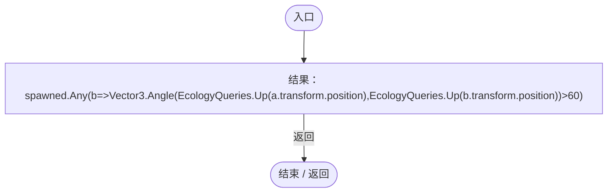

项目内调用/回调引用：

- [LayoutRandomSpawnRegression.回调@39 · L39](8995681fbd6854d1.md#maf83e0dd70199cec)（回调/委托）

<a id="maf83e0dd70199cec"></a>

## 回调@39 · L39

`b … => 回调`


### Editor · Roslyn编译器控制流

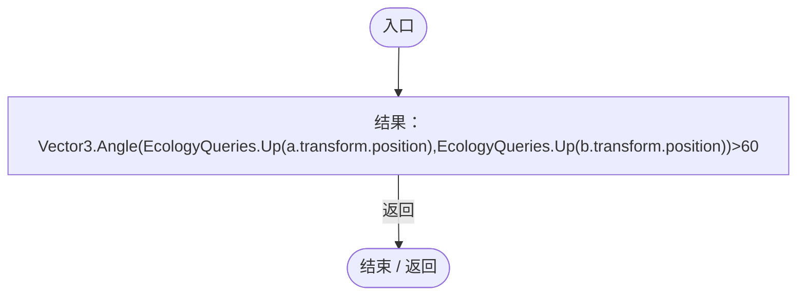

项目内调用/回调引用：

- [EcologyQueries.Up · L41](bdf7ccc2c9c0452f.md#maca7070196f125fd)（方法）

<a id="m2c281dac599fc202"></a>

## 回调@40 · L40

`e … => 回调`


### Editor · Roslyn编译器控制流

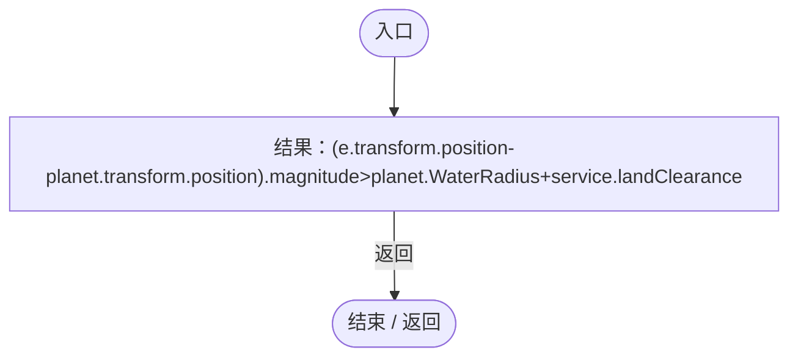

项目内调用/回调引用：

- [PlanetTerrainMeshBuilder.WaterRadius.get · L94](415285cf043354a9.md#m28d8809083881ec1)（访问器）

<a id="m5e0f28becadd5c34"></a>

## 回调@42 · L42

`e … => 回调`


### Editor · Roslyn编译器控制流

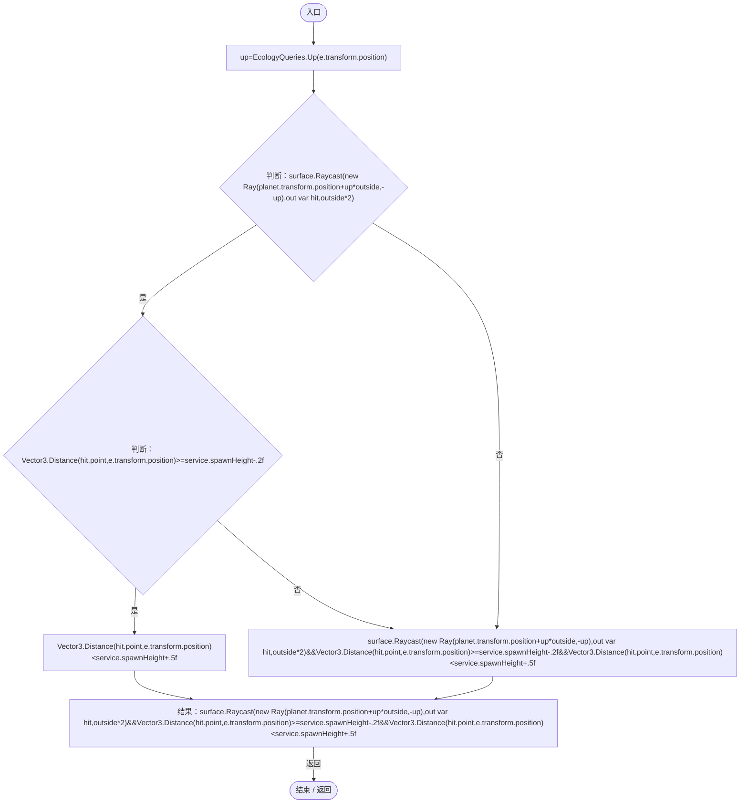

项目内调用/回调引用：

- [EcologyQueries.Up · L41](bdf7ccc2c9c0452f.md#maca7070196f125fd)（方法）

<a id="m30ef3db58aa262e8"></a>

## 回调@44 · L44

`t … => 回调`


### Editor · Roslyn编译器控制流


<a id="mf201f0031a2d4446"></a>

## 回调@48 · L48

`e … => 回调`


### Editor · Roslyn编译器控制流

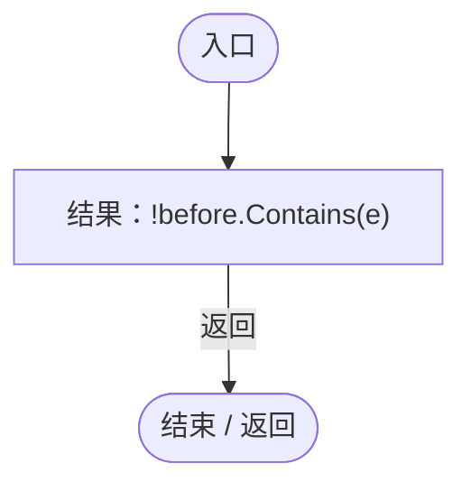

<a id="mf46ce010956d659a"></a>

## 回调@48 · L48

`t … => 回调`


### Editor · Roslyn编译器控制流

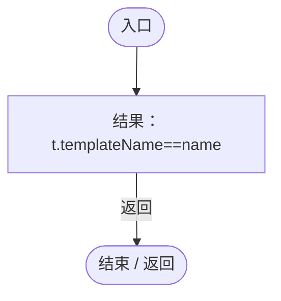

<a id="m92210d35ea704489"></a>

## 回调@49 · L49

`e … => 回调`


### Editor · Roslyn编译器控制流

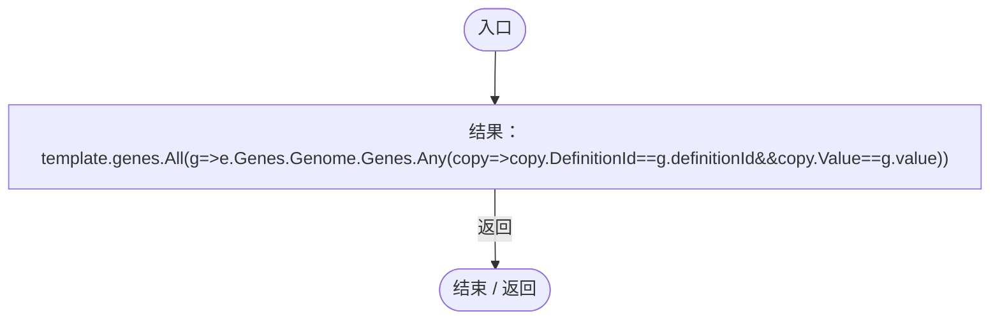

项目内调用/回调引用：

- [LayoutRandomSpawnRegression.回调@49 · L49](8995681fbd6854d1.md#m336c3775748f4ce1)（回调/委托）

<a id="m336c3775748f4ce1"></a>

## 回调@49 · L49

`g … => 回调`


### Editor · Roslyn编译器控制流

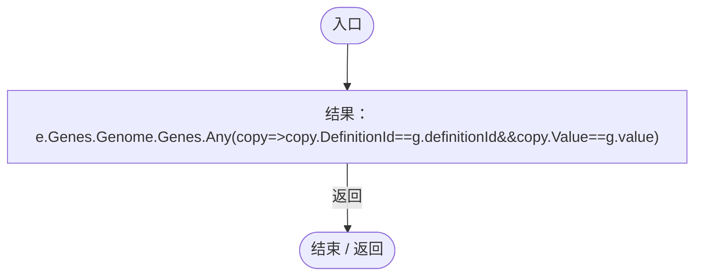

项目内调用/回调引用：

- [DarwinEntity.Genes.get · L14](70798dde169f2e8b.md#m622eb1adf401d431)（访问器）
- [LayoutRandomSpawnRegression.回调@49 · L49](8995681fbd6854d1.md#md8e436317d450c40)（回调/委托）

<a id="md8e436317d450c40"></a>

## 回调@49 · L49

`copy … => 回调`


### Editor · Roslyn编译器控制流

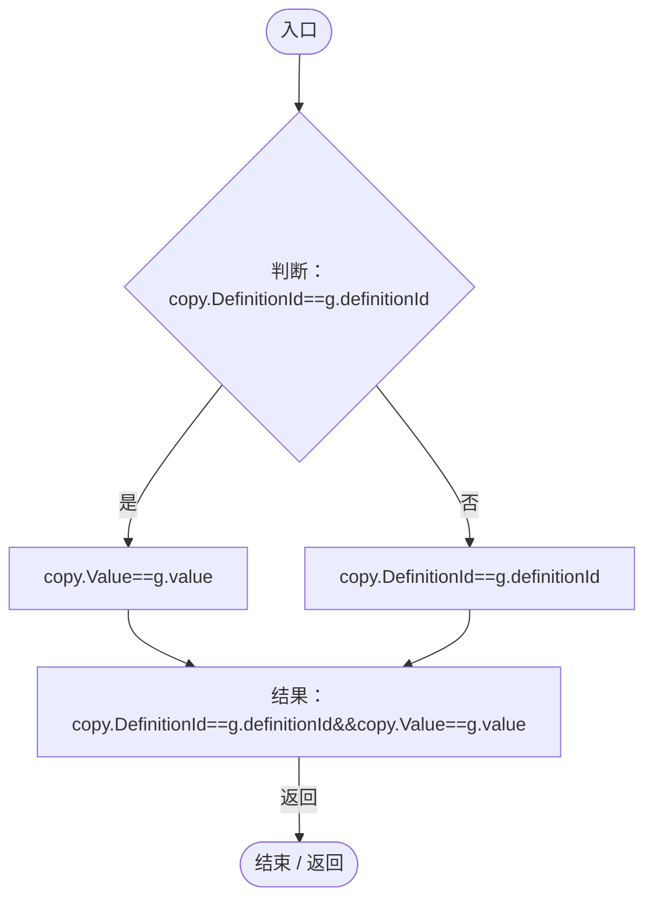

<a id="m19c2ec769503cc19"></a>

## VerifyEvolution · L63

`private static void VerifyEvolution(Action<bool,string> check)`


### Editor · Roslyn编译器控制流

```mermaid
flowchart TD
  b0(["入口"])
  b1["target=&quot;gene_nutrient_utilization&quot;<br/>parent=&quot;gene_storage&quot;"]
  b2{"check<br/>判断：GeneDatabase.Get(target).ParentGeneId==parent"}
  b3{"判断：GeneTreeStorage.Active.nodes.Single(n=&gt;n.id==target).error"}
  b4["GeneTreeStorage.Active.edges.Any(e=&gt;e.from==parent&amp;&amp;e.to==target&amp;&amp;e.kind==&quot;error&quot;)"]
  b5["GeneDatabase.Get(target).ParentGeneId==parent&amp;&amp;GeneTreeStorage.Active.nodes.Single(n=&gt;n.id==target).error&amp;&amp;GeneTreeStorage.Active.edges.Any(e=&gt;e.from==parent&amp;&amp;e.to==target&amp;&amp;e.kind==&quot;error&quot;)"]
  b6["check(GeneDatabase.Get(target).ParentGeneId==parent&amp;&amp;GeneTreeStorage.Active.nodes.Single(n=&gt;n.id==target).error&amp;&amp;GeneTreeStorage.Active.edges.Any(e=&gt;e.from==parent&amp;&amp;e.to==target&amp;&amp;e.kind==&quot;error&quot;),&quot;营养利用为储存基因的菱形出错分支&quot;);"]
  b7{"check<br/>判断：GeneEvolutionRules.Allows(parent,target,&quot;error&quot;,50)"}
  b8{"判断：GeneEvolutionRules.Allows(parent,target,&quot;evolution&quot;,50)"}
  b9{"判断：GeneEvolutionRules.Allows(&quot;gene_nutrition&quot;,target,&quot;error&quot;,50)"}
  b10["!GeneEvolutionRules.Allows(&quot;gene_nutrition&quot;,target,&quot;evolution&quot;,50)"]
  b11["GeneEvolutionRules.Allows(parent,target,&quot;error&quot;,50)&amp;&amp;!GeneEvolutionRules.Allows(parent,target,&quot;evolution&quot;,50)&amp;&amp;!GeneEvolutionRules.Allows(&quot;gene_nutrition&quot;,target,&quot;error&quot;,50)&amp;&amp;!GeneEvolutionRules.Allows(&quot;gene_nutrition&quot;,target,&quot;evolution&quot;…"]
  b12["check(GeneEvolutionRules.Allows(parent,target,&quot;error&quot;,50)&amp;&amp;!GeneEvolutionRules.Allows(parent,target,&quot;evolution&quot;,50)&amp;&amp;!GeneEvolutionRules.Allows(&quot;gene_nutrition&quot;,target,&quot;error&quot;,50)&amp;&amp;!GeneEvolutionRules.Allows(&quot;gene_nutrition&quot;,target,&quot;evol…"]
  b13["genome=new Genome()<br/>genome.Add(GeneInstance.Create(parent,50,GeneDatabase.Get(parent).Tier));"]
  b14["genome<br/>new GeneMutationSettings{ErrorWeight=1,DuplicateWeight=0,DeletionWeight=0,MaxErrorDelta=0}<br/>ErrorWeight=1<br/>DuplicateWeight=0<br/>DeletionWeight=0<br/>MaxErrorDelta=0<br/>GeneMutator.Mutate(genome,new GeneMutationSettings{ErrorWeight=1,Duplicate…"]
  b15["check(genome.Genes.Single().DefinitionId==target,&quot;储存基因通过真实出错变异产生营养利用基因&quot;);<br/>catalog=GeneTreeStorage.ReadCatalog()<br/>definition=JsonUtility.FromJson&lt;GeneDefinitionJson&gt;(catalog[target])<br/>definition.parentGeneId=&quot;gene_nutrition&quot;;<br/>definition.dis…"]
  b16["tree.edges<br/>new GeneTreeEdge{from=&quot;gene_nutrition&quot;,to=target,kind=&quot;evolution&quot;,value=42}<br/>from=&quot;gene_nutrition&quot;<br/>to=target<br/>kind=&quot;evolution&quot;<br/>value=42<br/>tree.edges.Add(new GeneTreeEdge{from=&quot;gene_nutrition&quot;,to=target,kind=&quot;evolution&quot;,value=42});"]
  b17["tree.nodes.Single(n=&gt;n.id==target).error=false;<br/>legacyTree=JsonUtility.ToJson(tree)<br/>legacyDefinition=catalog[target]<br/>GeneTreeStorage.Validate(tree,catalog);<br/>upgraded=JsonUtility.FromJson&lt;GeneDefinitionJson&gt;(catalog[target])"]
  b18{"check<br/>判断：upgraded.parentGeneId==parent"}
  b19{"判断：upgraded.displayName==definition.displayName"}
  b20{"判断：upgraded.attributeCurves[0].minValue==4.25f"}
  b21["tree.edges.Any(e=&gt;e.from==parent&amp;&amp;e.to==target&amp;&amp;e.kind==&quot;error&quot;&amp;&amp;e.value==42)"]
  b22["upgraded.parentGeneId==parent&amp;&amp;upgraded.displayName==definition.displayName&amp;&amp;upgraded.attributeCurves[0].minValue==4.25f&amp;&amp;tree.edges.Any(e=&gt;e.from==parent&amp;&amp;e.to==target&amp;&amp;e.kind==&quot;error&quot;&amp;&amp;e.value==42)"]
  b23["check(upgraded.parentGeneId==parent&amp;&amp;upgraded.displayName==definition.displayName&amp;&amp;upgraded.attributeCurves[0].minValue==4.25f&amp;&amp;tree.edges.Any(e=&gt;e.from==parent&amp;&amp;e.to==target&amp;&amp;e.kind==&quot;error&quot;&amp;&amp;e.value==42),&quot;旧保存关系迁移且保留自定义名称、曲线和边权重&quot;);"]
  b24["GeneTreeStorage.Validate(tree,catalog);<br/>check(tree.edges.Count(e=&gt;e.to==target)==1,&quot;重复迁移不产生重复关系&quot;);<br/>saved=JsonUtility.FromJson&lt;WorldSaveData&gt;(JsonUtility.ToJson(Object.FindFirstObjectByType&lt;WorldSessionManager&gt;().Current))<br/>saved.tree=Json…"]
  b25{"check<br/>判断：JsonUtility.FromJson&lt;GeneDefinitionJson&gt;(loaded.definitions.Single(d=&gt;d.id==target).json).parentGeneId==parent"}
  b26["loaded.tree.edges.Any(e=&gt;e.from==parent&amp;&amp;e.to==target&amp;&amp;e.kind==&quot;error&quot;)"]
  b27["JsonUtility.FromJson&lt;GeneDefinitionJson&gt;(loaded.definitions.Single(d=&gt;d.id==target).json).parentGeneId==parent"]
  b28["check(JsonUtility.FromJson&lt;GeneDefinitionJson&gt;(loaded.definitions.Single(d=&gt;d.id==target).json).parentGeneId==parent&amp;&amp;loaded.tree.edges.Any(e=&gt;e.from==parent&amp;&amp;e.to==target&amp;&amp;e.kind==&quot;error&quot;),&quot;旧世界实际写盘重读保持父定义与出错连线一致&quot;);"]
  b29(["结束 / 返回"])
  b0 --> b1
  b1 --> b2
  b2 -->|"是"| b3
  b2 -->|"否"| b5
  b3 -->|"是"| b4
  b3 -->|"否"| b5
  b4 --> b6
  b5 --> b6
  b6 --> b7
  b7 -->|"是"| b8
  b7 -->|"否"| b11
  b8 -->|"否"| b9
  b8 -->|"是"| b11
  b9 -->|"否"| b10
  b9 -->|"是"| b11
  b10 --> b12
  b11 --> b12
  b12 --> b13
  b13 --> b14
  b14 --> b15
  b15 --> b16
  b16 --> b17
  b17 --> b18
  b18 -->|"是"| b19
  b18 -->|"否"| b22
  b19 -->|"是"| b20
  b19 -->|"否"| b22
  b20 -->|"是"| b21
  b20 -->|"否"| b22
  b21 --> b23
  b22 --> b23
  b23 --> b24
  b24 --> b25
  b25 -->|"是"| b26
  b25 -->|"否"| b27
  b26 --> b28
  b27 --> b28
  b28 --> b29

```

项目内调用/回调引用：

- [GeneDatabase.Get · L135](ec0a03483435a863.md#m8f3bbfb35f3ca397)（方法）
- [GeneTreeStorage.Active.get · L26](a885bad0d7dedee8.md#mcd6b1d82c9cf8f5c)（访问器）
- [GeneEvolutionRules.Allows · L25](95d3abc5e23f05d3.md#m56e7f05bb0fe9159)（方法）
- [Genome.Add · L19](a2ef23f865bc7ee8.md#md9cfdc94b8b8d40f)（方法）
- [GeneInstance.Create · L20](f82e1498d67f5afd.md#m72e94c278de3cf8b)（方法）
- [GeneMutator.Mutate · L18](f297edbfb98ef475.md#m4444eb9ce9b6a55a)（方法）
- [GeneTreeStorage.ReadCatalog · L27](a885bad0d7dedee8.md#m89083f320ec287c0)（方法）
- [GeneTreeStorage.Validate · L67](a885bad0d7dedee8.md#m3371bf1e3c5ae267)（方法）
- [WorldSessionManager.Current.get · L21](08741c7b7b9d9344.md#m5d26a5eb846a8504)（访问器）
- [WorldSaveStore.Write · L117](d67a35e5e3814c15.md#m793b97a7ba7d2029)（方法）
- [WorldSaveStore.Read · L72](d67a35e5e3814c15.md#mca362c7675a5800c)（方法）
- [LayoutRandomSpawnRegression.回调@66 · L66](8995681fbd6854d1.md#m58788e93cd9d1564)（回调/委托）
- [LayoutRandomSpawnRegression.回调@66 · L66](8995681fbd6854d1.md#m2a569c38b0ffee4f)（回调/委托）
- [LayoutRandomSpawnRegression.回调@71 · L71](8995681fbd6854d1.md#mc32e5f5b226fc13b)（回调/委托）
- [LayoutRandomSpawnRegression.回调@71 · L71](8995681fbd6854d1.md#m518addeadff86429)（回调/委托）
- [LayoutRandomSpawnRegression.回调@74 · L74](8995681fbd6854d1.md#m78eba96b7b127a91)（回调/委托）
- [LayoutRandomSpawnRegression.回调@75 · L75](8995681fbd6854d1.md#m21bb32e278766eae)（回调/委托）
- [LayoutRandomSpawnRegression.回调@77 · L77](8995681fbd6854d1.md#mded3ae6bcab3cd9d)（回调/委托）
- [LayoutRandomSpawnRegression.回调@79 · L79](8995681fbd6854d1.md#m4e62ef371835f56e)（回调/委托）
- [LayoutRandomSpawnRegression.回调@79 · L79](8995681fbd6854d1.md#md53eea8d6b26e7a6)（回调/委托）

<a id="m58788e93cd9d1564"></a>

## 回调@66 · L66

`n … => 回调`


### Editor · Roslyn编译器控制流


<a id="m2a569c38b0ffee4f"></a>

## 回调@66 · L66

`e … => 回调`


### Editor · Roslyn编译器控制流

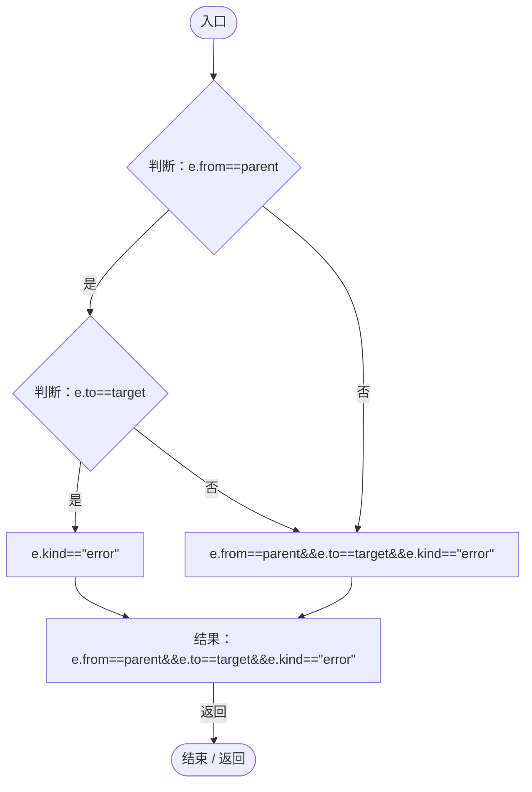

<a id="mc32e5f5b226fc13b"></a>

## 回调@71 · L71

`e … => 回调`


### Editor · Roslyn编译器控制流

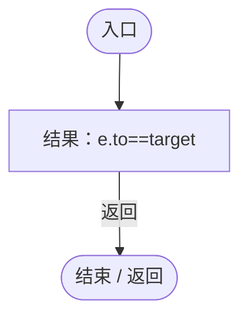

<a id="m518addeadff86429"></a>

## 回调@71 · L71

`n … => 回调`


### Editor · Roslyn编译器控制流

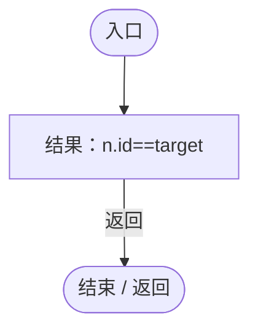

<a id="m78eba96b7b127a91"></a>

## 回调@74 · L74

`e … => 回调`


### Editor · Roslyn编译器控制流

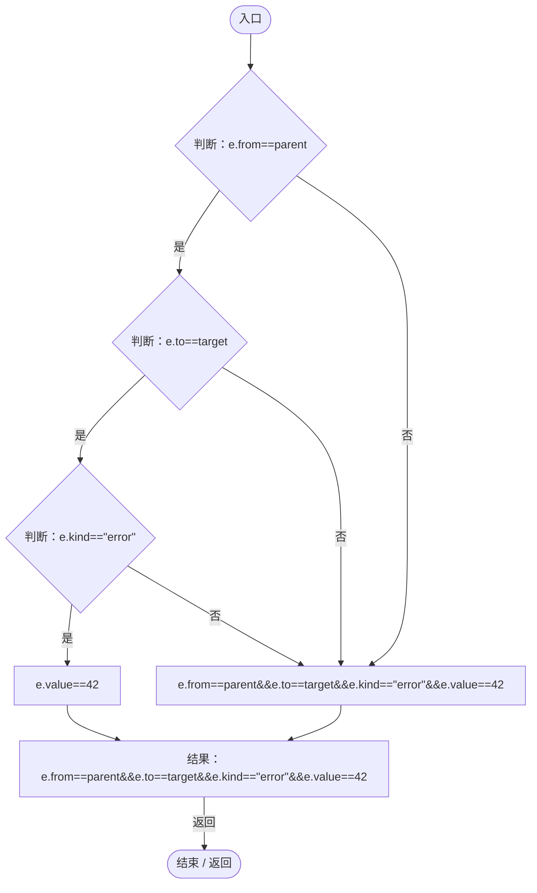

<a id="m21bb32e278766eae"></a>

## 回调@75 · L75

`e … => 回调`


### Editor · Roslyn编译器控制流


<a id="mded3ae6bcab3cd9d"></a>

## 回调@77 · L77

`d … => 回调`


### Editor · Roslyn编译器控制流

```mermaid
flowchart TD
  b0(["入口"])
  b1["结果：d.id==target"]
  b2(["结束 / 返回"])
  b0 --> b1
  b1 -->|"返回"| b2

```

<a id="m4e62ef371835f56e"></a>

## 回调@79 · L79

`d … => 回调`


### Editor · Roslyn编译器控制流

```mermaid
flowchart TD
  b0(["入口"])
  b1["结果：d.id==target"]
  b2(["结束 / 返回"])
  b0 --> b1
  b1 -->|"返回"| b2

```

<a id="md53eea8d6b26e7a6"></a>

## 回调@79 · L79

`e … => 回调`


### Editor · Roslyn编译器控制流

```mermaid
flowchart TD
  b0(["入口"])
  b1{"判断：e.from==parent"}
  b2{"判断：e.to==target"}
  b3["e.kind==&quot;error&quot;"]
  b4["e.from==parent&amp;&amp;e.to==target&amp;&amp;e.kind==&quot;error&quot;"]
  b5["结果：e.from==parent&amp;&amp;e.to==target&amp;&amp;e.kind==&quot;error&quot;"]
  b6(["结束 / 返回"])
  b0 --> b1
  b1 -->|"是"| b2
  b1 -->|"否"| b4
  b2 -->|"是"| b3
  b2 -->|"否"| b4
  b3 --> b5
  b4 --> b5
  b5 -->|"返回"| b6

```
