# ParthenogenesisRegression.cs

[返回总索引](../README.md) · `Editor` · `Assets/DarwinPark/Editor/ParthenogenesisRegression.cs`

[源文件](../../../Assets/DarwinPark/Editor/ParthenogenesisRegression.cs) · 源码校验：`b4a9e7c918fff5af2265c23dfa7877664f36aaf738fedfa7adc125e23dbe6a73`

方法按源文件位置排列。事件/回调引用不表示立即执行；分支与异常说明见总索引。完整源码与可点击关系图请打开离线手册。

<a id="m52248d7f5541a387"></a>

## Clear · L23

`private static void Clear()`


### Editor · Roslyn编译器控制流

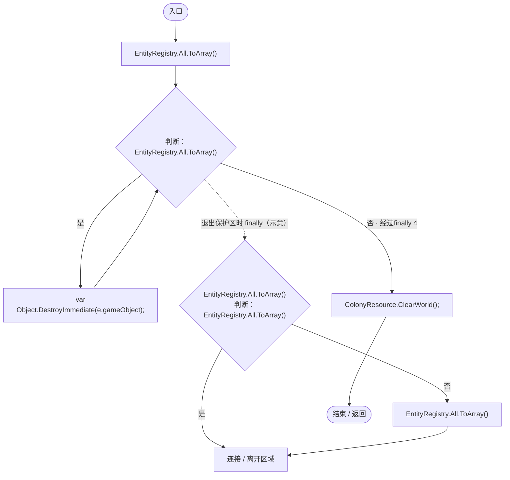

项目内调用/回调引用：

- [ColonyResource.ClearWorld · L100](293dbaecfff4b585.md#m634e84088b7cf78c)（方法）

<a id="mf4ac5e7e67a1d1ac"></a>

## Spawn · L24

`private static DarwinEntity Spawn(Vector3 position,params (string id,float value)[] definitions)`


### Editor · Roslyn编译器控制流

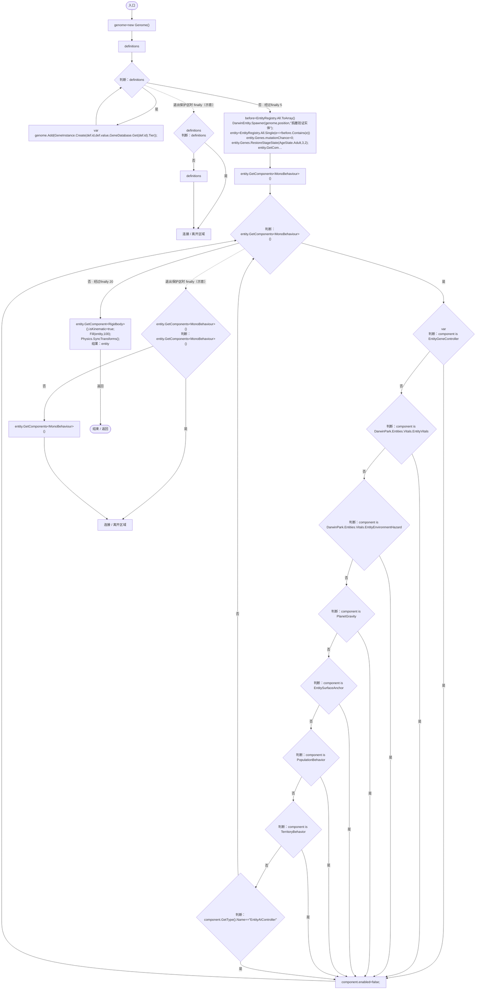

项目内调用/回调引用：

- [Genome.Add · L19](a2ef23f865bc7ee8.md#md9cfdc94b8b8d40f)（方法）
- [GeneInstance.Create · L20](f82e1498d67f5afd.md#m72e94c278de3cf8b)（方法）
- [GeneDatabase.Get · L135](ec0a03483435a863.md#m8f3bbfb35f3ca397)（方法）
- [DarwinEntity.Genes.get · L14](70798dde169f2e8b.md#m622eb1adf401d431)（访问器）
- [EntityGeneController.RestoreStageState · L51](7494d53178552f0e.md#m6264213de2a5ca6f)（方法）
- [EntityLifeCycle.RestoreProgress · L48](9f4138bfbae654b7.md#mfc75121476d49679)（方法）
- [LifeCycleSettings.Load · L16](ace76969fe8f61de.md#mbd2925785484f343)（方法）
- [EntityGeneController.Recalculate · L97](7494d53178552f0e.md#m65ea735c1e0e37a1)（方法）
- [ParthenogenesisRegression.Fill · L34](8a0c679de35169a0.md#m6ed28328712ee14f)（方法）
- [ParthenogenesisRegression.回调@27 · L27](8a0c679de35169a0.md#m799799437e6ad88f)（回调/委托）

<a id="m799799437e6ad88f"></a>

## 回调@27 · L27

`e … => 回调`


### Editor · Roslyn编译器控制流

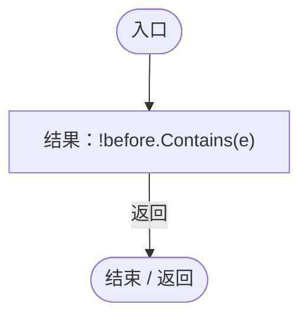

<a id="m3bb17a7b8a1d968c"></a>

## Logic · L32

`private static ReproductionGeneLogic Logic(DarwinEntity entity)`


### Editor · Roslyn编译器控制流

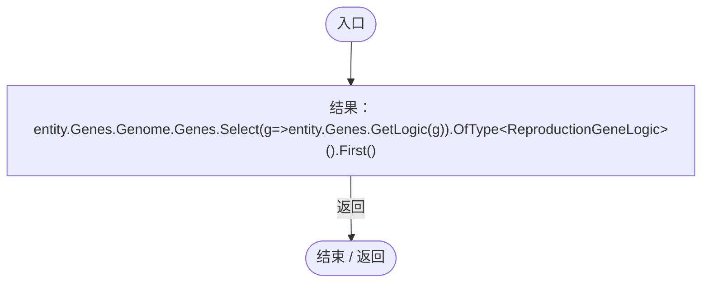

项目内调用/回调引用：

- [DarwinEntity.Genes.get · L14](70798dde169f2e8b.md#m622eb1adf401d431)（访问器）
- [ParthenogenesisRegression.回调@32 · L32](8a0c679de35169a0.md#me0b45e40e7988eb0)（回调/委托）

<a id="me0b45e40e7988eb0"></a>

## 回调@32 · L32

`g … => 回调`


### Editor · Roslyn编译器控制流


项目内调用/回调引用：

- [EntityGeneController.GetLogic · L211](7494d53178552f0e.md#maadb710e89e60395)（方法）
- [DarwinEntity.Genes.get · L14](70798dde169f2e8b.md#m622eb1adf401d431)（访问器）

<a id="m494029fbb53f1816"></a>

## Reserve · L33

`private static float Reserve(DarwinEntity entity)`


### Editor · Roslyn编译器控制流

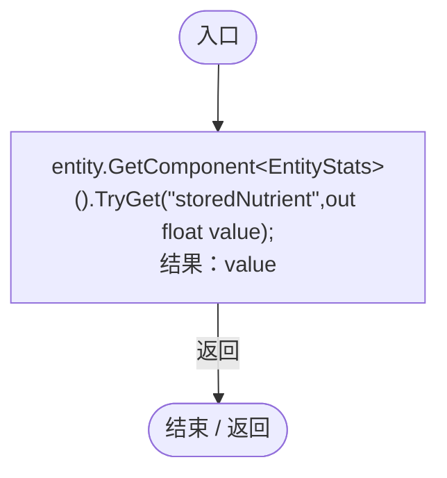

项目内调用/回调引用：

- [EntityStats.TryGet · L90](75aa86a368efdf24.md#m24ee1433e4a70d94)（方法）

<a id="m6ed28328712ee14f"></a>

## Fill · L34

`private static void Fill(DarwinEntity entity,float reserve)`


### Editor · Roslyn编译器控制流

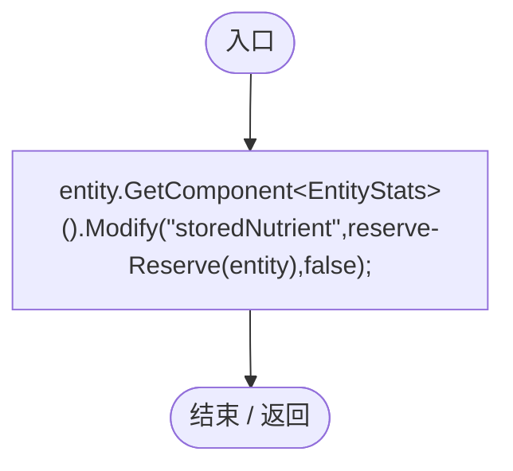

项目内调用/回调引用：

- [EntityStats.Modify · L111](75aa86a368efdf24.md#m9c837be197158240)（方法）
- [ParthenogenesisRegression.Reserve · L33](8a0c679de35169a0.md#m494029fbb53f1816)（方法）

<a id="m02882dbb5eae367d"></a>

## Verify · L35

`public static IEnumerator Verify(WorldSessionManager session,PlanetTerrainMeshBuilder builder,SimulationClock clock,Action<bool,string> check)`


### Editor · Roslyn编译器控制流

```mermaid
flowchart TD
  b0(["入口"])
  b1["geneId=ParthenogenesisEvolutionUpgrade.GeneId<br/>originalWait=GameplayTuning.Current.parthenogenesisWaitDays<br/>originalLimit=EntityPopulationLimit.Capture()"]
  b2["GameplayTuning.Current.parthenogenesisWaitDays=1;"]
  b3["new WorldGameSettings{entityLimit=0}<br/>entityLimit=0<br/>EntityPopulationLimit.UseSnapshot(new WorldGameSettings{entityLimit=0});"]
  b4["clock.Pause();<br/>Clear();<br/>home=EcologyQueries.Surface(builder.transform.position+Vector3.up*(builder.radius+builder.heightScale))<br/>wait=ParthenogenesisCondition.WaitSeconds<br/>catalog=GeneTreeStorage.ReadCatalog()<br/>tree=JsonUtility.FromJson&lt;Gen…"]
  b5{"check<br/>判断：catalog.ContainsKey(geneId)"}
  b6{"判断：tree.nodes.Any(n=&gt;n.id==geneId&amp;&amp;n.error)"}
  b7["tree.edges.Any(e=&gt;e.from==&quot;gene_sexual&quot;&amp;&amp;e.to==geneId&amp;&amp;e.kind==&quot;error&quot;)"]
  b8["catalog.ContainsKey(geneId)&amp;&amp;tree.nodes.Any(n=&gt;n.id==geneId&amp;&amp;n.error)&amp;&amp;tree.edges.Any(e=&gt;e.from==&quot;gene_sexual&quot;&amp;&amp;e.to==geneId&amp;&amp;e.kind==&quot;error&quot;)"]
  b9["check(catalog.ContainsKey(geneId)&amp;&amp;tree.nodes.Any(n=&gt;n.id==geneId&amp;&amp;n.error)&amp;&amp;tree.edges.Any(e=&gt;e.from==&quot;gene_sexual&quot;&amp;&amp;e.to==geneId&amp;&amp;e.kind==&quot;error&quot;),&quot;旧基因库与旧树补齐有性繁殖的孤雌出错分支&quot;);"]
  b10["edges=tree.edges.Count<br/>GeneTreeStorage.Validate(tree,catalog);<br/>check(tree.edges.Count==edges,&quot;孤雌分支迁移幂等&quot;);<br/>tree.edges.RemoveAll(e=&gt;e.to==geneId);<br/>check(tree.edges.All(e=&gt;e.to!=geneId),&quot;迁移后尊重用户删除孤雌分支连线&quot;);"]
  b11{"check<br/>判断：GeneEvolutionRules.Allows(&quot;gene_sexual&quot;,geneId,&quot;error&quot;,80)"}
  b12{"判断：GeneEvolutionRules.Allows(&quot;gene_asexual&quot;,geneId,&quot;error&quot;,20)"}
  b13["!GeneEvolutionRules.Allows(&quot;gene_sexual&quot;,geneId,&quot;evolution&quot;,80)"]
  b14["GeneEvolutionRules.Allows(&quot;gene_sexual&quot;,geneId,&quot;error&quot;,80)&amp;&amp;!GeneEvolutionRules.Allows(&quot;gene_asexual&quot;,geneId,&quot;error&quot;,20)&amp;&amp;!GeneEvolutionRules.Allows(&quot;gene_sexual&quot;,geneId,&quot;evolution&quot;,80)"]
  b15["check(GeneEvolutionRules.Allows(&quot;gene_sexual&quot;,geneId,&quot;error&quot;,80)&amp;&amp;!GeneEvolutionRules.Allows(&quot;gene_asexual&quot;,geneId,&quot;error&quot;,20)&amp;&amp;!GeneEvolutionRules.Allows(&quot;gene_sexual&quot;,geneId,&quot;evolution&quot;,80),&quot;孤雌生殖仅从有性特化通过出错演化&quot;);"]
  b16["mutation=new Genome()<br/>mutation.Add(GeneInstance.Create(&quot;gene_sexual&quot;,80,1));"]
  b17["mutation<br/>new GeneMutationSettings{ErrorWeight=1,DuplicateWeight=0,DeletionWeight=0,MaxErrorDelta=0}<br/>ErrorWeight=1<br/>DuplicateWeight=0<br/>DeletionWeight=0<br/>MaxErrorDelta=0<br/>GeneMutator.Mutate(mutation,new GeneMutationSettings{ErrorWeight=1,Dupli…"]
  b18["check(mutation.Genes.Single().DefinitionId==geneId,&quot;实际基因出错可以得到孤雌生殖基因&quot;);<br/>ordinary=Spawn(home,(&quot;gene_growth&quot;,50),(&quot;gene_sexual&quot;,80))<br/>Logic(ordinary).OnUpdate(wait*2);<br/>check(!ordinary.Genes.IsGestating,&quot;普通有性繁殖无配偶不会强制孕育&quot;);<br/>Clear();<br/>parent=Sp…"]
  b19{"check<br/>判断：parent.Genes.IsGestating"}
  b20["logic.CaptureState().mateWait==0"]
  b21["!parent.Genes.IsGestating"]
  b22["check(!parent.Genes.IsGestating&amp;&amp;logic.CaptureState().mateWait==0,&quot;幼体不累计孤雌等待或孕育&quot;);"]
  b23["parent.Genes.CurrentAge=AgeState.Adult;<br/>logic.OnUpdate(wait-1);"]
  b24{"check<br/>判断：parent.Genes.IsGestating"}
  b25["Mathf.Approximately(logic.CaptureState().mateWait,wait-1)"]
  b26["!parent.Genes.IsGestating"]
  b27["check(!parent.Genes.IsGestating&amp;&amp;Mathf.Approximately(logic.CaptureState().mateWait,wait-1),&quot;成年无配偶达到等待阈值前不孕育&quot;);"]
  b28["stateBefore=logic.CaptureState()<br/>logic.OnUpdate(0);<br/>WorldAuthority.IsReplica=true;<br/>logic.OnUpdate(wait*2);<br/>WorldAuthority.IsReplica=false;"]
  b29{"check<br/>判断：logic.CaptureState().mateWait==stateBefore.mateWait"}
  b30["!parent.Genes.IsGestating"]
  b31["logic.CaptureState().mateWait==stateBefore.mateWait"]
  b32["check(logic.CaptureState().mateWait==stateBefore.mateWait&amp;&amp;!parent.Genes.IsGestating,&quot;暂停与联机副本不推进等待&quot;);"]
  b33["session.SaveNow(false);<br/>saved=WorldSaveStore.Read(WorldSaveStore.FileFor(session.Current.id))<br/>check(saved.entities.Single().reproduction.Single().mateWait==stateBefore.mateWait,&quot;无配偶等待真实写盘读取&quot;);<br/>invalid=JsonUtility.FromJson&lt;WorldSaveData&gt;(…"]
  b34["WorldSaveStore.Validate(invalid);"]
  b35["rejected=true;"]
  b36["check(rejected,&quot;坏档无配偶计时在清场前被拒绝&quot;);<br/>session.Open(saved);"]
  b37{"判断：session.Busy"}
  b38["yield return null;"]
  b39["clock.Pause();<br/>parent=EntityRegistry.All.Single();<br/>parent.Genes.mutationChance=0;<br/>logic=Logic(parent);<br/>check(logic.CaptureState().mateWait==stateBefore.mateWait,&quot;实际重载继续原等待进度&quot;);<br/>reserve=Reserve(parent)<br/>parent.GetComponent&lt;EntityStats&gt;().T…"]
  b40{"check<br/>判断：parent.Genes.IsGestating"}
  b41{"判断：logic.CaptureState().parthenogenetic"}
  b42{"判断：logic.CaptureState().partner==null"}
  b43["Mathf.Abs(Reserve(parent)-(reserve-cost))&lt;.002f"]
  b44["parent.Genes.IsGestating&amp;&amp;logic.CaptureState().parthenogenetic&amp;&amp;logic.CaptureState().partner==null&amp;&amp;Mathf.Abs(Reserve(parent)-(reserve-cost))&lt;.002f"]
  b45["check(parent.Genes.IsGestating&amp;&amp;logic.CaptureState().parthenogenetic&amp;&amp;logic.CaptureState().partner==null&amp;&amp;Mathf.Abs(Reserve(parent)-(reserve-cost))&lt;.002f,&quot;超时启动孤雌孕育并且只扣一次真实营养&quot;);"]
  b46["check(logic.GetTooltipInfo().Contains(&quot;孤雌孕育&quot;),&quot;孕育状态明确显示孤雌生殖&quot;);<br/>session.SaveNow(false);<br/>pregnancy=WorldSaveStore.Read(WorldSaveStore.FileFor(session.Current.id))"]
  b47{"check<br/>判断：pregnancy.entities.Single().reproduction.Single().parthenogenetic"}
  b48["LanWorldSnapshot.Frame(1).actors.Single().state.reproduction.Single().parthenogenetic"]
  b49["pregnancy.entities.Single().reproduction.Single().parthenogenetic"]
  b50["check(pregnancy.entities.Single().reproduction.Single().parthenogenetic&amp;&amp;LanWorldSnapshot.Frame(1).actors.Single().state.reproduction.Single().parthenogenetic,&quot;孤雌孕育标记写盘并进入联机快照&quot;);"]
  b51["session.Open(pregnancy);"]
  b52{"判断：session.Busy"}
  b53["yield return null;"]
  b54["clock.Pause();<br/>parent=EntityRegistry.All.Single();<br/>logic=Logic(parent);"]
  b55{"check<br/>判断：parent.Genes.IsGestating"}
  b56{"判断：logic.CaptureState().parthenogenetic"}
  b57["logic.CaptureState().partner==null"]
  b58["parent.Genes.IsGestating&amp;&amp;logic.CaptureState().parthenogenetic&amp;&amp;logic.CaptureState().partner==null"]
  b59["check(parent.Genes.IsGestating&amp;&amp;logic.CaptureState().parthenogenetic&amp;&amp;logic.CaptureState().partner==null,&quot;孕育中实际读档保持单亲而非空配偶基因组&quot;);"]
  b60["beforeBirth=EntityRegistry.All.Count<br/>logic.OnUpdate(logic.CaptureState().gestation+1);"]
  b61{"check<br/>判断：parent.Genes.IsGestating"}
  b62["EntityRegistry.All.Count==beforeBirth+1"]
  b63["!parent.Genes.IsGestating"]
  b64["check(!parent.Genes.IsGestating&amp;&amp;EntityRegistry.All.Count==beforeBirth+1,&quot;孤雌孕育完成实际产下一个后代&quot;);"]
  b65["child=EntityRegistry.All.Single(e=&gt;e!=parent)"]
  b66{"check<br/>判断：child.Genes.Genome.Genes.All(g=&gt;parent.Genes.Genome.Genes.Any(p=&gt;p.DefinitionId==g.DefinitionId&amp;&amp;p.Value==g.Value))"}
  b67["child.Genes.Genome.Genes.Any(g=&gt;g.DefinitionId==geneId)"]
  b68["child.Genes.Genome.Genes.All(g=&gt;parent.Genes.Genome.Genes.Any(p=&gt;p.DefinitionId==g.DefinitionId&amp;&amp;p.Value==g.Value))"]
  b69["check(child.Genes.Genome.Genes.All(g=&gt;parent.Genes.Genome.Genes.Any(p=&gt;p.DefinitionId==g.DefinitionId&amp;&amp;p.Value==g.Value))&amp;&amp;child.Genes.Genome.Genes.Any(g=&gt;g.DefinitionId==geneId),&quot;孤雌后代遗传亲本基因且保留孤雌分支&quot;);"]
  b70["logic.OnUpdate(.1f);"]
  b71{"check<br/>判断：parent.Genes.IsGestating"}
  b72["logic.CaptureState().mateWait==0"]
  b73["!parent.Genes.IsGestating"]
  b74["check(!parent.Genes.IsGestating&amp;&amp;logic.CaptureState().mateWait==0,&quot;产后冷却不重复强制孕育&quot;);"]
  b75["Clear();<br/>parent=Spawn(home,(&quot;gene_growth&quot;,50),(geneId,80));<br/>logic=Logic(parent);<br/>Fill(parent,0);<br/>logic.OnUpdate(wait+1);"]
  b76{"check<br/>判断：parent.Genes.IsGestating"}
  b77["logic.CaptureState().mateWait&gt;=wait"]
  b78["!parent.Genes.IsGestating"]
  b79["check(!parent.Genes.IsGestating&amp;&amp;logic.CaptureState().mateWait&gt;=wait,&quot;储粮不足继续等待但保留超时资格&quot;);"]
  b80["Fill(parent,100);"]
  b81["new WorldGameSettings{entityLimit=1}<br/>entityLimit=1<br/>EntityPopulationLimit.UseSnapshot(new WorldGameSettings{entityLimit=1});"]
  b82["reserve=Reserve(parent);<br/>logic.OnUpdate(.1f);"]
  b83{"check<br/>判断：parent.Genes.IsGestating"}
  b84["Reserve(parent)==reserve"]
  b85["!parent.Genes.IsGestating"]
  b86["check(!parent.Genes.IsGestating&amp;&amp;Reserve(parent)==reserve,&quot;孤雌生殖不绕过世界数量上限或预扣营养&quot;);"]
  b87["new WorldGameSettings{entityLimit=0}<br/>entityLimit=0<br/>EntityPopulationLimit.UseSnapshot(new WorldGameSettings{entityLimit=0});"]
  b88["logic.OnUpdate(.1f);<br/>check(parent.Genes.IsGestating,&quot;恢复储粮和数量空位后自动开始孤雌孕育&quot;);<br/>Clear();<br/>parent=Spawn(home,(&quot;gene_growth&quot;,50),(geneId,80));<br/>logic=Logic(parent);<br/>Fill(parent,0);<br/>logic.OnUpdate(wait*.6f);<br/>mate=Spawn(home+Vector3.right*2,(&quot;gene_…"]
  b89{"check<br/>判断：logic.CaptureState().mateWait==0"}
  b90["!parent.Genes.IsGestating"]
  b91["logic.CaptureState().mateWait==0"]
  b92["check(logic.CaptureState().mateWait==0&amp;&amp;!parent.Genes.IsGestating,&quot;找到合适配偶会清零孤雌等待&quot;);"]
  b93["Fill(parent,100);<br/>logic.OnUpdate(.1f);"]
  b94{"check<br/>判断：parent.Genes.IsGestating"}
  b95{"判断：logic.CaptureState().parthenogenetic"}
  b96["logic.CaptureState().partner!=null"]
  b97["parent.Genes.IsGestating&amp;&amp;!logic.CaptureState().parthenogenetic&amp;&amp;logic.CaptureState().partner!=null"]
  b98["check(parent.Genes.IsGestating&amp;&amp;!logic.CaptureState().parthenogenetic&amp;&amp;logic.CaptureState().partner!=null,&quot;有配偶时优先正常有性孕育&quot;);"]
  b99["Clear();<br/>parent=Spawn(home,(&quot;gene_growth&quot;,50),(geneId,80));<br/>logic=Logic(parent);<br/>logic.OnUpdate(wait*.6f);<br/>parent.Genes.CurrentAge=AgeState.Elder;<br/>logic.OnUpdate(wait*2);"]
  b100{"check<br/>判断：logic.CaptureState().mateWait==0"}
  b101["!parent.Genes.IsGestating"]
  b102["logic.CaptureState().mateWait==0"]
  b103["check(logic.CaptureState().mateWait==0&amp;&amp;!parent.Genes.IsGestating,&quot;离开成年阶段清零孤雌等待&quot;);"]
  b104["parent.Genes.CurrentAge=AgeState.Adult;<br/>parent.Genes.Genome.Genes.Single(g=&gt;g.DefinitionId==geneId).Enabled=false;<br/>parent.Genes.Recalculate();<br/>logic.OnUpdate(wait*2);<br/>check(!parent.Genes.IsGestating,&quot;禁用孤雌基因不会继续强制孕育&quot;);<br/>Clear();<br/>parent=Spa…"]
  b105{"check<br/>判断：parent.Genes.IsGestating"}
  b106{"判断：queen.State.mateWait==wait-1"}
  b107["queen.Group.All(m=&gt;m.Role!=AntRole.Mate)"]
  b108["!parent.Genes.IsGestating&amp;&amp;queen.State.mateWait==wait-1&amp;&amp;queen.Group.All(m=&gt;m.Role!=AntRole.Mate)"]
  b109["check(!parent.Genes.IsGestating&amp;&amp;queen.State.mateWait==wait-1&amp;&amp;queen.Group.All(m=&gt;m.Role!=AntRole.Mate),&quot;孤雌王后等待真实配偶而非自动复制配偶&quot;);"]
  b110["session.SaveNow(false);<br/>queenSave=WorldSaveStore.Read(WorldSaveStore.FileFor(session.Current.id))<br/>check(queenSave.entities.Single().ecology.ant.mateWait==wait-1,&quot;王后等待进度成对保存读取&quot;);<br/>session.Open(queenSave);"]
  b111{"判断：session.Busy"}
  b112["yield return null;"]
  b113["clock.Pause();<br/>parent=EntityRegistry.All.Single();<br/>queen=parent.GetComponent&lt;AntColonyMember&gt;();<br/>check(queen.State.mateWait==wait-1,&quot;王后实际读档恢复原等待时长&quot;);<br/>AntColonyReproduction.Advance(queen,1.01f);"]
  b114{"check<br/>判断：parent.Genes.IsGestating"}
  b115{"判断：queen.State.parthenogenetic"}
  b116["queen.State.partnerGenome==null"]
  b117["parent.Genes.IsGestating&amp;&amp;queen.State.parthenogenetic&amp;&amp;queen.State.partnerGenome==null"]
  b118["check(parent.Genes.IsGestating&amp;&amp;queen.State.parthenogenetic&amp;&amp;queen.State.partnerGenome==null,&quot;王后超时同样启动孤雌孕育&quot;);"]
  b119["beforeBirth=EntityRegistry.All.Count;<br/>AntColonyReproduction.Advance(queen,queen.State.reproductionTimer+1);"]
  b120{"check<br/>判断：EntityRegistry.All.Count==beforeBirth+1"}
  b121["EntityRegistry.All.Single(e=&gt;e!=parent).GetComponent&lt;PopulationBehavior&gt;().GroupId==queen.GroupId"]
  b122["EntityRegistry.All.Count==beforeBirth+1"]
  b123["check(EntityRegistry.All.Count==beforeBirth+1&amp;&amp;EntityRegistry.All.Single(e=&gt;e!=parent).GetComponent&lt;PopulationBehavior&gt;().GroupId==queen.GroupId,&quot;王后孤雌后代继承同群分工&quot;);"]
  b124["Clear();<br/>parent=Spawn(home,(&quot;gene_growth&quot;,50),(&quot;gene_population&quot;,20),(geneId,80));<br/>logic=Logic(parent);<br/>AntColonyMember.Ensure(parent.GetComponent&lt;PopulationBehavior&gt;()).Assign(AntRole.Worker,Guid.NewGuid().ToString(&quot;N&quot;));<br/>logic.OnUpdate…"]
  b125{"check<br/>判断：parent.Genes.IsGestating"}
  b126["parent.Genes.Evaluation.Genes.Where(g=&gt;g.Definition.Id==geneId).All(g=&gt;!g.IsActive)"]
  b127["!parent.Genes.IsGestating"]
  b128["check(!parent.Genes.IsGestating&amp;&amp;parent.Genes.Evaluation.Genes.Where(g=&gt;g.Definition.Id==geneId).All(g=&gt;!g.IsActive),&quot;工匠分工仍抑制孤雌分支且不能自主繁殖&quot;);"]
  b129["Clear();<br/>parent=Spawn(home,(&quot;gene_growth&quot;,50),(geneId,80),(geneId,80));<br/>reserve=Reserve(parent);<br/>parent.GetComponent&lt;EntityStats&gt;().TryGet(&quot;size&quot;,out size);<br/>cost=LifeCycleSettings.Load().nutrientCost*Mathf.Max(EcologyBalanceSettings.Curr…"]
  b130["parent.Genes.Genome.Genes.Select(g=&gt;parent.Genes.GetLogic(g)).OfType&lt;ReproductionGeneLogic&gt;().ToArray()"]
  b131{"判断：parent.Genes.Genome.Genes.Select(g=&gt;parent.Genes.GetLogic(g)).OfType&lt;ReproductionGeneLogic&gt;().ToArray()"}
  b132["var<br/>item.OnUpdate(wait+1);"]
  b133{"parent.Genes.Genome.Genes.Select(g=&gt;parent.Genes.GetLogic(g)).OfType&lt;ReproductionGeneLogic&gt;().ToArray()<br/>判断：parent.Genes.Genome.Genes.Select(g=&gt;parent.Genes.GetLogic(g)).OfType&lt;ReproductionGeneLogic&gt;().ToArray()"}
  b134["parent.Genes.Genome.Genes.Select(g=&gt;parent.Genes.GetLogic(g)).OfType&lt;ReproductionGeneLogic&gt;().ToArray()"]
  b135["连接 / 离开区域"]
  b136{"check<br/>判断：parent.Genes.IsGestating"}
  b137{"判断：Mathf.Abs(Reserve(parent)-(reserve-cost))&lt;.002f"}
  b138["parent.Genes.Genome.Genes.Select(g=&gt;parent.Genes.GetLogic(g)).OfType&lt;ReproductionGeneLogic&gt;().Count(r=&gt;r.CaptureState().parthenogenetic)==1"]
  b139["parent.Genes.IsGestating&amp;&amp;Mathf.Abs(Reserve(parent)-(reserve-cost))&lt;.002f&amp;&amp;parent.Genes.Genome.Genes.Select(g=&gt;parent.Genes.GetLogic(g)).OfType&lt;ReproductionGeneLogic&gt;().Count(r=&gt;r.CaptureState().parthenogenetic)==1"]
  b140["check(parent.Genes.IsGestating&amp;&amp;Mathf.Abs(Reserve(parent)-(reserve-cost))&lt;.002f&amp;&amp;parent.Genes.Genome.Genes.Select(g=&gt;parent.Genes.GetLogic(g)).OfType&lt;ReproductionGeneLogic&gt;().Count(r=&gt;r.CaptureState().parthenogenetic)==1,&quot;重复孤雌基因只有一个繁殖行为写…"]
  b141["Clear();<br/>parent=Spawn(home,(&quot;gene_growth&quot;,50),(geneId,80),(&quot;gene_oviparous&quot;,80));<br/>primary=parent.Genes.Genome.Genes.First(g=&gt;parent.Genes.GetLogic(g) is ReproductionGeneLogic&amp;&amp;GeneBehaviorAuthority.IsPrimary&lt;ReproductionGeneLogic&gt;(parent…"]
  b142{"check<br/>判断：EntityRegistry.All.Count==2"}
  b143{"EntityRegistry.All.Single(e=&gt;e!=parent).GetComponent&lt;EggIncubation&gt;()<br/>判断：EntityRegistry.All.Single(e=&gt;e!=parent).GetComponent&lt;EggIncubation&gt;()"}
  b144[".Incubating"]
  b145["EntityRegistry.All.Single(e=&gt;e!=parent).GetComponent&lt;EggIncubation&gt;()"]
  b146["EntityRegistry.All.Single(e=&gt;e!=parent).GetComponent&lt;EggIncubation&gt;()?.Incubating==true"]
  b147["EntityRegistry.All.Count==2"]
  b148["check(EntityRegistry.All.Count==2&amp;&amp;EntityRegistry.All.Single(e=&gt;e!=parent).GetComponent&lt;EggIncubation&gt;()?.Incubating==true,&quot;孤雌生殖与卵生共存时仍生成待孵化卵&quot;);"]
  b149["WorldAuthority.IsReplica=false;<br/>GameplayTuning.Current.parthenogenesisWaitDays=originalWait;<br/>EntityPopulationLimit.UseSnapshot(originalLimit);"]
  b150(["结束 / 返回"])
  b0 --> b1
  b1 --> b2
  b2 --> b3
  b3 --> b4
  b4 --> b5
  b5 -->|"是"| b6
  b5 -->|"否"| b8
  b6 -->|"是"| b7
  b6 -->|"否"| b8
  b7 --> b9
  b8 --> b9
  b9 --> b10
  b10 --> b11
  b11 -->|"是"| b12
  b11 -->|"否"| b14
  b12 -->|"否"| b13
  b12 -->|"是"| b14
  b13 --> b15
  b14 --> b15
  b15 --> b16
  b16 --> b17
  b17 --> b18
  b18 --> b19
  b19 -->|"否"| b20
  b19 -->|"是"| b21
  b20 --> b22
  b21 --> b22
  b22 --> b23
  b23 --> b24
  b24 -->|"否"| b25
  b24 -->|"是"| b26
  b25 --> b27
  b26 --> b27
  b27 --> b28
  b28 --> b29
  b29 -->|"是"| b30
  b29 -->|"否"| b31
  b30 --> b32
  b31 --> b32
  b32 --> b33
  b33 --> b34
  b34 --> b36
  b35 --> b36
  b36 --> b37
  b37 -->|"是"| b38
  b37 -->|"否"| b39
  b38 --> b37
  b39 --> b40
  b40 -->|"是"| b41
  b40 -->|"否"| b44
  b41 -->|"是"| b42
  b41 -->|"否"| b44
  b42 -->|"是"| b43
  b42 -->|"否"| b44
  b43 --> b45
  b44 --> b45
  b45 --> b46
  b46 --> b47
  b47 -->|"是"| b48
  b47 -->|"否"| b49
  b48 --> b50
  b49 --> b50
  b50 --> b51
  b51 --> b52
  b52 -->|"是"| b53
  b52 -->|"否"| b54
  b53 --> b52
  b54 --> b55
  b55 -->|"是"| b56
  b55 -->|"否"| b58
  b56 -->|"是"| b57
  b56 -->|"否"| b58
  b57 --> b59
  b58 --> b59
  b59 --> b60
  b60 --> b61
  b61 -->|"否"| b62
  b61 -->|"是"| b63
  b62 --> b64
  b63 --> b64
  b64 --> b65
  b65 --> b66
  b66 -->|"是"| b67
  b66 -->|"否"| b68
  b67 --> b69
  b68 --> b69
  b69 --> b70
  b70 --> b71
  b71 -->|"否"| b72
  b71 -->|"是"| b73
  b72 --> b74
  b73 --> b74
  b74 --> b75
  b75 --> b76
  b76 -->|"否"| b77
  b76 -->|"是"| b78
  b77 --> b79
  b78 --> b79
  b79 --> b80
  b80 --> b81
  b81 --> b82
  b82 --> b83
  b83 -->|"否"| b84
  b83 -->|"是"| b85
  b84 --> b86
  b85 --> b86
  b86 --> b87
  b87 --> b88
  b88 --> b89
  b89 -->|"是"| b90
  b89 -->|"否"| b91
  b90 --> b92
  b91 --> b92
  b92 --> b93
  b93 --> b94
  b94 -->|"是"| b95
  b94 -->|"否"| b97
  b95 -->|"否"| b96
  b95 -->|"是"| b97
  b96 --> b98
  b97 --> b98
  b98 --> b99
  b99 --> b100
  b100 -->|"是"| b101
  b100 -->|"否"| b102
  b101 --> b103
  b102 --> b103
  b103 --> b104
  b104 --> b105
  b105 -->|"否"| b106
  b105 -->|"是"| b108
  b106 -->|"是"| b107
  b106 -->|"否"| b108
  b107 --> b109
  b108 --> b109
  b109 --> b110
  b110 --> b111
  b111 -->|"是"| b112
  b111 -->|"否"| b113
  b112 --> b111
  b113 --> b114
  b114 -->|"是"| b115
  b114 -->|"否"| b117
  b115 -->|"是"| b116
  b115 -->|"否"| b117
  b116 --> b118
  b117 --> b118
  b118 --> b119
  b119 --> b120
  b120 -->|"是"| b121
  b120 -->|"否"| b122
  b121 --> b123
  b122 --> b123
  b123 --> b124
  b124 --> b125
  b125 -->|"否"| b126
  b125 -->|"是"| b127
  b126 --> b128
  b127 --> b128
  b128 --> b129
  b129 --> b130
  b130 --> b131
  b131 -->|"是"| b132
  b131 -->|"否 · 经过finally 133"| b136
  b132 --> b131
  b133 -->|"否"| b134
  b133 -->|"是"| b135
  b134 --> b135
  b136 -->|"是"| b137
  b136 -->|"否"| b139
  b137 -->|"是"| b138
  b137 -->|"否"| b139
  b138 --> b140
  b139 --> b140
  b140 --> b141
  b141 --> b142
  b142 -->|"是"| b143
  b142 -->|"否"| b147
  b143 -->|"否"| b144
  b143 -->|"是"| b145
  b144 --> b146
  b145 --> b146
  b146 --> b148
  b147 --> b148
  b148 -->|"经过finally 149"| b150
  b34 -. "保护区可能异常（示意）" .-> b35
  b131 -. "退出保护区时 finally（示意）" .-> b133
  b2 -. "退出保护区时 finally（示意）" .-> b149

```

项目内调用/回调引用：

- [GameplayTuning.Current.get · L21](db546e5713b32d53.md#m1caba89e7704d239)（访问器）
- [EntityPopulationLimit.Capture · L29](44f717c5df79d270.md#m9d42f19642677139)（方法）
- [EntityPopulationLimit.UseSnapshot · L30](44f717c5df79d270.md#m735185cedc969868)（方法）
- [SimulationClock.Pause · L79](a8f444aec9614b0a.md#m30929d45a885d0f1)（方法）
- [ParthenogenesisRegression.Clear · L23](8a0c679de35169a0.md#m52248d7f5541a387)（方法）
- [EcologyQueries.Surface · L47](bdf7ccc2c9c0452f.md#m2f1f6873ee5fc8df)（方法）
- [GeneTreeStorage.ReadCatalog · L27](a885bad0d7dedee8.md#m89083f320ec287c0)（方法）
- [GeneTreeStorage.Validate · L67](a885bad0d7dedee8.md#m3371bf1e3c5ae267)（方法）
- [GeneEvolutionRules.Allows · L25](95d3abc5e23f05d3.md#m56e7f05bb0fe9159)（方法）
- [Genome.Add · L19](a2ef23f865bc7ee8.md#md9cfdc94b8b8d40f)（方法）
- [GeneInstance.Create · L20](f82e1498d67f5afd.md#m72e94c278de3cf8b)（方法）
- [GeneMutator.Mutate · L18](f297edbfb98ef475.md#m4444eb9ce9b6a55a)（方法）
- [ParthenogenesisRegression.Spawn · L24](8a0c679de35169a0.md#mf4ac5e7e67a1d1ac)（方法）
- [ReproductionGeneLogic.OnUpdate · L36](ac319ea70bd8b723.md#mf050ec0ba2694604)（方法）
- [ParthenogenesisRegression.Logic · L32](8a0c679de35169a0.md#m3bb17a7b8a1d968c)（方法）
- [DarwinEntity.Genes.get · L14](70798dde169f2e8b.md#m622eb1adf401d431)（访问器）
- [EntityGeneController.CurrentAge.set · L34](7494d53178552f0e.md#me616ca96310ad01c)（访问器）
- [ReproductionGeneLogic.CaptureState · L33](ac319ea70bd8b723.md#mb3b414bac984dd2e)（方法）
- [WorldSessionManager.SaveNow · L157](08741c7b7b9d9344.md#mbecd8b5c222ba46b)（方法）
- [WorldSaveStore.Read · L72](d67a35e5e3814c15.md#mca362c7675a5800c)（方法）
- [WorldSaveStore.FileFor · L48](d67a35e5e3814c15.md#m419a625e2bcc70f8)（方法）
- [WorldSessionManager.Current.get · L21](08741c7b7b9d9344.md#m5d26a5eb846a8504)（访问器）
- [WorldSaveStore.Validate · L73](d67a35e5e3814c15.md#mb2f88d55be126f07)（方法）
- [WorldSessionManager.Open · L58](08741c7b7b9d9344.md#m0a8e69a8a4fbc512)（方法）
- [WorldSessionManager.Busy.get · L24](08741c7b7b9d9344.md#m4483e2e4f28f7c85)（访问器）
- [ParthenogenesisRegression.Reserve · L33](8a0c679de35169a0.md#m494029fbb53f1816)（方法）
- [EntityStats.TryGet · L90](75aa86a368efdf24.md#m24ee1433e4a70d94)（方法）
- [LifeCycleSettings.Load · L16](ace76969fe8f61de.md#mbd2925785484f343)（方法）
- [EcologyBalanceSettings.Current.get · L29](5a37bc79f15f6238.md#md33d4c4b8f82540b)（访问器）
- [ReproductionGeneLogic.GetTooltipInfo · L224](ac319ea70bd8b723.md#md74fe154911bfaa2)（方法）
- [LanWorldSnapshot.Frame · L32](02a722701106da02.md#m85d6595c09ac428c)（方法）
- [ParthenogenesisRegression.Fill · L34](8a0c679de35169a0.md#m6ed28328712ee14f)（方法）
- [EntityGeneController.Recalculate · L97](7494d53178552f0e.md#m65ea735c1e0e37a1)（方法）
- [AntColonyMember.Ensure · L51](baebd85c05598377.md#m408f716118716988)（方法）
- [AntColonyMember.Assign · L54](baebd85c05598377.md#mda0fe308acecb8f2)（方法）
- [AntColonyReproduction.Advance · L25](c22084eac4e522ed.md#mf3336413ca12a59b)（方法）
- [AntColonyMember.State.get · L27](baebd85c05598377.md#mc8282e8cc823ceeb)（访问器）
- [PopulationBehavior.GroupId.get · L20](21e4f62f75a9a80f.md#m5145936fa914ba8c)（访问器）
- [EntityGeneController.Evaluation.get · L18](7494d53178552f0e.md#mc0039c100a31b455)（访问器）
- [EntityGeneController.GetLogic · L211](7494d53178552f0e.md#maadb710e89e60395)（方法）
- [ParthenogenesisRegression.回调@42 · L42](8a0c679de35169a0.md#m0cef1f4ee8d6f252)（回调/委托）
- [ParthenogenesisRegression.回调@42 · L42](8a0c679de35169a0.md#m02cf99ae9e68c813)（回调/委托）
- [ParthenogenesisRegression.回调@43 · L43](8a0c679de35169a0.md#mafdcc0d3fd222b78)（回调/委托）
- [ParthenogenesisRegression.回调@43 · L43](8a0c679de35169a0.md#m0235c8152b4c406f)（回调/委托）
- [ParthenogenesisRegression.回调@44 · L44](8a0c679de35169a0.md#m35e3cbf43d0fd6b9)（回调/委托）
- [ParthenogenesisRegression.回调@44 · L44](8a0c679de35169a0.md#md561a5c24b294706)（回调/委托）
- [ParthenogenesisRegression.回调@59 · L59](8a0c679de35169a0.md#mfe164c76e52bee93)（回调/委托）
- [ParthenogenesisRegression.回调@59 · L59](8a0c679de35169a0.md#m7b028b6300305c6e)（回调/委托）
- [ParthenogenesisRegression.回调@59 · L59](8a0c679de35169a0.md#ma9b1b7333d8fec8e)（回调/委托）
- [ParthenogenesisRegression.回调@64 · L64](8a0c679de35169a0.md#mfa71dd0d0c95d894)（回调/委托）
- [ParthenogenesisRegression.回调@66 · L66](8a0c679de35169a0.md#m26fc495c8620b1d8)（回调/委托）
- [ParthenogenesisRegression.回调@69 · L69](8a0c679de35169a0.md#m57ef546e5c21706c)（回调/委托）
- [ParthenogenesisRegression.回调@70 · L70](8a0c679de35169a0.md#mfe3c6a23d7dd2bd5)（回调/委托）
- [ParthenogenesisRegression.回调@70 · L70](8a0c679de35169a0.md#m566760f7016f6143)（回调/委托）
- [ParthenogenesisRegression.回调@72 · L72](8a0c679de35169a0.md#m4a430989b0440dac)（回调/委托）
- [ParthenogenesisRegression.回调@73 · L73](8a0c679de35169a0.md#m65c2b3658059b8d1)（回调/委托）
- [ParthenogenesisRegression.回调@73 · L73](8a0c679de35169a0.md#mb11ab57bff557b1e)（回调/委托）
- [ParthenogenesisRegression.回调@75 · L75](8a0c679de35169a0.md#m970c1eab5d33470f)（回调/委托）
- [ParthenogenesisRegression.回调@75 · L75](8a0c679de35169a0.md#m0eacff0561c418fa)（回调/委托）

<a id="m0cef1f4ee8d6f252"></a>

## 回调@42 · L42

`n … => 回调`


### Editor · Roslyn编译器控制流

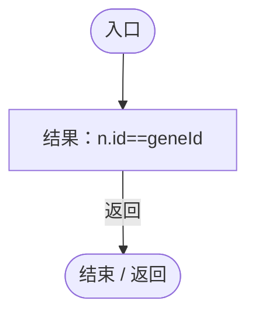

<a id="m02cf99ae9e68c813"></a>

## 回调@42 · L42

`e … => 回调`


### Editor · Roslyn编译器控制流


<a id="mafdcc0d3fd222b78"></a>

## 回调@43 · L43

`n … => 回调`


### Editor · Roslyn编译器控制流

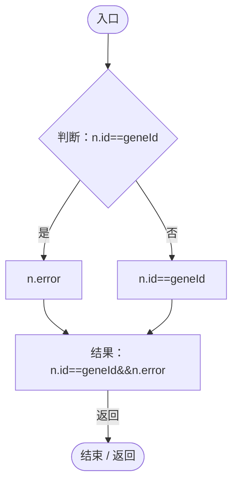

<a id="m0235c8152b4c406f"></a>

## 回调@43 · L43

`e … => 回调`


### Editor · Roslyn编译器控制流

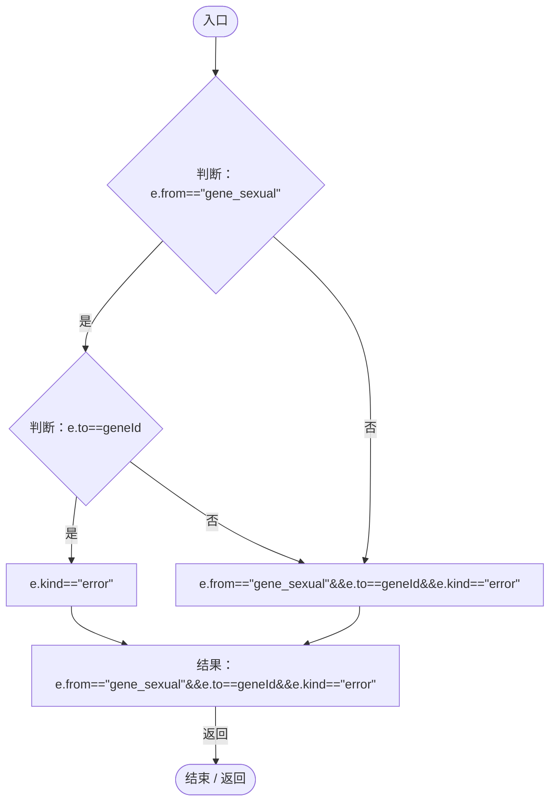

<a id="m35e3cbf43d0fd6b9"></a>

## 回调@44 · L44

`e … => 回调`


### Editor · Roslyn编译器控制流


<a id="md561a5c24b294706"></a>

## 回调@44 · L44

`e … => 回调`


### Editor · Roslyn编译器控制流

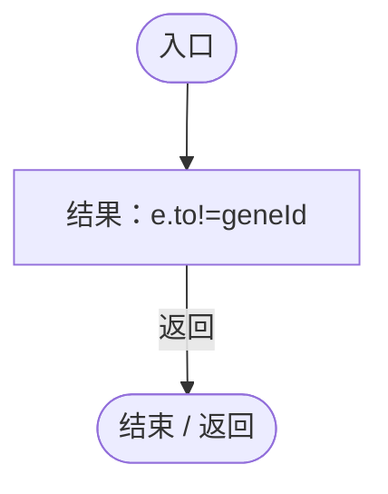

<a id="mfe164c76e52bee93"></a>

## 回调@59 · L59

`e … => 回调`


### Editor · Roslyn编译器控制流


<a id="m7b028b6300305c6e"></a>

## 回调@59 · L59

`g … => 回调`


### Editor · Roslyn编译器控制流

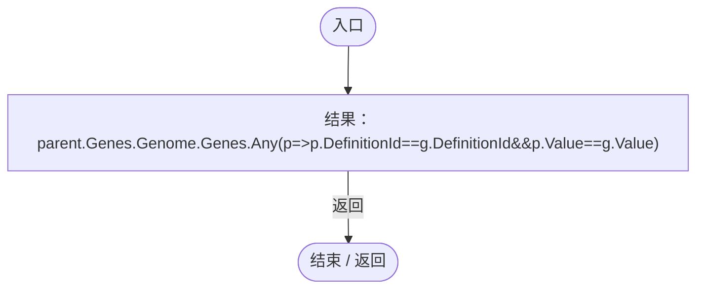

项目内调用/回调引用：

- [DarwinEntity.Genes.get · L14](70798dde169f2e8b.md#m622eb1adf401d431)（访问器）
- [ParthenogenesisRegression.回调@59 · L59](8a0c679de35169a0.md#m3e5035cfc38bc565)（回调/委托）

<a id="m3e5035cfc38bc565"></a>

## 回调@59 · L59

`p … => 回调`


### Editor · Roslyn编译器控制流

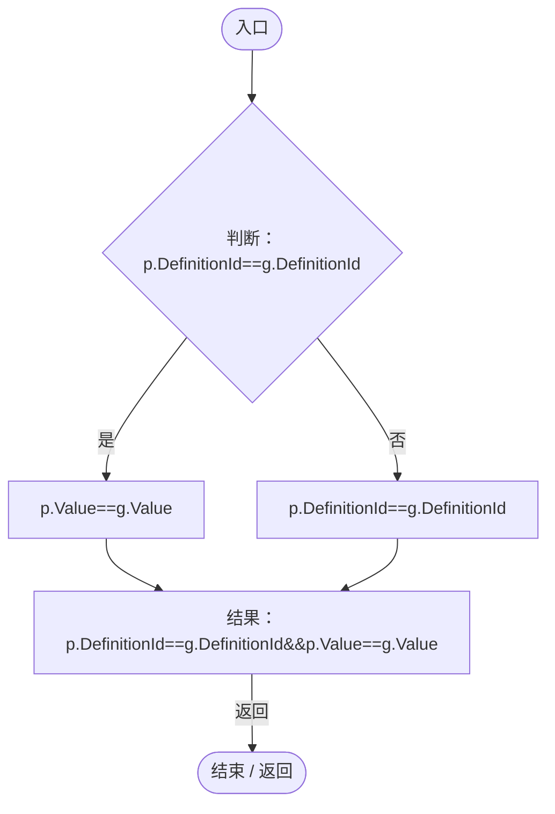

<a id="ma9b1b7333d8fec8e"></a>

## 回调@59 · L59

`g … => 回调`


### Editor · Roslyn编译器控制流


<a id="mfa71dd0d0c95d894"></a>

## 回调@64 · L64

`g … => 回调`


### Editor · Roslyn编译器控制流

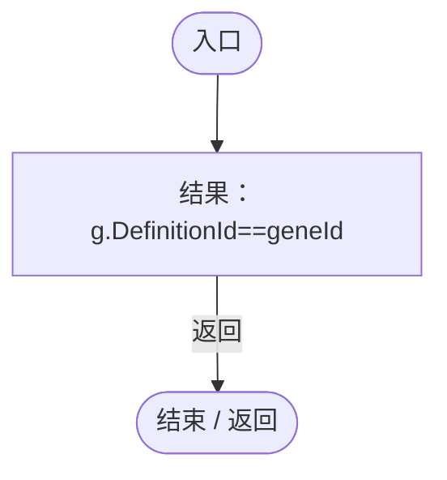

<a id="m26fc495c8620b1d8"></a>

## 回调@66 · L66

`m … => 回调`


### Editor · Roslyn编译器控制流

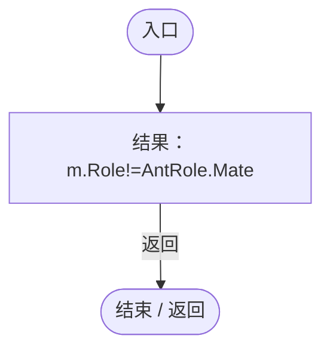

项目内调用/回调引用：

- [AntColonyMember.Role.get · L33](baebd85c05598377.md#mdf6df89f7116c7a3)（访问器）

<a id="m57ef546e5c21706c"></a>

## 回调@69 · L69

`e … => 回调`


### Editor · Roslyn编译器控制流

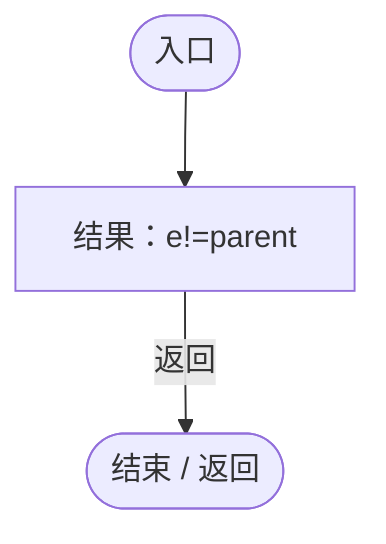

<a id="mfe3c6a23d7dd2bd5"></a>

## 回调@70 · L70

`g … => 回调`


### Editor · Roslyn编译器控制流

```mermaid
flowchart TD
  b0(["入口"])
  b1["结果：g.Definition.Id==geneId"]
  b2(["结束 / 返回"])
  b0 --> b1
  b1 -->|"返回"| b2

```

<a id="m566760f7016f6143"></a>

## 回调@70 · L70

`g … => 回调`


### Editor · Roslyn编译器控制流

```mermaid
flowchart TD
  b0(["入口"])
  b1["结果：!g.IsActive"]
  b2(["结束 / 返回"])
  b0 --> b1
  b1 -->|"返回"| b2

```

<a id="m4a430989b0440dac"></a>

## 回调@72 · L72

`g … => 回调`


### Editor · Roslyn编译器控制流

```mermaid
flowchart TD
  b0(["入口"])
  b1["结果：parent.Genes.GetLogic(g)"]
  b2(["结束 / 返回"])
  b0 --> b1
  b1 -->|"返回"| b2

```

项目内调用/回调引用：

- [EntityGeneController.GetLogic · L211](7494d53178552f0e.md#maadb710e89e60395)（方法）
- [DarwinEntity.Genes.get · L14](70798dde169f2e8b.md#m622eb1adf401d431)（访问器）

<a id="m65c2b3658059b8d1"></a>

## 回调@73 · L73

`g … => 回调`


### Editor · Roslyn编译器控制流

```mermaid
flowchart TD
  b0(["入口"])
  b1["结果：parent.Genes.GetLogic(g)"]
  b2(["结束 / 返回"])
  b0 --> b1
  b1 -->|"返回"| b2

```

项目内调用/回调引用：

- [EntityGeneController.GetLogic · L211](7494d53178552f0e.md#maadb710e89e60395)（方法）
- [DarwinEntity.Genes.get · L14](70798dde169f2e8b.md#m622eb1adf401d431)（访问器）

<a id="mb11ab57bff557b1e"></a>

## 回调@73 · L73

`r … => 回调`


### Editor · Roslyn编译器控制流

```mermaid
flowchart TD
  b0(["入口"])
  b1["结果：r.CaptureState().parthenogenetic"]
  b2(["结束 / 返回"])
  b0 --> b1
  b1 -->|"返回"| b2

```

项目内调用/回调引用：

- [ReproductionGeneLogic.CaptureState · L33](ac319ea70bd8b723.md#mb3b414bac984dd2e)（方法）

<a id="m970c1eab5d33470f"></a>

## 回调@75 · L75

`g … => 回调`


### Editor · Roslyn编译器控制流

```mermaid
flowchart TD
  b0(["入口"])
  b1{"判断：parent.Genes.GetLogic(g) is ReproductionGeneLogic"}
  b2["GeneBehaviorAuthority.IsPrimary&lt;ReproductionGeneLogic&gt;(parent.Genes,g)"]
  b3["parent.Genes.GetLogic(g) is ReproductionGeneLogic"]
  b4["结果：parent.Genes.GetLogic(g) is ReproductionGeneLogic&amp;&amp;GeneBehaviorAuthority.IsPrimary&lt;ReproductionGeneLogic&gt;(parent.Genes,g)"]
  b5(["结束 / 返回"])
  b0 --> b1
  b1 -->|"是"| b2
  b1 -->|"否"| b3
  b2 --> b4
  b3 --> b4
  b4 -->|"返回"| b5

```

项目内调用/回调引用：

- [EntityGeneController.GetLogic · L211](7494d53178552f0e.md#maadb710e89e60395)（方法）
- [DarwinEntity.Genes.get · L14](70798dde169f2e8b.md#m622eb1adf401d431)（访问器）
- [GeneBehaviorAuthority.IsPrimary · L10](be83fa896bbe02ae.md#me2fc1f2e16fcd073)（方法）

<a id="m0eacff0561c418fa"></a>

## 回调@75 · L75

`e … => 回调`


### Editor · Roslyn编译器控制流

```mermaid
flowchart TD
  b0(["入口"])
  b1["结果：e!=parent"]
  b2(["结束 / 返回"])
  b0 --> b1
  b1 -->|"返回"| b2

```
