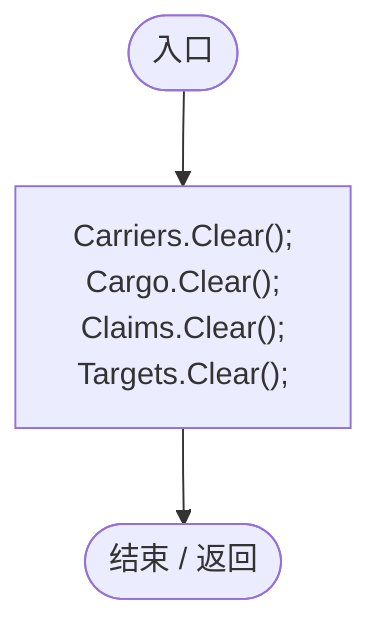
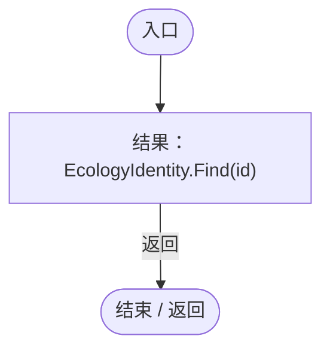
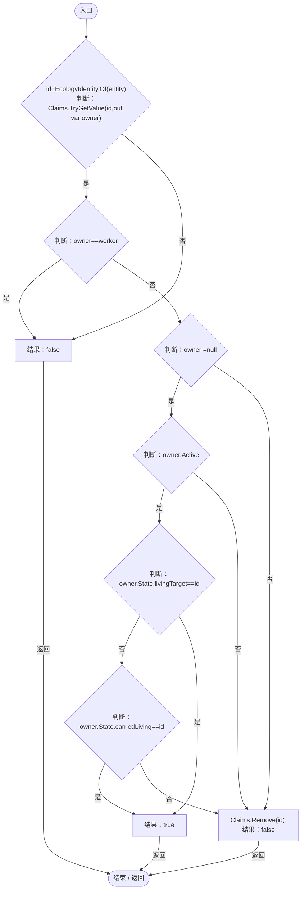
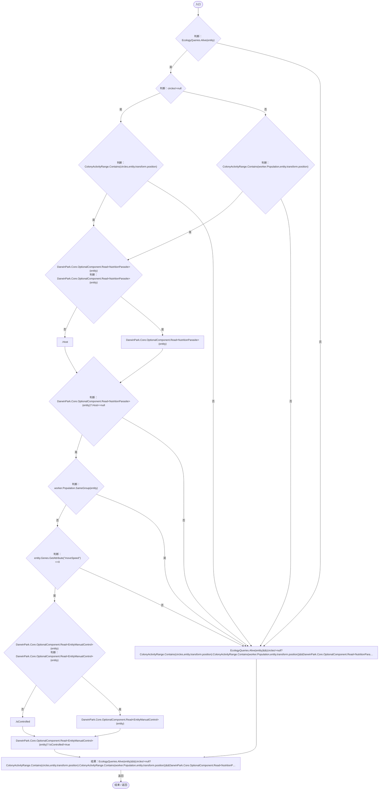
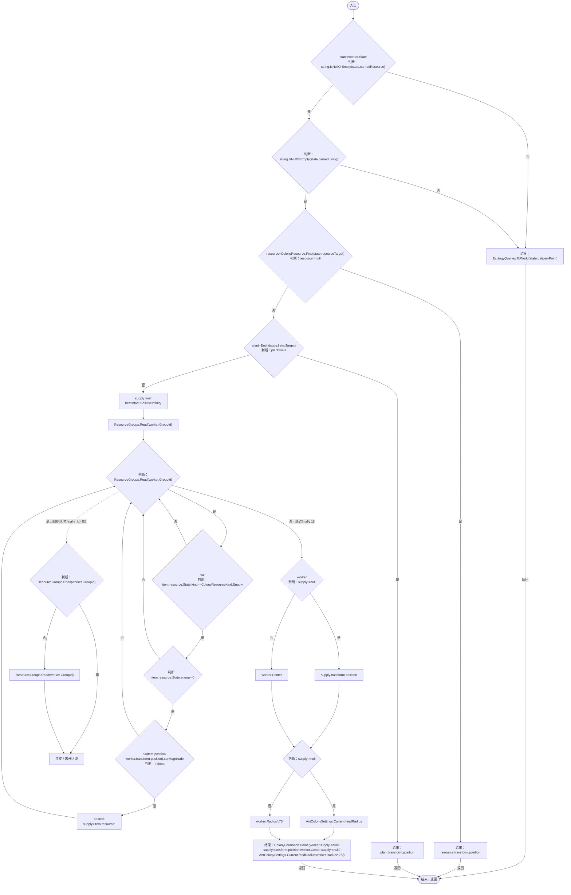
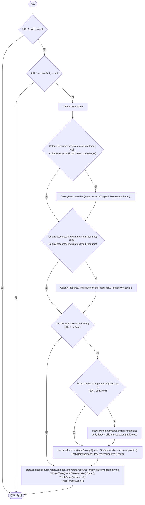

```mermaid
flowchart TD
  b0(["入口"])
  b1{"state=worker.State<br/>settings=AntColonySettings.Current<br/>carried=ColonyResource.Find(state.carriedResource)<br/>live=Entity(state.carriedLiving)<br/>TrackTarget(worker);<br/>TrackCargo(worker,live);<br/>判断：carried!=null"}
  b2{"判断：live!=null"}
  b3{"worker.Activity=ColonyActivity.Transport;<br/>held=worker.transform.position+EcologyQueries.Up(worker.transform.position)*settings.transportOffset<br/>判断：carried!=null"}
  b4["carried.CarryTo(held);"]
  b5{"判断：live!=null"}
  b6["live.transform.position=held;<br/>EntityNeighborhood.ObservePosition(live.Genes);"]
  b7{"判断：ColonyFeeding.Destination(worker,out _)"}
  b8{"判断：state.deliveryNursery"}
  b9{"判断：worker.Queen!=null"}
  b10["state.deliveryPoint=EcologyQueries.ToLocal(worker.Queen.transform.position);"]
  b11{"destination=EcologyQueries.ToWorld(state.deliveryPoint)<br/>判断：EcologyQueries.Distance(worker.transform.position,destination)&gt;settings.arrivalDistance"}
  b12{"判断：carried!=null"}
  b13["carried.State.energy"]
  b14["ColonyResource.Biomass(live)"]
  b15["energy=carried!=null?carried.State.energy:ColonyResource.Biomass(live)"]
  b16{"判断：carried!=null"}
  b17["carried.Remove();"]
  b18{"判断：live!=null"}
  b19["live.gameObject.SetActive(false);<br/>Object.Destroy(live.gameObject);"]
  b20["ColonyResource.Convert(worker.GroupId,destination,energy,state.deliveryNursery);<br/>state.carriedResource=state.carriedLiving=state.resourceTarget=state.livingTarget=null;<br/>TrackCargo(worker,null);<br/>TrackTarget(worker);<br/>WorkerTaskQueue.Comple…"]
  b21{"state.carriedResource=state.carriedLiving=null;<br/>判断：ColonyFeeding.Destination(worker,out _)"}
  b22{"resource=ColonyResource.Find(state.resourceTarget)<br/>plant=Entity(state.livingTarget)<br/>判断：resource!=null"}
  b23{"判断：ColonyActivityRange.Contains(worker.Population,resource.transform.position)"}
  b24{"判断：resource.Claim(worker)"}
  b25["resource.Release(worker.Id);<br/>state.resourceTarget=null;<br/>resource=null;"]
  b26{"判断：plant!=null"}
  b27{"判断：Valid(plant,worker)"}
  b28{"判断：Claimed(plant,worker)"}
  b29["state.livingTarget=null;<br/>plant=null;"]
  b30{"WorkerTaskQueue.Select(worker);<br/>resource=ColonyResource.Find(state.resourceTarget);<br/>plant=Entity(state.livingTarget);<br/>TrackTarget(worker);<br/>判断：resource==null"}
  b31{"判断：plant==null"}
  b32["worker.Activity=ColonyActivity.Rest;"]
  b33["worker.Activity=ColonyActivity.Collect;"]
  b34{"判断：resource!=null"}
  b35["resource.transform.position"]
  b36["plant.transform.position"]
  b37["point=resource!=null?resource.transform.position:plant.transform.position"]
  b38{"判断：EcologyQueries.Distance(worker.transform.position,point)&gt;settings.transportReach"}
  b39{"判断：resource!=null"}
  b40["state.carriedResource=resource.State.id;"]
  b41{"state.carriedLiving=EcologyIdentity.Of(plant);<br/>body=plant.GetComponent&lt;Rigidbody&gt;()<br/>TrackCargo(worker,plant);<br/>判断：body!=null"}
  b42{"state.originalKinematic=body.isKinematic;<br/>state.originalDetect=body.detectCollisions;<br/>判断：body.isKinematic"}
  b43["body.linearVelocity=Vector3.zero;"]
  b44["body.isKinematic=true;<br/>body.detectCollisions=false;"]
  b45{"WorkerTaskQueue.PickedUp(worker);<br/>queen=worker.Queen<br/>state.deliveryNursery=UnityEngine.Random.value&lt;settings.nurseryDeliveryFraction;<br/>判断：queen==null"}
  b46["state.deliveryPoint=EcologyQueries.ToLocal(worker.Center);<br/>state.deliveryNursery=true;"]
  b47{"queen.EnsureSupplyPoints();<br/>判断：ResourceGroups.Has(worker.GroupId,ColonyResourceKind.Nursery)"}
  b48["state.deliveryNursery=true;"]
  b49{"判断：ResourceGroups.Has(worker.GroupId,ColonyResourceKind.Supply)"}
  b50["state.deliveryNursery=false;"]
  b51{"判断：state.deliveryNursery"}
  b52["state.deliveryPoint=EcologyQueries.ToLocal(queen.transform.position);"]
  b53{"判断：queen.State.supplyPoints.Count&gt;=settings.supplyPointCount"}
  b54["state.deliveryPoint=queen.State.supplyPoints[UnityEngine.Random.Range(0,queen.State.supplyPoints.Count)];"]
  b55["tangent=Vector3.ProjectOnPlane(UnityEngine.Random.onUnitSphere,EcologyQueries.Up(queen.transform.position)).normalized<br/>state.deliveryPoint=EcologyQueries.ToLocal(EcologyQueries.Surface(queen.transform.position+tangent*UnityEngine.Random.…"]
  b56(["结束 / 返回"])
  b0 --> b1
  b1 -->|"否"| b2
  b1 -->|"是"| b3
  b2 -->|"是"| b3
  b2 -->|"否"| b21
  b3 -->|"是"| b4
  b3 -->|"否"| b5
  b4 --> b5
  b5 -->|"是"| b6
  b5 -->|"否"| b7
  b6 --> b7
  b7 -->|"是"| b56
  b7 -->|"否"| b8
  b8 -->|"是"| b9
  b8 -->|"否"| b11
  b9 -->|"是"| b10
  b9 -->|"否"| b11
  b10 --> b11
  b11 -->|"是"| b56
  b11 -->|"否"| b12
  b12 -->|"是"| b13
  b12 -->|"否"| b14
  b13 --> b15
  b14 --> b15
  b15 --> b16
  b16 -->|"是"| b17
  b16 -->|"否"| b18
  b17 --> b18
  b18 -->|"是"| b19
  b18 -->|"否"| b20
  b19 --> b20
  b20 --> b56
  b21 -->|"是"| b56
  b21 -->|"否"| b22
  b22 -->|"是"| b23
  b22 -->|"否"| b26
  b23 -->|"是"| b24
  b23 -->|"否"| b25
  b24 -->|"否"| b25
  b24 -->|"是"| b26
  b25 --> b26
  b26 -->|"是"| b27
  b26 -->|"否"| b30
  b27 -->|"是"| b28
  b27 -->|"否"| b29
  b28 -->|"是"| b29
  b28 -->|"否"| b30
  b29 --> b30
  b30 -->|"是"| b31
  b30 -->|"否"| b33
  b31 -->|"是"| b32
  b31 -->|"否"| b33
  b32 --> b56
  b33 --> b34
  b34 -->|"是"| b35
  b34 -->|"否"| b36
  b35 --> b37
  b36 --> b37
  b37 --> b38
  b38 -->|"是"| b56
  b38 -->|"否"| b39
  b39 -->|"是"| b40
  b39 -->|"否"| b41
  b40 --> b45
  b41 -->|"是"| b42
  b41 -->|"否"| b45
  b42 -->|"否"| b43
  b42 -->|"是"| b44
  b43 --> b44
  b44 --> b45
  b45 -->|"是"| b46
  b45 -->|"否"| b47
  b46 --> b56
  b47 -->|"否"| b48
  b47 -->|"是"| b49
  b48 --> b51
  b49 -->|"否"| b50
  b49 -->|"是"| b51
  b50 --> b51
  b51 -->|"是"| b52
  b51 -->|"否"| b53
  b52 --> b56
  b53 -->|"是"| b54
  b53 -->|"否"| b55
  b54 --> b56
  b55 --> b56

```

# AntColonyWorker.cs

[返回总索引](../README.md) · `Runtime` · `Assets/DarwinPark/Entities/Ecology/AntColonyWorker.cs`

[源文件](../../../Assets/DarwinPark/Entities/Ecology/AntColonyWorker.cs) · 源码校验：`01a39df284ef9b905a26dfdb7e833583d74375bf932070fbc832fe2e9f57b8d1`

方法按源文件位置排列。事件/回调引用不表示立即执行；分支与异常说明见总索引。完整源码与可点击关系图请打开离线手册。

## Reset · L13

`[RuntimeInitializeOnLoadMethod(RuntimeInitializeLoadType.SubsystemRegistration)] private static void Reset()`

### Editor / Player · Roslyn编译器控制流

## Entity · L14

`private static DarwinEntity Entity(string id)`

### Editor / Player · Roslyn编译器控制流

项目内调用/回调引用：

- [EcologyIdentity.Find · L21](bdf7ccc2c9c0452f.md#mb670b64dc2baff58)（方法）

## TrackCargo · L16

`private static void TrackCargo(AntColonyMember worker,DarwinEntity entity)`

★ 修复（防Bug回归）：移动属性只需判定是否被搬运，不应每次扫描所有蚁群并重算每名成员的表达。

### Editor / Player · Roslyn编译器控制流

## TrackTarget · L22

`private static void TrackTarget(AntColonyMember worker)`

### Editor / Player · Roslyn编译器控制流

项目内调用/回调引用：

- [AntColonyMember.State.get · L34](baebd85c05598377.md#m64745194ab46f363)（访问器）

## Claimed · L29

`internal static bool Claimed(DarwinEntity entity,AntColonyMember worker)`

### Editor / Player · Roslyn编译器控制流

项目内调用/回调引用：

- [EcologyIdentity.Of · L22](bdf7ccc2c9c0452f.md#mb23020fe763aafd3)（方法）
- [AntColonyMember.State.get · L34](baebd85c05598377.md#m64745194ab46f363)（访问器）

## Valid · L37

`internal static bool Valid(DarwinEntity entity,AntColonyMember worker,IReadOnlyList<ActivityCircle> circles=null)`

★ 适配：体内隐藏的寄生幼体不是可搬运植株；不能把被宿主带到附近的幼体当作零速食物。

### Editor / Player · Roslyn编译器控制流

项目内调用/回调引用：

- [EcologyQueries.Alive · L39](bdf7ccc2c9c0452f.md#m8352bfacbe2996a8)（方法）
- [ColonyActivityRange.Contains · L27](e8d854132f563257.md#m75fd40dfa1ab2aec)（方法）
- [ColonyActivityRange.Contains · L21](e8d854132f563257.md#m535d817473d6a256)（方法）
- [AntColonyMember.Population.get · L37](baebd85c05598377.md#m8a87d3d378490df9)（访问器）
- [OptionalComponent.Read · L7](806c46b42ced4d36.md#m69622a4dee165c5a)（方法）
- [NutritionParasite.Host.get · L22](4a18785b7c1e1484.md#m5812c5feaf5f3103)（访问器）
- [PopulationBehavior.SameGroup · L127](21e4f62f75a9a80f.md#m4af6332162bb0355)（方法）
- [EntityGeneController.GetAttribute · L288](7494d53178552f0e.md#m45127bcdd833aaf5)（方法）
- [DarwinEntity.Genes.get · L14](70798dde169f2e8b.md#m622eb1adf401d431)（访问器）
- [EntityManualControl.IsControlled.get · L12](a6969896da35e1f0.md#m125d8f7da7ab33bf)（访问器）

## Advance · L38

`public static void Advance(AntColonyMember worker,float dt)`

### Editor / Player · Roslyn编译器控制流

项目内调用/回调引用：

- [AntColonyMember.State.get · L34](baebd85c05598377.md#m64745194ab46f363)（访问器）
- [AntColonySettings.Current.get · L31](cb0a937e97c8fbb3.md#mcd121159f407ccdf)（访问器）
- [ColonyResource.Find · L28](293dbaecfff4b585.md#m1324285ab40ac6f4)（方法）
- [AntColonyWorker.Entity · L14](8a0cca2020271b6f.md#m2994413751c7964c)（方法）
- [AntColonyWorker.TrackTarget · L22](8a0cca2020271b6f.md#m3dd7e60c7c0b9024)（方法）
- [AntColonyWorker.TrackCargo · L16](8a0cca2020271b6f.md#m31edb08c9b5a3c07)（方法）
- [AntColonyMember.Activity.set · L52](baebd85c05598377.md#m044555b23cca15dc)（访问器）
- [EcologyQueries.Up · L42](bdf7ccc2c9c0452f.md#ma73e6bbbc726282f)（方法）
- [ColonyResource.CarryTo · L85](293dbaecfff4b585.md#md7070757a728b6f5)（方法）
- [EntityNeighborhood.ObservePosition · L81](e5e24c4aff0395b1.md#m232339f32a8c5875)（方法）
- [DarwinEntity.Genes.get · L14](70798dde169f2e8b.md#m622eb1adf401d431)（访问器）
- [ColonyFeeding.Destination · L37](2cb56c08d08ff8ec.md#mae2885d7d6ea7035)（方法）
- [EcologyQueries.ToLocal · L40](bdf7ccc2c9c0452f.md#mfa1ace432c73012a)（方法）
- [EcologyQueries.ToWorld · L41](bdf7ccc2c9c0452f.md#mc67423f4877c3534)（方法）
- [EcologyQueries.Distance · L43](bdf7ccc2c9c0452f.md#m6e395dce655ebcac)（方法）
- [ColonyResource.State.get · L24](293dbaecfff4b585.md#m41824f1a0e160aa5)（访问器）
- [ColonyResource.Biomass · L33](293dbaecfff4b585.md#mac6f0b77996f44ab)（方法）
- [ColonyResource.Remove · L108](293dbaecfff4b585.md#m42fd78441247c433)（方法）
- [ColonyResource.Convert · L86](293dbaecfff4b585.md#mf4a0916c3cd78e2e)（方法）
- [WorkerTaskQueue.Complete · L23](dc0692495776be10.md#ma1450397c6869690)（方法）
- [ColonyActivityRange.Contains · L21](e8d854132f563257.md#m535d817473d6a256)（方法）
- [AntColonyMember.Population.get · L37](baebd85c05598377.md#m8a87d3d378490df9)（访问器）
- [ColonyResource.Claim · L73](293dbaecfff4b585.md#m367d2436206a4618)（方法）
- [ColonyResource.Release · L84](293dbaecfff4b585.md#m8a7905808688a0a6)（方法）
- [AntColonyWorker.Valid · L37](8a0cca2020271b6f.md#mdeeb29672bb0d9fa)（方法）
- [AntColonyWorker.Claimed · L29](8a0cca2020271b6f.md#mff9a0d119103c9ed)（方法）
- [WorkerTaskQueue.Select · L27](dc0692495776be10.md#mf7061cdad05e5c0f)（方法）
- [EcologyIdentity.Of · L22](bdf7ccc2c9c0452f.md#mb23020fe763aafd3)（方法）
- [WorkerTaskQueue.PickedUp · L25](dc0692495776be10.md#mb52de928a27dce12)（方法）
- [AntColonyMember.Center.get · L47](baebd85c05598377.md#mcc7c915e5d37ccc3)（访问器）
- [AntColonyMember.EnsureSupplyPoints · L174](baebd85c05598377.md#me506d417831a646f)（方法）
- [ResourceGroups.Has · L16](97a3c8522367343a.md#m47a60bcde0821462)（方法）
- [EcologyQueries.Surface · L48](bdf7ccc2c9c0452f.md#m40ee3e975d7f5137)（方法）

## Destination · L103

`public static Vector3 Destination(AntColonyMember worker)`

### Editor / Player · Roslyn编译器控制流

项目内调用/回调引用：

- [AntColonyMember.State.get · L34](baebd85c05598377.md#m64745194ab46f363)（访问器）
- [EcologyQueries.ToWorld · L41](bdf7ccc2c9c0452f.md#mc67423f4877c3534)（方法）
- [ColonyResource.Find · L28](293dbaecfff4b585.md#m1324285ab40ac6f4)（方法）
- [AntColonyWorker.Entity · L14](8a0cca2020271b6f.md#m2994413751c7964c)（方法）
- [ResourceGroups.Read · L9](97a3c8522367343a.md#m155d5ab724041bf7)（方法）
- [ColonyResource.State.get · L24](293dbaecfff4b585.md#m41824f1a0e160aa5)（访问器）
- [ColonyFormation.Home · L36](c65dce2d54e43480.md#m79ad3420baeaf49d)（方法）
- [AntColonyMember.Center.get · L47](baebd85c05598377.md#mcc7c915e5d37ccc3)（访问器）
- [AntColonySettings.Current.get · L31](cb0a937e97c8fbb3.md#mcd121159f407ccdf)（访问器）

## Release · L115

`public static void Release(AntColonyMember worker)`

### Editor / Player · Roslyn编译器控制流

项目内调用/回调引用：

- [AntColonyMember.Entity.get · L36](baebd85c05598377.md#m9b719fef2d946b65)（访问器）
- [AntColonyMember.State.get · L34](baebd85c05598377.md#m64745194ab46f363)（访问器）
- [ColonyResource.Find · L28](293dbaecfff4b585.md#m1324285ab40ac6f4)（方法）
- [ColonyResource.Release · L84](293dbaecfff4b585.md#m8a7905808688a0a6)（方法）
- [AntColonyWorker.Entity · L14](8a0cca2020271b6f.md#m2994413751c7964c)（方法）
- [EcologyQueries.Surface · L48](bdf7ccc2c9c0452f.md#m40ee3e975d7f5137)（方法）
- [EntityNeighborhood.ObservePosition · L81](e5e24c4aff0395b1.md#m232339f32a8c5875)（方法）
- [DarwinEntity.Genes.get · L14](70798dde169f2e8b.md#m622eb1adf401d431)（访问器）
- [WorkerTaskQueue.Tasks · L16](dc0692495776be10.md#m39e1f5f7df33e56c)（方法）
- [AntColonyWorker.TrackCargo · L16](8a0cca2020271b6f.md#m31edb08c9b5a3c07)（方法）
- [AntColonyWorker.TrackTarget · L22](8a0cca2020271b6f.md#m3dd7e60c7c0b9024)（方法）

## Resolve · L127

`public static void Resolve(AntColonyMember worker)`

### Editor / Player · Roslyn编译器控制流

项目内调用/回调引用：

- [AntColonyWorker.TrackTarget · L22](8a0cca2020271b6f.md#m3dd7e60c7c0b9024)（方法）
- [AntColonyWorker.Entity · L14](8a0cca2020271b6f.md#m2994413751c7964c)（方法）
- [AntColonyMember.State.get · L34](baebd85c05598377.md#m64745194ab46f363)（访问器）
- [AntColonyWorker.TrackCargo · L16](8a0cca2020271b6f.md#m31edb08c9b5a3c07)（方法）

## IsCarried · L132

`public static bool IsCarried(DarwinEntity entity)`

### Editor / Player · Roslyn编译器控制流

项目内调用/回调引用：

- [AntColonyMember.State.get · L34](baebd85c05598377.md#m64745194ab46f363)（访问器）
- [EcologyIdentity.Of · L22](bdf7ccc2c9c0452f.md#mb23020fe763aafd3)（方法）
