# AntColonyWorker.cs

[返回总索引](../README.md) · `Runtime` · `Assets/DarwinPark/Entities/Ecology/AntColonyWorker.cs`

[源文件](../../../Assets/DarwinPark/Entities/Ecology/AntColonyWorker.cs) · 源码校验：`baf94fdcc2122faf5e06cace15370c2291fd834e10a092166ecacd11289159a3`

方法按源文件位置排列。事件/回调引用不表示立即执行；分支与异常说明见总索引。完整源码与可点击关系图请打开离线手册。

## Reset · L14

`[RuntimeInitializeOnLoadMethod(RuntimeInitializeLoadType.SubsystemRegistration)] private static void Reset()`

### Editor / Player · Roslyn编译器控制流

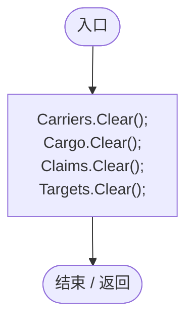

## Entity · L15

`private static DarwinEntity Entity(string id)`

### Editor / Player · Roslyn编译器控制流

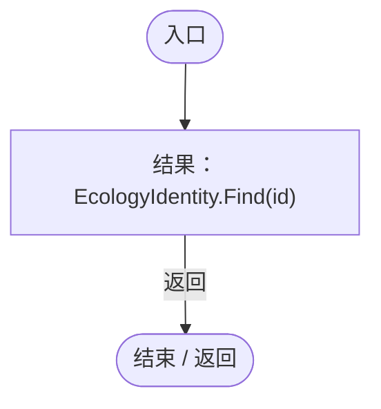

项目内调用/回调引用：

- [EcologyIdentity.Find · L20](bdf7ccc2c9c0452f.md#m58f756a3ba9ec990)（方法）

## TrackCargo · L17

`private static void TrackCargo(AntColonyMember worker,DarwinEntity entity)`

★ 修复（防Bug回归）：移动属性只需判定是否被搬运，不应每次扫描所有蚁群并重算每名成员的表达。

### Editor / Player · Roslyn编译器控制流

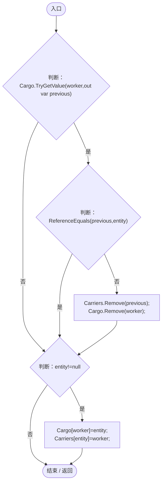

## TrackTarget · L23

`private static void TrackTarget(AntColonyMember worker)`

### Editor / Player · Roslyn编译器控制流

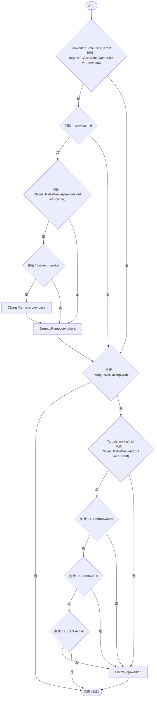

项目内调用/回调引用：

- [AntColonyMember.State.get · L27](baebd85c05598377.md#mc8282e8cc823ceeb)（访问器）

## Claimed · L30

`private static bool Claimed(DarwinEntity entity,AntColonyMember worker)`

### Editor / Player · Roslyn编译器控制流

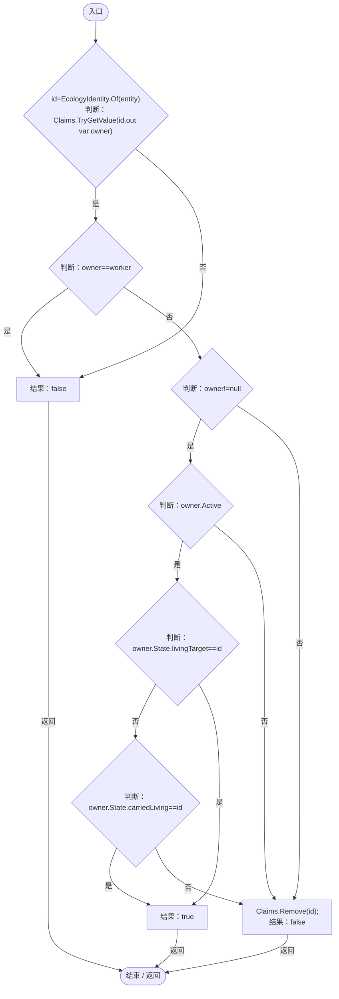

项目内调用/回调引用：

- [EcologyIdentity.Of · L21](bdf7ccc2c9c0452f.md#m1143cf9570a93b72)（方法）
- [AntColonyMember.State.get · L27](baebd85c05598377.md#mc8282e8cc823ceeb)（访问器）

## Valid · L38

`private static bool Valid(DarwinEntity entity,AntColonyMember worker)`

★ 适配：体内隐藏的寄生幼体不是可搬运植株；不能把被宿主带到附近的幼体当作零速食物。

### Editor / Player · Roslyn编译器控制流

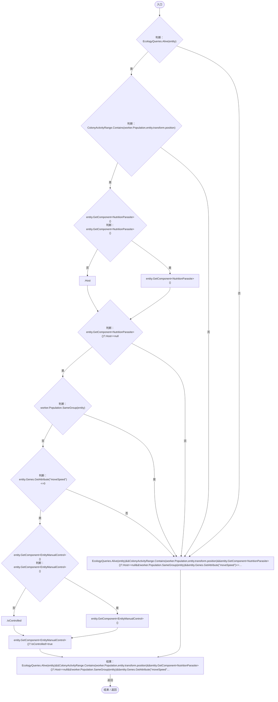

项目内调用/回调引用：

- [EcologyQueries.Alive · L38](bdf7ccc2c9c0452f.md#mb2877c487f449970)（方法）
- [ColonyActivityRange.Contains · L33](e8d854132f563257.md#m9ee9b6f17791cff5)（方法）
- [AntColonyMember.Population.get · L30](baebd85c05598377.md#m688c2c0dfb5a66d6)（访问器）
- [NutritionParasite.Host.get · L19](4a18785b7c1e1484.md#me3131db9b6e16399)（访问器）
- [PopulationBehavior.SameGroup · L123](21e4f62f75a9a80f.md#m7a9d850e1d8967d4)（方法）
- [EntityGeneController.GetAttribute · L257](7494d53178552f0e.md#m600509f72d274f0c)（方法）
- [DarwinEntity.Genes.get · L14](70798dde169f2e8b.md#m622eb1adf401d431)（访问器）
- [EntityManualControl.IsControlled.get · L12](a6969896da35e1f0.md#m125d8f7da7ab33bf)（访问器）

## Advance · L39

`public static void Advance(AntColonyMember worker,float dt)`

### Editor / Player · Roslyn编译器控制流

```mermaid
flowchart TD
  b0(["入口"])
  b1{"state=worker.State<br/>settings=AntColonySettings.Current<br/>carried=ColonyResource.Find(state.carriedResource)<br/>live=Entity(state.carriedLiving)<br/>TrackTarget(worker);<br/>TrackCargo(worker,live);<br/>判断：carried!=null"}
  b2{"判断：live!=null"}
  b3{"worker.Activity=ColonyActivity.Transport;<br/>held=worker.transform.position+EcologyQueries.Up(worker.transform.position)*settings.transportOffset<br/>判断：carried!=null"}
  b4["carried.CarryTo(held);"]
  b5{"判断：live!=null"}
  b6["live.transform.position=held;<br/>EntityNeighborhood.ObservePosition(live.Genes);"]
  b7{"判断：ColonyFeeding.Destination(worker,out _)"}
  b8{"判断：state.deliveryNursery"}
  b9{"判断：worker.Queen!=null"}
  b10["state.deliveryPoint=EcologyQueries.ToLocal(worker.Queen.transform.position);"]
  b11{"destination=EcologyQueries.ToWorld(state.deliveryPoint)<br/>判断：EcologyQueries.Distance(worker.transform.position,destination)&gt;settings.arrivalDistance"}
  b12{"判断：carried!=null"}
  b13["carried.State.energy"]
  b14["ColonyResource.Biomass(live)"]
  b15["energy=carried!=null?carried.State.energy:ColonyResource.Biomass(live)"]
  b16{"判断：carried!=null"}
  b17["carried.Remove();"]
  b18{"判断：live!=null"}
  b19["live.gameObject.SetActive(false);<br/>Object.Destroy(live.gameObject);"]
  b20["ColonyResource.Convert(worker.GroupId,destination,energy,state.deliveryNursery);<br/>state.carriedResource=state.carriedLiving=state.resourceTarget=state.livingTarget=null;<br/>TrackCargo(worker,null);<br/>TrackTarget(worker);"]
  b21{"state.carriedResource=state.carriedLiving=null;<br/>判断：ColonyFeeding.Destination(worker,out _)"}
  b22{"resource=ColonyResource.Find(state.resourceTarget)<br/>plant=Entity(state.livingTarget)<br/>判断：resource!=null"}
  b23{"判断：ColonyActivityRange.Contains(worker.Population,resource.transform.position)"}
  b24{"判断：resource.Claim(worker)"}
  b25["resource.Release(worker.Id);<br/>state.resourceTarget=null;<br/>resource=null;"]
  b26{"判断：plant!=null"}
  b27{"判断：Valid(plant,worker)"}
  b28{"判断：Claimed(plant,worker)"}
  b29["state.livingTarget=null;<br/>plant=null;"]
  b30{"判断：resource==null"}
  b31{"判断：plant==null"}
  b32{"判断：state.scan&lt;=0"}
  b33["state.scan=settings.scanInterval;"]
  b34["ColonyResource.All.Where(r=&gt;ColonyCorpseAccess.Available(r,worker)&amp;&amp;ColonyActivityRange.Contains(worker.Population,r.transform.position)&amp;&amp;EcologyQueries.Distance(worker.transform.position,r.transform.position)&lt;=settings.transportSearchRa…"]
  b35{"判断：ColonyResource.All.Where(r=&gt;ColonyCorpseAccess.Available(r,worker)&amp;&amp;ColonyActivityRange.Contains(worker.Population,r.transform.position)&amp;&amp;EcologyQueries.Distance(worker.transform.position,r.transform.position)&lt;=settings.transportSearc…"}
  b36{"var<br/>判断：body.Claim(worker)"}
  b37["resource=body;<br/>state.resourceTarget=body.State.id;"]
  b38{"判断：ColonyResource.All.Where(r=&gt;ColonyCorpseAccess.Available(r,worker)&amp;&amp;ColonyActivityRange.Contains(worker.Population,r.transform.position)&amp;&amp;EcologyQueries.Distance(worker.transform.position,r.transform.position)&lt;=settings.transportSearc…"}
  b39["ColonyResource.All.Where(r=&gt;ColonyCorpseAccess.Available(r,worker)&amp;&amp;ColonyActivityRange.Contains(worker.Population,r.transform.position)&amp;&amp;EcologyQueries.Distance(worker.transform.position,r.transform.position)&lt;=settings.transportSearchRa…"]
  b40["连接 / 离开区域"]
  b41{"判断：resource==null"}
  b42["plant=EntityRegistry.All.Where(e=&gt;(e.transform.position-worker.transform.position).sqrMagnitude&lt;=settings.transportSearchRadius*settings.transportSearchRadius&amp;&amp;Valid(e,worker)&amp;&amp;!Claimed(e,worker)&amp;&amp;EcologyQueries.Distance(worker.transform…"]
  b43{"state.livingTarget<br/>判断：plant!=null"}
  b44["EcologyIdentity.Of(plant)"]
  b45["null"]
  b46["state.livingTarget=plant!=null?EcologyIdentity.Of(plant):null;"]
  b47["TrackTarget(worker);"]
  b48{"判断：resource==null"}
  b49{"判断：plant==null"}
  b50["worker.Activity=ColonyActivity.Rest;"]
  b51["worker.Activity=ColonyActivity.Collect;"]
  b52{"判断：resource!=null"}
  b53["resource.transform.position"]
  b54["plant.transform.position"]
  b55["point=resource!=null?resource.transform.position:plant.transform.position"]
  b56{"判断：EcologyQueries.Distance(worker.transform.position,point)&gt;settings.transportReach"}
  b57{"判断：resource!=null"}
  b58["state.carriedResource=resource.State.id;"]
  b59{"state.carriedLiving=EcologyIdentity.Of(plant);<br/>body=plant.GetComponent&lt;Rigidbody&gt;()<br/>TrackCargo(worker,plant);<br/>判断：body!=null"}
  b60{"state.originalKinematic=body.isKinematic;<br/>state.originalDetect=body.detectCollisions;<br/>判断：body.isKinematic"}
  b61["body.linearVelocity=Vector3.zero;"]
  b62["body.isKinematic=true;<br/>body.detectCollisions=false;"]
  b63{"queen=worker.Queen<br/>state.deliveryNursery=UnityEngine.Random.value&lt;settings.nurseryDeliveryFraction;<br/>判断：queen==null"}
  b64["state.deliveryPoint=EcologyQueries.ToLocal(worker.Center);<br/>state.deliveryNursery=true;"]
  b65{"queen.EnsureSupplyPoints();<br/>判断：ColonyResource.All.Any(r=&gt;r.State.group==worker.GroupId&amp;&amp;r.State.kind==ColonyResourceKind.Nursery)"}
  b66["state.deliveryNursery=true;"]
  b67{"判断：ColonyResource.All.Any(r=&gt;r.State.group==worker.GroupId&amp;&amp;r.State.kind==ColonyResourceKind.Supply)"}
  b68["state.deliveryNursery=false;"]
  b69{"判断：state.deliveryNursery"}
  b70["state.deliveryPoint=EcologyQueries.ToLocal(queen.transform.position);"]
  b71{"判断：queen.State.supplyPoints.Count&gt;=settings.supplyPointCount"}
  b72["state.deliveryPoint=queen.State.supplyPoints[UnityEngine.Random.Range(0,queen.State.supplyPoints.Count)];"]
  b73["tangent=Vector3.ProjectOnPlane(UnityEngine.Random.onUnitSphere,EcologyQueries.Up(queen.transform.position)).normalized<br/>state.deliveryPoint=EcologyQueries.ToLocal(EcologyQueries.Surface(queen.transform.position+tangent*UnityEngine.Random.…"]
  b74(["结束 / 返回"])
  b0 --> b1
  b1 -->|"否"| b2
  b1 -->|"是"| b3
  b2 -->|"是"| b3
  b2 -->|"否"| b21
  b3 -->|"是"| b4
  b3 -->|"否"| b5
  b4 --> b5
  b5 -->|"是"| b6
  b5 -->|"否"| b7
  b6 --> b7
  b7 -->|"是"| b74
  b7 -->|"否"| b8
  b8 -->|"是"| b9
  b8 -->|"否"| b11
  b9 -->|"是"| b10
  b9 -->|"否"| b11
  b10 --> b11
  b11 -->|"是"| b74
  b11 -->|"否"| b12
  b12 -->|"是"| b13
  b12 -->|"否"| b14
  b13 --> b15
  b14 --> b15
  b15 --> b16
  b16 -->|"是"| b17
  b16 -->|"否"| b18
  b17 --> b18
  b18 -->|"是"| b19
  b18 -->|"否"| b20
  b19 --> b20
  b20 --> b74
  b21 -->|"是"| b74
  b21 -->|"否"| b22
  b22 -->|"是"| b23
  b22 -->|"否"| b26
  b23 -->|"是"| b24
  b23 -->|"否"| b25
  b24 -->|"否"| b25
  b24 -->|"是"| b26
  b25 --> b26
  b26 -->|"是"| b27
  b26 -->|"否"| b30
  b27 -->|"是"| b28
  b27 -->|"否"| b29
  b28 -->|"是"| b29
  b28 -->|"否"| b30
  b29 --> b30
  b30 -->|"是"| b31
  b30 -->|"否"| b48
  b31 -->|"是"| b32
  b31 -->|"否"| b48
  b32 -->|"是"| b33
  b32 -->|"否"| b48
  b33 --> b34
  b34 --> b35
  b35 -->|"是"| b36
  b35 -->|"否 · 经过finally 38"| b41
  b36 -->|"是"| b37
  b36 -->|"否"| b35
  b37 -->|"经过finally 38"| b41
  b38 -->|"否"| b39
  b38 -->|"是"| b40
  b39 --> b40
  b41 -->|"是"| b42
  b41 -->|"否"| b48
  b42 --> b43
  b43 -->|"是"| b44
  b43 -->|"否"| b45
  b44 --> b46
  b45 --> b46
  b46 --> b47
  b47 --> b48
  b48 -->|"是"| b49
  b48 -->|"否"| b51
  b49 -->|"是"| b50
  b49 -->|"否"| b51
  b50 --> b74
  b51 --> b52
  b52 -->|"是"| b53
  b52 -->|"否"| b54
  b53 --> b55
  b54 --> b55
  b55 --> b56
  b56 -->|"是"| b74
  b56 -->|"否"| b57
  b57 -->|"是"| b58
  b57 -->|"否"| b59
  b58 --> b63
  b59 -->|"是"| b60
  b59 -->|"否"| b63
  b60 -->|"否"| b61
  b60 -->|"是"| b62
  b61 --> b62
  b62 --> b63
  b63 -->|"是"| b64
  b63 -->|"否"| b65
  b64 --> b74
  b65 -->|"否"| b66
  b65 -->|"是"| b67
  b66 --> b69
  b67 -->|"否"| b68
  b67 -->|"是"| b69
  b68 --> b69
  b69 -->|"是"| b70
  b69 -->|"否"| b71
  b70 --> b74
  b71 -->|"是"| b72
  b71 -->|"否"| b73
  b72 --> b74
  b73 --> b74
  b35 -. "退出保护区时 finally（示意）" .-> b38

```

项目内调用/回调引用：

- [AntColonyMember.State.get · L27](baebd85c05598377.md#mc8282e8cc823ceeb)（访问器）
- [AntColonySettings.Current.get · L31](cb0a937e97c8fbb3.md#mcd121159f407ccdf)（访问器）
- [ColonyResource.Find · L26](293dbaecfff4b585.md#m8e52e678f4038a50)（方法）
- [AntColonyWorker.Entity · L15](8a0cca2020271b6f.md#m38d9e1a8fb1776ea)（方法）
- [AntColonyWorker.TrackTarget · L23](8a0cca2020271b6f.md#m7153c251ef7e4992)（方法）
- [AntColonyWorker.TrackCargo · L17](8a0cca2020271b6f.md#md6550af24e4e765e)（方法）
- [AntColonyMember.Activity.set · L43](baebd85c05598377.md#m8a34eff66ccac9e4)（访问器）
- [EcologyQueries.Up · L41](bdf7ccc2c9c0452f.md#maca7070196f125fd)（方法）
- [ColonyResource.CarryTo · L77](293dbaecfff4b585.md#mf1b53d872114d3a5)（方法）
- [EntityNeighborhood.ObservePosition · L63](e5e24c4aff0395b1.md#m994f4a7ab30bcd1d)（方法）
- [DarwinEntity.Genes.get · L14](70798dde169f2e8b.md#m622eb1adf401d431)（访问器）
- [ColonyFeeding.Destination · L41](2cb56c08d08ff8ec.md#m9eaa68b3dda17a5d)（方法）
- [EcologyQueries.ToLocal · L39](bdf7ccc2c9c0452f.md#m1a07639eacf3aa47)（方法）
- [EcologyQueries.ToWorld · L40](bdf7ccc2c9c0452f.md#m320932c05ccecbf7)（方法）
- [EcologyQueries.Distance · L42](bdf7ccc2c9c0452f.md#mba9c3e3c95d0f2dd)（方法）
- [ColonyResource.State.get · L22](293dbaecfff4b585.md#m341a1355f4d657bf)（访问器）
- [ColonyResource.Biomass · L30](293dbaecfff4b585.md#m98b1ac7eb3c22aaf)（方法）
- [ColonyResource.Remove · L99](293dbaecfff4b585.md#m3e346b425034ee3a)（方法）
- [ColonyResource.Convert · L78](293dbaecfff4b585.md#m91c734732ae2bc49)（方法）
- [ColonyActivityRange.Contains · L33](e8d854132f563257.md#m9ee9b6f17791cff5)（方法）
- [AntColonyMember.Population.get · L30](baebd85c05598377.md#m688c2c0dfb5a66d6)（访问器）
- [ColonyResource.Claim · L65](293dbaecfff4b585.md#mdee42e4bd6fb5563)（方法）
- [ColonyResource.Release · L76](293dbaecfff4b585.md#m8e4d3a531b8701e8)（方法）
- [AntColonyWorker.Valid · L38](8a0cca2020271b6f.md#m91b2699c5caf6855)（方法）
- [AntColonyWorker.Claimed · L30](8a0cca2020271b6f.md#m6b63c201bb21db75)（方法）
- [EcologyIdentity.Of · L21](bdf7ccc2c9c0452f.md#m1143cf9570a93b72)（方法）
- [AntColonyMember.Center.get · L40](baebd85c05598377.md#m0295e0f1ea7ab95c)（访问器）
- [AntColonyMember.EnsureSupplyPoints · L157](baebd85c05598377.md#meac391c25479ba7e)（方法）
- [EcologyQueries.Surface · L47](bdf7ccc2c9c0452f.md#m2f1f6873ee5fc8df)（方法）
- [AntColonyWorker.回调@74 · L74](8a0cca2020271b6f.md#mfb040a79d6257713)（回调/委托）
- [AntColonyWorker.回调@74 · L74](8a0cca2020271b6f.md#me1ae648536d46ead)（回调/委托）
- [AntColonyWorker.回调@79 · L79](8a0cca2020271b6f.md#m3852575581bd2253)（回调/委托）
- [AntColonyWorker.回调@79 · L79](8a0cca2020271b6f.md#m5f3ba49d04881b01)（回调/委托）
- [AntColonyWorker.回调@102 · L102](8a0cca2020271b6f.md#m0de85eca69805def)（回调/委托）
- [AntColonyWorker.回调@103 · L103](8a0cca2020271b6f.md#md570af9a49943866)（回调/委托）

## 回调@74 · L74

`r … => 回调`

### Editor / Player · Roslyn编译器控制流

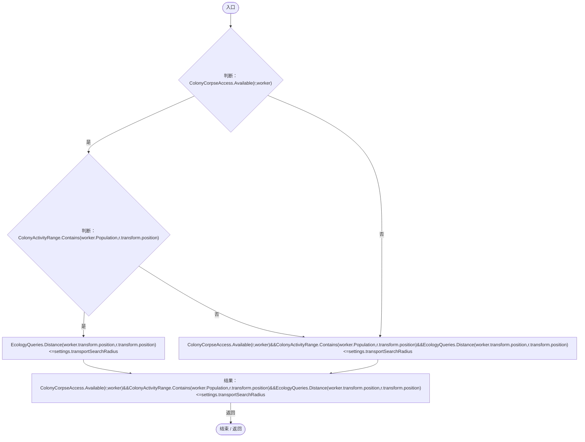

项目内调用/回调引用：

- [ColonyCorpseAccess.Available · L6](f6ef68cc68f39eea.md#m8ffa84bc06beaed6)（方法）
- [ColonyActivityRange.Contains · L33](e8d854132f563257.md#m9ee9b6f17791cff5)（方法）
- [AntColonyMember.Population.get · L30](baebd85c05598377.md#m688c2c0dfb5a66d6)（访问器）
- [EcologyQueries.Distance · L42](bdf7ccc2c9c0452f.md#mba9c3e3c95d0f2dd)（方法）

## 回调@74 · L74

`r … => 回调`

### Editor / Player · Roslyn编译器控制流

## 回调@79 · L79

`e … => 回调`

### Editor / Player · Roslyn编译器控制流

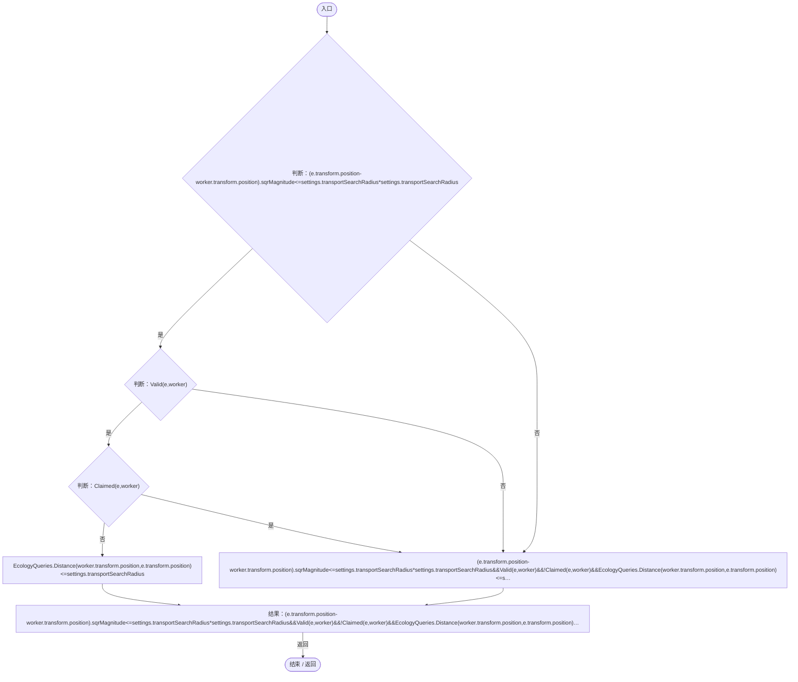

项目内调用/回调引用：

- [AntColonyWorker.Valid · L38](8a0cca2020271b6f.md#m91b2699c5caf6855)（方法）
- [AntColonyWorker.Claimed · L30](8a0cca2020271b6f.md#m6b63c201bb21db75)（方法）
- [EcologyQueries.Distance · L42](bdf7ccc2c9c0452f.md#mba9c3e3c95d0f2dd)（方法）

## 回调@79 · L79

`e … => 回调`

### Editor / Player · Roslyn编译器控制流

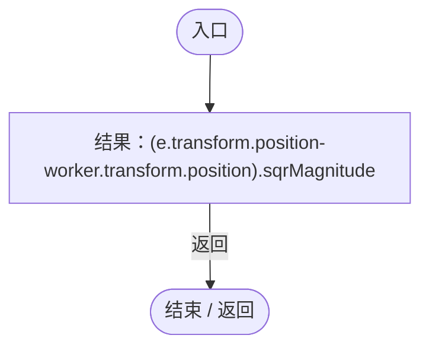

## 回调@102 · L102

`r … => 回调`

### Editor / Player · Roslyn编译器控制流

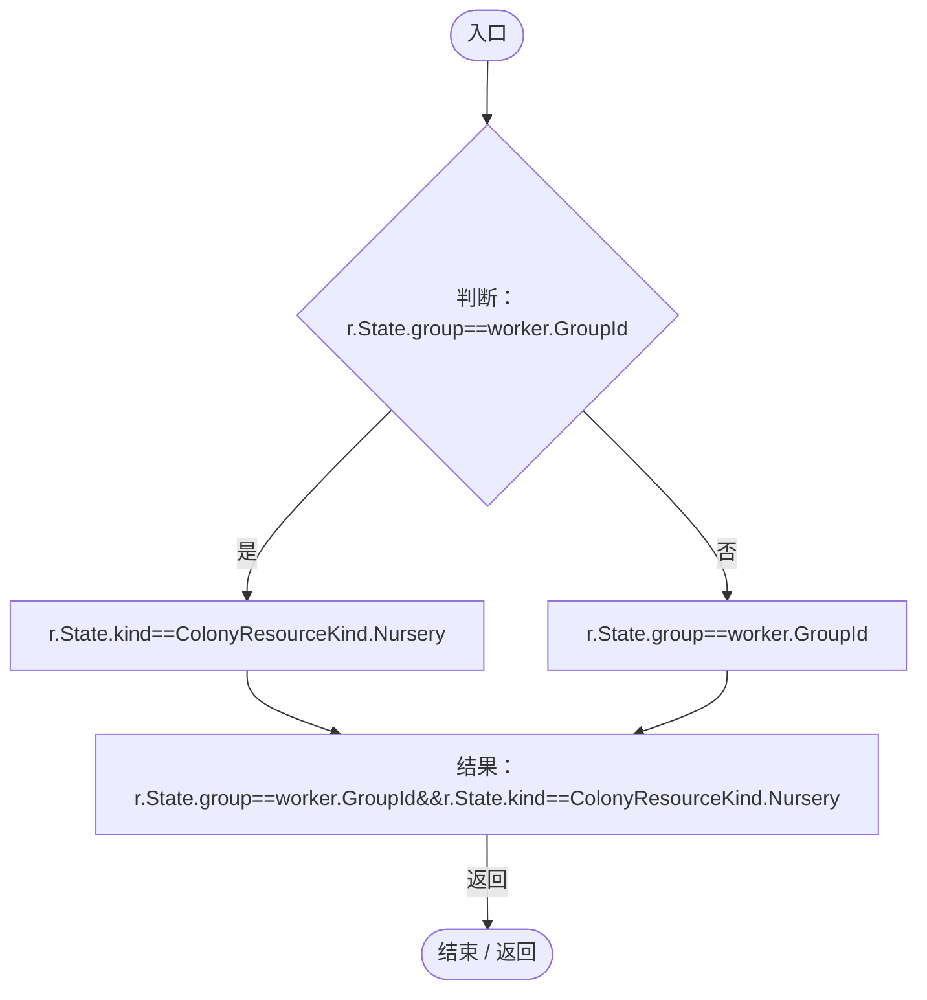

项目内调用/回调引用：

- [ColonyResource.State.get · L22](293dbaecfff4b585.md#m341a1355f4d657bf)（访问器）

## 回调@103 · L103

`r … => 回调`

### Editor / Player · Roslyn编译器控制流

项目内调用/回调引用：

- [ColonyResource.State.get · L22](293dbaecfff4b585.md#m341a1355f4d657bf)（访问器）

## Destination · L114

`public static Vector3 Destination(AntColonyMember worker)`

### Editor / Player · Roslyn编译器控制流

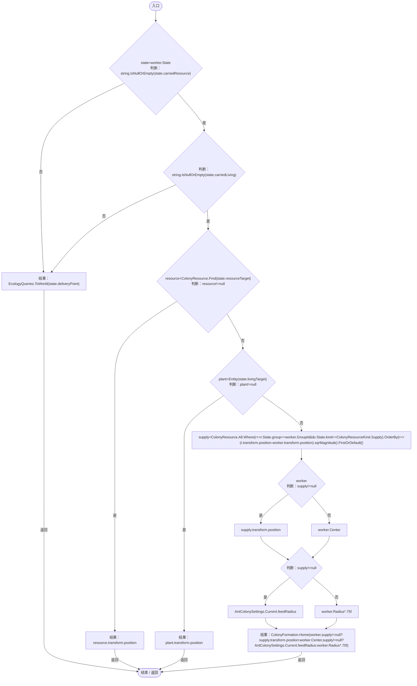

项目内调用/回调引用：

- [AntColonyMember.State.get · L27](baebd85c05598377.md#mc8282e8cc823ceeb)（访问器）
- [EcologyQueries.ToWorld · L40](bdf7ccc2c9c0452f.md#m320932c05ccecbf7)（方法）
- [ColonyResource.Find · L26](293dbaecfff4b585.md#m8e52e678f4038a50)（方法）
- [AntColonyWorker.Entity · L15](8a0cca2020271b6f.md#m38d9e1a8fb1776ea)（方法）
- [ColonyFormation.Home · L36](c65dce2d54e43480.md#m79ad3420baeaf49d)（方法）
- [AntColonyMember.Center.get · L40](baebd85c05598377.md#m0295e0f1ea7ab95c)（访问器）
- [AntColonySettings.Current.get · L31](cb0a937e97c8fbb3.md#mcd121159f407ccdf)（访问器）
- [AntColonyWorker.回调@121 · L121](8a0cca2020271b6f.md#md8c5f51cf6ecd5df)（回调/委托）
- [AntColonyWorker.回调@121 · L121](8a0cca2020271b6f.md#mb8d4bb8218958c8a)（回调/委托）

## 回调@121 · L121

`r … => 回调`

### Editor / Player · Roslyn编译器控制流

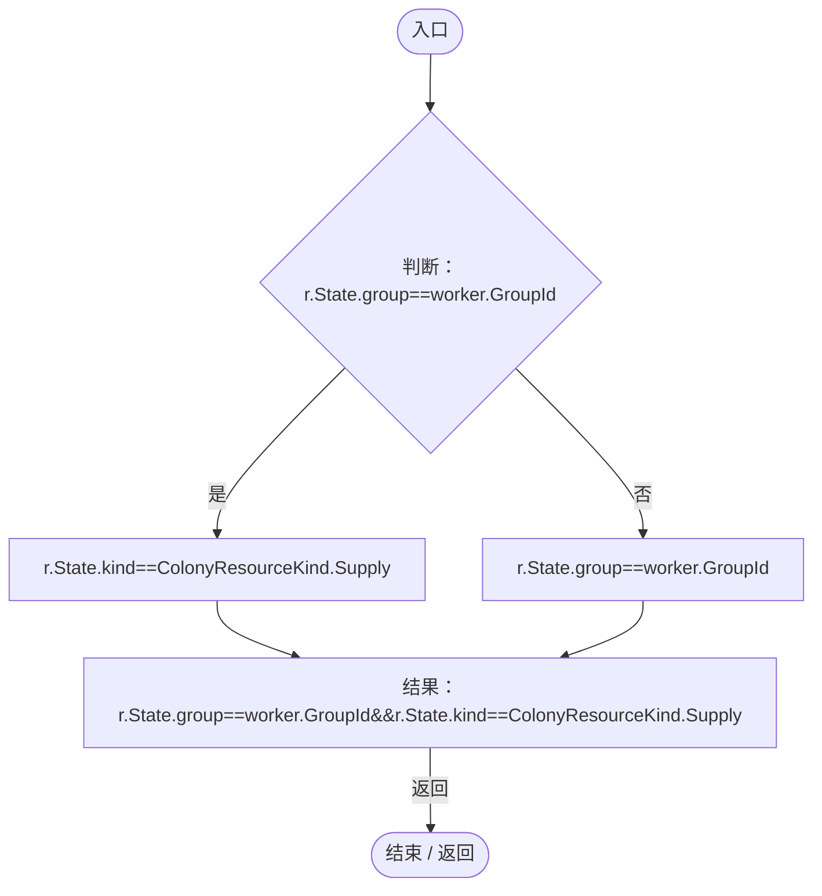

项目内调用/回调引用：

- [ColonyResource.State.get · L22](293dbaecfff4b585.md#m341a1355f4d657bf)（访问器）

## 回调@121 · L121

`r … => 回调`

### Editor / Player · Roslyn编译器控制流

## Release · L125

`public static void Release(AntColonyMember worker)`

### Editor / Player · Roslyn编译器控制流

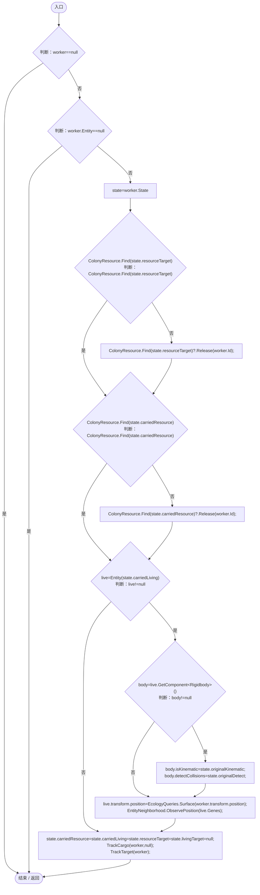

项目内调用/回调引用：

- [AntColonyMember.Entity.get · L29](baebd85c05598377.md#m4a0664814e72f13c)（访问器）
- [AntColonyMember.State.get · L27](baebd85c05598377.md#mc8282e8cc823ceeb)（访问器）
- [ColonyResource.Find · L26](293dbaecfff4b585.md#m8e52e678f4038a50)（方法）
- [ColonyResource.Release · L76](293dbaecfff4b585.md#m8e4d3a531b8701e8)（方法）
- [AntColonyWorker.Entity · L15](8a0cca2020271b6f.md#m38d9e1a8fb1776ea)（方法）
- [EcologyQueries.Surface · L47](bdf7ccc2c9c0452f.md#m2f1f6873ee5fc8df)（方法）
- [EntityNeighborhood.ObservePosition · L63](e5e24c4aff0395b1.md#m994f4a7ab30bcd1d)（方法）
- [DarwinEntity.Genes.get · L14](70798dde169f2e8b.md#m622eb1adf401d431)（访问器）
- [AntColonyWorker.TrackCargo · L17](8a0cca2020271b6f.md#md6550af24e4e765e)（方法）
- [AntColonyWorker.TrackTarget · L23](8a0cca2020271b6f.md#m7153c251ef7e4992)（方法）

## Resolve · L135

`public static void Resolve(AntColonyMember worker)`

### Editor / Player · Roslyn编译器控制流

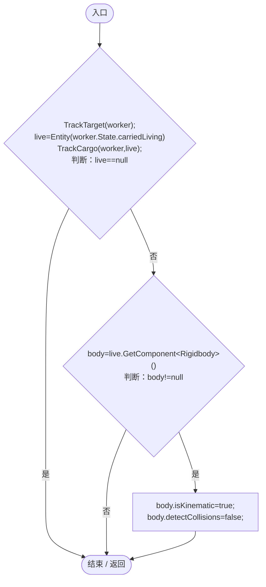

项目内调用/回调引用：

- [AntColonyWorker.TrackTarget · L23](8a0cca2020271b6f.md#m7153c251ef7e4992)（方法）
- [AntColonyWorker.Entity · L15](8a0cca2020271b6f.md#m38d9e1a8fb1776ea)（方法）
- [AntColonyMember.State.get · L27](baebd85c05598377.md#mc8282e8cc823ceeb)（访问器）
- [AntColonyWorker.TrackCargo · L17](8a0cca2020271b6f.md#md6550af24e4e765e)（方法）

## IsCarried · L140

`public static bool IsCarried(DarwinEntity entity)`

### Editor / Player · Roslyn编译器控制流

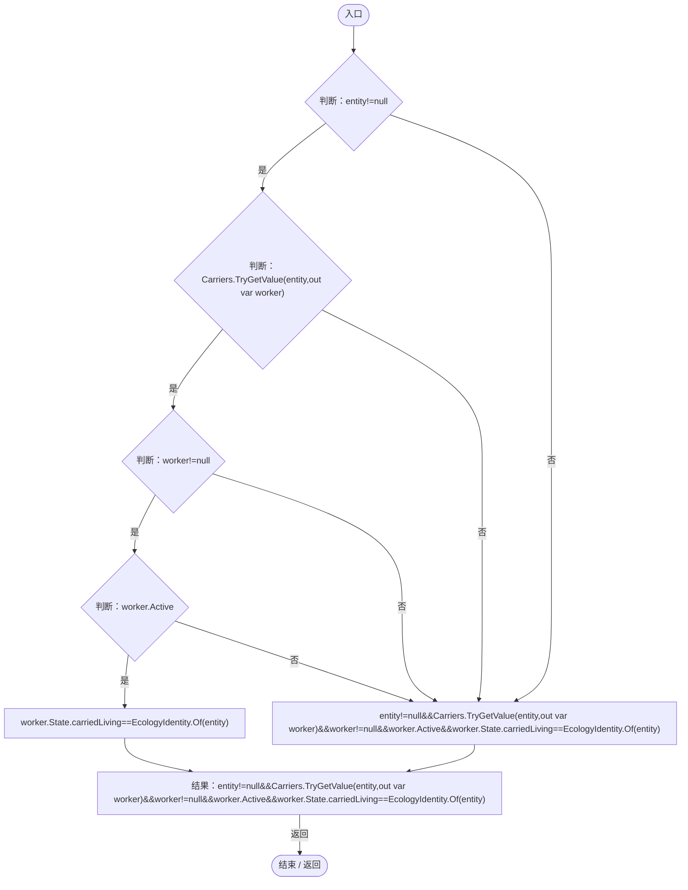

项目内调用/回调引用：

- [AntColonyMember.State.get · L27](baebd85c05598377.md#mc8282e8cc823ceeb)（访问器）
- [EcologyIdentity.Of · L21](bdf7ccc2c9c0452f.md#m1143cf9570a93b72)（方法）
