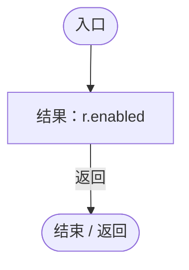
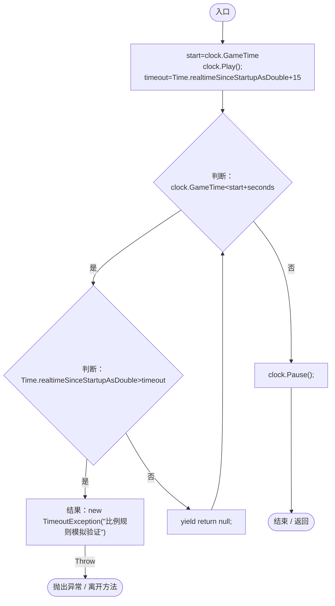
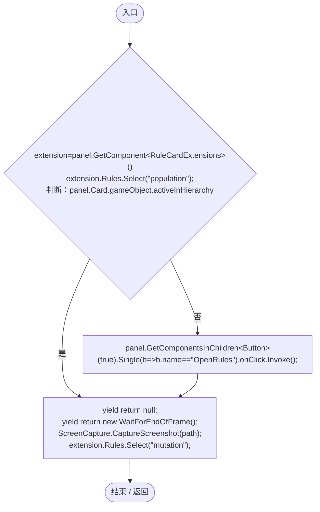
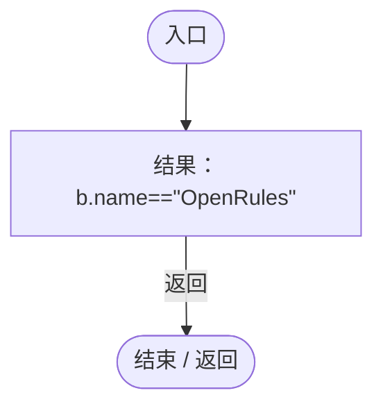

```mermaid
flowchart TD
  b0(["入口"])
  b1{"check<br/>判断：new GameplayTuning().populationRatioControlEnabled"}
  b2["!GameplayTuning.Parse(&quot;{\&quot;version\&quot;:1,\&quot;automaticRefillEnabled\&quot;:true}&quot;).populationRatioControlEnabled"]
  b3["!new GameplayTuning().populationRatioControlEnabled"]
  b4["check(!new GameplayTuning().populationRatioControlEnabled&amp;&amp;!GameplayTuning.Parse(&quot;{\&quot;version\&quot;:1,\&quot;automaticRefillEnabled\&quot;:true}&quot;).populationRatioControlEnabled,&quot;新配置及带旧补员字段的配置均默认关闭比例调节&quot;);"]
  b5["check(!GameplayTuning.Current.populationRatioControlEnabled,&quot;默认外部配置关闭比例调节&quot;);<br/>before=EntityRegistry.All.Count<br/>yield return RunFor(clock,2);"]
  b6{"check<br/>判断：EntityRegistry.All.Count==before"}
  b7{"判断：spawner.IsBusy"}
  b8["PopulationMaintenance.Needed(rule)&gt;0"]
  b9["EntityRegistry.All.Count==before&amp;&amp;!spawner.IsBusy&amp;&amp;PopulationMaintenance.Needed(rule)&gt;0"]
  b10["check(EntityRegistry.All.Count==before&amp;&amp;!spawner.IsBusy&amp;&amp;PopulationMaintenance.Needed(rule)&gt;0,&quot;明显缺额且有旧比例规则，默认运行也不直接补员&quot;);"]
  b11["new PopulationMaintenanceRule{id=Guid.NewGuid().ToString(&quot;N&quot;),ratio=.3f,source=new RandomSpawnRecipe{method=RandomSpawnMethod.Genes,name=&quot;超额营养实体&quot;,included=new(){&quot;gene_nutrition&quot;}}}<br/>id=Guid.NewGuid().ToString(&quot;N&quot;)<br/>ratio=.3f"]
  b12["new RandomSpawnRecipe{method=RandomSpawnMethod.Genes,name=&quot;超额营养实体&quot;,included=new(){&quot;gene_nutrition&quot;}}<br/>method=RandomSpawnMethod.Genes<br/>name=&quot;超额营养实体&quot;"]
  b13["new(){&quot;gene_nutrition&quot;}<br/>&quot;gene_nutrition&quot;<br/>included=new(){&quot;gene_nutrition&quot;}"]
  b14["source=new RandomSpawnRecipe{method=RandomSpawnMethod.Genes,name=&quot;超额营养实体&quot;,included=new(){&quot;gene_nutrition&quot;}}"]
  b15["excess=new PopulationMaintenanceRule{id=Guid.NewGuid().ToString(&quot;N&quot;),ratio=.3f,source=new RandomSpawnRecipe{method=RandomSpawnMethod.Genes,name=&quot;超额营养实体&quot;,included=new(){&quot;gene_nutrition&quot;}}}"]
  b16["check(PopulationMaintenance.Set(excess),&quot;建立真实超额类别作为繁殖调节样本&quot;);<br/>parent=EntityRegistry.All.First()<br/>check(PopulationMaintenance.BreedingScale(parent.Genes)==1,&quot;总规则关闭时不干预超额类别繁殖&quot;);<br/>panel=Object.FindObjectsByType&lt;SimulationRulesPanel&gt;(FindObject…"]
  b17{"check<br/>判断：panel.Card.sizeDelta==new Vector2(260,164)"}
  b18["panel.Card.Find(&quot;MutationEnabled&quot;).GetComponentInChildren&lt;Text&gt;().text.Contains(&quot;关&quot;)"]
  b19["panel.Card.sizeDelta==new Vector2(260,164)"]
  b20["check(panel.Card.sizeDelta==new Vector2(260,164)&amp;&amp;panel.Card.Find(&quot;MutationEnabled&quot;).GetComponentInChildren&lt;Text&gt;().text.Contains(&quot;关&quot;),&quot;比例调节默认显示关闭并保留原卡尺寸&quot;);"]
  b21["toggle=panel.Card.Find(&quot;MutationEnabled&quot;).GetComponent&lt;Button&gt;()<br/>toggle.onClick.Invoke();<br/>check(!GameplayTuning.Current.populationRatioControlEnabled,&quot;修改草稿不立即改变模拟&quot;);<br/>panel.Apply();"]
  b22{"check<br/>判断：GameplayTuning.Current.populationRatioControlEnabled"}
  b23["GameplayTuning.Parse(File.ReadAllText(GameplayTuning.FilePath)).populationRatioControlEnabled"]
  b24["GameplayTuning.Current.populationRatioControlEnabled"]
  b25["check(GameplayTuning.Current.populationRatioControlEnabled&amp;&amp;GameplayTuning.Parse(File.ReadAllText(GameplayTuning.FilePath)).populationRatioControlEnabled,&quot;应用后比例规则同时写盘并生效&quot;);"]
  b26["check(Mathf.Abs(PopulationMaintenance.BreedingScale(parent.Genes)-.3f)&lt;.0001f,&quot;启用后超额类别的真实繁殖速率按比例降低&quot;);<br/>yield return RunFor(clock,2);"]
  b27{"check<br/>判断：EntityRegistry.All.Count==before"}
  b28["!spawner.IsBusy"]
  b29["EntityRegistry.All.Count==before"]
  b30["check(EntityRegistry.All.Count==before&amp;&amp;!spawner.IsBusy,&quot;比例调节开启后依然不直接生成不足类别&quot;);"]
  b31["retired=(bool)typeof(RandomPlanetSpawner).GetMethod(&quot;StartInternal&quot;,System.Reflection.BindingFlags.NonPublic&#124;System.Reflection.BindingFlags.Instance).Invoke(spawner,new object[]{rule.source,3,true,rule})"]
  b32{"check<br/>判断：retired"}
  b33["!spawner.IsBusy"]
  b34["!retired"]
  b35["check(!retired&amp;&amp;!spawner.IsBusy,&quot;退休的自动补员入口无法被旧调用重新启动&quot;);"]
  b36["panel.Reload();<br/>check(panel.Card.Find(&quot;MutationEnabled&quot;).GetComponentInChildren&lt;Text&gt;().text.Contains(&quot;开&quot;),&quot;重新载入后保留比例调节开关&quot;);<br/>toggle.onClick.Invoke();<br/>panel.Apply();"]
  b37{"check<br/>判断：PopulationMaintenance.BreedingScale(parent.Genes)==1"}
  b38["PopulationMaintenance.Rules.Any(r=&gt;r.enabled)"]
  b39["PopulationMaintenance.BreedingScale(parent.Genes)==1"]
  b40["check(PopulationMaintenance.BreedingScale(parent.Genes)==1&amp;&amp;PopulationMaintenance.Rules.Any(r=&gt;r.enabled),&quot;关闭总规则恢复正常繁殖并保留世界的比例配置&quot;);"]
  b41["toggle.onClick.Invoke();<br/>panel.Apply();<br/>PopulationMaintenance.Remove(excess.id);<br/>hundred=JsonUtility.FromJson&lt;PopulationMaintenanceRule&gt;(JsonUtility.ToJson(rule))<br/>hundred.ratio=1;<br/>check(PopulationMaintenance.Set(hundred),&quot;移除直接补员后允许100%目标…"]
  b42{"check<br/>判断：panel.Card.Find(&quot;PeriodUnit&quot;).GetComponent&lt;Text&gt;().text==&quot;游戏天&quot;"}
  b43["float.Parse(panel.Card.Find(&quot;Seconds&quot;).GetComponent&lt;InputField&gt;().text,System.Globalization.CultureInfo.InvariantCulture)==oldMutation/day"]
  b44["panel.Card.Find(&quot;PeriodUnit&quot;).GetComponent&lt;Text&gt;().text==&quot;游戏天&quot;"]
  b45["check(panel.Card.Find(&quot;PeriodUnit&quot;).GetComponent&lt;Text&gt;().text==&quot;游戏天&quot;&amp;&amp;float.Parse(panel.Card.Find(&quot;Seconds&quot;).GetComponent&lt;InputField&gt;().text,System.Globalization.CultureInfo.InvariantCulture)==oldMutation/day,&quot;原模拟秒配置按游戏天显示，旧值不被迁移或重置&quot;);"]
  b46["panel.Card.Find(&quot;Seconds&quot;).GetComponent&lt;InputField&gt;().text=&quot;2.5&quot;;<br/>panel.Apply();<br/>check(GameplayTuning.Current.mutationRoundSeconds==2.5f*day,&quot;游戏天输入准确换算为内部模拟秒并保存&quot;);<br/>extension.Rules.Select(&quot;corpseCleanup&quot;);<br/>panel.Card.Find(&quot;Fraction&quot;).GetC…"]
  b47{"check<br/>判断：GameplayTuning.Current.corpseCleanupSeconds==1.5f*day"}
  b48["GameplayTuning.Current.mutationRoundSeconds==2.5f*day"]
  b49["GameplayTuning.Current.corpseCleanupSeconds==1.5f*day"]
  b50["check(GameplayTuning.Current.corpseCleanupSeconds==1.5f*day&amp;&amp;GameplayTuning.Current.mutationRoundSeconds==2.5f*day,&quot;清尸游戏天独立保存，不覆盖其他规则&quot;);"]
  b51["rejected=false"]
  b52["SimulationTimeHelp.ToSeconds(.001f);"]
  b53["(FormatException error)<br/>rejected=error.Message.Contains(&quot;游戏天&quot;);"]
  b54["check(rejected,&quot;无效周期提示使用界面当前的游戏天单位&quot;);<br/>panel.Card.Find(&quot;Fraction&quot;).GetComponent&lt;InputField&gt;().text=(oldCleanup/day).ToString(&quot;R&quot;,System.Globalization.CultureInfo.InvariantCulture);<br/>panel.Apply();<br/>extension.Rules.Select(&quot;mutation&quot;);<br/>panel.…"]
  b55(["结束 / 返回"])
  b0 --> b1
  b1 -->|"否"| b2
  b1 -->|"是"| b3
  b2 --> b4
  b3 --> b4
  b4 --> b5
  b5 --> b6
  b6 -->|"是"| b7
  b6 -->|"否"| b9
  b7 -->|"否"| b8
  b7 -->|"是"| b9
  b8 --> b10
  b9 --> b10
  b10 --> b11
  b11 --> b12
  b12 --> b13
  b13 --> b14
  b14 --> b15
  b15 --> b16
  b16 --> b17
  b17 -->|"是"| b18
  b17 -->|"否"| b19
  b18 --> b20
  b19 --> b20
  b20 --> b21
  b21 --> b22
  b22 -->|"是"| b23
  b22 -->|"否"| b24
  b23 --> b25
  b24 --> b25
  b25 --> b26
  b26 --> b27
  b27 -->|"是"| b28
  b27 -->|"否"| b29
  b28 --> b30
  b29 --> b30
  b30 --> b31
  b31 --> b32
  b32 -->|"否"| b33
  b32 -->|"是"| b34
  b33 --> b35
  b34 --> b35
  b35 --> b36
  b36 --> b37
  b37 -->|"是"| b38
  b37 -->|"否"| b39
  b38 --> b40
  b39 --> b40
  b40 --> b41
  b41 --> b42
  b42 -->|"是"| b43
  b42 -->|"否"| b44
  b43 --> b45
  b44 --> b45
  b45 --> b46
  b46 --> b47
  b47 -->|"是"| b48
  b47 -->|"否"| b49
  b48 --> b50
  b49 --> b50
  b50 --> b51
  b51 --> b52
  b52 --> b54
  b53 --> b54
  b54 --> b55
  b52 -. "保护区可能异常（示意）" .-> b53

```

# PopulationRatioRuleChecks.cs

[返回总索引](../README.md) · `Editor` · `Assets/DarwinPark/Editor/PopulationRatioRuleChecks.cs`

[源文件](../../../Assets/DarwinPark/Editor/PopulationRatioRuleChecks.cs) · 源码校验：`059832e668d362108090d7483c1823cbf0a2cf40ab6a2530d17159ab82dfa608`

方法按源文件位置排列。事件/回调引用不表示立即执行；分支与异常说明见总索引。完整源码与可点击关系图请打开离线手册。

## Verify · L16

`public static IEnumerator Verify(PopulationMaintenanceRule rule,RandomPlanetSpawner spawner,SimulationClock clock,Action<bool,string> check)`

### Editor · Roslyn编译器控制流

项目内调用/回调引用：

- [GameplayTuning.Parse · L47](db546e5713b32d53.md#ma257d3ec126af87c)（方法）
- [GameplayTuning.Current.get · L46](db546e5713b32d53.md#m4fa691bd8a3b9618)（访问器）
- [PopulationRatioRuleChecks.RunFor · L42](8a1ed94562678893.md#m2f8518b37c18a9d3)（方法）
- [RandomPlanetSpawner.IsBusy.get · L19](1c13222a547b265c.md#mfcbb58f20e164d8c)（访问器）
- [PopulationMaintenance.Needed · L100](923ccc4e86c4786c.md#mdcace1effaa637c5)（方法）
- [PopulationMaintenance.Set · L139](923ccc4e86c4786c.md#m6800c4aec7cf8971)（方法）
- [PopulationMaintenance.BreedingScale · L121](923ccc4e86c4786c.md#m791c153c53c076d4)（方法）
- [DarwinEntity.Genes.get · L14](70798dde169f2e8b.md#m622eb1adf401d431)（访问器）
- [SimulationRuleList.Select · L25](8e0c9b70cd52abbf.md#m93e0ddaa26b331e3)（方法）
- [RuleCardExtensions.Rules.get · L15](92d59cd12a5696c3.md#m82cd86458c20264f)（访问器）
- [SimulationRulesPanel.Apply · L46](dd1021765f4bd253.md#m941ed6e6973ca7d3)（方法）
- [SimulationRulesPanel.Reload · L40](dd1021765f4bd253.md#m05a949ad01c8f870)（方法）
- [PopulationMaintenance.Remove · L145](923ccc4e86c4786c.md#m95f8623404ba6453)（方法）
- [LifeCycleSettings.Load · L16](ace76969fe8f61de.md#m6fe263852e5a8989)（方法）
- [SimulationTimeHelp.ToSeconds · L10](a6e8ca06f4cafa96.md#m7a09fdf6dec870ff)（方法）
- [PopulationRatioRuleChecks.回调@30 · L30](8a1ed94562678893.md#mb7ad73c1e3b0cdb6)（回调/委托）

## 回调@30 · L30

`r … => 回调`

### Editor · Roslyn编译器控制流

## RunFor · L42

`private static IEnumerator RunFor(SimulationClock clock,float seconds)`

### Editor · Roslyn编译器控制流

项目内调用/回调引用：

- [SimulationClock.GameTime.get · L23](a8f444aec9614b0a.md#m74adfa39a896652f)（访问器）
- [SimulationClock.Play · L78](a8f444aec9614b0a.md#m7aa9e64b7de60ed0)（方法）
- [SimulationClock.Pause · L79](a8f444aec9614b0a.md#m30929d45a885d0f1)（方法）

## Capture · L45

`public static IEnumerator Capture(SimulationRulesPanel panel,string path)`

★ 新增：正式大小的规则卡实际显示并截图，避免只检查隐藏控件的尺寸。

### Editor · Roslyn编译器控制流

项目内调用/回调引用：

- [SimulationRuleList.Select · L25](8e0c9b70cd52abbf.md#m93e0ddaa26b331e3)（方法）
- [RuleCardExtensions.Rules.get · L15](92d59cd12a5696c3.md#m82cd86458c20264f)（访问器）
- [PopulationRatioRuleChecks.回调@48 · L48](8a1ed94562678893.md#m8bf41690d287332a)（回调/委托）

## 回调@48 · L48

`b … => 回调`

### Editor · Roslyn编译器控制流

