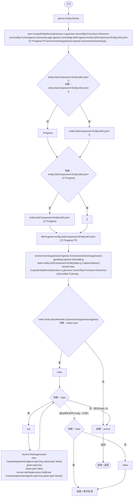
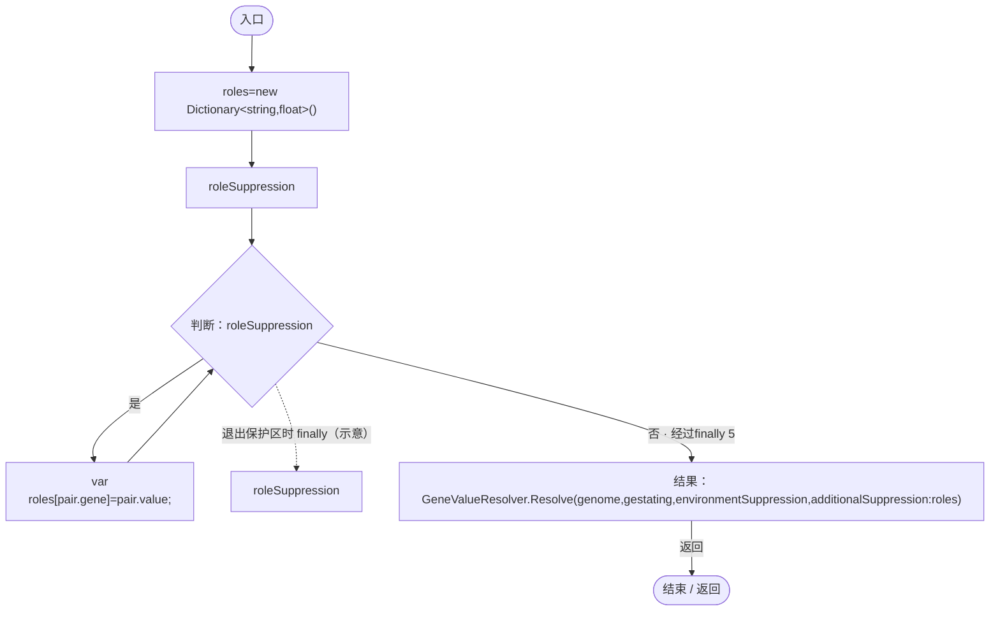
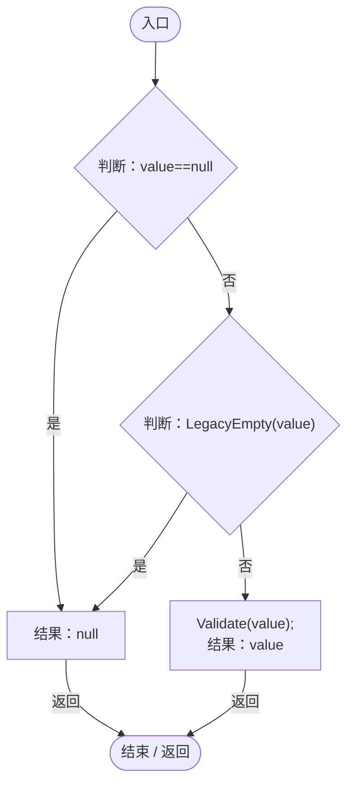
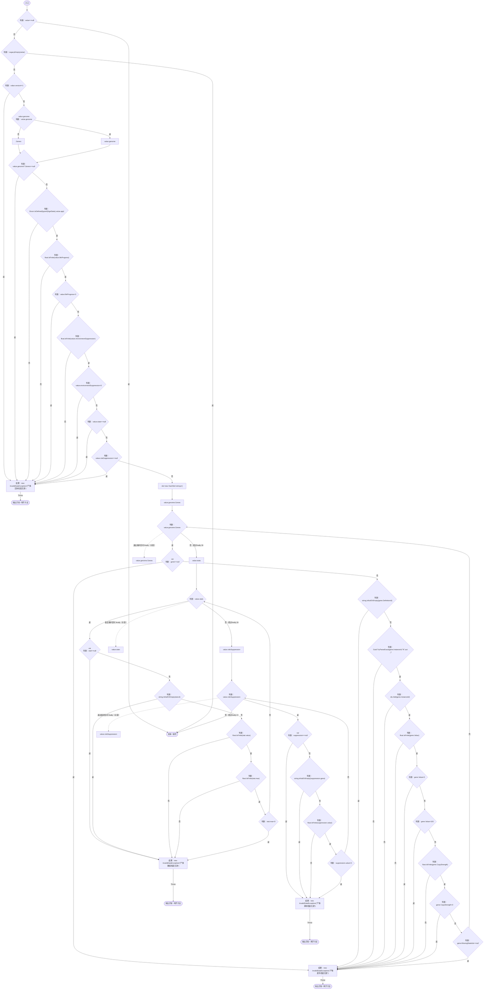

# CorpseEntityRecord.cs

[返回总索引](../README.md) · `Runtime` · `Assets/DarwinPark/Entities/Ecology/CorpseEntityRecord.cs`

[源文件](../../../Assets/DarwinPark/Entities/Ecology/CorpseEntityRecord.cs) · 源码校验：`a6cedf76781ac931ca184c6de95d3d18d5e8153bb0565a7a8888bda83217a391`

方法按源文件位置排列。事件/回调引用不表示立即执行；分支与异常说明见总索引。完整源码与可点击关系图请打开离线手册。

## Capture · L15

`public static CorpseEntityRecord Capture(DarwinEntity entity)`

### Editor / Player · Roslyn编译器控制流

项目内调用/回调引用：

- [DarwinEntity.Genes.get · L14](70798dde169f2e8b.md#m622eb1adf401d431)（访问器）
- [EntityGeneController.CurrentAge.get · L39](7494d53178552f0e.md#m977f52932bb90600)（访问器）
- [EntityLifeCycle.Progress.get · L12](9f4138bfbae654b7.md#md607c90b6934f95f)（访问器）
- [EntityStats.CaptureValues · L89](75aa86a368efdf24.md#m0e1a770efc316d9e)（方法）
- [AntColonyMember.ExpressionSuppression · L186](baebd85c05598377.md#m6cbcee054b6111a9)（方法）

## Evaluate · L20

`public GenomeEvaluation Evaluate()`

### Editor / Player · Roslyn编译器控制流

项目内调用/回调引用：

- [GeneValueResolver.Resolve · L32](837eb9ce6eba3cc6.md#m063abac8252cd4e8)（方法）

## LegacyEmpty · L22

`public static bool LegacyEmpty(CorpseEntityRecord value)`

★ 修复（防Bug回归）：Unity旧档缺少内联对象时可能生成全零空对象，必须与明确的损坏新档区分。

### Editor / Player · Roslyn编译器控制流

```mermaid
flowchart TD
  b0(["入口"])
  b1{"判断：value!=null"}
  b2{"判断：value.version==0"}
  b3{"value.genome<br/>判断：value.genome"}
  b4[".Genes"]
  b5["value.genome"]
  b6{"判断：value.genome?.Genes==null"}
  b7{"判断：value.genome.Genes.Count==0"}
  b8{"判断：value.age==AgeState.Infant"}
  b9{"判断：value.lifeProgress==0"}
  b10{"判断：value.environmentSuppression==0"}
  b11{"判断：value.gestating"}
  b12{"判断：value.stats==null"}
  b13{"判断：value.stats.Count==0"}
  b14{"判断：value.roleSuppression==null"}
  b15["value.roleSuppression.Count==0"]
  b16["value.roleSuppression==null"]
  b17["value!=null&amp;&amp;value.version==0&amp;&amp;(value.genome?.Genes==null&#124;&#124;value.genome.Genes.Count==0)&amp;&amp;value.age==AgeState.Infant&amp;&amp;value.lifeProgress==0&amp;&amp;value.environmentSuppression==0&amp;&amp;!value.gestating&amp;&amp;(value.stats==null&#124;&#124;value.stats.Count==0)&amp;&amp;(va…"]
  b18["结果：value!=null&amp;&amp;value.version==0&amp;&amp;(value.genome?.Genes==null&#124;&#124;value.genome.Genes.Count==0)&amp;&amp;value.age==AgeState.Infant&amp;&amp;value.lifeProgress==0&amp;&amp;value.environmentSuppression==0&amp;&amp;!value.gestating&amp;&amp;(value.stats==null&#124;&#124;value.stats.Count==0)&amp;&amp;…"]
  b19(["结束 / 返回"])
  b0 --> b1
  b1 -->|"是"| b2
  b1 -->|"否"| b17
  b2 -->|"是"| b3
  b2 -->|"否"| b17
  b3 -->|"否"| b4
  b3 -->|"是"| b5
  b4 --> b6
  b5 --> b6
  b6 -->|"否"| b7
  b6 -->|"是"| b8
  b7 -->|"是"| b8
  b7 -->|"否"| b17
  b8 -->|"是"| b9
  b8 -->|"否"| b17
  b9 -->|"是"| b10
  b9 -->|"否"| b17
  b10 -->|"是"| b11
  b10 -->|"否"| b17
  b11 -->|"否"| b12
  b11 -->|"是"| b17
  b12 -->|"否"| b13
  b12 -->|"是"| b14
  b13 -->|"是"| b14
  b13 -->|"否"| b17
  b14 -->|"否"| b15
  b14 -->|"是"| b16
  b15 --> b18
  b16 --> b18
  b17 --> b18
  b18 -->|"返回"| b19

```

## Normalize · L23

`public static CorpseEntityRecord Normalize(CorpseEntityRecord value)`

### Editor / Player · Roslyn编译器控制流

项目内调用/回调引用：

- [CorpseEntityRecord.LegacyEmpty · L22](8a2345f1e54b1c75.md#md68fa808f162efb6)（方法）
- [CorpseEntityRecord.Validate · L24](8a2345f1e54b1c75.md#m7f233f866d12f977)（方法）

## Validate · L24

`public static void Validate(CorpseEntityRecord value)`

### Editor / Player · Roslyn编译器控制流

项目内调用/回调引用：

- [CorpseEntityRecord.LegacyEmpty · L22](8a2345f1e54b1c75.md#md68fa808f162efb6)（方法）
