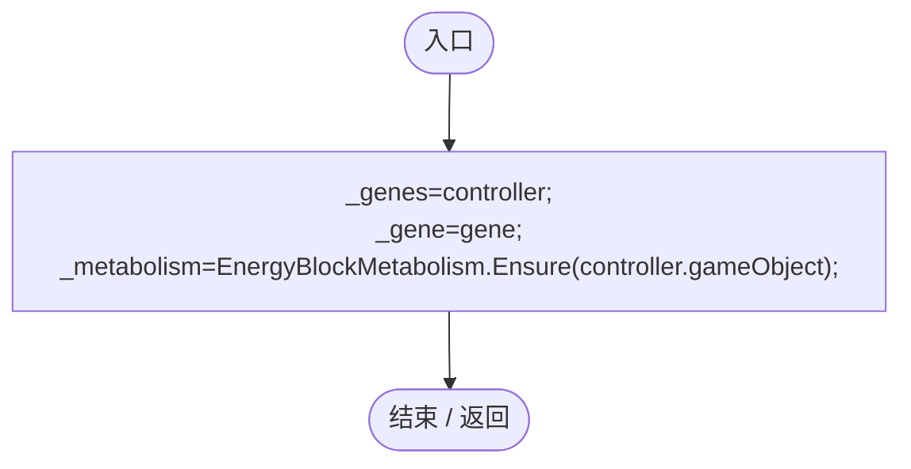
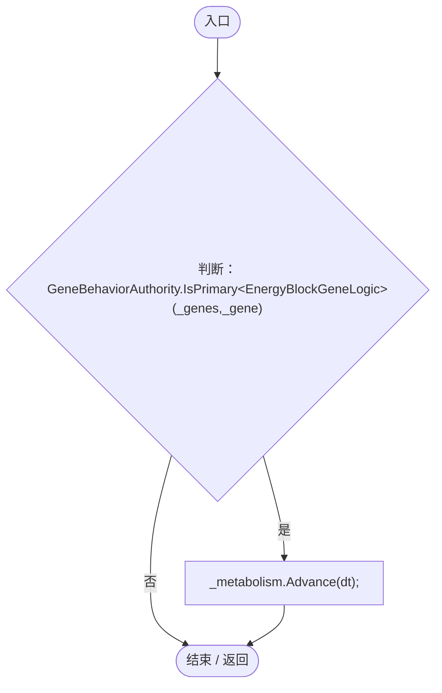
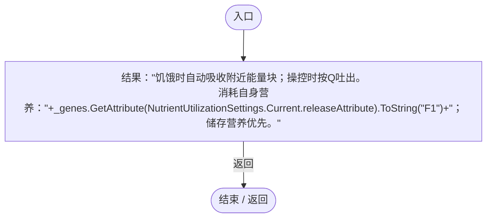

# EnergyBlockGeneLogic.cs

[返回总索引](../README.md) · `Runtime` · `Assets/DarwinPark/Entities/Logic/EnergyBlockGeneLogic.cs`

[源文件](../../../Assets/DarwinPark/Entities/Logic/EnergyBlockGeneLogic.cs) · 源码校验：`a67d633c3af941f98107e10800b8f686504232201eff45092165490ed3f91023`

方法按源文件位置排列。事件/回调引用不表示立即执行；分支与异常说明见总索引。完整源码与可点击关系图请打开离线手册。

## Initialize · L10

`public void Initialize(EntityGeneController controller,GeneInstance gene)`

### Editor / Player · Roslyn编译器控制流

项目内调用/回调引用：

- [EnergyBlockMetabolism.Ensure · L15](123c1bf82bdb8ea2.md#mcf3953011a690ea5)（方法）

## OnUpdate · L12

`public void OnUpdate(float dt)`

### Editor / Player · Roslyn编译器控制流

项目内调用/回调引用：

- [GeneBehaviorAuthority.IsPrimary · L10](be83fa896bbe02ae.md#me2fc1f2e16fcd073)（方法）
- [EnergyBlockMetabolism.Advance · L34](123c1bf82bdb8ea2.md#m23d8a3e49e260c4c)（方法）

## GetTooltipInfo · L13

`public string GetTooltipInfo()`

### Editor / Player · Roslyn编译器控制流

项目内调用/回调引用：

- [EntityGeneController.GetAttribute · L225](7494d53178552f0e.md#mc707943b1138a009)（方法）
- [NutrientUtilizationSettings.Current.get · L17](276bc943280dcfce.md#mfa1e978a0be0644c)（访问器）
