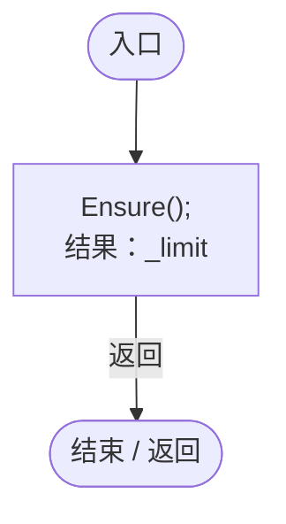
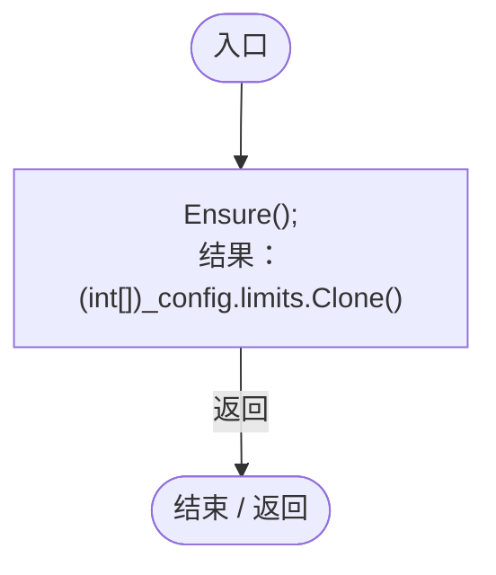
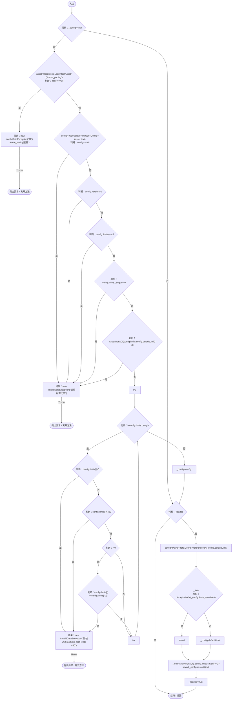
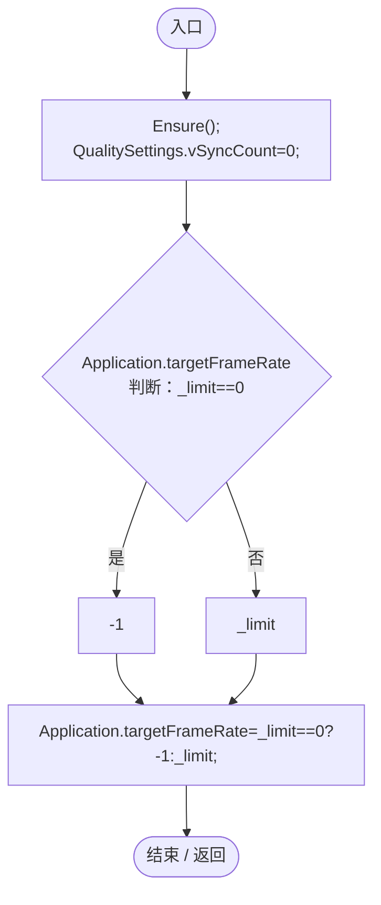
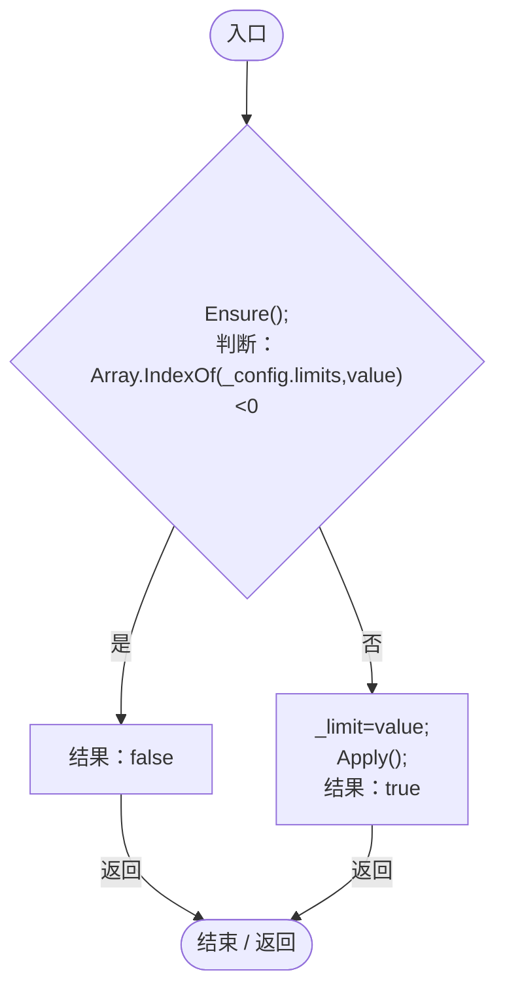
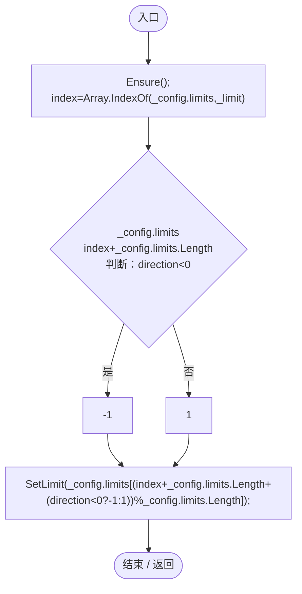
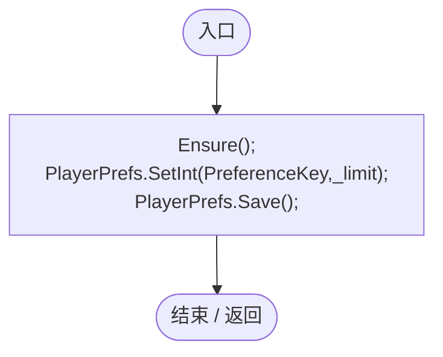
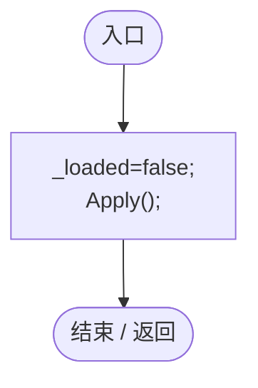
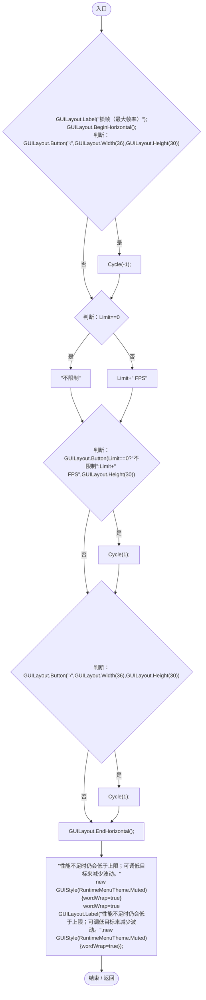
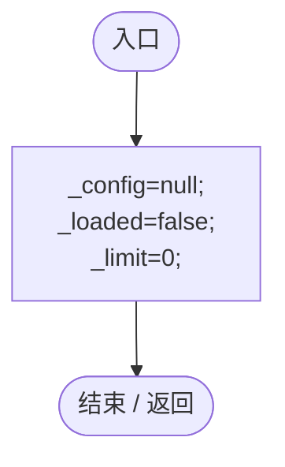

# FramePacingSettings.cs

[返回总索引](../README.md) · `Runtime` · `Assets/DarwinPark/UI/FramePacingSettings.cs`

[源文件](../../../Assets/DarwinPark/UI/FramePacingSettings.cs) · 源码校验：`4c178d0b5bfa583f6211f72604a823ba63695cee3a4d3747df1028a04f3828b5`

方法按源文件位置排列。事件/回调引用不表示立即执行；分支与异常说明见总索引。完整源码与可点击关系图请打开离线手册。

## Limit.get · L11

`get`

### Editor / Player · Roslyn编译器控制流

项目内调用/回调引用：

- [FramePacingSettings.Ensure · L13](8a946f816b77d4b6.md#m184259ec0a61b95a)（方法）

## Choices.get · L12

`get`

### Editor / Player · Roslyn编译器控制流

项目内调用/回调引用：

- [FramePacingSettings.Ensure · L13](8a946f816b77d4b6.md#m184259ec0a61b95a)（方法）

## Ensure · L13

`private static void Ensure()`

### Editor / Player · Roslyn编译器控制流

## Apply · L18

`public static void Apply()`

### Editor / Player · Roslyn编译器控制流

项目内调用/回调引用：

- [FramePacingSettings.Ensure · L13](8a946f816b77d4b6.md#m184259ec0a61b95a)（方法）

## SetLimit · L19

`public static bool SetLimit(int value)`

### Editor / Player · Roslyn编译器控制流

项目内调用/回调引用：

- [FramePacingSettings.Ensure · L13](8a946f816b77d4b6.md#m184259ec0a61b95a)（方法）
- [FramePacingSettings.Apply · L18](8a946f816b77d4b6.md#m4848492bff442d46)（方法）

## Cycle · L20

`public static void Cycle(int direction)`

### Editor / Player · Roslyn编译器控制流

项目内调用/回调引用：

- [FramePacingSettings.Ensure · L13](8a946f816b77d4b6.md#m184259ec0a61b95a)（方法）
- [FramePacingSettings.SetLimit · L19](8a946f816b77d4b6.md#mff17d0cc654b6a7f)（方法）

## Save · L21

`public static void Save()`

### Editor / Player · Roslyn编译器控制流

项目内调用/回调引用：

- [FramePacingSettings.Ensure · L13](8a946f816b77d4b6.md#m184259ec0a61b95a)（方法）

## Reload · L22

`public static void Reload()`

### Editor / Player · Roslyn编译器控制流

项目内调用/回调引用：

- [FramePacingSettings.Apply · L18](8a946f816b77d4b6.md#m4848492bff442d46)（方法）

## Draw · L23

`public static void Draw()`

### Editor / Player · Roslyn编译器控制流

项目内调用/回调引用：

- [FramePacingSettings.Cycle · L20](8a946f816b77d4b6.md#me6b34bfb1718ed1a)（方法）
- [FramePacingSettings.Limit.get · L11](8a946f816b77d4b6.md#m30a0a118e57b6343)（访问器）
- [RuntimeMenuTheme.Muted.get · L13](b9d8455882f2a532.md#meeaba271eb4ad2ed)（访问器）

## Reset · L31

`[RuntimeInitializeOnLoadMethod(RuntimeInitializeLoadType.SubsystemRegistration)]private static void Reset()`

### Editor / Player · Roslyn编译器控制流

