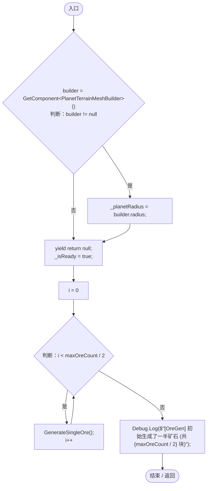
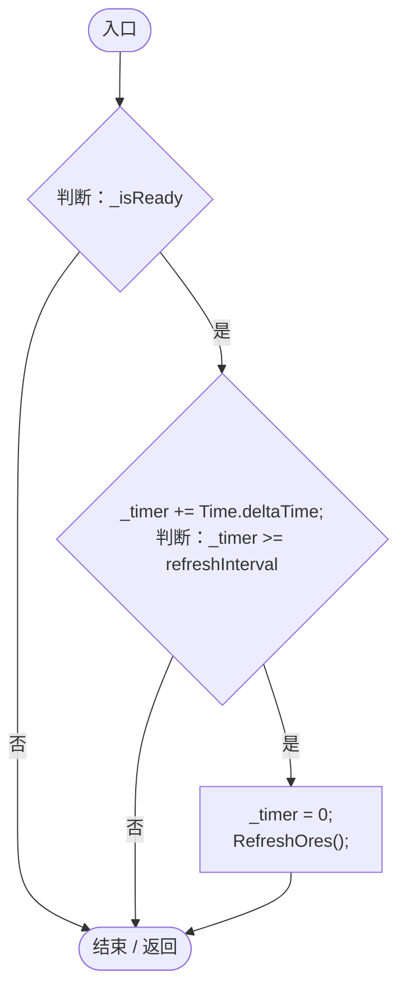
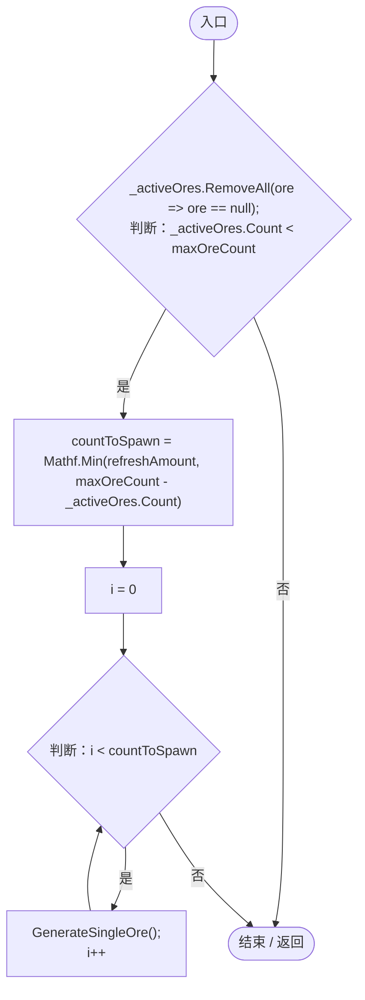
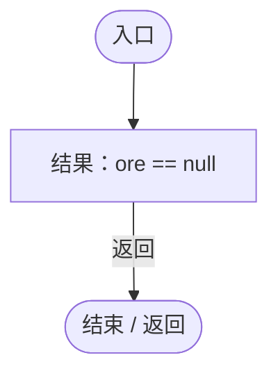
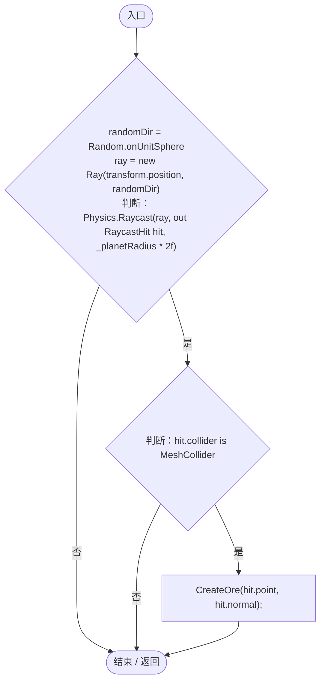
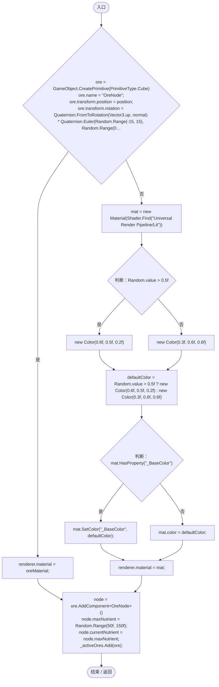

# OreGenerator.cs

[返回总索引](../README.md) · `Runtime` · `Assets/DarwinPark/Planet/OreGenerator.cs`

[源文件](../../../Assets/DarwinPark/Planet/OreGenerator.cs) · 源码校验：`70e316a7a6e122096a2b959dfc1ae4f16f4563d8ae9deb83c9c1b4da29b5adf9`

方法按源文件位置排列。事件/回调引用不表示立即执行；分支与异常说明见总索引。完整源码与可点击关系图请打开离线手册。

## Start · L24

`private IEnumerator Start()`

### Editor / Player · Roslyn编译器控制流

项目内调用/回调引用：

- [OreGenerator.GenerateSingleOre · L66](8b91160d13811390.md#mbdc219ddc5b4fa3f)（方法）

## Update · L40

`private void Update()`

### Editor / Player · Roslyn编译器控制流

项目内调用/回调引用：

- [OreGenerator.RefreshOres · L52](8b91160d13811390.md#mfbd0f0c529c0202b)（方法）

## RefreshOres · L52

`private void RefreshOres()`

### Editor / Player · Roslyn编译器控制流

项目内调用/回调引用：

- [OreGenerator.GenerateSingleOre · L66](8b91160d13811390.md#mbdc219ddc5b4fa3f)（方法）
- [OreGenerator.回调@54 · L54](8b91160d13811390.md#mda11a13c8e59db78)（回调/委托）

## 回调@54 · L54

`ore … => 回调`

### Editor / Player · Roslyn编译器控制流

## GenerateSingleOre · L66

`private void GenerateSingleOre()`

### Editor / Player · Roslyn编译器控制流

项目内调用/回调引用：

- [OreGenerator.CreateOre · L81](8b91160d13811390.md#mecc3cb0eebc0d87b)（方法）

## CreateOre · L81

`private void CreateOre(Vector3 position, Vector3 normal)`

### Editor / Player · Roslyn编译器控制流

