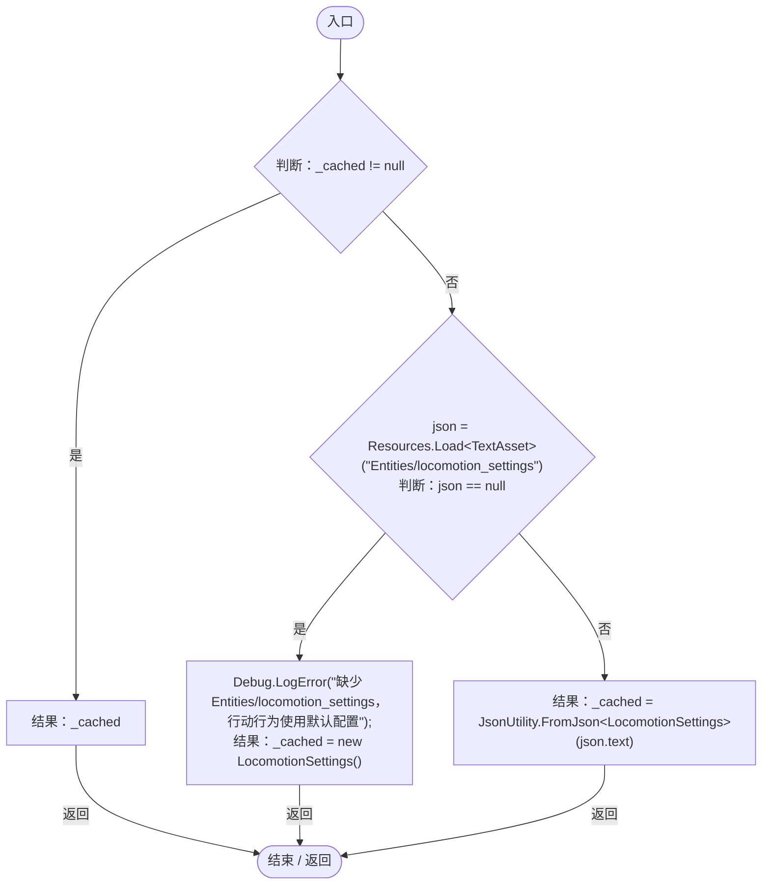

# LocomotionSettings.cs

[返回总索引](../README.md) · `Runtime` · `Assets/DarwinPark/Entities/Logic/LocomotionSettings.cs`

[源文件](../../../Assets/DarwinPark/Entities/Logic/LocomotionSettings.cs) · 源码校验：`7716e3e3a3404b0292cc26bdf7a08f0797afb4c1537145826701fc0d07c19010`

方法按源文件位置排列。事件/回调引用不表示立即执行；分支与异常说明见总索引。完整源码与可点击关系图请打开离线手册。

## Load · L17

`public static LocomotionSettings Load()`

### Editor / Player · Roslyn编译器控制流

