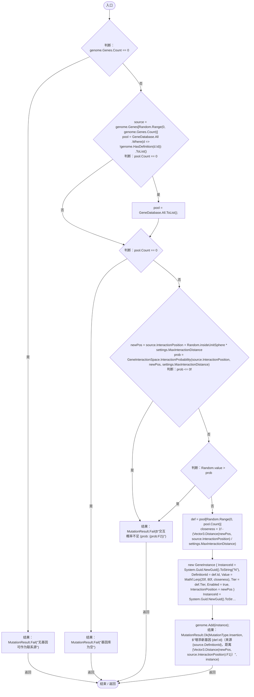
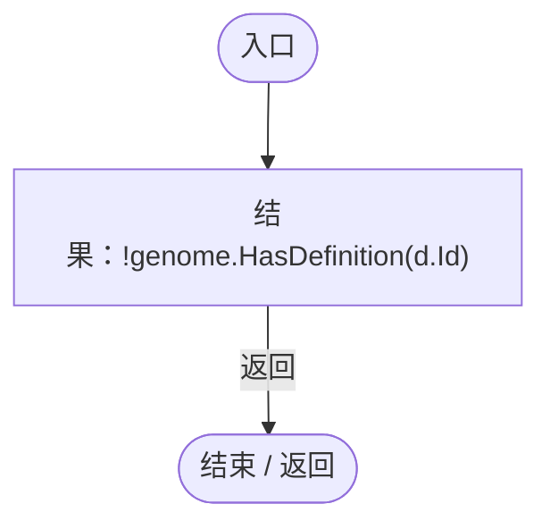

# MutationInsertion.cs

[返回总索引](../README.md) · `Runtime` · `Assets/DarwinPark/Genetics/Mutation/MutationInsertion.cs`

[源文件](../../../Assets/DarwinPark/Genetics/Mutation/MutationInsertion.cs) · 源码校验：`e90f4911725e12d5c94f75c68ed10340cf1f637ae463190a545b0cd59aed43b8`

方法按源文件位置排列。事件/回调引用不表示立即执行；分支与异常说明见总索引。完整源码与可点击关系图请打开离线手册。

## Apply · L9

`public static MutationResult Apply(Genome genome, GeneMutationSettings settings)`

### Editor / Player · Roslyn编译器控制流

项目内调用/回调引用：

- [MutationResult.Fail · L12](5f57b52059148da9.md#m14be42b2c3e424d3)（方法）
- [GeneDatabase.All.get · L128](ec0a03483435a863.md#m0a367ed24734f426)（访问器）
- [GeneInteractionSpace.InteractionProbability · L7](d0edcf131499c737.md#m1f8d482a5373fc9a)（方法）
- [Genome.Add · L19](a2ef23f865bc7ee8.md#md9cfdc94b8b8d40f)（方法）
- [MutationResult.Ok · L15](5f57b52059148da9.md#m4c90cf67054dec65)（方法）
- [MutationInsertion.回调@18 · L18](8d5c69d238f618f4.md#mee129bc3196d0a2d)（回调/委托）

## 回调@18 · L18

`d … => 回调`

### Editor / Player · Roslyn编译器控制流

项目内调用/回调引用：

- [Genome.HasDefinition · L17](a2ef23f865bc7ee8.md#mcc1574af6feb9c6a)（方法）
