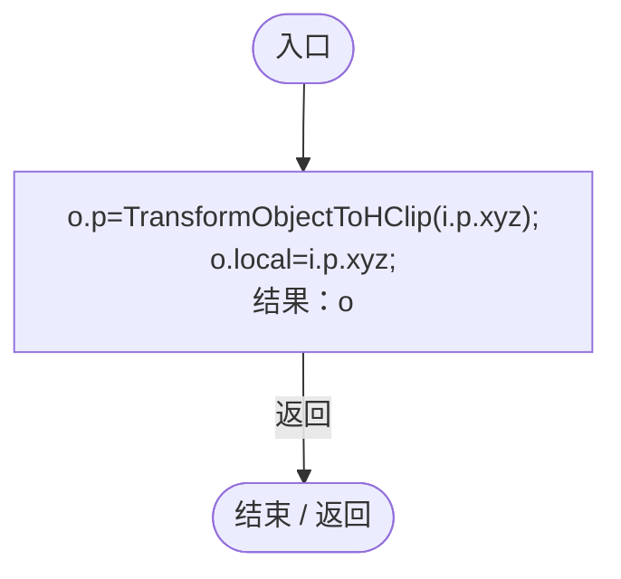
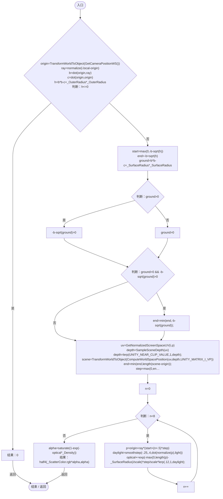

# PlanetScattering.shader

[返回总索引](../README.md) · `GPU` · `Assets/DarwinPark/Planet/PlanetScattering.shader`

[源文件](../../../Assets/DarwinPark/Planet/PlanetScattering.shader) · 源码校验：`20282f9df70f4d96bbd5168d3c522b3ebfea3c339ba2681bfcbcbf9b74048ded`

方法按源文件位置排列。事件/回调引用不表示立即执行；分支与异常说明见总索引。完整源码与可点击关系图请打开离线手册。

## vert · L25

`V vert(A i)`

### GPU · GPU控制结构（名称链接，不作C#类型推断）

## frag · L26

`half4 frag(V i):SV_Target`

### GPU · GPU控制结构（名称链接，不作C#类型推断）

