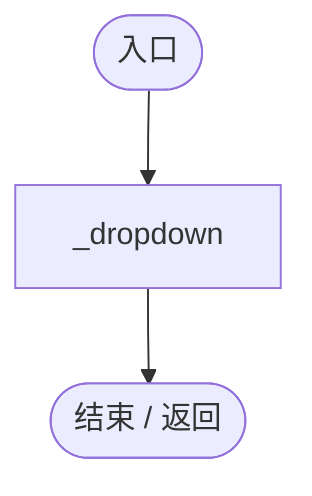
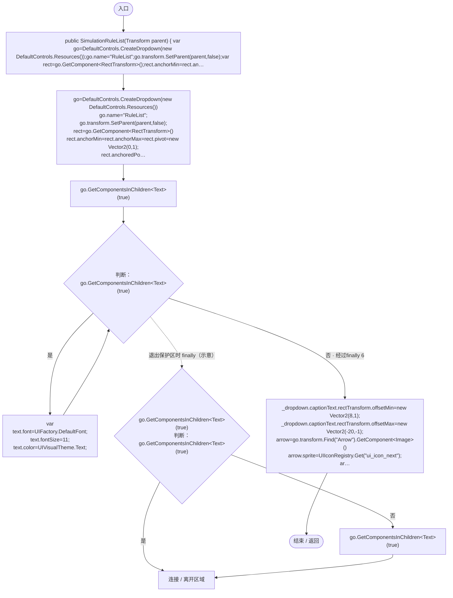
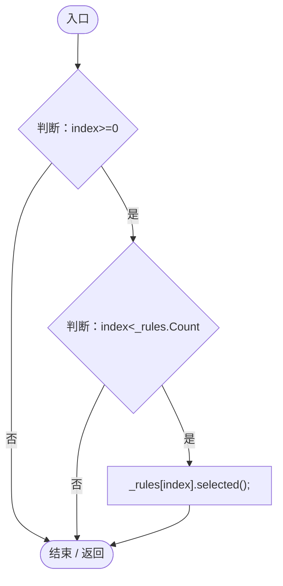
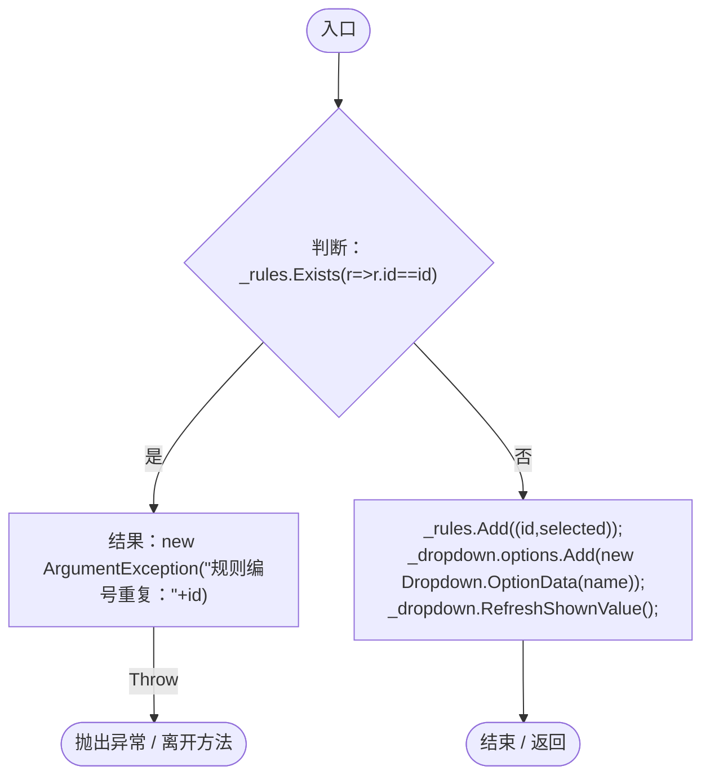
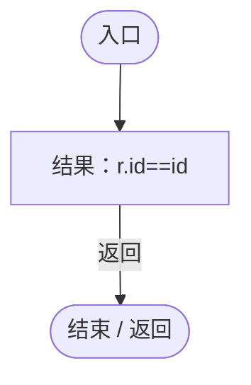
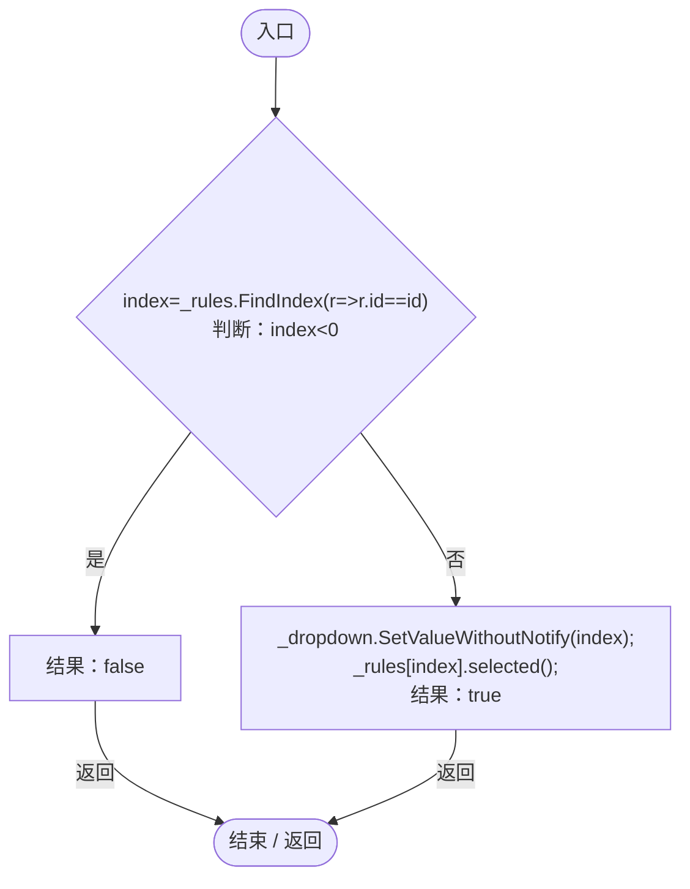

# SimulationRuleList.cs

[返回总索引](../README.md) · `Runtime` · `Assets/DarwinPark/UI/SimulationRuleList.cs`

[源文件](../../../Assets/DarwinPark/UI/SimulationRuleList.cs) · 源码校验：`29b18df608ea49e91e51a40bb5401fc96a79999de88663b8497a271a52078196`

方法按源文件位置排列。事件/回调引用不表示立即执行；分支与异常说明见总索引。完整源码与可点击关系图请打开离线手册。

## Dropdown.get · L12

`public Dropdown Dropdown`

### Editor / Player · 语法控制结构 / 声明（非CFG）

## SimulationRuleList.ctor · L13

`public SimulationRuleList(Transform parent)`

### Editor / Player · Roslyn编译器控制流

项目内调用/回调引用：

- [UIVisualTheme.Paint · L58](ca525a798a08f966.md#m2d61a6b26ab24980)（方法）
- [UIFactory.DefaultFont.get · L17](dd1096a6995423db.md#m89af6843ae7629d3)（访问器）
- [UIIconRegistry.Get · L38](5e97f4545b48cac2.md#m95da89c0db2bbab9)（方法）
- [RuntimeDropdownSkin.Apply · L10](4e9d66f8395f54ec.md#m2b589d708f286228)（方法）
- [SimulationRuleList.回调@21 · L21](8e0c9b70cd52abbf.md#mcaf2dbe042cfef25)（回调/委托）

## 回调@21 · L21

`index … => 回调`

### Editor / Player · Roslyn编译器控制流

## Register · L23

`public void Register(string id,string name,Action selected)`

### Editor / Player · Roslyn编译器控制流

项目内调用/回调引用：

- [SimulationRuleList.回调@24 · L24](8e0c9b70cd52abbf.md#m1152a64a25db914f)（回调/委托）

## 回调@24 · L24

`r … => 回调`

### Editor / Player · Roslyn编译器控制流

## Select · L25

`public bool Select(string id)`

### Editor / Player · Roslyn编译器控制流

项目内调用/回调引用：

- [SimulationRuleList.回调@26 · L26](8e0c9b70cd52abbf.md#me55ff423b1e557c6)（回调/委托）

## 回调@26 · L26

`r … => 回调`

### Editor / Player · Roslyn编译器控制流

