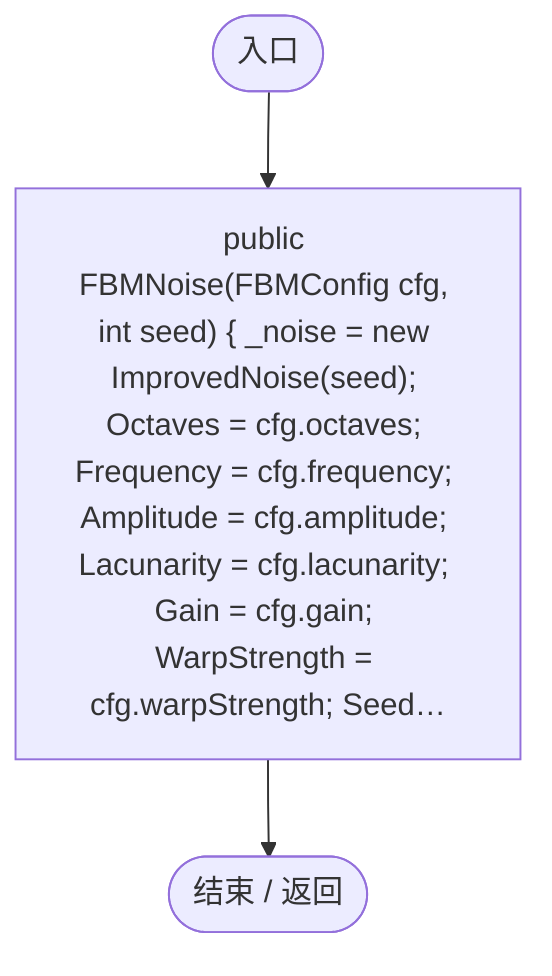
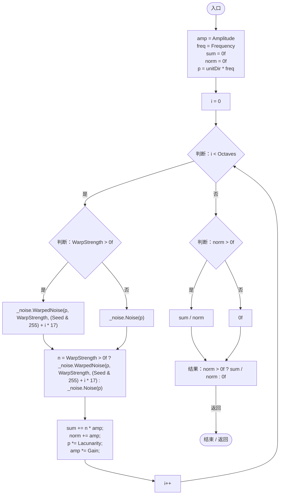

# FBMNoise.cs

[返回总索引](../README.md) · `Runtime` · `Assets/DarwinPark/Planet/Noise/FBMNoise.cs`

[源文件](../../../Assets/DarwinPark/Planet/Noise/FBMNoise.cs) · 源码校验：`f018e3b063fd0dffcf07e7ef0e4953b2784085f79a1e567f6dc930751dd29782`

方法按源文件位置排列。事件/回调引用不表示立即执行；分支与异常说明见总索引。完整源码与可点击关系图请打开离线手册。

## FBMNoise.ctor · L12

`public FBMNoise(FBMConfig cfg, int seed)`

### Editor / Player · Roslyn编译器控制流

项目内调用/回调引用：

- [ImprovedNoise.ImprovedNoise.ctor · L13](a8f42417442eeb03.md#m6f027a607146cc3e)（构造函数）

## Sample · L24

`public float Sample(Vector3 unitDir)`

### Editor / Player · Roslyn编译器控制流

项目内调用/回调引用：

- [ImprovedNoise.WarpedNoise · L58](a8f42417442eeb03.md#md848757b285fdff8)（方法）
- [ImprovedNoise.Noise · L39](a8f42417442eeb03.md#m683c13216672e25c)（方法）
