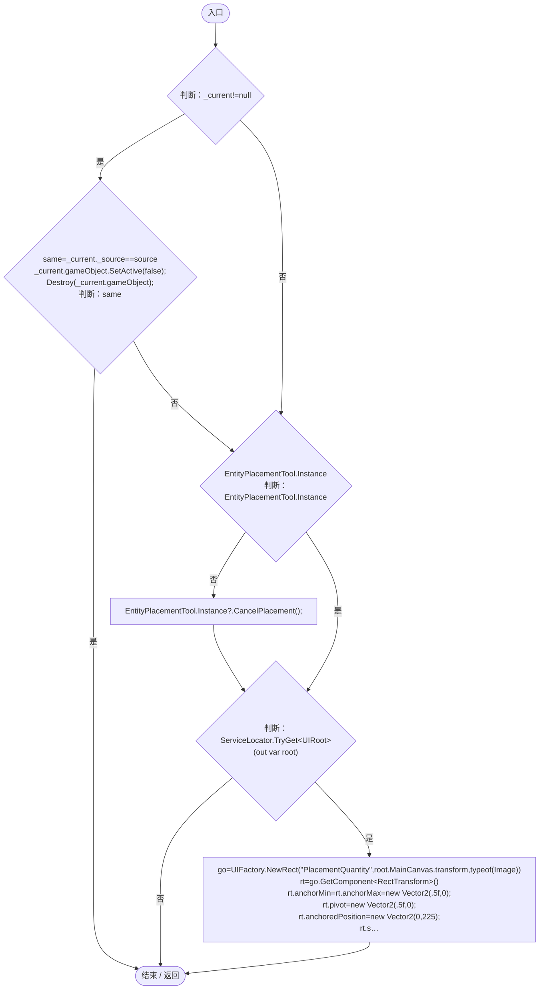
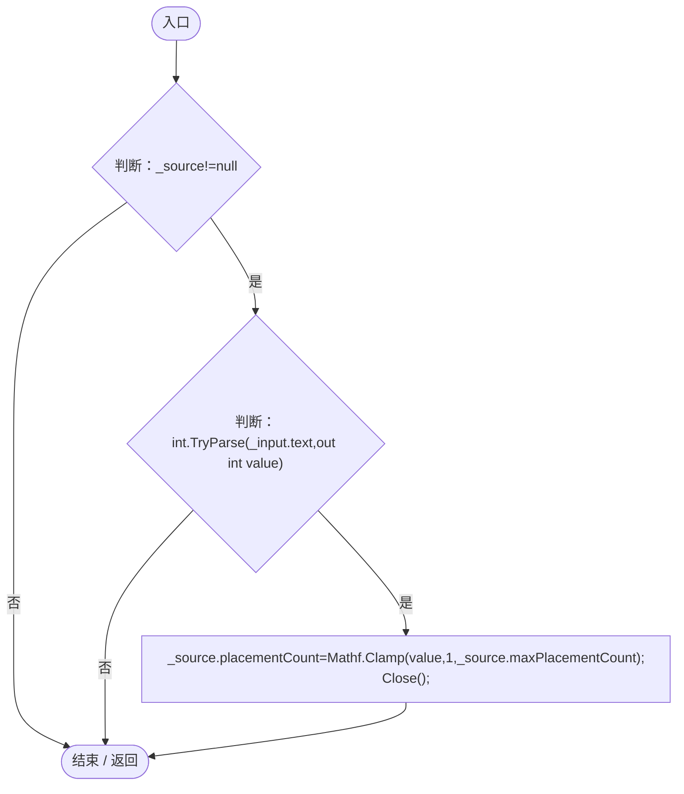
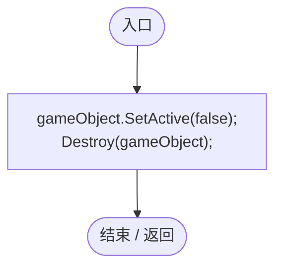
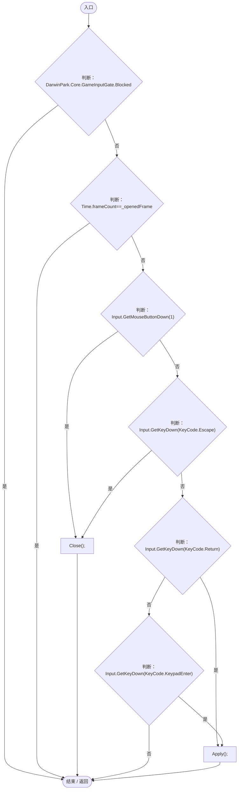
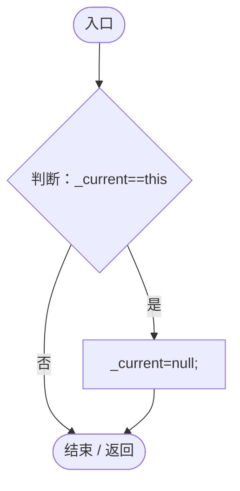

# PlacementQuantityPopup.cs

[返回总索引](../README.md) · `Runtime` · `Assets/DarwinPark/UI/PlacementQuantityPopup.cs`

[源文件](../../../Assets/DarwinPark/UI/PlacementQuantityPopup.cs) · 源码校验：`3236f4757a582f691797d60830d296c35f26cff17f12345120236fc1865a4fd1`

方法按源文件位置排列。事件/回调引用不表示立即执行；分支与异常说明见总索引。完整源码与可点击关系图请打开离线手册。

## Show · L14

`public static void Show(EntitySpawnerUI source)`

### Editor / Player · Roslyn编译器控制流

项目内调用/回调引用：

- [EntityPlacementTool.Instance.get · L13](2ca993947b0a7e7a.md#mafb26991c0dfcb86)（访问器）
- [EntityPlacementTool.CancelPlacement · L81](2ca993947b0a7e7a.md#m5a9374d2c71f0a2d)（方法）
- [ServiceLocator.TryGet · L26](f2fdbe9f9ccd93cb.md#m143b24e6d58471b0)（方法）
- [UIFactory.NewRect · L33](dd1096a6995423db.md#med612116f3152344)（方法）
- [UIRoot.MainCanvas.get · L14](9c1421378791f0e0.md#maa2cc9baf1248477)（访问器）
- [UIVisualTheme.Paint · L58](ca525a798a08f966.md#m2d61a6b26ab24980)（方法）
- [UIFactory.NewText · L57](dd1096a6995423db.md#m9dbccb5f0c38189e)（方法）
- [UIFactory.Stretch · L150](dd1096a6995423db.md#m11d8f6c6d00cc047)（方法）
- [UIFactory.NewButton · L73](dd1096a6995423db.md#m5896f1b097c8bdde)（方法）
- [UIVisualTheme.StyleButton · L67](ca525a798a08f966.md#mf2e64598de5115f3)（方法）
- [PlacementQuantityPopup.Apply · L38](8e55f714deb963c4.md#m779d8397f2a21920)（方法）

## Apply · L38

`public void Apply()`

### Editor / Player · Roslyn编译器控制流

项目内调用/回调引用：

- [PlacementQuantityPopup.Close · L43](8e55f714deb963c4.md#m87b4c702a40211dc)（方法）

## Close · L43

`private void Close()`

### Editor / Player · Roslyn编译器控制流

## Update · L44

`private void Update()`

### Editor / Player · Roslyn编译器控制流

项目内调用/回调引用：

- [GameInputGate.Blocked.get · L8](52955daae7e592ab.md#m765763b665829633)（访问器）
- [PlacementQuantityPopup.Close · L43](8e55f714deb963c4.md#m87b4c702a40211dc)（方法）
- [PlacementQuantityPopup.Apply · L38](8e55f714deb963c4.md#m779d8397f2a21920)（方法）

## OnDestroy · L52

`private void OnDestroy()`

### Editor / Player · Roslyn编译器控制流

