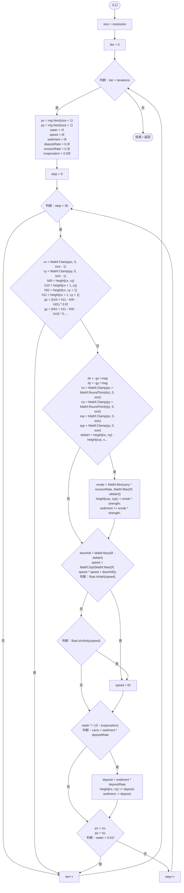

# HydraulicErosion.cs

[返回总索引](../README.md) · `Runtime` · `Assets/DarwinPark/Planet/Erosion/HydraulicErosion.cs`

[源文件](../../../Assets/DarwinPark/Planet/Erosion/HydraulicErosion.cs) · 源码校验：`3093fba211deaa2aecc9cf0839cf12ae5be309b8ed6c161e4e7aefa007d025d0`

方法按源文件位置排列。事件/回调引用不表示立即执行；分支与异常说明见总索引。完整源码与可点击关系图请打开离线手册。

## Apply · L12

`public static void Apply(float[,] height, int resolution, int iterations, float strength, DeterministicRandom rng)`

### Editor / Player · Roslyn编译器控制流

项目内调用/回调引用：

- [DeterministicRandom.Next · L32](0c2b60ffd3650bfd.md#m5fab9b9b1a9df9bf)（方法）
