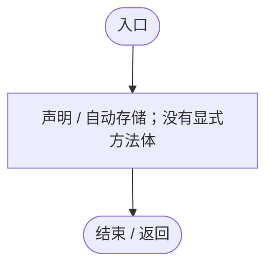
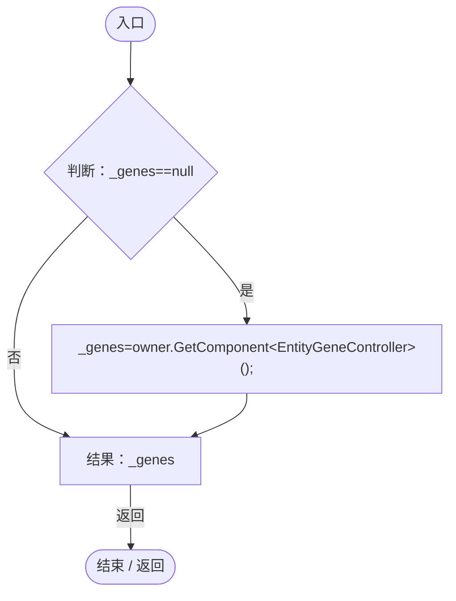
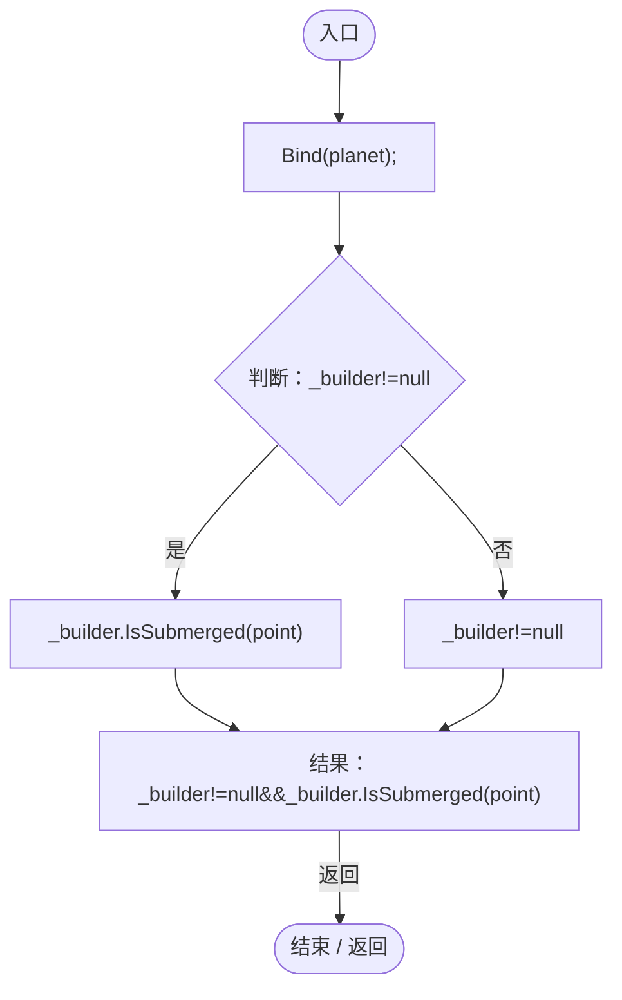
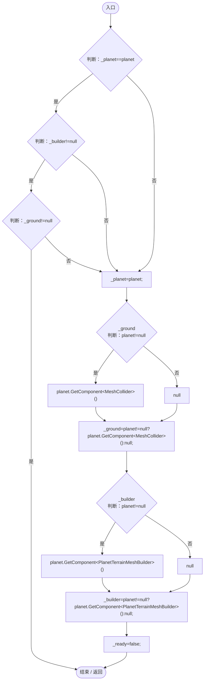
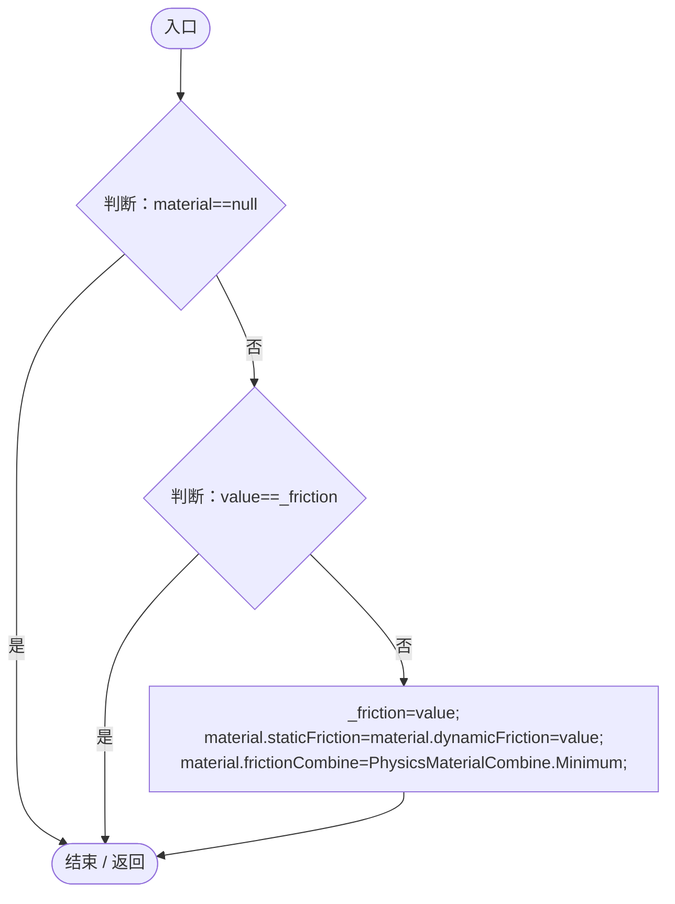

```mermaid
flowchart TD
  b0(["入口"])
  b1["Bind(planet);<br/>matrix=planet.localToWorldMatrix"]
  b2{"_builder<br/>判断：_builder"}
  b3[".Data"]
  b4["_builder"]
  b5["data=_builder?.Data"]
  b6{"判断：_builder!=null"}
  b7["_builder.radius"]
  b8["0"]
  b9["radius=_builder!=null?_builder.radius:0"]
  b10{"判断：_builder!=null"}
  b11["_builder.heightScale"]
  b12["0"]
  b13["height=_builder!=null?_builder.heightScale:0"]
  b14{"tuning=SimulationOptimization.Current<br/>gentle=Mathf.Abs(Vector3.Dot(body.linearVelocity,direction))&lt;tuning.groundProbeVerticalSpeed<br/>判断：_ready"}
  b15{"判断：Time.fixedTime&gt;=_next"}
  b16{"判断：gentle"}
  b17{"判断：(body.position-_position).sqrMagnitude&gt;tuning.groundProbeMoveTolerance*tuning.groundProbeMoveTolerance"}
  b18{"判断：matrix!=_matrix"}
  b19{"判断：ReferenceEquals(data,_data)"}
  b20{"判断：radius!=_radius"}
  b21{"判断：height!=_height"}
  b22{"_found<br/>判断：_ground!=null"}
  b23["_ground.Raycast(new Ray(body.position,direction),out _hit,20)"]
  b24["_ground!=null"]
  b25["_found=_ground!=null&amp;&amp;_ground.Raycast(new Ray(body.position,direction),out _hit,20);"]
  b26["Raycasts++;<br/>_position=body.position;<br/>_matrix=matrix;<br/>_data=data;<br/>_radius=radius;<br/>_height=height;<br/>_next=Time.fixedTime+SimulationOptimization.Current.groundProbeSeconds;<br/>_ready=true;"]
  b27{"hit=_hit;<br/>判断：_found"}
  b28["hit.distance=Mathf.Max(0,Vector3.Dot(body.position-_hit.point,-direction));"]
  b29["结果：_found"]
  b30(["结束 / 返回"])
  b0 --> b1
  b1 --> b2
  b2 -->|"否"| b3
  b2 -->|"是"| b4
  b3 --> b5
  b4 --> b5
  b5 --> b6
  b6 -->|"是"| b7
  b6 -->|"否"| b8
  b7 --> b9
  b8 --> b9
  b9 --> b10
  b10 -->|"是"| b11
  b10 -->|"否"| b12
  b11 --> b13
  b12 --> b13
  b13 --> b14
  b14 -->|"是"| b15
  b14 -->|"否"| b22
  b15 -->|"否"| b16
  b15 -->|"是"| b22
  b16 -->|"是"| b17
  b16 -->|"否"| b22
  b17 -->|"否"| b18
  b17 -->|"是"| b22
  b18 -->|"否"| b19
  b18 -->|"是"| b22
  b19 -->|"是"| b20
  b19 -->|"否"| b22
  b20 -->|"否"| b21
  b20 -->|"是"| b22
  b21 -->|"是"| b22
  b21 -->|"否"| b27
  b22 -->|"是"| b23
  b22 -->|"否"| b24
  b23 --> b25
  b24 --> b25
  b25 --> b26
  b26 --> b27
  b27 -->|"是"| b28
  b27 -->|"否"| b29
  b28 --> b29
  b29 -->|"返回"| b30

```

# GravityProbeCache.cs

[返回总索引](../README.md) · `Runtime` · `Assets/DarwinPark/Entities/GravityProbeCache.cs`

[源文件](../../../Assets/DarwinPark/Entities/GravityProbeCache.cs) · 源码校验：`a0b7526a7427297c731014b852316a1bb13d45657622588366d0731fb7500940`

方法按源文件位置排列。事件/回调引用不表示立即执行；分支与异常说明见总索引。完整源码与可点击关系图请打开离线手册。

## Raycasts.get · L11

`get`

### Editor / Player · 语法控制结构 / 声明（非CFG）

## Raycasts.set · L11

`private set`

### Editor / Player · 语法控制结构 / 声明（非CFG）

## Genes · L12

`public EntityGeneController Genes(Component owner)`

### Editor / Player · Roslyn编译器控制流

## UnderWater · L13

`public bool UnderWater(Transform planet,Vector3 point)`

### Editor / Player · Roslyn编译器控制流

项目内调用/回调引用：

- [GravityProbeCache.Bind · L14](901cef6b99719cf7.md#m23df419a43bce3cf)（方法）
- [PlanetTerrainMeshBuilder.IsSubmerged · L107](415285cf043354a9.md#m77993fefee27a702)（方法）

## Bind · L14

`private void Bind(Transform planet)`

### Editor / Player · Roslyn编译器控制流

## Probe · L15

`public bool Probe(Transform planet,Rigidbody body,Vector3 direction,out RaycastHit hit)`

### Editor / Player · Roslyn编译器控制流

项目内调用/回调引用：

- [GravityProbeCache.Bind · L14](901cef6b99719cf7.md#m23df419a43bce3cf)（方法）
- [PlanetTerrainMeshBuilder.Data.get · L81](415285cf043354a9.md#m1a65abfe0f34c5d8)（访问器）
- [SimulationOptimization.Current.get · L25](11c9091e70893352.md#mde7abfdc18429e4a)（访问器）
- [GravityProbeCache.Raycasts.set · L11](901cef6b99719cf7.md#m6bd52d456f7ae637)（访问器）
- [GravityProbeCache.Raycasts.get · L11](901cef6b99719cf7.md#mcf76d70f4147b29d)（访问器）

## Friction · L25

`public void Friction(PhysicsMaterial material,float value)`

### Editor / Player · Roslyn编译器控制流

