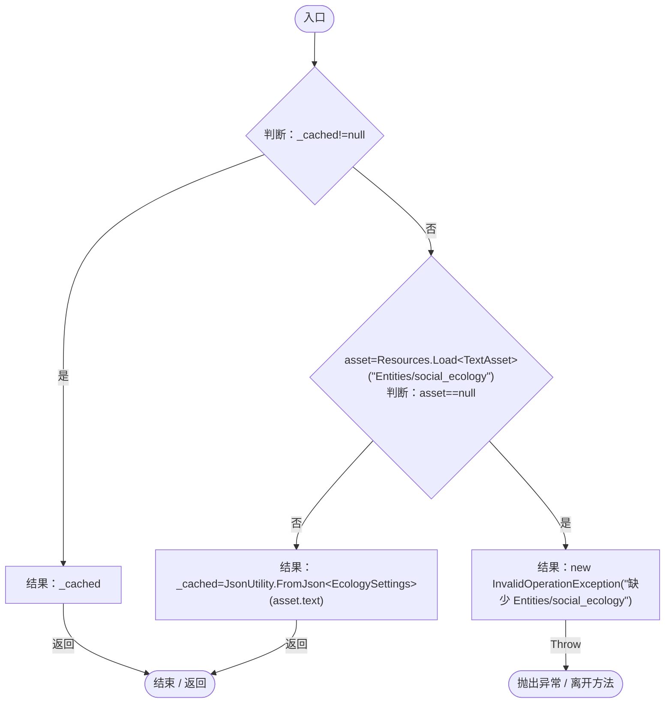

# EcologySettings.cs

[返回总索引](../README.md) · `Runtime` · `Assets/DarwinPark/Entities/Ecology/EcologySettings.cs`

[源文件](../../../Assets/DarwinPark/Entities/Ecology/EcologySettings.cs) · 源码校验：`e8f614950b158fb87af13aa7369deba267b13be4cf53d76fd7591a1a6bad45f2`

方法按源文件位置排列。事件/回调引用不表示立即执行；分支与异常说明见总索引。完整源码与可点击关系图请打开离线手册。

## Load · L18

`public static EcologySettings Load()`

★ 新增：行为半径、周期与战斗收益集中配置，统一使用模拟秒。

### Editor / Player · Roslyn编译器控制流

