# PopulationPerformanceRegression.cs

[返回总索引](../README.md) · `Editor` · `Assets/DarwinPark/Editor/PopulationPerformanceRegression.cs`

[源文件](../../../Assets/DarwinPark/Editor/PopulationPerformanceRegression.cs) · 源码校验：`5d0af774fc48d1b88d63b5747be8d9d227eede893730ca26b54c335cb6ca4114`

方法按源文件位置排列。事件/回调引用不表示立即执行；分支与异常说明见总索引。完整源码与可点击关系图请打开离线手册。

## Folder.get · L27

`private static string Folder`

### Editor · 语法控制结构 / 声明（非CFG）

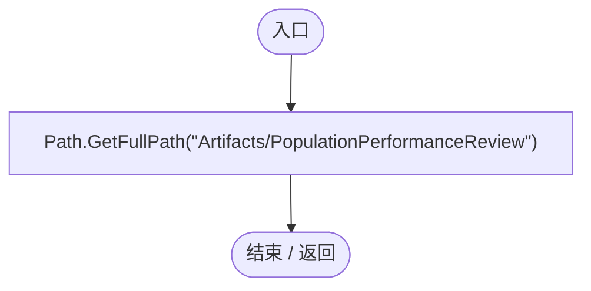

## PopulationPerformanceRegression.ctor · L28

`static PopulationPerformanceRegression()`

### Editor · Roslyn编译器控制流

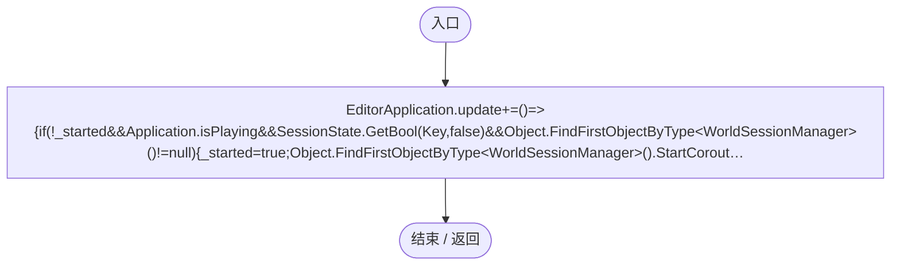

项目内调用/回调引用：

- [PopulationPerformanceRegression.回调@28 · L28](9157b2281b645f60.md#mbcf3d23800e8714c)（回调/委托）

## 回调@28 · L28

`( … => 回调`

### Editor · Roslyn编译器控制流

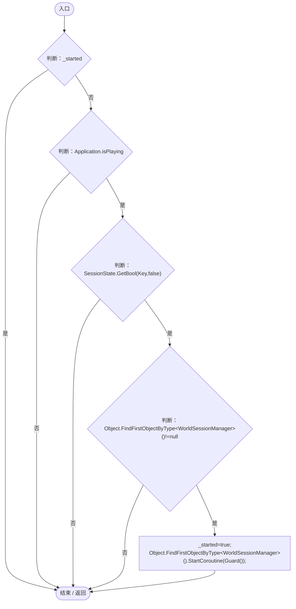

项目内调用/回调引用：

- [PopulationPerformanceRegression.Guard · L44](9157b2281b645f60.md#m7b2c388808394dfa)（方法）

## RunBaseline · L29

`public static void RunBaseline()`

### Editor · Roslyn编译器控制流

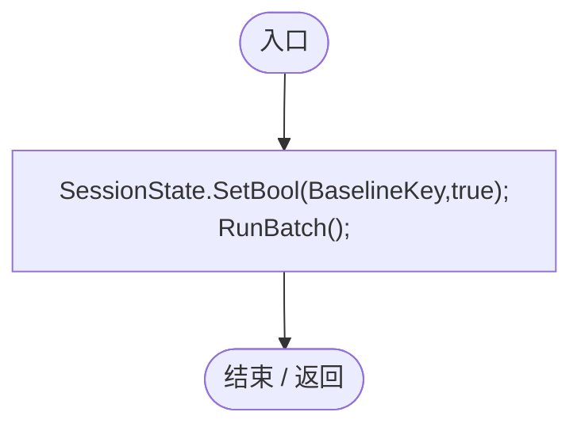

项目内调用/回调引用：

- [PopulationPerformanceRegression.RunBatch · L31](9157b2281b645f60.md#ma51d2d60883ef1dc)（方法）

## RunBatch · L31

`public static void RunBatch()`

★ 修复（防Bug回归）：独立验证窗口失焦后仍须推进实际模拟，否则后台等待会误以为种群逻辑卡死。

### Editor · Roslyn编译器控制流

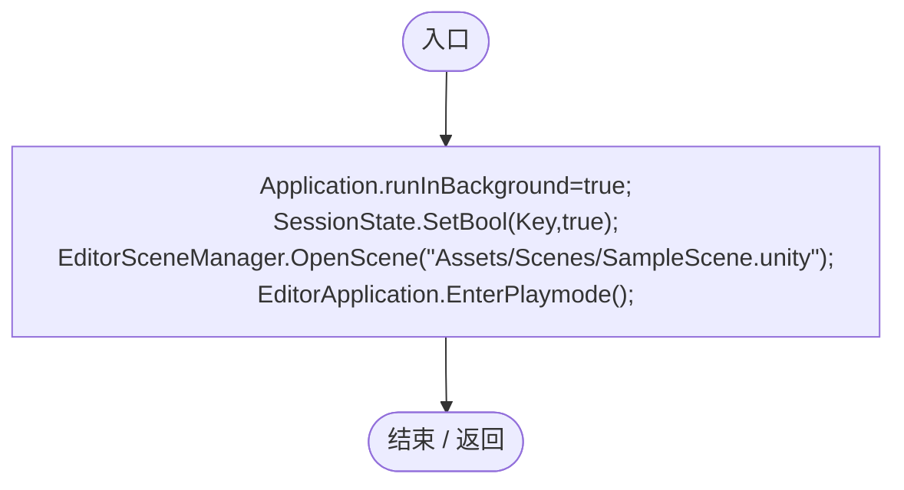

## RunAllBatch · L32

`public static void RunAllBatch()`

### Editor · Roslyn编译器控制流

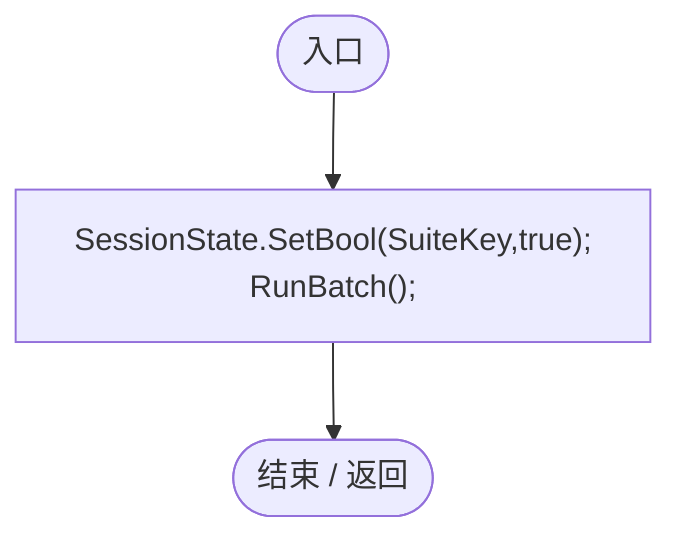

项目内调用/回调引用：

- [PopulationPerformanceRegression.RunBatch · L31](9157b2281b645f60.md#ma51d2d60883ef1dc)（方法）

## Spawn · L33

`private static DarwinEntity Spawn(int index,int groups,bool wolf=false)`

### Editor · Roslyn编译器控制流

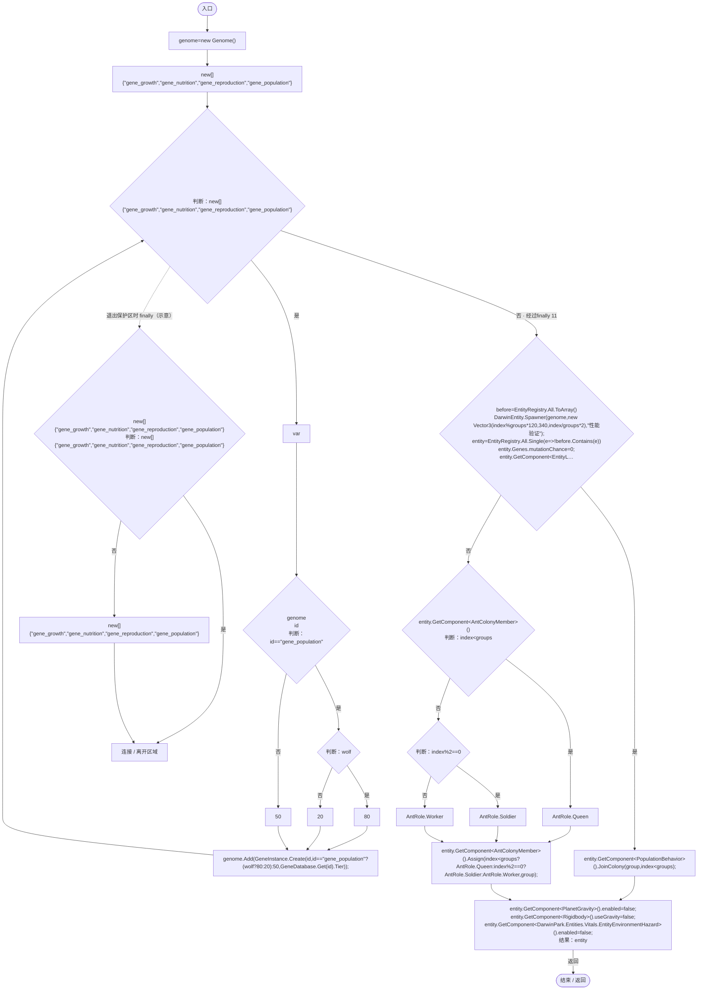

项目内调用/回调引用：

- [Genome.Add · L19](a2ef23f865bc7ee8.md#md9cfdc94b8b8d40f)（方法）
- [GeneInstance.Create · L20](f82e1498d67f5afd.md#m72e94c278de3cf8b)（方法）
- [GeneDatabase.Get · L135](ec0a03483435a863.md#m8f3bbfb35f3ca397)（方法）
- [DarwinEntity.Genes.get · L14](70798dde169f2e8b.md#m622eb1adf401d431)（访问器）
- [EntityLifeCycle.RestoreProgress · L48](9f4138bfbae654b7.md#mfc75121476d49679)（方法）
- [LifeCycleSettings.Load · L16](ace76969fe8f61de.md#mbd2925785484f343)（方法）
- [EntityGeneController.RestoreStageState · L45](7494d53178552f0e.md#m49489af39061f1a1)（方法）
- [PopulationBehavior.JoinColony · L121](21e4f62f75a9a80f.md#mf185963e98c1e28c)（方法）
- [AntColonyMember.Assign · L54](baebd85c05598377.md#mda0fe308acecb8f2)（方法）
- [PopulationPerformanceRegression.回调@36 · L36](9157b2281b645f60.md#mbb74d4c7afcd2c90)（回调/委托）

## 回调@36 · L36

`e … => 回调`

### Editor · Roslyn编译器控制流

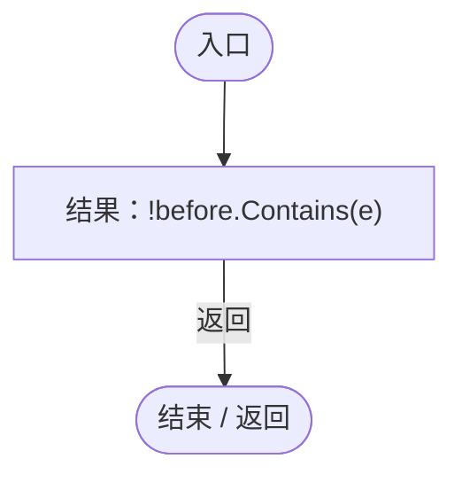

## Clean · L43

`private static void Clean()`

### Editor · Roslyn编译器控制流

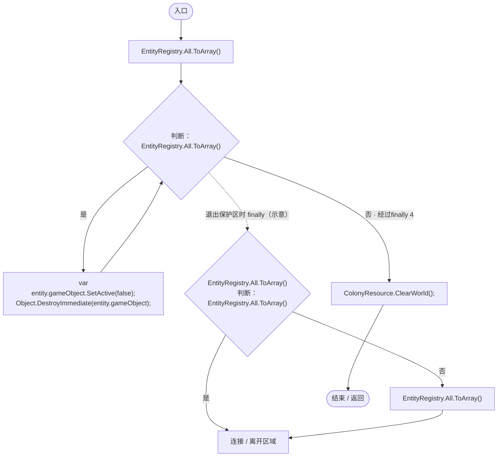

项目内调用/回调引用：

- [ColonyResource.ClearWorld · L100](293dbaecfff4b585.md#m634e84088b7cf78c)（方法）

## Guard · L44

`private static IEnumerator Guard()`

### Editor · Roslyn编译器控制流

```mermaid
flowchart TD
  b0(["入口"])
  b1["yield return null;<br/>Directory.CreateDirectory(Folder);<br/>Results.Clear();<br/>error=null<br/>ServiceLocator.Get&lt;SimulationClock&gt;().Pause();"]
  b2{"判断：SessionState.GetBool(SuiteKey,false)"}
  b3["RunAll()"]
  b4["Run()"]
  b5["operation=SessionState.GetBool(SuiteKey,false)?RunAll():Run()"]
  b6{"判断：true"}
  b7["next=false<br/>value=null"]
  b8{"next=operation.MoveNext();<br/>判断：next"}
  b9["value=operation.Current;"]
  b10["(Exception ex)<br/>error=ex.ToString();<br/>Debug.LogException(ex);"]
  b11{"判断：error!=null"}
  b12{"判断：next"}
  b13["yield return value;"]
  b14{"判断：SessionState.GetBool(BaselineKey,false)"}
  b15["&quot;baseline.txt&quot;"]
  b16["&quot;result.txt&quot;"]
  b17["file=SessionState.GetBool(BaselineKey,false)?&quot;baseline.txt&quot;:&quot;result.txt&quot;"]
  b18{"Path.Combine(Folder,file)<br/>判断：error==null"}
  b19["&quot;PASS&quot;"]
  b20["&quot;FAIL&quot;"]
  b21["File.WriteAllText(Path.Combine(Folder,file),(error==null?&quot;PASS&quot;:&quot;FAIL&quot;)+&quot;\n&quot;+error+&quot;\n&quot;+string.Join(&quot;\n&quot;,Results));"]
  b22["Clean();<br/>SessionState.SetBool(Key,false);"]
  b23{"&quot;[PopulationPerformance] &quot;<br/>判断：error==null"}
  b24["&quot;PASS&quot;"]
  b25["&quot;FAIL&quot;"]
  b26["Debug.Log(&quot;[PopulationPerformance] &quot;+(error==null?&quot;PASS&quot;:&quot;FAIL&quot;));"]
  b27{"判断：error==null"}
  b28["0"]
  b29["1"]
  b30["EditorApplication.Exit(error==null?0:1);"]
  b31(["结束 / 返回"])
  b0 --> b1
  b1 --> b2
  b2 -->|"是"| b3
  b2 -->|"否"| b4
  b3 --> b5
  b4 --> b5
  b5 --> b6
  b6 -->|"是"| b7
  b6 -->|"否"| b14
  b7 --> b8
  b8 -->|"是"| b9
  b8 -->|"否"| b11
  b9 --> b11
  b10 --> b11
  b11 -->|"否"| b12
  b11 -->|"是"| b14
  b12 -->|"否"| b14
  b12 -->|"是"| b13
  b13 --> b6
  b14 -->|"是"| b15
  b14 -->|"否"| b16
  b15 --> b17
  b16 --> b17
  b17 --> b18
  b18 -->|"是"| b19
  b18 -->|"否"| b20
  b19 --> b21
  b20 --> b21
  b21 --> b22
  b22 --> b23
  b23 -->|"是"| b24
  b23 -->|"否"| b25
  b24 --> b26
  b25 --> b26
  b26 --> b27
  b27 -->|"是"| b28
  b27 -->|"否"| b29
  b28 --> b30
  b29 --> b30
  b30 --> b31
  b8 -. "保护区可能异常（示意）" .-> b10

```

项目内调用/回调引用：

- [SimulationClock.Pause · L79](a8f444aec9614b0a.md#m30929d45a885d0f1)（方法）
- [ServiceLocator.Get · L33](f2fdbe9f9ccd93cb.md#m2ae625299520c56d)（方法）
- [PopulationPerformanceRegression.RunAll · L57](9157b2281b645f60.md#m5f3118329aa2625b)（方法）
- [PopulationPerformanceRegression.Run · L65](9157b2281b645f60.md#m0eb0c21536ae42af)（方法）
- [PopulationPerformanceRegression.Clean · L43](9157b2281b645f60.md#mc487420634060693)（方法）

## RunAll · L57

`private static IEnumerator RunAll()`

### Editor · Roslyn编译器控制流

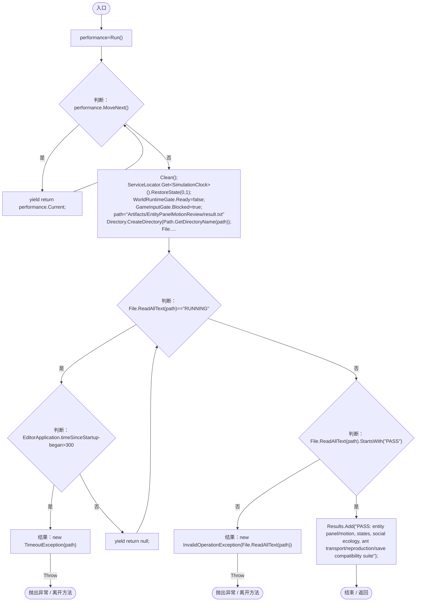

项目内调用/回调引用：

- [PopulationPerformanceRegression.Run · L65](9157b2281b645f60.md#m0eb0c21536ae42af)（方法）
- [PopulationPerformanceRegression.Clean · L43](9157b2281b645f60.md#mc487420634060693)（方法）
- [SimulationClock.RestoreState · L74](a8f444aec9614b0a.md#m8f617e95e1282846)（方法）
- [ServiceLocator.Get · L33](f2fdbe9f9ccd93cb.md#m2ae625299520c56d)（方法）
- [GameInputGate.Blocked.set · L8](52955daae7e592ab.md#m578697f6379686f4)（访问器）
- [EntityPanelMotionRegression.ValidateSuite · L48](c42720484a16e881.md#m3aac069ddcae22ac)（方法）

## Run · L65

`private static IEnumerator Run()`

### Editor · Roslyn编译器控制流

```mermaid
flowchart TD
  b0(["入口"])
  b1["new[]{(count:10,groups:1),(count:100,groups:1),(count:100,groups:10)}"]
  b2{"判断：new[]{(count:10,groups:1),(count:100,groups:1),(count:100,groups:10)}"}
  b3["var"]
  b4["Clean();<br/>Groups.Clear();"]
  b5["i=0"]
  b6{"判断：i&lt;scenario.groups"}
  b7["Groups.Add(Guid.NewGuid().ToString(&quot;N&quot;));<br/>i++"]
  b8["entities=new List&lt;DarwinEntity&gt;()"]
  b9["i=0"]
  b10{"判断：i&lt;scenario.count"}
  b11["entities.Add(Spawn(i,scenario.groups));<br/>i++"]
  b12["timer=Stopwatch.StartNew()<br/>allocated=GC.GetAllocatedBytesForCurrentThread()"]
  b13["entities"]
  b14{"判断：entities"}
  b15["var<br/>entity.GetComponent&lt;PopulationBehavior&gt;().Advance(.016f);"]
  b16["read=0"]
  b17{"判断：read&lt;5"}
  b18["entity.Genes.GetAttribute(&quot;moveSpeed&quot;);<br/>entity.Genes.GetAttribute(&quot;attack&quot;);<br/>entity.GetComponent&lt;AntColonyMember&gt;().Destination(out _,out _,out _);<br/>read++"]
  b19["entities"]
  b20{"timer.Stop();<br/>bytes=GC.GetAllocatedBytesForCurrentThread()-allocated<br/>report=$&quot;{scenario.count} entities / {scenario.groups} colonies: {timer.Elapsed.TotalMilliseconds:F3} ms, {bytes} bytes per dispatch&quot;<br/>Results.Add(report);<br/>File.WriteAll…"}
  b21{"判断：SessionState.GetBool(BaselineKey,false)"}
  b22["结果：new InvalidOperationException(report)"]
  x22(["抛出异常 / 离开方法"])
  b23{"yield return null;<br/>判断：SessionState.GetBool(BaselineKey,false)"}
  b24["entities"]
  b25{"判断：entities"}
  b26{"var<br/>entity.Genes.GetAttribute(&quot;moveSpeed&quot;);<br/>判断：entity.GetComponent&lt;AntColonyMember&gt;().Queen==null"}
  b27["结果：new InvalidOperationException(&quot;王后缺失&quot;)"]
  x27(["抛出异常 / 离开方法"])
  b28["entities"]
  b29["builds=PopulationGroupIndex.BuildCount"]
  b30["entities"]
  b31{"判断：entities"}
  b32["var"]
  b33["read=0"]
  b34{"判断：read&lt;20"}
  b35{"entity.Genes.GetAttribute(&quot;moveSpeed&quot;);<br/>判断：entity.GetComponent&lt;AntColonyMember&gt;().Queen==null"}
  b36["结果：new InvalidOperationException(&quot;王后缺失&quot;)"]
  x36(["抛出异常 / 离开方法"])
  b37["read++"]
  b38["entities"]
  b39{"判断：PopulationGroupIndex.BuildCount!=builds"}
  b40["结果：new InvalidOperationException(&quot;稳定成员的重复属性读取仍在重建群体索引&quot;)"]
  x40(["抛出异常 / 离开方法"])
  b41{"Results.Add(&quot;PASS: repeated movement/queen reads reuse group index&quot;);<br/>originalQueen=entities[0].GetComponent&lt;AntColonyMember&gt;()<br/>successor=entities[scenario.groups].GetComponent&lt;AntColonyMember&gt;()<br/>group=originalQueen.GroupId<br/>successor.Ass…"}
  b42["结果：new InvalidOperationException(&quot;停用旧王后后缓存仍引用旧领袖&quot;)"]
  x42(["抛出异常 / 离开方法"])
  b43{"originalQueen.Assign(AntRole.Worker,group);<br/>originalQueen.gameObject.SetActive(true);<br/>originalQueen.Population.Advance(.01f);<br/>判断：originalQueen.Queen!=successor"}
  b44["结果：new InvalidOperationException(&quot;角色/激活变化未更新群体索引&quot;)"]
  x44(["抛出异常 / 离开方法"])
  b45{"Results.Add(&quot;PASS: queen disable, role change and re-enable invalidate membership index&quot;);<br/>populationGene=successor.Genes.Genome.Genes.Single(g=&gt;g.DefinitionId==&quot;gene_population&quot;)<br/>populationGene.Value=80;<br/>successor.Genes.Recalculate();<br/>判…"}
  b46{"判断：originalQueen.Queen!=null"}
  b47["结果：new InvalidOperationException(&quot;同帧改变种群模式后仍使用旧缓存&quot;)"]
  x47(["抛出异常 / 离开方法"])
  b48{"populationGene.Value=20;<br/>successor.Genes.Recalculate();<br/>判断：originalQueen.Queen!=successor"}
  b49["结果：new InvalidOperationException(&quot;同帧恢复种群表达后王后缓存未更新&quot;)"]
  x49(["抛出异常 / 离开方法"])
  b50{"Results.Add(&quot;PASS: same-frame gene mode changes invalidate group/queen lookup&quot;);<br/>worker=entities.Select(e=&gt;e.GetComponent&lt;AntColonyMember&gt;()).First(m=&gt;m.Role==AntRole.Worker)<br/>plantGenome=new Genome()<br/>plantGenome.Add(GeneInstance.Create(&quot;…"}
  b51["结果：new InvalidOperationException(&quot;拾取活体后搬运索引未登记&quot;)"]
  x51(["抛出异常 / 离开方法"])
  b52{"AntColonyWorker.Release(worker);<br/>判断：AntColonyWorker.IsCarried(plant)"}
  b53["结果：new InvalidOperationException(&quot;释放活体后搬运索引未清理&quot;)"]
  x53(["抛出异常 / 离开方法"])
  b54{"plant.gameObject.SetActive(false);<br/>Object.DestroyImmediate(plant.gameObject);<br/>判断：EcologyIdentity.Find(plantId)!=null"}
  b55["结果：new InvalidOperationException(&quot;停用实体仍出现在 ID 索引&quot;)"]
  x55(["抛出异常 / 离开方法"])
  b56{"Results.Add(&quot;PASS: live cargo claim/release and identity cleanup&quot;);<br/>cargoIndex=(System.Collections.IDictionary)typeof(AntColonyWorker).GetField(&quot;Cargo&quot;,System.Reflection.BindingFlags.NonPublic&#124;System.Reflection.BindingFlags.Static).GetVa…"}
  b57["结果：new InvalidOperationException(&quot;Unity 假空对象导致运载物销毁后索引泄漏&quot;)"]
  x57(["抛出异常 / 离开方法"])
  b58["AntColonyWorker.Release(worker);<br/>Results.Add(&quot;PASS: destroyed cargo does not retain worker/entity index entries&quot;);"]
  b59{"判断：scenario.count==10"}
  b60["new[]{1,16}"]
  b61["new[]{1}"]
  b62["scenario.count==10?new[]{1,16}:new[]{1}"]
  b63{"判断：scenario.count==10?new[]{1,16}:new[]{1}"}
  b64["int"]
  b65["menu=Object.FindFirstObjectByType&lt;GameMainMenu&gt;()<br/>menu.enabled=false;<br/>WorldRuntimeGate.Ready=true;<br/>clock=ServiceLocator.Get&lt;SimulationClock&gt;()<br/>gameBefore=clock.GameTime<br/>clock.SetTimeScale(scale);<br/>clock.Play();<br/>frames=0<br/>began=EditorApplic…"]
  b66{"判断：EditorApplication.timeSinceStartup-began&lt;1"}
  b67["frames++;<br/>yield return null;"]
  b68{"clock.Pause();<br/>WorldRuntimeGate.Ready=false;<br/>menu.enabled=true;<br/>Results.Add($&quot;Runtime {scale}x heartbeat: {frames} frames / {EditorApplication.timeSinceStartup-began:F2} s, game advanced {clock.GameTime-gameBefore:F2} s&quot;);<br/>判断：clock.GameT…"}
  b69["结果：new InvalidOperationException(&quot;实时验证未推进实际模拟时钟&quot;)"]
  x69(["抛出异常 / 离开方法"])
  b70{"判断：entities.Count(e=&gt;e!=null&amp;&amp;e.GetComponent&lt;PopulationBehavior&gt;().Active)!=scenario.count"}
  b71["结果：new InvalidOperationException(&quot;规模验证中的种群成员没有保持实际生效&quot;)"]
  x71(["抛出异常 / 离开方法"])
  b72{"判断：frames&lt;5"}
  b73["结果：new InvalidOperationException(&quot;实时帧推进不足：&quot;+report)"]
  x73(["抛出异常 / 离开方法"])
  b74{"scenario.count==10?new[]{1,16}:new[]{1}<br/>判断：scenario.count==10?new[]{1,16}:new[]{1}"}
  b75["scenario.count==10?new[]{1,16}:new[]{1}"]
  b76["连接 / 离开区域"]
  b77["entities"]
  b78{"判断：entities"}
  b79{"var<br/>判断：entity!=null"}
  b80{"判断：entity.GetComponent&lt;AntColonyMember&gt;().Queen==null"}
  b81["结果：new InvalidOperationException(&quot;种群缓存丢失王后&quot;)"]
  x81(["抛出异常 / 离开方法"])
  b82["entities"]
  b83{"new[]{(count:10,groups:1),(count:100,groups:1),(count:100,groups:10)}<br/>判断：new[]{(count:10,groups:1),(count:100,groups:1),(count:100,groups:10)}"}
  b84["new[]{(count:10,groups:1),(count:100,groups:1),(count:100,groups:10)}"]
  b85["连接 / 离开区域"]
  b86{"判断：SessionState.GetBool(BaselineKey,false)"}
  b87["Clean();<br/>Groups.Clear();"]
  b88["i=0"]
  b89{"判断：i&lt;10"}
  b90["Groups.Add(Guid.NewGuid().ToString(&quot;N&quot;));<br/>i++"]
  b91["wolves=new List&lt;DarwinEntity&gt;()"]
  b92["i=0"]
  b93{"判断：i&lt;100"}
  b94["wolves.Add(Spawn(i,10,true));<br/>i++"]
  b95["timer=Stopwatch.StartNew()"]
  b96["wolves"]
  b97{"判断：wolves"}
  b98["var<br/>entity.GetComponent&lt;PopulationBehavior&gt;().Advance(.016f);"]
  b99["read=0"]
  b100{"判断：read&lt;5"}
  b101["entity.Genes.GetAttribute(&quot;moveSpeed&quot;);<br/>entity.Genes.GetAttribute(&quot;attack&quot;);<br/>read++"]
  b102["wolves"]
  b103["timer.Stop();<br/>Results.Add($&quot;100 wolves / 10 groups: {timer.Elapsed.TotalMilliseconds:F3} ms per dispatch&quot;);<br/>menu=Object.FindFirstObjectByType&lt;GameMainMenu&gt;()<br/>menu.enabled=false;<br/>WorldRuntimeGate.Ready=true;<br/>clock=ServiceLocator.Get&lt;Simul…"]
  b104{"判断：EditorApplication.timeSinceStartup-began&lt;1"}
  b105["frames++;<br/>yield return null;"]
  b106{"clock.Pause();<br/>menu.enabled=true;<br/>WorldRuntimeGate.Ready=false;<br/>判断：frames&lt;5"}
  b107{"判断：clock.GameTime-before&lt;.1f"}
  b108{"判断：wolves.Any(w=&gt;!w.GetComponent&lt;PopulationBehavior&gt;().Active&#124;&#124;w.GetComponent&lt;PopulationBehavior&gt;().Leader==null)"}
  b109["结果：new InvalidOperationException(&quot;狼群规模验证失败&quot;)"]
  x109(["抛出异常 / 离开方法"])
  b110["Results.Add($&quot;PASS: 100 wolves active, {frames} frames / {EditorApplication.timeSinceStartup-began:F2} s, game advanced {clock.GameTime-before:F2} s&quot;);"]
  b111(["结束 / 返回"])
  b0 --> b1
  b1 --> b2
  b2 -->|"是"| b3
  b2 -->|"否 · 经过finally 83"| b86
  b3 --> b4
  b4 --> b5
  b5 --> b6
  b6 -->|"是"| b7
  b6 -->|"否"| b8
  b7 --> b6
  b8 --> b9
  b9 --> b10
  b10 -->|"是"| b11
  b10 -->|"否"| b12
  b11 --> b10
  b12 --> b13
  b13 --> b14
  b14 -->|"是"| b15
  b14 -->|"否 · 经过finally 19"| b20
  b15 --> b16
  b16 --> b17
  b17 -->|"是"| b18
  b17 -->|"否"| b14
  b18 --> b17
  b20 -->|"是"| b21
  b20 -->|"否"| b23
  b21 -->|"否"| b22
  b21 -->|"是 · 经过finally 83"| b111
  b22 -->|"Throw"| x22
  b23 -->|"否"| b24
  b23 -->|"是"| b2
  b24 --> b25
  b25 -->|"是"| b26
  b25 -->|"否 · 经过finally 28"| b29
  b26 -->|"是"| b27
  b26 -->|"否"| b25
  b27 -->|"Throw"| x27
  b29 --> b30
  b30 --> b31
  b31 -->|"是"| b32
  b31 -->|"否 · 经过finally 38"| b39
  b32 --> b33
  b33 --> b34
  b34 -->|"是"| b35
  b34 -->|"否"| b31
  b35 -->|"是"| b36
  b35 -->|"否"| b37
  b36 -->|"Throw"| x36
  b37 --> b34
  b39 -->|"是"| b40
  b39 -->|"否"| b41
  b40 -->|"Throw"| x40
  b41 -->|"是"| b42
  b41 -->|"否"| b43
  b42 -->|"Throw"| x42
  b43 -->|"是"| b44
  b43 -->|"否"| b45
  b44 -->|"Throw"| x44
  b45 -->|"否"| b46
  b45 -->|"是"| b47
  b46 -->|"是"| b47
  b46 -->|"否"| b48
  b47 -->|"Throw"| x47
  b48 -->|"是"| b49
  b48 -->|"否"| b50
  b49 -->|"Throw"| x49
  b50 -->|"否"| b51
  b50 -->|"是"| b52
  b51 -->|"Throw"| x51
  b52 -->|"是"| b53
  b52 -->|"否"| b54
  b53 -->|"Throw"| x53
  b54 -->|"是"| b55
  b54 -->|"否"| b56
  b55 -->|"Throw"| x55
  b56 -->|"是"| b57
  b56 -->|"否"| b58
  b57 -->|"Throw"| x57
  b58 --> b59
  b59 -->|"是"| b60
  b59 -->|"否"| b61
  b60 --> b62
  b61 --> b62
  b62 --> b63
  b63 -->|"是"| b64
  b63 -->|"否 · 经过finally 74"| b77
  b64 --> b65
  b65 --> b66
  b66 -->|"是"| b67
  b66 -->|"否"| b68
  b67 --> b66
  b68 -->|"是"| b69
  b68 -->|"否"| b70
  b69 -->|"Throw"| x69
  b70 -->|"是"| b71
  b70 -->|"否"| b72
  b71 -->|"Throw"| x71
  b72 -->|"是"| b73
  b72 -->|"否"| b63
  b73 -->|"Throw"| x73
  b74 -->|"否"| b75
  b74 -->|"是"| b76
  b75 --> b76
  b77 --> b78
  b78 -->|"是"| b79
  b78 -->|"否 · 经过finally 82"| b2
  b79 -->|"是"| b80
  b79 -->|"否"| b78
  b80 -->|"是"| b81
  b80 -->|"否"| b78
  b81 -->|"Throw"| x81
  b83 -->|"否"| b84
  b83 -->|"是"| b85
  b84 --> b85
  b86 -->|"否"| b87
  b86 -->|"是"| b111
  b87 --> b88
  b88 --> b89
  b89 -->|"是"| b90
  b89 -->|"否"| b91
  b90 --> b89
  b91 --> b92
  b92 --> b93
  b93 -->|"是"| b94
  b93 -->|"否"| b95
  b94 --> b93
  b95 --> b96
  b96 --> b97
  b97 -->|"是"| b98
  b97 -->|"否 · 经过finally 102"| b103
  b98 --> b99
  b99 --> b100
  b100 -->|"是"| b101
  b100 -->|"否"| b97
  b101 --> b100
  b103 --> b104
  b104 -->|"是"| b105
  b104 -->|"否"| b106
  b105 --> b104
  b106 -->|"否"| b107
  b106 -->|"是"| b109
  b107 -->|"否"| b108
  b107 -->|"是"| b109
  b108 -->|"是"| b109
  b108 -->|"否"| b110
  b109 -->|"Throw"| x109
  b110 --> b111
  b14 -. "退出保护区时 finally（示意）" .-> b19
  b25 -. "退出保护区时 finally（示意）" .-> b28
  b31 -. "退出保护区时 finally（示意）" .-> b38
  b63 -. "退出保护区时 finally（示意）" .-> b74
  b78 -. "退出保护区时 finally（示意）" .-> b82
  b2 -. "退出保护区时 finally（示意）" .-> b83
  b97 -. "退出保护区时 finally（示意）" .-> b102

```

项目内调用/回调引用：

- [PopulationPerformanceRegression.Clean · L43](9157b2281b645f60.md#mc487420634060693)（方法）
- [PopulationPerformanceRegression.Spawn · L33](9157b2281b645f60.md#m39d2db825cdaa46a)（方法）
- [PopulationBehavior.Advance · L78](21e4f62f75a9a80f.md#m3b1594d99e3bdf28)（方法）
- [EntityGeneController.GetAttribute · L225](7494d53178552f0e.md#mc707943b1138a009)（方法）
- [DarwinEntity.Genes.get · L14](70798dde169f2e8b.md#m622eb1adf401d431)（访问器）
- [AntColonyMember.Destination · L134](baebd85c05598377.md#m8fbd14b933818c86)（方法）
- [PopulationGroupIndex.BuildCount.get · L17](6bb343d8be5beae5.md#mbb4bfaa8b0e1b169)（访问器）
- [AntColonyMember.Assign · L54](baebd85c05598377.md#mda0fe308acecb8f2)（方法）
- [AntColonyMember.Population.get · L30](baebd85c05598377.md#m688c2c0dfb5a66d6)（访问器）
- [AntColonyMember.Genes.get · L28](baebd85c05598377.md#m3b8445af6c82650a)（访问器）
- [EntityGeneController.Recalculate · L90](7494d53178552f0e.md#m93744c8f3039b93c)（方法）
- [Genome.Add · L19](a2ef23f865bc7ee8.md#md9cfdc94b8b8d40f)（方法）
- [GeneInstance.Create · L20](f82e1498d67f5afd.md#m72e94c278de3cf8b)（方法）
- [EcologyIdentity.Of · L21](bdf7ccc2c9c0452f.md#m1143cf9570a93b72)（方法）
- [AntColonyMember.State.get · L27](baebd85c05598377.md#mc8282e8cc823ceeb)（访问器）
- [AntColonyMember.Advance · L77](baebd85c05598377.md#m29cff578dd85ff16)（方法）
- [AntColonyWorker.IsCarried · L140](8a0cca2020271b6f.md#mf552b19f9aeffe97)（方法）
- [AntColonyWorker.Release · L125](8a0cca2020271b6f.md#m1d9a49a310c2b22d)（方法）
- [EcologyIdentity.Find · L20](bdf7ccc2c9c0452f.md#m58f756a3ba9ec990)（方法）
- [ServiceLocator.Get · L33](f2fdbe9f9ccd93cb.md#m2ae625299520c56d)（方法）
- [SimulationClock.GameTime.get · L23](a8f444aec9614b0a.md#m74adfa39a896652f)（访问器）
- [SimulationClock.SetTimeScale · L81](a8f444aec9614b0a.md#mecaa463a0561aca3)（方法）
- [SimulationClock.Play · L78](a8f444aec9614b0a.md#m7aa9e64b7de60ed0)（方法）
- [SimulationClock.Pause · L79](a8f444aec9614b0a.md#m30929d45a885d0f1)（方法）
- [PopulationPerformanceRegression.回调@96 · L96](9157b2281b645f60.md#m1d10f65eb35fd661)（回调/委托）
- [PopulationPerformanceRegression.回调@101 · L101](9157b2281b645f60.md#m27834787ca74d2a8)（回调/委托）
- [PopulationPerformanceRegression.回调@101 · L101](9157b2281b645f60.md#m5294231d30d16788)（回调/委托）
- [PopulationPerformanceRegression.回调@102 · L102](9157b2281b645f60.md#m2d2668afa69cb242)（回调/委托）
- [PopulationPerformanceRegression.回调@110 · L110](9157b2281b645f60.md#m97772eb929d9da56)（回调/委托）
- [PopulationPerformanceRegression.回调@120 · L120](9157b2281b645f60.md#m4a30fc9fb49f65c0)（回调/委托）
- [PopulationPerformanceRegression.回调@135 · L135](9157b2281b645f60.md#m04a95652f411b50e)（回调/委托）

## 回调@96 · L96

`g … => 回调`

### Editor · Roslyn编译器控制流

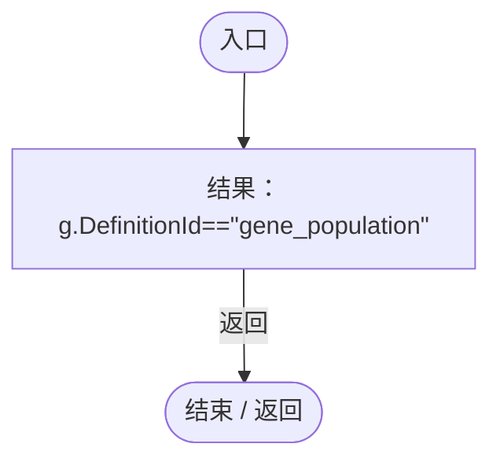

## 回调@101 · L101

`e … => 回调`

### Editor · Roslyn编译器控制流

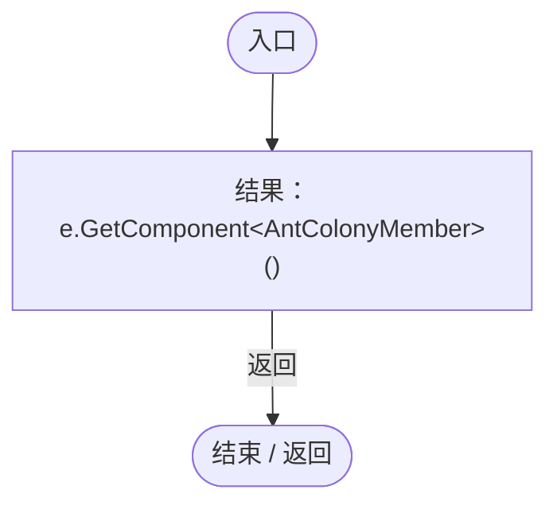

## 回调@101 · L101

`m … => 回调`

### Editor · Roslyn编译器控制流

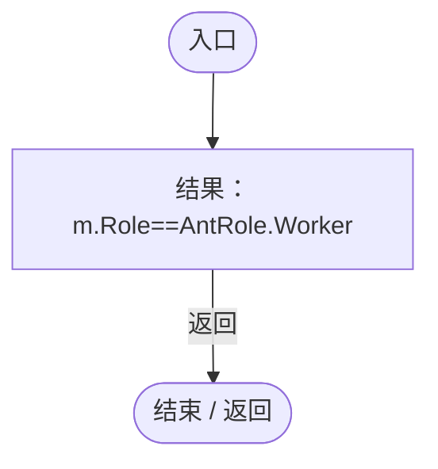

项目内调用/回调引用：

- [AntColonyMember.Role.get · L33](baebd85c05598377.md#mdf6df89f7116c7a3)（访问器）

## 回调@102 · L102

`e … => 回调`

### Editor · Roslyn编译器控制流

## 回调@110 · L110

`e … => 回调`

### Editor · Roslyn编译器控制流

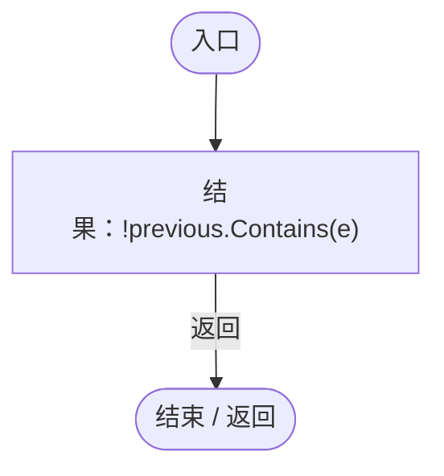

## 回调@120 · L120

`e … => 回调`

### Editor · Roslyn编译器控制流

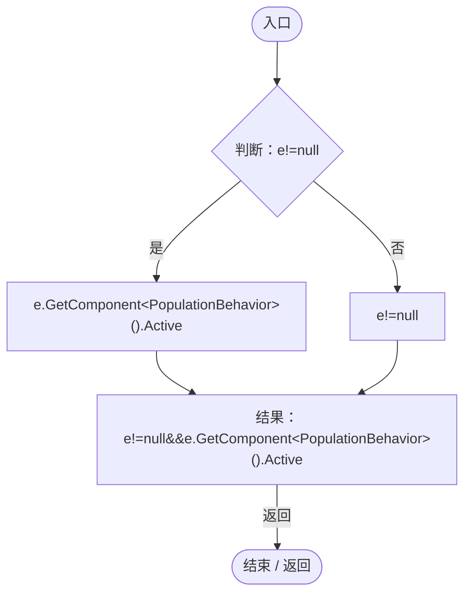

## 回调@135 · L135

`w … => 回调`

### Editor · Roslyn编译器控制流

```mermaid
flowchart TD
  b0(["入口"])
  b1{"判断：w.GetComponent&lt;PopulationBehavior&gt;().Active"}
  b2["w.GetComponent&lt;PopulationBehavior&gt;().Leader==null"]
  b3["!w.GetComponent&lt;PopulationBehavior&gt;().Active"]
  b4["结果：!w.GetComponent&lt;PopulationBehavior&gt;().Active&#124;&#124;w.GetComponent&lt;PopulationBehavior&gt;().Leader==null"]
  b5(["结束 / 返回"])
  b0 --> b1
  b1 -->|"是"| b2
  b1 -->|"否"| b3
  b2 --> b4
  b3 --> b4
  b4 -->|"返回"| b5

```
