# PopulationMaintenance.cs

[返回总索引](../README.md) · `Runtime` · `Assets/DarwinPark/Entities/PopulationMaintenance.cs`

[源文件](../../../Assets/DarwinPark/Entities/PopulationMaintenance.cs) · 源码校验：`1a9174a7d711b99024dc3bee9c2a0991828b95ed4e5ce04c8bd46b9a44f9d5d9`

方法按源文件位置排列。事件/回调引用不表示立即执行；分支与异常说明见总索引。完整源码与可点击关系图请打开离线手册。

<a id="me771b4b81f75bedc"></a>

## DefaultGenome · L18

`public static Genome DefaultGenome()`


### Editor / Player · Roslyn编译器控制流

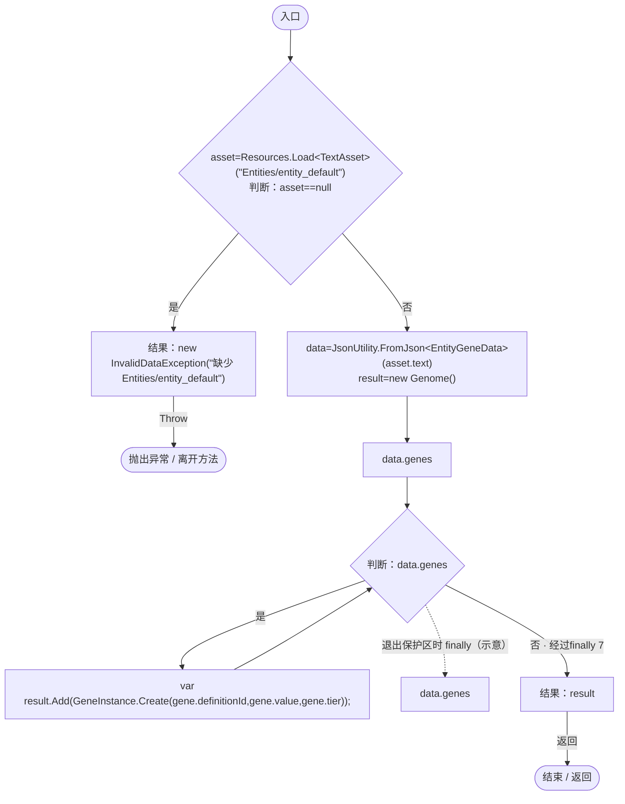

项目内调用/回调引用：

- [Genome.Add · L19](a2ef23f865bc7ee8.md#md9cfdc94b8b8d40f)（方法）
- [GeneInstance.Create · L20](f82e1498d67f5afd.md#m72e94c278de3cf8b)（方法）

<a id="me0949958df9c70e0"></a>

## Clone · L23

`public static Genome Clone(Genome source)`


### Editor / Player · Roslyn编译器控制流

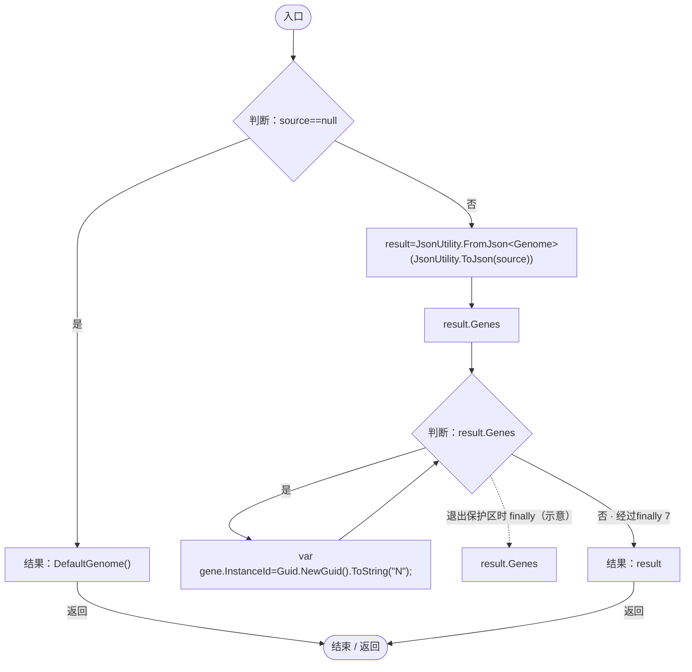

项目内调用/回调引用：

- [RandomSpawnRecipe.DefaultGenome · L18](923ccc4e86c4786c.md#me771b4b81f75bedc)（方法）

<a id="m2612c79fe3848e08"></a>

## CreateGenome · L25

`public Genome CreateGenome()`


### Editor / Player · Roslyn编译器控制流

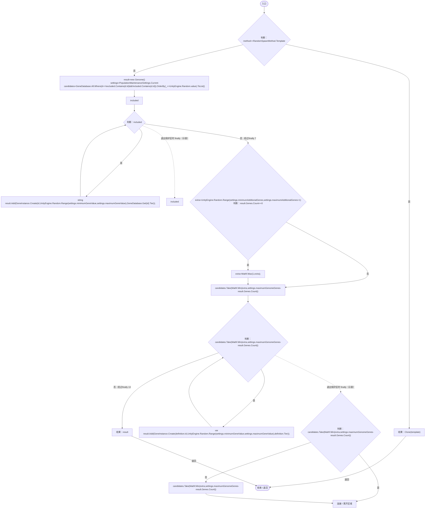

项目内调用/回调引用：

- [RandomSpawnRecipe.Clone · L23](923ccc4e86c4786c.md#me0949958df9c70e0)（方法）
- [PopulationMaintenanceSettings.Current.get · L67](923ccc4e86c4786c.md#m98032f1fd6454bb8)（访问器）
- [GeneDatabase.All.get · L128](ec0a03483435a863.md#m0a367ed24734f426)（访问器）
- [Genome.Add · L19](a2ef23f865bc7ee8.md#md9cfdc94b8b8d40f)（方法）
- [GeneInstance.Create · L20](f82e1498d67f5afd.md#m72e94c278de3cf8b)（方法）
- [GeneDatabase.Get · L135](ec0a03483435a863.md#m8f3bbfb35f3ca397)（方法）
- [RandomSpawnRecipe.回调@29 · L29](923ccc4e86c4786c.md#mc8a7492d09be4d95)（回调/委托）
- [RandomSpawnRecipe.回调@29 · L29](923ccc4e86c4786c.md#m9bf26274737cbf26)（回调/委托）

<a id="mc8a7492d09be4d95"></a>

## 回调@29 · L29

`d … => 回调`


### Editor / Player · Roslyn编译器控制流

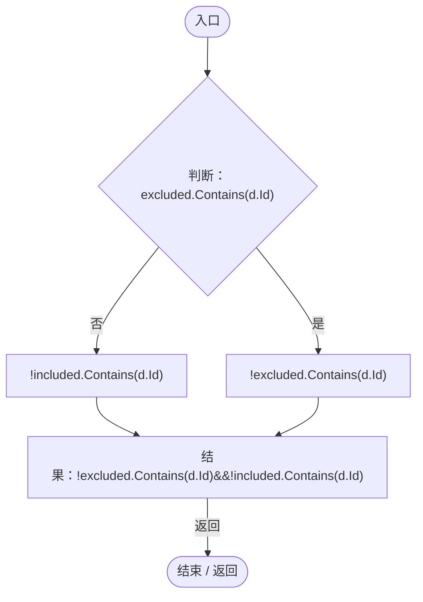

<a id="m9bf26274737cbf26"></a>

## 回调@29 · L29

`_ … => 回调`


### Editor / Player · Roslyn编译器控制流

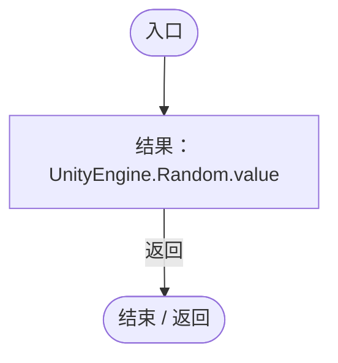

<a id="mb2348b1f360c1cce"></a>

## Matches · L34

`public bool Matches(Genome genome)`


### Editor / Player · Roslyn编译器控制流

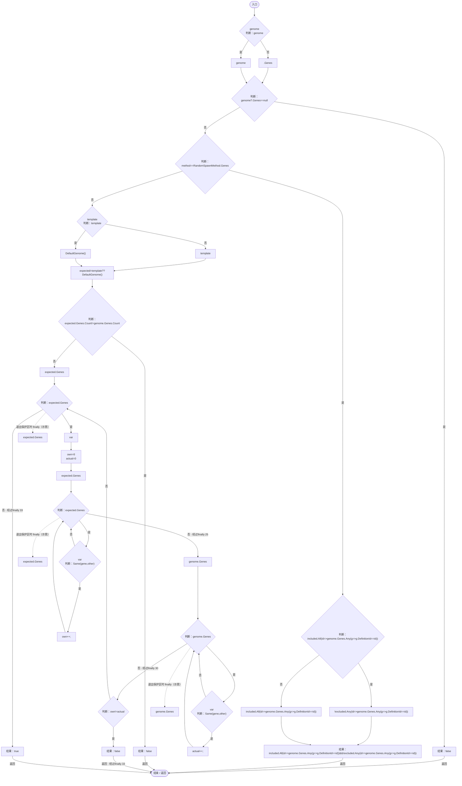

项目内调用/回调引用：

- [RandomSpawnRecipe.DefaultGenome · L18](923ccc4e86c4786c.md#me771b4b81f75bedc)（方法）
- [RandomSpawnRecipe.Same · L47](923ccc4e86c4786c.md#me826b486bab8cc3a)（方法）
- [RandomSpawnRecipe.回调@37 · L37](923ccc4e86c4786c.md#md5b7ce5168cc90ac)（回调/委托）
- [RandomSpawnRecipe.回调@37 · L37](923ccc4e86c4786c.md#m072469b211f78c1a)（回调/委托）

<a id="md5b7ce5168cc90ac"></a>

## 回调@37 · L37

`id … => 回调`


### Editor / Player · Roslyn编译器控制流


项目内调用/回调引用：

- [RandomSpawnRecipe.回调@37 · L37](923ccc4e86c4786c.md#m56c5a135fce99120)（回调/委托）

<a id="m56c5a135fce99120"></a>

## 回调@37 · L37

`g … => 回调`


### Editor / Player · Roslyn编译器控制流

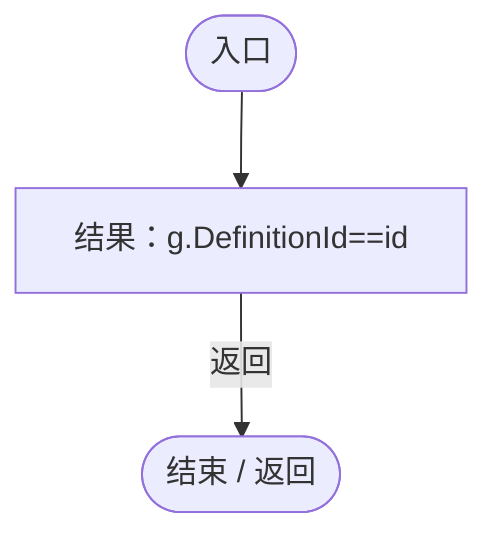

<a id="m072469b211f78c1a"></a>

## 回调@37 · L37

`id … => 回调`


### Editor / Player · Roslyn编译器控制流

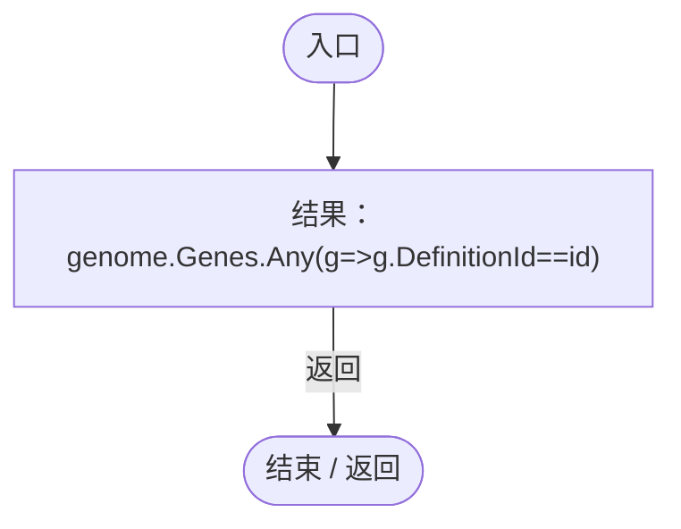

项目内调用/回调引用：

- [RandomSpawnRecipe.回调@37 · L37](923ccc4e86c4786c.md#m3fc25ae37be6f753)（回调/委托）

<a id="m3fc25ae37be6f753"></a>

## 回调@37 · L37

`g … => 回调`


### Editor / Player · Roslyn编译器控制流


<a id="me826b486bab8cc3a"></a>

## Same · L47

`private static bool Same(GeneInstance a,GeneInstance b)`

★ 修复（防Bug回归）：数量扫描不为每个实体/基因拼接浮点字符串，避免维持模板带来持续GC。

### Editor / Player · Roslyn编译器控制流


<a id="m0fe74d9bb4825883"></a>

## Validate · L48

`public void Validate(ICollection<string> catalog)`


### Editor / Player · Roslyn编译器控制流

```mermaid
flowchart TD
  b0(["入口"])
  b1{"判断：Enum.IsDefined(typeof(RandomSpawnMethod),method)"}
  b2{"判断：string.IsNullOrWhiteSpace(name)"}
  b3{"判断：name.Length&gt;128"}
  b4{"判断：included==null"}
  b5{"判断：excluded==null"}
  b6{"判断：included.Count!=included.Distinct().Count()"}
  b7{"判断：excluded.Count!=excluded.Distinct().Count()"}
  b8{"判断：included.Intersect(excluded).Any()"}
  b9{"判断：included.Concat(excluded).Any(id=&gt;!catalog.Contains(id))"}
  b10["结果：new InvalidDataException(&quot;随机生成来源或基因条件无效&quot;)"]
  x10(["抛出异常 / 离开方法"])
  b11{"判断：method==RandomSpawnMethod.Template"}
  b12{"判断：template==null"}
  b13["template=DefaultGenome();"]
  b14{"genes=template.Genes<br/>判断：genes==null"}
  b15{"判断：genes.Count==0"}
  b16{"判断：genes.Count&gt;PopulationMaintenanceSettings.Current.maximumGenomeGenes"}
  b17{"判断：genes.Any(g=&gt;g==null&#124;&#124;!catalog.Contains(g.DefinitionId)&#124;&#124;!float.IsFinite(g.Value)&#124;&#124;g.Value&lt;0&#124;&#124;g.Value&gt;100&#124;&#124;!float.IsFinite(g.CopyStrength)&#124;&#124;g.CopyStrength&lt;0&#124;&#124;g.MissingStateIds==null)"}
  b18["结果：new InvalidDataException(&quot;随机生成模板基因无效&quot;)"]
  x18(["抛出异常 / 离开方法"])
  b19{"判断：included.Count&gt;PopulationMaintenanceSettings.Current.maximumGenomeGenes"}
  b20{"判断：catalog.All(excluded.Contains)"}
  b21["结果：new InvalidDataException(&quot;基因条件没有可生成的基因或必选基因过多&quot;)"]
  x21(["抛出异常 / 离开方法"])
  b22(["结束 / 返回"])
  b0 --> b1
  b1 -->|"是"| b2
  b1 -->|"否"| b10
  b2 -->|"否"| b3
  b2 -->|"是"| b10
  b3 -->|"否"| b4
  b3 -->|"是"| b10
  b4 -->|"否"| b5
  b4 -->|"是"| b10
  b5 -->|"否"| b6
  b5 -->|"是"| b10
  b6 -->|"否"| b7
  b6 -->|"是"| b10
  b7 -->|"否"| b8
  b7 -->|"是"| b10
  b8 -->|"否"| b9
  b8 -->|"是"| b10
  b9 -->|"是"| b10
  b9 -->|"否"| b11
  b10 -->|"Throw"| x10
  b11 -->|"是"| b12
  b11 -->|"否"| b19
  b12 -->|"是"| b13
  b12 -->|"否"| b14
  b13 --> b14
  b14 -->|"否"| b15
  b14 -->|"是"| b18
  b15 -->|"否"| b16
  b15 -->|"是"| b18
  b16 -->|"否"| b17
  b16 -->|"是"| b18
  b17 -->|"是"| b18
  b17 -->|"否"| b22
  b18 -->|"Throw"| x18
  b19 -->|"否"| b20
  b19 -->|"是"| b21
  b20 -->|"是"| b21
  b20 -->|"否"| b22
  b21 -->|"Throw"| x21

```

项目内调用/回调引用：

- [RandomSpawnRecipe.DefaultGenome · L18](923ccc4e86c4786c.md#me771b4b81f75bedc)（方法）
- [PopulationMaintenanceSettings.Current.get · L67](923ccc4e86c4786c.md#m98032f1fd6454bb8)（访问器）
- [RandomSpawnRecipe.回调@50 · L50](923ccc4e86c4786c.md#mc060c2a60ec1dffa)（回调/委托）
- [RandomSpawnRecipe.回调@52 · L52](923ccc4e86c4786c.md#mc8856be0fd26e8db)（回调/委托）

<a id="mc060c2a60ec1dffa"></a>

## 回调@50 · L50

`id … => 回调`


### Editor / Player · Roslyn编译器控制流

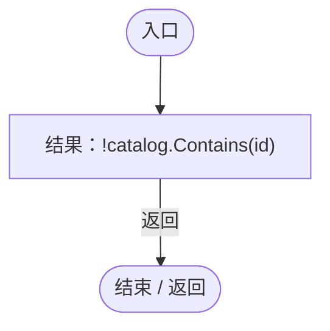

<a id="mc8856be0fd26e8db"></a>

## 回调@52 · L52

`g … => 回调`


### Editor / Player · Roslyn编译器控制流


<a id="m98032f1fd6454bb8"></a>

## Current.get · L67

`get`


### Editor / Player · Roslyn编译器控制流


<a id="m19b58f3e2687c6a3"></a>

## Rules.get · L78

`public static IReadOnlyList<PopulationMaintenanceRule> Rules`


### Editor / Player · 语法控制结构 / 声明（非CFG）


<a id="m716f3a3da24b121a"></a>

## Total.get · L78

`get`


### Editor / Player · 语法控制结构 / 声明（非CFG）


<a id="m62188c80c2df0aca"></a>

## Total.set · L78

`private set`


### Editor / Player · 语法控制结构 / 声明（非CFG）


<a id="m68d4133ac5e035ed"></a>

## Refresh · L79

`public static void Refresh()`


### Editor / Player · Roslyn编译器控制流

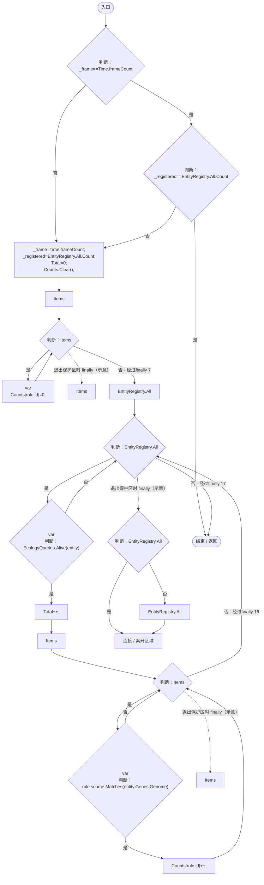

项目内调用/回调引用：

- [PopulationMaintenance.Total.set · L78](923ccc4e86c4786c.md#m62188c80c2df0aca)（访问器）
- [EcologyQueries.Alive · L38](bdf7ccc2c9c0452f.md#mb2877c487f449970)（方法）
- [PopulationMaintenance.Total.get · L78](923ccc4e86c4786c.md#m716f3a3da24b121a)（访问器）
- [RandomSpawnRecipe.Matches · L34](923ccc4e86c4786c.md#mb2348b1f360c1cce)（方法）
- [DarwinEntity.Genes.get · L14](70798dde169f2e8b.md#m622eb1adf401d431)（访问器）

<a id="m2d5cc0fde7e7bbfa"></a>

## Count · L84

`public static int Count(PopulationMaintenanceRule rule)`


### Editor / Player · Roslyn编译器控制流


项目内调用/回调引用：

- [PopulationMaintenance.Refresh · L79](923ccc4e86c4786c.md#m68d4133ac5e035ed)（方法）

<a id="m29a1a96365f74909"></a>

## Needed · L85

`public static int Needed(PopulationMaintenanceRule rule)`


### Editor / Player · Roslyn编译器控制流

```mermaid
flowchart TD
  b0(["入口"])
  b1{"count=Count(rule)<br/>判断：rule.enabled"}
  b2{"判断：rule.ratio&lt;=0"}
  b3["结果：0"]
  b4{"判断：Total==0"}
  b5["结果：Math.Min(PopulationMaintenanceSettings.Current.emptyWorldSeedCount,PopulationMaintenanceSettings.Current.maximumRefillPerCycle)"]
  b6{"判断：count&gt;=Total*rule.ratio"}
  b7["结果：0"]
  b8["结果：(int)Math.Min(PopulationMaintenanceSettings.Current.maximumRefillPerCycle,Math.Max(0,Math.Ceiling(((double)rule.ratio*Total-count)/(1d-rule.ratio))))"]
  b9(["结束 / 返回"])
  b0 --> b1
  b1 -->|"是"| b2
  b1 -->|"否"| b3
  b2 -->|"是"| b3
  b2 -->|"否"| b4
  b3 -->|"返回"| b9
  b4 -->|"是"| b5
  b4 -->|"否"| b6
  b5 -->|"返回"| b9
  b6 -->|"是"| b7
  b6 -->|"否"| b8
  b7 -->|"返回"| b9
  b8 -->|"返回"| b9

```

项目内调用/回调引用：

- [PopulationMaintenance.Count · L84](923ccc4e86c4786c.md#m2d5cc0fde7e7bbfa)（方法）
- [PopulationMaintenance.Total.get · L78](923ccc4e86c4786c.md#m716f3a3da24b121a)（访问器）
- [PopulationMaintenanceSettings.Current.get · L67](923ccc4e86c4786c.md#m98032f1fd6454bb8)（访问器）

<a id="md85ad248b85bab28"></a>

## Disjoint · L91

`private static bool Disjoint(RandomSpawnRecipe a,RandomSpawnRecipe b)`


### Editor / Player · Roslyn编译器控制流

```mermaid
flowchart TD
  b0(["入口"])
  b1{"判断：a.method==RandomSpawnMethod.Template"}
  b2["结果：!b.Matches(a.template)"]
  b3{"判断：b.method==RandomSpawnMethod.Template"}
  b4["结果：!a.Matches(b.template)"]
  b5{"判断：a.included.Any(b.excluded.Contains)"}
  b6["b.included.Any(a.excluded.Contains)"]
  b7["a.included.Any(b.excluded.Contains)"]
  b8["结果：a.included.Any(b.excluded.Contains)&#124;&#124;b.included.Any(a.excluded.Contains)"]
  b9(["结束 / 返回"])
  b0 --> b1
  b1 -->|"是"| b2
  b1 -->|"否"| b3
  b2 -->|"返回"| b9
  b3 -->|"是"| b4
  b3 -->|"否"| b5
  b4 -->|"返回"| b9
  b5 -->|"否"| b6
  b5 -->|"是"| b7
  b6 --> b8
  b7 --> b8
  b8 -->|"返回"| b9

```

项目内调用/回调引用：

- [RandomSpawnRecipe.Matches · L34](923ccc4e86c4786c.md#mb2348b1f360c1cce)（方法）

<a id="m5bf32a4f4b44fb39"></a>

## RequiresRefill · L97

`public static bool RequiresRefill(PopulationMaintenanceRule rule)`


### Editor / Player · Roslyn编译器控制流

```mermaid
flowchart TD
  b0(["入口"])
  b1{"判断：Needed(rule)==0"}
  b2["结果：false"]
  b3{"count=Count(rule)<br/>判断：count==0"}
  b4["结果：true"]
  b5{"判断：RoundedPartitions.Contains(rule.id)"}
  b6["rule.ratio*Total-count&gt;=1"]
  b7["!RoundedPartitions.Contains(rule.id)"]
  b8["结果：!RoundedPartitions.Contains(rule.id)&#124;&#124;rule.ratio*Total-count&gt;=1"]
  b9(["结束 / 返回"])
  b0 --> b1
  b1 -->|"是"| b2
  b1 -->|"否"| b3
  b2 -->|"返回"| b9
  b3 -->|"是"| b4
  b3 -->|"否"| b5
  b4 -->|"返回"| b9
  b5 -->|"是"| b6
  b5 -->|"否"| b7
  b6 --> b8
  b7 --> b8
  b8 -->|"返回"| b9

```

项目内调用/回调引用：

- [PopulationMaintenance.Needed · L85](923ccc4e86c4786c.md#m29a1a96365f74909)（方法）
- [PopulationMaintenance.Count · L84](923ccc4e86c4786c.md#m2d5cc0fde7e7bbfa)（方法）
- [PopulationMaintenance.Total.get · L78](923ccc4e86c4786c.md#m716f3a3da24b121a)（访问器）

<a id="mc254594e5109e9bf"></a>

## BreedingScale · L103

`public static float BreedingScale(EntityGeneController genes)`


### Editor / Player · Roslyn编译器控制流

```mermaid
flowchart TD
  b0(["入口"])
  b1{"判断：Items.Count==0"}
  b2["结果：1"]
  b3["Refresh();<br/>factor=1"]
  b4["Items"]
  b5{"判断：Items"}
  b6{"var<br/>判断：rule.enabled"}
  b7{"判断：rule.source.Matches(genes.Genome)"}
  b8{"判断：Total&gt;0"}
  b9{"share=Counts[rule.id]/(float)Total<br/>判断：share&gt;rule.ratio"}
  b10["factor=Mathf.Min(factor,rule.ratio/share);"]
  b11["Items"]
  b12["结果：factor"]
  b13(["结束 / 返回"])
  b0 --> b1
  b1 -->|"是"| b2
  b1 -->|"否"| b3
  b2 -->|"返回"| b13
  b3 --> b4
  b4 --> b5
  b5 -->|"是"| b6
  b5 -->|"否 · 经过finally 11"| b12
  b6 -->|"是"| b7
  b6 -->|"否"| b5
  b7 -->|"是"| b8
  b7 -->|"否"| b5
  b8 -->|"是"| b9
  b8 -->|"否"| b5
  b9 -->|"是"| b10
  b9 -->|"否"| b5
  b10 --> b5
  b12 -->|"返回"| b13
  b5 -. "退出保护区时 finally（示意）" .-> b11

```

项目内调用/回调引用：

- [PopulationMaintenance.Refresh · L79](923ccc4e86c4786c.md#m68d4133ac5e035ed)（方法）
- [RandomSpawnRecipe.Matches · L34](923ccc4e86c4786c.md#mb2348b1f360c1cce)（方法）
- [PopulationMaintenance.Total.get · L78](923ccc4e86c4786c.md#m716f3a3da24b121a)（访问器）

<a id="m6443aed2cb3ff306"></a>

## BreedingReady · L108

`public static bool BreedingReady(EntityGeneController genes,ref float waited,float dt)`


### Editor / Player · Roslyn编译器控制流

```mermaid
flowchart TD
  b0(["入口"])
  b1{"scale=BreedingScale(genes)<br/>判断：scale&gt;=1"}
  b2["waited=0;<br/>结果：true"]
  b3{"判断：scale&lt;=0"}
  b4["waited=0;<br/>结果：false"]
  b5["delay=PopulationMaintenanceSettings.Current.extraBreedingDelaySeconds*(1/scale-1)<br/>waited=Mathf.Min(delay,waited+Mathf.Max(0,dt));<br/>结果：waited&gt;=delay"]
  b6(["结束 / 返回"])
  b0 --> b1
  b1 -->|"是"| b2
  b1 -->|"否"| b3
  b2 -->|"返回"| b6
  b3 -->|"是"| b4
  b3 -->|"否"| b5
  b4 -->|"返回"| b6
  b5 -->|"返回"| b6

```

项目内调用/回调引用：

- [PopulationMaintenance.BreedingScale · L103](923ccc4e86c4786c.md#mc254594e5109e9bf)（方法）
- [PopulationMaintenanceSettings.Current.get · L67](923ccc4e86c4786c.md#m98032f1fd6454bb8)（访问器）

<a id="m75c086e56c17f2aa"></a>

## Set · L113

`public static bool Set(PopulationMaintenanceRule rule)`


### Editor / Player · Roslyn编译器控制流

```mermaid
flowchart TD
  b0(["入口"])
  b1{"判断：WorldAuthority.IsReplica"}
  b2{"判断：WorldAuthority.CanEdit"}
  b3{"判断：rule==null"}
  b4["结果：false"]
  b5{"next=Capture()<br/>index=next.rules.FindIndex(r=&gt;r.id==rule.id)<br/>判断：index&lt;0"}
  b6["next.rules.Add(rule);"]
  b7["next.rules[index]=rule;"]
  b8["Validate(next,GeneDatabase.All.Select(d=&gt;d.Id).ToArray());"]
  b9["结果：false"]
  b10["Restore(next);<br/>结果：true"]
  b11(["结束 / 返回"])
  b0 --> b1
  b1 -->|"否"| b2
  b1 -->|"是"| b4
  b2 -->|"是"| b3
  b2 -->|"否"| b4
  b3 -->|"是"| b4
  b3 -->|"否"| b5
  b4 -->|"返回"| b11
  b5 -->|"是"| b6
  b5 -->|"否"| b7
  b6 --> b8
  b7 --> b8
  b8 --> b10
  b9 -->|"返回"| b11
  b10 -->|"返回"| b11
  b8 -. "保护区可能异常（示意）" .-> b9

```

项目内调用/回调引用：

- [PopulationMaintenance.Capture · L121](923ccc4e86c4786c.md#m5dc9a32bbddf0f63)（方法）
- [PopulationMaintenance.Validate · L122](923ccc4e86c4786c.md#m0c29d6aef903cb75)（方法）
- [GeneDatabase.All.get · L128](ec0a03483435a863.md#m0a367ed24734f426)（访问器）
- [PopulationMaintenance.Restore · L136](923ccc4e86c4786c.md#m17a7879cb457a04a)（方法）
- [PopulationMaintenance.回调@116 · L116](923ccc4e86c4786c.md#m51f4baf7a4ee98f1)（回调/委托）
- [PopulationMaintenance.回调@117 · L117](923ccc4e86c4786c.md#m611518d3f6d53d45)（回调/委托）

<a id="m51f4baf7a4ee98f1"></a>

## 回调@116 · L116

`r … => 回调`


### Editor / Player · Roslyn编译器控制流

```mermaid
flowchart TD
  b0(["入口"])
  b1["结果：r.id==rule.id"]
  b2(["结束 / 返回"])
  b0 --> b1
  b1 -->|"返回"| b2

```

<a id="m611518d3f6d53d45"></a>

## 回调@117 · L117

`d … => 回调`


### Editor / Player · Roslyn编译器控制流

```mermaid
flowchart TD
  b0(["入口"])
  b1["结果：d.Id"]
  b2(["结束 / 返回"])
  b0 --> b1
  b1 -->|"返回"| b2

```

<a id="m0a08161e15af8470"></a>

## Remove · L119

`public static bool Remove(string id)`


### Editor / Player · Roslyn编译器控制流

```mermaid
flowchart TD
  b0(["入口"])
  b1{"判断：WorldAuthority.IsReplica"}
  b2{"判断：WorldAuthority.CanEdit"}
  b3["结果：false"]
  b4["removed=Items.RemoveAll(r=&gt;r.id==id)<br/>RoundedPartitions=CheckPartitions(Items);<br/>_frame=-1;<br/>结果：removed&gt;0"]
  b5(["结束 / 返回"])
  b0 --> b1
  b1 -->|"否"| b2
  b1 -->|"是"| b3
  b2 -->|"否"| b3
  b2 -->|"是"| b4
  b3 -->|"返回"| b5
  b4 -->|"返回"| b5

```

项目内调用/回调引用：

- [PopulationMaintenance.CheckPartitions · L130](923ccc4e86c4786c.md#m181175ba948ac97b)（方法）
- [PopulationMaintenance.回调@119 · L119](923ccc4e86c4786c.md#m586d5bf6e191d83d)（回调/委托）

<a id="m586d5bf6e191d83d"></a>

## 回调@119 · L119

`r … => 回调`


### Editor / Player · Roslyn编译器控制流

```mermaid
flowchart TD
  b0(["入口"])
  b1["结果：r.id==id"]
  b2(["结束 / 返回"])
  b0 --> b1
  b1 -->|"返回"| b2

```

<a id="m5d2ca5d56a6f43ae"></a>

## SuspendAll · L120

`public static void SuspendAll()`


### Editor / Player · Roslyn编译器控制流

```mermaid
flowchart TD
  b0(["入口"])
  b1["Items"]
  b2{"判断：Items"}
  b3["var<br/>rule.enabled=false;"]
  b4["Items"]
  b5["RoundedPartitions.Clear();<br/>_frame=-1;"]
  b6(["结束 / 返回"])
  b0 --> b1
  b1 --> b2
  b2 -->|"是"| b3
  b2 -->|"否 · 经过finally 4"| b5
  b3 --> b2
  b5 --> b6
  b2 -. "退出保护区时 finally（示意）" .-> b4

```

<a id="m5dc9a32bbddf0f63"></a>

## Capture · L121

`public static PopulationMaintenanceState Capture()`


### Editor / Player · Roslyn编译器控制流

```mermaid
flowchart TD
  b0(["入口"])
  b1["new PopulationMaintenanceState{rules=Items.ToList()}<br/>rules=Items.ToList()<br/>结果：JsonUtility.FromJson&lt;PopulationMaintenanceState&gt;(JsonUtility.ToJson(new PopulationMaintenanceState{rules=Items.ToList()}))"]
  b2(["结束 / 返回"])
  b0 --> b1
  b1 -->|"返回"| b2

```

<a id="m0c29d6aef903cb75"></a>

## Validate · L122

`public static void Validate(PopulationMaintenanceState state,ICollection<string> catalog)`


### Editor / Player · Roslyn编译器控制流

```mermaid
flowchart TD
  b0(["入口"])
  b1{"判断：state==null"}
  b2{"判断：state.version==0"}
  b3{"判断：state.rules==null"}
  b4{"判断：state.rules.Count==0"}
  b5{"判断：state.version!=1"}
  b6{"判断：state.rules==null"}
  b7{"判断：state.rules.Count&gt;PopulationMaintenanceSettings.Current.maximumRules"}
  b8["结果：new InvalidDataException(&quot;数量维持规则版本或数量无效&quot;)"]
  x8(["抛出异常 / 离开方法"])
  b9["ids=new HashSet&lt;string&gt;()"]
  b10["state.rules"]
  b11{"判断：state.rules"}
  b12{"var<br/>判断：rule==null"}
  b13{"判断：Guid.TryParseExact(rule.id,&quot;N&quot;,out _)"}
  b14{"判断：ids.Add(rule.id)"}
  b15{"判断：float.IsFinite(rule.ratio)"}
  b16{"判断：rule.ratio&lt;0"}
  b17{"判断：rule.ratio&gt;=1"}
  b18{"判断：rule.source==null"}
  b19["结果：new InvalidDataException(&quot;数量维持比例或来源无效（比例须小于100%）&quot;)"]
  x19(["抛出异常 / 离开方法"])
  b20["rule.source.Validate(catalog);"]
  b21["state.rules"]
  b22["CheckPartitions(state.rules);"]
  b23(["结束 / 返回"])
  b0 --> b1
  b1 -->|"否"| b2
  b1 -->|"是"| b23
  b2 -->|"是"| b3
  b2 -->|"否"| b5
  b3 -->|"否"| b4
  b3 -->|"是"| b23
  b4 -->|"是"| b23
  b4 -->|"否"| b5
  b5 -->|"否"| b6
  b5 -->|"是"| b8
  b6 -->|"否"| b7
  b6 -->|"是"| b8
  b7 -->|"是"| b8
  b7 -->|"否"| b9
  b8 -->|"Throw"| x8
  b9 --> b10
  b10 --> b11
  b11 -->|"是"| b12
  b11 -->|"否 · 经过finally 21"| b22
  b12 -->|"否"| b13
  b12 -->|"是"| b19
  b13 -->|"是"| b14
  b13 -->|"否"| b19
  b14 -->|"是"| b15
  b14 -->|"否"| b19
  b15 -->|"是"| b16
  b15 -->|"否"| b19
  b16 -->|"否"| b17
  b16 -->|"是"| b19
  b17 -->|"否"| b18
  b17 -->|"是"| b19
  b18 -->|"是"| b19
  b18 -->|"否"| b20
  b19 -->|"Throw"| x19
  b20 --> b11
  b22 --> b23
  b11 -. "退出保护区时 finally（示意）" .-> b21

```

项目内调用/回调引用：

- [PopulationMaintenanceSettings.Current.get · L67](923ccc4e86c4786c.md#m98032f1fd6454bb8)（访问器）
- [RandomSpawnRecipe.Validate · L48](923ccc4e86c4786c.md#m0fe74d9bb4825883)（方法）
- [PopulationMaintenance.CheckPartitions · L130](923ccc4e86c4786c.md#m181175ba948ac97b)（方法）

<a id="m181175ba948ac97b"></a>

## CheckPartitions · L130

`private static HashSet<string> CheckPartitions(IEnumerable<PopulationMaintenanceRule> rules)`


### Editor / Player · Roslyn编译器控制流

```mermaid
flowchart TD
  b0(["入口"])
  b1["result=new HashSet&lt;string&gt;()<br/>enabled=rules.Where(r=&gt;r.enabled).ToArray()<br/>apart=new bool[enabled.Length,enabled.Length]"]
  b2["i=0"]
  b3{"判断：i&lt;enabled.Length"}
  b4["j=0"]
  b5{"判断：j&lt;i"}
  b6["apart[i,j]=Disjoint(enabled[i].source,enabled[j].source);<br/>j++"]
  b7["i++"]
  b8["mask=1"]
  b9{"判断：mask&lt;(1&lt;&lt;enabled.Length)"}
  b10["sum=0<br/>clique=true"]
  b11["i=0"]
  b12{"判断：i&lt;enabled.Length"}
  b13{"判断：clique"}
  b14{"判断：(mask&amp;(1&lt;&lt;i))!=0"}
  b15["sum+=enabled[i].ratio;"]
  b16["j=0"]
  b17{"判断：j&lt;i"}
  b18{"判断：(mask&amp;(1&lt;&lt;j))!=0"}
  b19{"判断：apart[i,j]"}
  b20["clique=false;"]
  b21["j++"]
  b22["i++"]
  b23{"判断：clique"}
  b24{"判断：sum&gt;1.000001"}
  b25["结果：new InvalidDataException(&quot;互斥维持规则的目标比例总和不能超过100%&quot;)"]
  x25(["抛出异常 / 离开方法"])
  b26{"判断：Math.Abs(sum-1)&lt;.000001"}
  b27["i=0"]
  b28{"判断：i&lt;enabled.Length"}
  b29{"判断：(mask&amp;(1&lt;&lt;i))!=0"}
  b30["result.Add(enabled[i].id);"]
  b31["i++"]
  b32["mask++"]
  b33["结果：result"]
  b34(["结束 / 返回"])
  b0 --> b1
  b1 --> b2
  b2 --> b3
  b3 -->|"是"| b4
  b3 -->|"否"| b8
  b4 --> b5
  b5 -->|"是"| b6
  b5 -->|"否"| b7
  b6 --> b5
  b7 --> b3
  b8 --> b9
  b9 -->|"是"| b10
  b9 -->|"否"| b33
  b10 --> b11
  b11 --> b12
  b12 -->|"是"| b13
  b12 -->|"否"| b23
  b13 -->|"是"| b14
  b13 -->|"否"| b23
  b14 -->|"是"| b15
  b14 -->|"否"| b22
  b15 --> b16
  b16 --> b17
  b17 -->|"是"| b18
  b17 -->|"否"| b22
  b18 -->|"是"| b19
  b18 -->|"否"| b21
  b19 -->|"否"| b20
  b19 -->|"是"| b21
  b20 --> b22
  b21 --> b17
  b22 --> b12
  b23 -->|"否"| b32
  b23 -->|"是"| b24
  b24 -->|"是"| b25
  b24 -->|"否"| b26
  b25 -->|"Throw"| x25
  b26 -->|"是"| b27
  b26 -->|"否"| b32
  b27 --> b28
  b28 -->|"是"| b29
  b28 -->|"否"| b32
  b29 -->|"是"| b30
  b29 -->|"否"| b31
  b30 --> b31
  b31 --> b28
  b32 --> b9
  b33 -->|"返回"| b34

```

项目内调用/回调引用：

- [PopulationMaintenance.Disjoint · L91](923ccc4e86c4786c.md#md85ad248b85bab28)（方法）
- [PopulationMaintenance.回调@132 · L132](923ccc4e86c4786c.md#m5ee05926c6c11962)（回调/委托）

<a id="m5ee05926c6c11962"></a>

## 回调@132 · L132

`r … => 回调`


### Editor / Player · Roslyn编译器控制流

```mermaid
flowchart TD
  b0(["入口"])
  b1["结果：r.enabled"]
  b2(["结束 / 返回"])
  b0 --> b1
  b1 -->|"返回"| b2

```

<a id="m17a7879cb457a04a"></a>

## Restore · L136

`public static void Restore(PopulationMaintenanceState state)`


### Editor / Player · Roslyn编译器控制流

```mermaid
flowchart TD
  b0(["入口"])
  b1{"state<br/>判断：state"}
  b2[".rules"]
  b3["state"]
  b4{"判断：state?.rules!=null"}
  b5["JsonUtility.FromJson&lt;PopulationMaintenanceState&gt;(JsonUtility.ToJson(state)).rules"]
  b6["new List&lt;PopulationMaintenanceRule&gt;()"]
  b7["incoming=state?.rules!=null?JsonUtility.FromJson&lt;PopulationMaintenanceState&gt;(JsonUtility.ToJson(state)).rules:new List&lt;PopulationMaintenanceRule&gt;()"]
  b8["partitions=CheckPartitions(incoming)<br/>Items.Clear();<br/>Items.AddRange(incoming);<br/>RoundedPartitions=partitions;<br/>_frame=-1;<br/>Counts.Clear();<br/>Total=0;"]
  b9(["结束 / 返回"])
  b0 --> b1
  b1 -->|"否"| b2
  b1 -->|"是"| b3
  b2 --> b4
  b3 --> b4
  b4 -->|"是"| b5
  b4 -->|"否"| b6
  b5 --> b7
  b6 --> b7
  b7 --> b8
  b8 --> b9

```

项目内调用/回调引用：

- [PopulationMaintenance.CheckPartitions · L130](923ccc4e86c4786c.md#m181175ba948ac97b)（方法）
- [PopulationMaintenance.Total.set · L78](923ccc4e86c4786c.md#m62188c80c2df0aca)（访问器）

<a id="m2b5ea7a9cd63db69"></a>

## Reset · L138

`[RuntimeInitializeOnLoadMethod(RuntimeInitializeLoadType.SubsystemRegistration)] private static void Reset()`


### Editor / Player · Roslyn编译器控制流

```mermaid
flowchart TD
  b0(["入口"])
  b1["Restore(null)"]
  b2(["结束 / 返回"])
  b0 --> b1
  b1 --> b2

```

项目内调用/回调引用：

- [PopulationMaintenance.Restore · L136](923ccc4e86c4786c.md#m17a7879cb457a04a)（方法）
