# PopulationMaintenance.cs

[返回总索引](../README.md) · `Runtime` · `Assets/DarwinPark/Entities/PopulationMaintenance.cs`

[源文件](../../../Assets/DarwinPark/Entities/PopulationMaintenance.cs) · 源码校验：`698b8498110962008ff7a5ba7d9c4cb0b3c553a1c3781537a1507aa4d329b0a0`

方法按源文件位置排列。事件/回调引用不表示立即执行；分支与异常说明见总索引。完整源码与可点击关系图请打开离线手册。

<a id="me771b4b81f75bedc"></a>

## DefaultGenome · L18

`public static Genome DefaultGenome()`


### Editor / Player · Roslyn编译器控制流

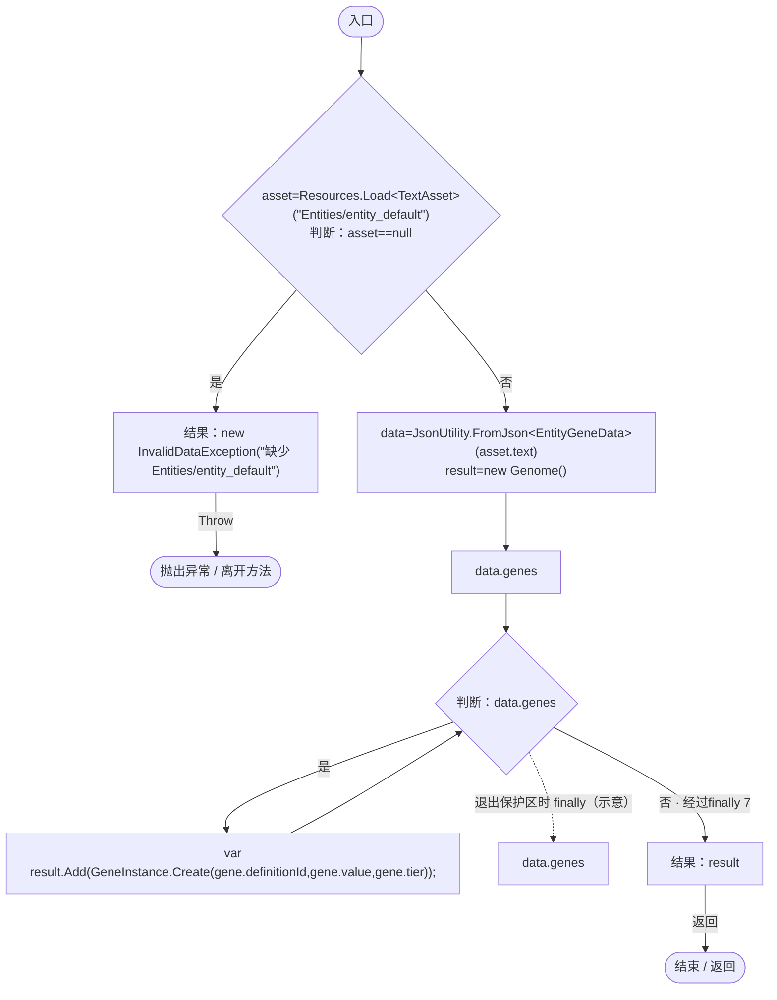

项目内调用/回调引用：

- [Genome.Add · L19](a2ef23f865bc7ee8.md#md9cfdc94b8b8d40f)（方法）
- [GeneInstance.Create · L20](f82e1498d67f5afd.md#m72e94c278de3cf8b)（方法）

<a id="me0949958df9c70e0"></a>

## Clone · L23

`public static Genome Clone(Genome source)`


### Editor / Player · Roslyn编译器控制流

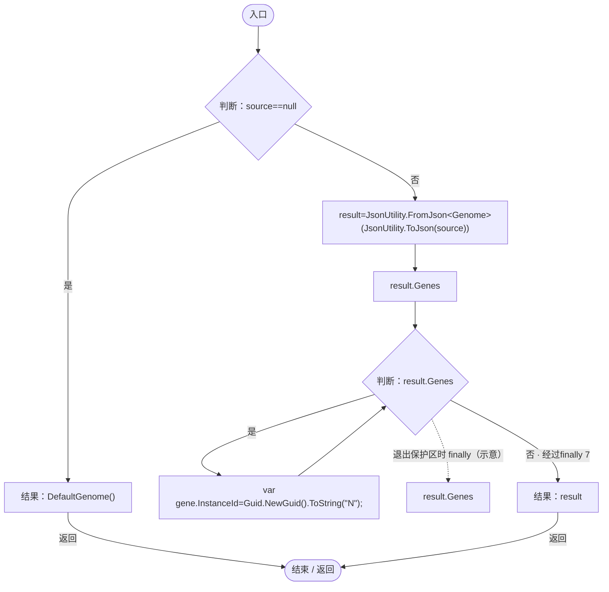

项目内调用/回调引用：

- [RandomSpawnRecipe.DefaultGenome · L18](923ccc4e86c4786c.md#me771b4b81f75bedc)（方法）

<a id="m2612c79fe3848e08"></a>

## CreateGenome · L25

`public Genome CreateGenome()`


### Editor / Player · Roslyn编译器控制流

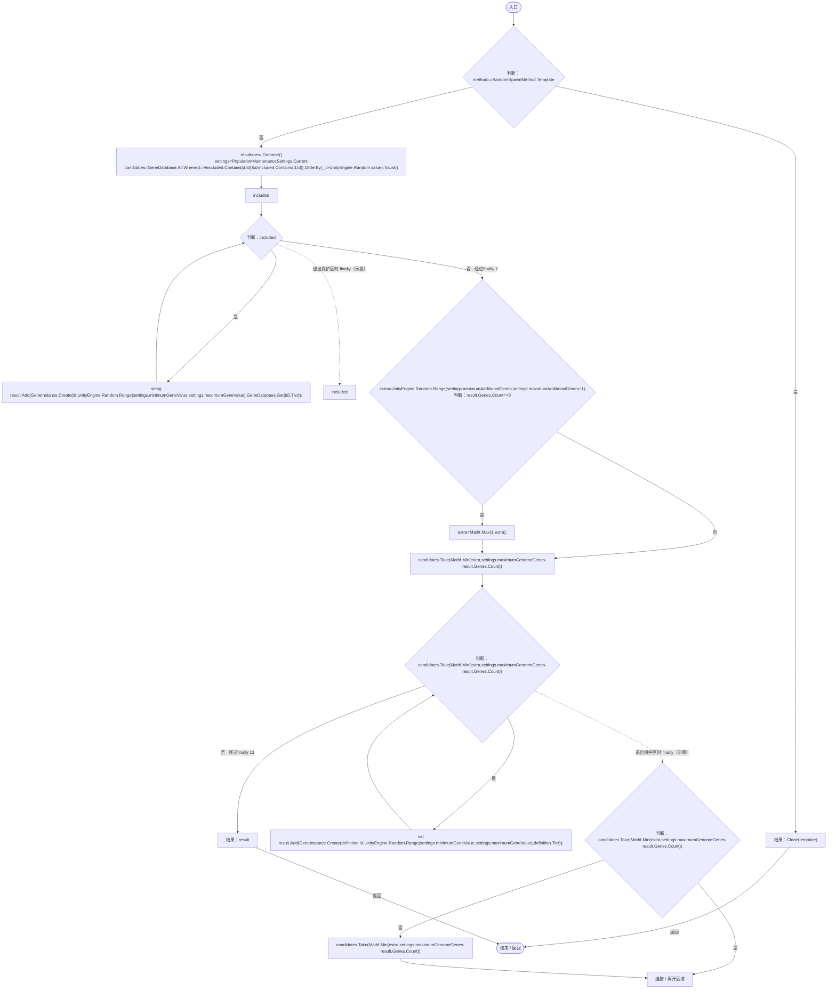

项目内调用/回调引用：

- [RandomSpawnRecipe.Clone · L23](923ccc4e86c4786c.md#me0949958df9c70e0)（方法）
- [PopulationMaintenanceSettings.Current.get · L77](923ccc4e86c4786c.md#ma2442661558e4796)（访问器）
- [GeneDatabase.All.get · L129](ec0a03483435a863.md#m6e0bbdec8f131ed0)（访问器）
- [Genome.Add · L19](a2ef23f865bc7ee8.md#md9cfdc94b8b8d40f)（方法）
- [GeneInstance.Create · L20](f82e1498d67f5afd.md#m72e94c278de3cf8b)（方法）
- [GeneDatabase.Get · L136](ec0a03483435a863.md#me6a5fefe6c3492f9)（方法）
- [RandomSpawnRecipe.回调@29 · L29](923ccc4e86c4786c.md#mc8a7492d09be4d95)（回调/委托）
- [RandomSpawnRecipe.回调@29 · L29](923ccc4e86c4786c.md#m9bf26274737cbf26)（回调/委托）

<a id="mc8a7492d09be4d95"></a>

## 回调@29 · L29

`d … => 回调`


### Editor / Player · Roslyn编译器控制流

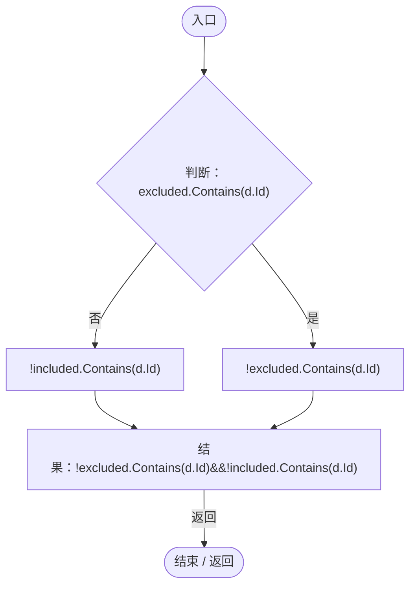

<a id="m9bf26274737cbf26"></a>

## 回调@29 · L29

`_ … => 回调`


### Editor / Player · Roslyn编译器控制流

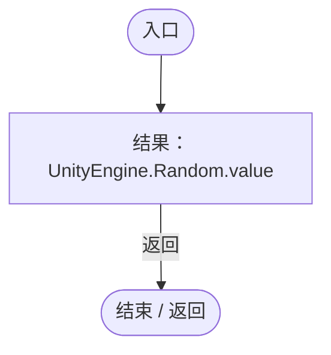

<a id="mb2348b1f360c1cce"></a>

## Matches · L34

`public bool Matches(Genome genome)`


### Editor / Player · Roslyn编译器控制流

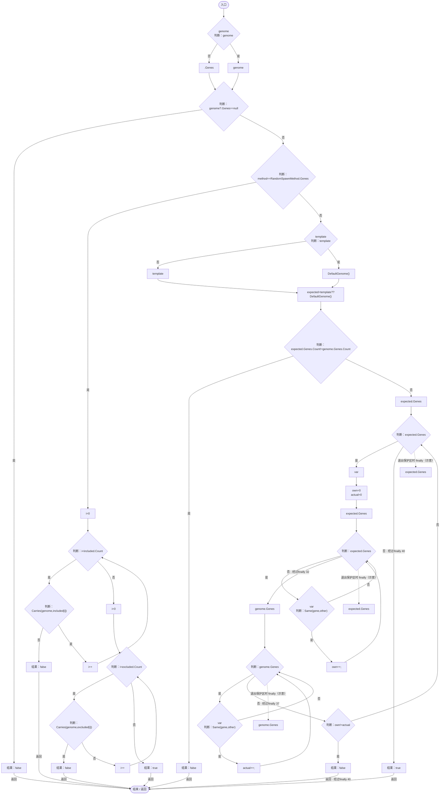

项目内调用/回调引用：

- [RandomSpawnRecipe.Carries · L52](923ccc4e86c4786c.md#m2c0cab6bfbfb8a3e)（方法）
- [RandomSpawnRecipe.DefaultGenome · L18](923ccc4e86c4786c.md#me771b4b81f75bedc)（方法）
- [RandomSpawnRecipe.Same · L55](923ccc4e86c4786c.md#maf0425575dc4ed71)（方法）

<a id="m2c0cab6bfbfb8a3e"></a>

## Carries · L52

`private static bool Carries(Genome genome,string id)`


### Editor / Player · Roslyn编译器控制流

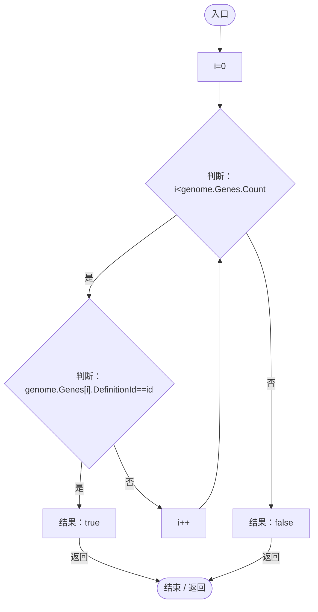

<a id="maf0425575dc4ed71"></a>

## Same · L55

`private static bool Same(GeneInstance a,GeneInstance b)`

★ 修复（防Bug回归）：数量扫描不为每个实体/基因拼接浮点字符串，避免维持模板带来持续GC。

### Editor / Player · Roslyn编译器控制流

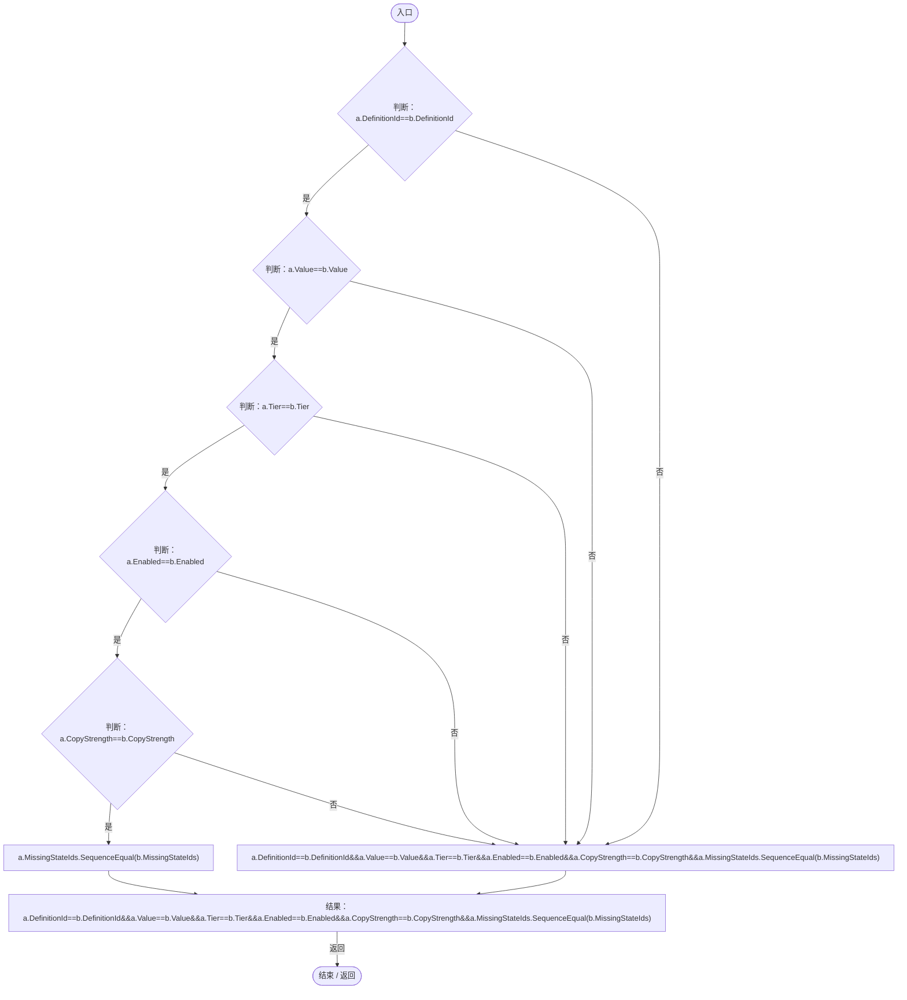

<a id="m4ac968c3ea314edb"></a>

## Validate · L56

`public void Validate(ICollection<string> catalog)`


### Editor / Player · Roslyn编译器控制流

```mermaid
flowchart TD
  b0(["入口"])
  b1{"判断：Enum.IsDefined(typeof(RandomSpawnMethod),method)"}
  b2{"判断：string.IsNullOrWhiteSpace(name)"}
  b3{"判断：name.Length&gt;128"}
  b4{"判断：included==null"}
  b5{"判断：excluded==null"}
  b6{"判断：included.Count!=included.Distinct().Count()"}
  b7{"判断：excluded.Count!=excluded.Distinct().Count()"}
  b8{"判断：included.Intersect(excluded).Any()"}
  b9{"判断：included.Concat(excluded).Any(id=&gt;!catalog.Contains(id))"}
  b10["结果：new InvalidDataException(&quot;随机生成来源或基因条件无效&quot;)"]
  x10(["抛出异常 / 离开方法"])
  b11{"判断：method==RandomSpawnMethod.Template"}
  b12{"判断：template==null"}
  b13["template=DefaultGenome();"]
  b14{"genes=template.Genes<br/>判断：genes==null"}
  b15{"判断：genes.Count==0"}
  b16{"判断：genes.Count&gt;PopulationMaintenanceSettings.Current.maximumGenomeGenes"}
  b17{"判断：genes.Any(g=&gt;g==null&#124;&#124;!catalog.Contains(g.DefinitionId)&#124;&#124;!float.IsFinite(g.Value)&#124;&#124;g.Value&lt;0&#124;&#124;g.Value&gt;100&#124;&#124;!float.IsFinite(g.CopyStrength)&#124;&#124;g.CopyStrength&lt;0&#124;&#124;g.MissingStateIds==null)"}
  b18["结果：new InvalidDataException(&quot;随机生成模板基因无效&quot;)"]
  x18(["抛出异常 / 离开方法"])
  b19{"判断：included.Count&gt;PopulationMaintenanceSettings.Current.maximumGenomeGenes"}
  b20{"判断：catalog.All(excluded.Contains)"}
  b21["结果：new InvalidDataException(&quot;基因条件没有可生成的基因或必选基因过多&quot;)"]
  x21(["抛出异常 / 离开方法"])
  b22(["结束 / 返回"])
  b0 --> b1
  b1 -->|"是"| b2
  b1 -->|"否"| b10
  b2 -->|"否"| b3
  b2 -->|"是"| b10
  b3 -->|"否"| b4
  b3 -->|"是"| b10
  b4 -->|"否"| b5
  b4 -->|"是"| b10
  b5 -->|"否"| b6
  b5 -->|"是"| b10
  b6 -->|"否"| b7
  b6 -->|"是"| b10
  b7 -->|"否"| b8
  b7 -->|"是"| b10
  b8 -->|"否"| b9
  b8 -->|"是"| b10
  b9 -->|"是"| b10
  b9 -->|"否"| b11
  b10 -->|"Throw"| x10
  b11 -->|"是"| b12
  b11 -->|"否"| b19
  b12 -->|"是"| b13
  b12 -->|"否"| b14
  b13 --> b14
  b14 -->|"否"| b15
  b14 -->|"是"| b18
  b15 -->|"否"| b16
  b15 -->|"是"| b18
  b16 -->|"否"| b17
  b16 -->|"是"| b18
  b17 -->|"是"| b18
  b17 -->|"否"| b22
  b18 -->|"Throw"| x18
  b19 -->|"否"| b20
  b19 -->|"是"| b21
  b20 -->|"是"| b21
  b20 -->|"否"| b22
  b21 -->|"Throw"| x21

```

项目内调用/回调引用：

- [RandomSpawnRecipe.DefaultGenome · L18](923ccc4e86c4786c.md#me771b4b81f75bedc)（方法）
- [PopulationMaintenanceSettings.Current.get · L77](923ccc4e86c4786c.md#ma2442661558e4796)（访问器）
- [RandomSpawnRecipe.回调@58 · L58](923ccc4e86c4786c.md#m708d001ce8a8957f)（回调/委托）
- [RandomSpawnRecipe.回调@60 · L60](923ccc4e86c4786c.md#m8d2e2594e9b94429)（回调/委托）

<a id="m708d001ce8a8957f"></a>

## 回调@58 · L58

`id … => 回调`


### Editor / Player · Roslyn编译器控制流

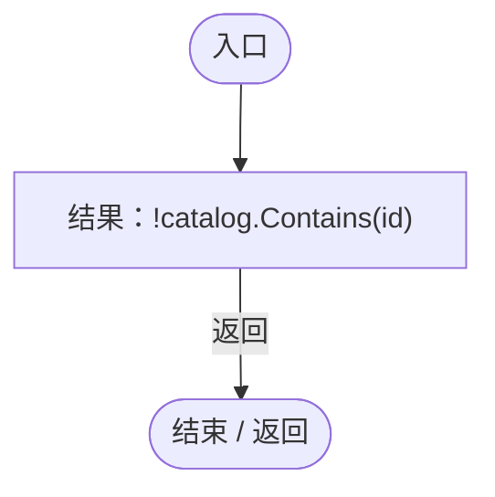

<a id="m8d2e2594e9b94429"></a>

## 回调@60 · L60

`g … => 回调`


### Editor / Player · Roslyn编译器控制流

```mermaid
flowchart TD
  b0(["入口"])
  b1{"判断：g==null"}
  b2{"判断：catalog.Contains(g.DefinitionId)"}
  b3{"判断：float.IsFinite(g.Value)"}
  b4{"判断：g.Value&lt;0"}
  b5{"判断：g.Value&gt;100"}
  b6{"判断：float.IsFinite(g.CopyStrength)"}
  b7{"判断：g.CopyStrength&lt;0"}
  b8["g.MissingStateIds==null"]
  b9["g==null&#124;&#124;!catalog.Contains(g.DefinitionId)&#124;&#124;!float.IsFinite(g.Value)&#124;&#124;g.Value&lt;0&#124;&#124;g.Value&gt;100&#124;&#124;!float.IsFinite(g.CopyStrength)&#124;&#124;g.CopyStrength&lt;0&#124;&#124;g.MissingStateIds==null"]
  b10["结果：g==null&#124;&#124;!catalog.Contains(g.DefinitionId)&#124;&#124;!float.IsFinite(g.Value)&#124;&#124;g.Value&lt;0&#124;&#124;g.Value&gt;100&#124;&#124;!float.IsFinite(g.CopyStrength)&#124;&#124;g.CopyStrength&lt;0&#124;&#124;g.MissingStateIds==null"]
  b11(["结束 / 返回"])
  b0 --> b1
  b1 -->|"否"| b2
  b1 -->|"是"| b9
  b2 -->|"是"| b3
  b2 -->|"否"| b9
  b3 -->|"是"| b4
  b3 -->|"否"| b9
  b4 -->|"否"| b5
  b4 -->|"是"| b9
  b5 -->|"否"| b6
  b5 -->|"是"| b9
  b6 -->|"是"| b7
  b6 -->|"否"| b9
  b7 -->|"否"| b8
  b7 -->|"是"| b9
  b8 --> b10
  b9 --> b10
  b10 -->|"返回"| b11

```

<a id="ma2442661558e4796"></a>

## Current.get · L77

`get`


### Editor / Player · Roslyn编译器控制流

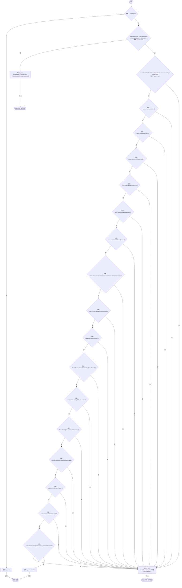

<a id="m08b2611ca1c101f8"></a>

## Rules.get · L88

`public static IReadOnlyList<PopulationMaintenanceRule> Rules`


### Editor / Player · 语法控制结构 / 声明（非CFG）

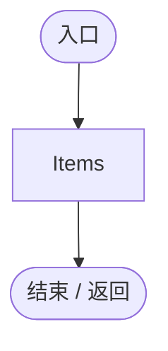

<a id="medbdb8bcbd2f1195"></a>

## Total.get · L88

`get`


### Editor / Player · 语法控制结构 / 声明（非CFG）


<a id="mea225c730d37ee4c"></a>

## Total.set · L88

`private set`


### Editor / Player · 语法控制结构 / 声明（非CFG）

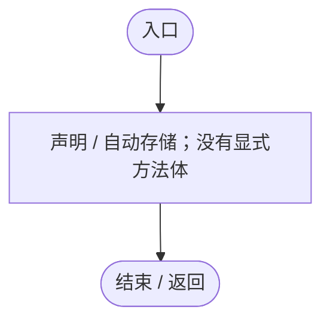

<a id="md4b0ebe230b2a373"></a>

## Refresh · L89

`public static void Refresh()`


### Editor / Player · Roslyn编译器控制流

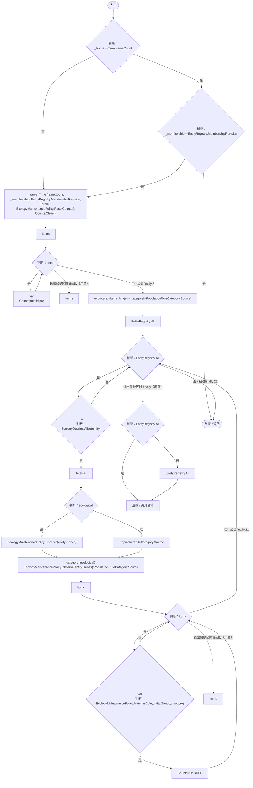

项目内调用/回调引用：

- [EntityRegistry.MembershipRevision.get · L15](2093aaf08559c9f2.md#m6afb6f184d119e11)（访问器）
- [PopulationMaintenance.Total.set · L88](923ccc4e86c4786c.md#mea225c730d37ee4c)（访问器）
- [EcologyMaintenancePolicy.ResetCounts · L12](554e3f13e11b3808.md#mdf5f7d2472a9e113)（方法）
- [EcologyQueries.Alive · L38](bdf7ccc2c9c0452f.md#mb2877c487f449970)（方法）
- [PopulationMaintenance.Total.get · L88](923ccc4e86c4786c.md#medbdb8bcbd2f1195)（访问器）
- [EcologyMaintenancePolicy.Observe · L13](554e3f13e11b3808.md#m8bc52ee55cfb7b6e)（方法）
- [DarwinEntity.Genes.get · L14](70798dde169f2e8b.md#m622eb1adf401d431)（访问器）
- [EcologyMaintenancePolicy.Matches · L18](554e3f13e11b3808.md#m93cad8d2c6e73e24)（方法）
- [PopulationMaintenance.回调@94 · L94](923ccc4e86c4786c.md#m0f986574c9edf830)（回调/委托）

<a id="m0f986574c9edf830"></a>

## 回调@94 · L94

`r … => 回调`


### Editor / Player · Roslyn编译器控制流

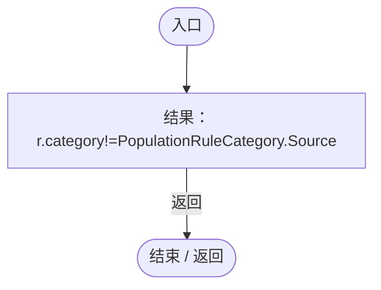

<a id="mbe9ad2ebe3b97624"></a>

## Count · L97

`public static int Count(PopulationMaintenanceRule rule)`


### Editor / Player · Roslyn编译器控制流

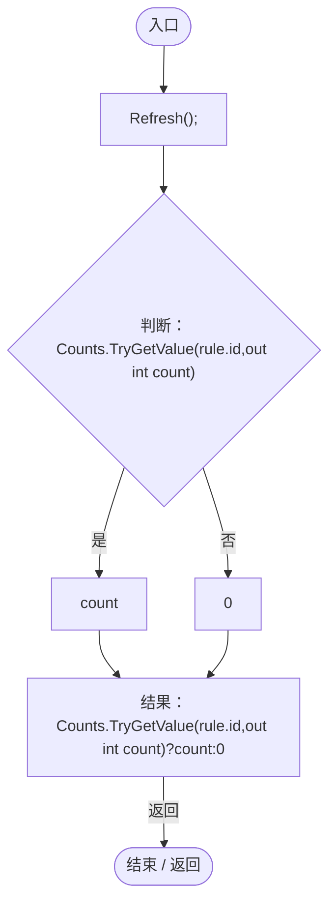

项目内调用/回调引用：

- [PopulationMaintenance.Refresh · L89](923ccc4e86c4786c.md#md4b0ebe230b2a373)（方法）

<a id="me76cdd08358ff4f0"></a>

## Denominator · L99

`public static int Denominator(PopulationMaintenanceRule rule)`

★ 适配：生态70/30共享“生产者+移动者”分母，其他静止异养个体不导致两个分区无解。

### Editor / Player · Roslyn编译器控制流

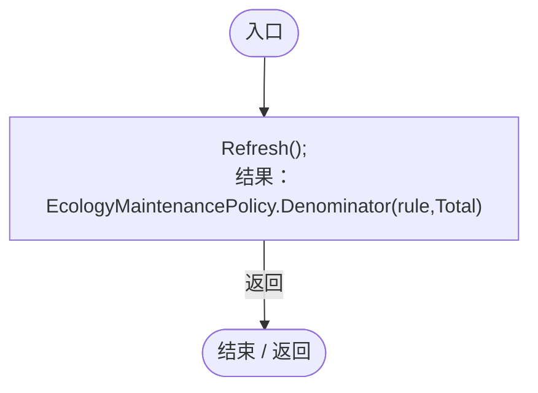

项目内调用/回调引用：

- [PopulationMaintenance.Refresh · L89](923ccc4e86c4786c.md#md4b0ebe230b2a373)（方法）
- [EcologyMaintenancePolicy.Denominator · L25](554e3f13e11b3808.md#m762c8935b6339195)（方法）
- [PopulationMaintenance.Total.get · L88](923ccc4e86c4786c.md#medbdb8bcbd2f1195)（访问器）

<a id="m9218b875eb51a5d3"></a>

## Needed · L100

`public static int Needed(PopulationMaintenanceRule rule)`


### Editor / Player · Roslyn编译器控制流

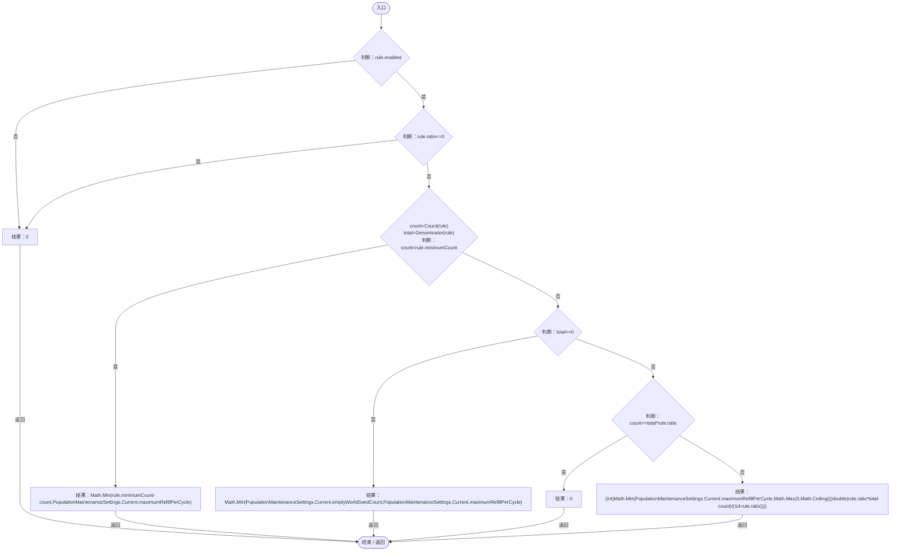

项目内调用/回调引用：

- [PopulationMaintenance.Count · L97](923ccc4e86c4786c.md#mbe9ad2ebe3b97624)（方法）
- [PopulationMaintenance.Denominator · L99](923ccc4e86c4786c.md#me76cdd08358ff4f0)（方法）
- [PopulationMaintenanceSettings.Current.get · L77](923ccc4e86c4786c.md#ma2442661558e4796)（访问器）

<a id="m28c0ec6015450106"></a>

## Disjoint · L109

`private static bool Disjoint(RandomSpawnRecipe a,RandomSpawnRecipe b)`


### Editor / Player · Roslyn编译器控制流

```mermaid
flowchart TD
  b0(["入口"])
  b1{"判断：a.method==RandomSpawnMethod.Template"}
  b2["结果：!b.Matches(a.template)"]
  b3{"判断：b.method==RandomSpawnMethod.Template"}
  b4["结果：!a.Matches(b.template)"]
  b5{"判断：a.included.Any(b.excluded.Contains)"}
  b6["b.included.Any(a.excluded.Contains)"]
  b7["a.included.Any(b.excluded.Contains)"]
  b8["结果：a.included.Any(b.excluded.Contains)&#124;&#124;b.included.Any(a.excluded.Contains)"]
  b9(["结束 / 返回"])
  b0 --> b1
  b1 -->|"是"| b2
  b1 -->|"否"| b3
  b2 -->|"返回"| b9
  b3 -->|"是"| b4
  b3 -->|"否"| b5
  b4 -->|"返回"| b9
  b5 -->|"否"| b6
  b5 -->|"是"| b7
  b6 --> b8
  b7 --> b8
  b8 -->|"返回"| b9

```

项目内调用/回调引用：

- [RandomSpawnRecipe.Matches · L34](923ccc4e86c4786c.md#mb2348b1f360c1cce)（方法）

<a id="ma3d63afa633ccab8"></a>

## RequiresRefill · L115

`public static bool RequiresRefill(PopulationMaintenanceRule rule)`


### Editor / Player · Roslyn编译器控制流

```mermaid
flowchart TD
  b0(["入口"])
  b1{"判断：Needed(rule)==0"}
  b2["结果：false"]
  b3{"count=Count(rule)<br/>判断：count==0"}
  b4["结果：true"]
  b5{"判断：count&lt;rule.minimumCount"}
  b6{"判断：RoundedPartitions.Contains(rule.id)"}
  b7["rule.ratio*Denominator(rule)-count&gt;=1"]
  b8["count&lt;rule.minimumCount&#124;&#124;!RoundedPartitions.Contains(rule.id)&#124;&#124;rule.ratio*Denominator(rule)-count&gt;=1"]
  b9["结果：count&lt;rule.minimumCount&#124;&#124;!RoundedPartitions.Contains(rule.id)&#124;&#124;rule.ratio*Denominator(rule)-count&gt;=1"]
  b10(["结束 / 返回"])
  b0 --> b1
  b1 -->|"是"| b2
  b1 -->|"否"| b3
  b2 -->|"返回"| b10
  b3 -->|"是"| b4
  b3 -->|"否"| b5
  b4 -->|"返回"| b10
  b5 -->|"否"| b6
  b5 -->|"是"| b8
  b6 -->|"是"| b7
  b6 -->|"否"| b8
  b7 --> b9
  b8 --> b9
  b9 -->|"返回"| b10

```

项目内调用/回调引用：

- [PopulationMaintenance.Needed · L100](923ccc4e86c4786c.md#m9218b875eb51a5d3)（方法）
- [PopulationMaintenance.Count · L97](923ccc4e86c4786c.md#mbe9ad2ebe3b97624)（方法）
- [PopulationMaintenance.Denominator · L99](923ccc4e86c4786c.md#me76cdd08358ff4f0)（方法）

<a id="m9b244c9c72a45a9d"></a>

## BreedingScale · L121

`public static float BreedingScale(EntityGeneController genes)`


### Editor / Player · Roslyn编译器控制流

```mermaid
flowchart TD
  b0(["入口"])
  b1["performance=PerformanceTimings.Measure(PerformanceTimings.Area.BreedingMaintenance)"]
  b2["active=false"]
  b3["i=0"]
  b4{"判断：i&lt;Items.Count"}
  b5{"判断：Items[i].enabled"}
  b6["active=true;"]
  b7["i++"]
  b8{"判断：active"}
  b9["结果：1"]
  b10["Refresh();<br/>factor=1"]
  b11["Items"]
  b12{"判断：Items"}
  b13{"var<br/>判断：rule.enabled"}
  b14{"判断：EcologyMaintenancePolicy.Matches(rule,genes)"}
  b15{"判断：Denominator(rule)&gt;0"}
  b16{"share=Counts[rule.id]/(float)Denominator(rule)<br/>判断：share&gt;rule.ratio"}
  b17["factor=Mathf.Min(factor,rule.ratio/share);"]
  b18["Items"]
  b19["结果：factor"]
  b20["performance=PerformanceTimings.Measure(PerformanceTimings.Area.BreedingMaintenance)"]
  b21(["结束 / 返回"])
  b0 --> b1
  b1 --> b2
  b2 --> b3
  b3 --> b4
  b4 -->|"是"| b5
  b4 -->|"否"| b8
  b5 -->|"是"| b6
  b5 -->|"否"| b7
  b6 --> b8
  b7 --> b4
  b8 -->|"否"| b9
  b8 -->|"是"| b10
  b9 -->|"返回 · 经过finally 20"| b21
  b10 --> b11
  b11 --> b12
  b12 -->|"是"| b13
  b12 -->|"否 · 经过finally 18"| b19
  b13 -->|"是"| b14
  b13 -->|"否"| b12
  b14 -->|"是"| b15
  b14 -->|"否"| b12
  b15 -->|"是"| b16
  b15 -->|"否"| b12
  b16 -->|"是"| b17
  b16 -->|"否"| b12
  b17 --> b12
  b19 -->|"返回 · 经过finally 20"| b21
  b12 -. "退出保护区时 finally（示意）" .-> b18
  b2 -. "退出保护区时 finally（示意）" .-> b20

```

项目内调用/回调引用：

- [PerformanceTimings.Measure · L24](a8403a4c7503726d.md#m0ac3c3f9c550edb2)（方法）
- [PopulationMaintenance.Refresh · L89](923ccc4e86c4786c.md#md4b0ebe230b2a373)（方法）
- [EcologyMaintenancePolicy.Matches · L20](554e3f13e11b3808.md#ma67d386eaec83627)（方法）
- [PopulationMaintenance.Denominator · L99](923ccc4e86c4786c.md#me76cdd08358ff4f0)（方法）

<a id="m413243103de37add"></a>

## BreedingReady · L129

`public static bool BreedingReady(EntityGeneController genes,ref float waited,float dt)`


### Editor / Player · Roslyn编译器控制流

```mermaid
flowchart TD
  b0(["入口"])
  b1{"scale=BreedingScale(genes)<br/>判断：scale&gt;=1"}
  b2["waited=0;<br/>结果：true"]
  b3{"判断：scale&lt;=0"}
  b4["waited=0;<br/>结果：false"]
  b5["delay=PopulationMaintenanceSettings.Current.extraBreedingDelaySeconds*(1/scale-1)<br/>waited=Mathf.Min(delay,waited+Mathf.Max(0,dt));<br/>结果：waited&gt;=delay"]
  b6(["结束 / 返回"])
  b0 --> b1
  b1 -->|"是"| b2
  b1 -->|"否"| b3
  b2 -->|"返回"| b6
  b3 -->|"是"| b4
  b3 -->|"否"| b5
  b4 -->|"返回"| b6
  b5 -->|"返回"| b6

```

项目内调用/回调引用：

- [PopulationMaintenance.BreedingScale · L121](923ccc4e86c4786c.md#m9b244c9c72a45a9d)（方法）
- [PopulationMaintenanceSettings.Current.get · L77](923ccc4e86c4786c.md#ma2442661558e4796)（访问器）

<a id="mff15c6c41be41bf1"></a>

## Set · L134

`public static bool Set(PopulationMaintenanceRule rule)`


### Editor / Player · Roslyn编译器控制流

```mermaid
flowchart TD
  b0(["入口"])
  b1{"判断：WorldAuthority.IsReplica"}
  b2{"判断：WorldAuthority.CanEdit"}
  b3{"判断：rule==null"}
  b4["结果：false"]
  b5{"next=Capture()<br/>index=next.rules.FindIndex(r=&gt;r.id==rule.id)<br/>判断：index&lt;0"}
  b6["next.rules.Add(rule);"]
  b7["next.rules[index]=rule;"]
  b8["Validate(next,GeneDatabase.All.Select(d=&gt;d.Id).ToArray());"]
  b9["结果：false"]
  b10["Restore(next);<br/>结果：true"]
  b11(["结束 / 返回"])
  b0 --> b1
  b1 -->|"否"| b2
  b1 -->|"是"| b4
  b2 -->|"是"| b3
  b2 -->|"否"| b4
  b3 -->|"是"| b4
  b3 -->|"否"| b5
  b4 -->|"返回"| b11
  b5 -->|"是"| b6
  b5 -->|"否"| b7
  b6 --> b8
  b7 --> b8
  b8 --> b10
  b9 -->|"返回"| b11
  b10 -->|"返回"| b11
  b8 -. "保护区可能异常（示意）" .-> b9

```

项目内调用/回调引用：

- [PopulationMaintenance.Capture · L142](923ccc4e86c4786c.md#m6c8aacdfa60638b4)（方法）
- [PopulationMaintenance.Validate · L143](923ccc4e86c4786c.md#medd62fa7dade6017)（方法）
- [GeneDatabase.All.get · L129](ec0a03483435a863.md#m6e0bbdec8f131ed0)（访问器）
- [PopulationMaintenance.Restore · L157](923ccc4e86c4786c.md#m6eadf366fa1602cc)（方法）
- [PopulationMaintenance.回调@137 · L137](923ccc4e86c4786c.md#m8e6029862c428cad)（回调/委托）
- [PopulationMaintenance.回调@138 · L138](923ccc4e86c4786c.md#mf2c917fab9f50f13)（回调/委托）

<a id="m8e6029862c428cad"></a>

## 回调@137 · L137

`r … => 回调`


### Editor / Player · Roslyn编译器控制流

```mermaid
flowchart TD
  b0(["入口"])
  b1["结果：r.id==rule.id"]
  b2(["结束 / 返回"])
  b0 --> b1
  b1 -->|"返回"| b2

```

<a id="mf2c917fab9f50f13"></a>

## 回调@138 · L138

`d … => 回调`


### Editor / Player · Roslyn编译器控制流

```mermaid
flowchart TD
  b0(["入口"])
  b1["结果：d.Id"]
  b2(["结束 / 返回"])
  b0 --> b1
  b1 -->|"返回"| b2

```

<a id="m3229ab7e40d37177"></a>

## Remove · L140

`public static bool Remove(string id)`


### Editor / Player · Roslyn编译器控制流

```mermaid
flowchart TD
  b0(["入口"])
  b1{"判断：WorldAuthority.IsReplica"}
  b2{"判断：WorldAuthority.CanEdit"}
  b3["结果：false"]
  b4["removed=Items.RemoveAll(r=&gt;r.id==id)<br/>RoundedPartitions=CheckPartitions(Items);<br/>_frame=-1;<br/>结果：removed&gt;0"]
  b5(["结束 / 返回"])
  b0 --> b1
  b1 -->|"否"| b2
  b1 -->|"是"| b3
  b2 -->|"否"| b3
  b2 -->|"是"| b4
  b3 -->|"返回"| b5
  b4 -->|"返回"| b5

```

项目内调用/回调引用：

- [PopulationMaintenance.CheckPartitions · L151](923ccc4e86c4786c.md#me93bc6548b386762)（方法）
- [PopulationMaintenance.回调@140 · L140](923ccc4e86c4786c.md#mbd56ea70a8dc02ce)（回调/委托）

<a id="mbd56ea70a8dc02ce"></a>

## 回调@140 · L140

`r … => 回调`


### Editor / Player · Roslyn编译器控制流

```mermaid
flowchart TD
  b0(["入口"])
  b1["结果：r.id==id"]
  b2(["结束 / 返回"])
  b0 --> b1
  b1 -->|"返回"| b2

```

<a id="mbfb14052108db827"></a>

## SuspendAll · L141

`public static void SuspendAll()`


### Editor / Player · Roslyn编译器控制流

```mermaid
flowchart TD
  b0(["入口"])
  b1["Items"]
  b2{"判断：Items"}
  b3["var<br/>rule.enabled=false;"]
  b4["Items"]
  b5["RoundedPartitions.Clear();<br/>_frame=-1;"]
  b6(["结束 / 返回"])
  b0 --> b1
  b1 --> b2
  b2 -->|"是"| b3
  b2 -->|"否 · 经过finally 4"| b5
  b3 --> b2
  b5 --> b6
  b2 -. "退出保护区时 finally（示意）" .-> b4

```

<a id="m6c8aacdfa60638b4"></a>

## Capture · L142

`public static PopulationMaintenanceState Capture()`


### Editor / Player · Roslyn编译器控制流

```mermaid
flowchart TD
  b0(["入口"])
  b1["new PopulationMaintenanceState{rules=Items.ToList()}<br/>rules=Items.ToList()<br/>结果：JsonUtility.FromJson&lt;PopulationMaintenanceState&gt;(JsonUtility.ToJson(new PopulationMaintenanceState{rules=Items.ToList()}))"]
  b2(["结束 / 返回"])
  b0 --> b1
  b1 -->|"返回"| b2

```

<a id="medd62fa7dade6017"></a>

## Validate · L143

`public static void Validate(PopulationMaintenanceState state,ICollection<string> catalog)`


### Editor / Player · Roslyn编译器控制流

```mermaid
flowchart TD
  b0(["入口"])
  b1{"判断：state==null"}
  b2{"判断：state.version==0"}
  b3{"判断：state.rules==null"}
  b4{"判断：state.rules.Count==0"}
  b5{"判断：state.version!=1"}
  b6{"判断：state.rules==null"}
  b7{"判断：state.rules.Count&gt;PopulationMaintenanceSettings.Current.maximumRules"}
  b8["结果：new InvalidDataException(&quot;数量维持规则版本或数量无效&quot;)"]
  x8(["抛出异常 / 离开方法"])
  b9["ids=new HashSet&lt;string&gt;()"]
  b10["state.rules"]
  b11{"判断：state.rules"}
  b12{"var<br/>判断：rule==null"}
  b13{"判断：Enum.IsDefined(typeof(PopulationRuleCategory),rule.category)"}
  b14{"判断：rule.minimumCount&lt;0"}
  b15{"判断：rule.minimumCount&gt;100000"}
  b16{"判断：Guid.TryParseExact(rule.id,&quot;N&quot;,out _)"}
  b17{"判断：ids.Add(rule.id)"}
  b18{"判断：float.IsFinite(rule.ratio)"}
  b19{"判断：rule.ratio&lt;0"}
  b20{"判断：rule.ratio&gt;=1"}
  b21{"判断：rule.source==null"}
  b22["结果：new InvalidDataException(&quot;数量维持比例或来源无效（比例须小于100%）&quot;)"]
  x22(["抛出异常 / 离开方法"])
  b23["rule.source.Validate(catalog);"]
  b24["state.rules"]
  b25["CheckPartitions(state.rules);"]
  b26(["结束 / 返回"])
  b0 --> b1
  b1 -->|"否"| b2
  b1 -->|"是"| b26
  b2 -->|"是"| b3
  b2 -->|"否"| b5
  b3 -->|"否"| b4
  b3 -->|"是"| b26
  b4 -->|"是"| b26
  b4 -->|"否"| b5
  b5 -->|"否"| b6
  b5 -->|"是"| b8
  b6 -->|"否"| b7
  b6 -->|"是"| b8
  b7 -->|"是"| b8
  b7 -->|"否"| b9
  b8 -->|"Throw"| x8
  b9 --> b10
  b10 --> b11
  b11 -->|"是"| b12
  b11 -->|"否 · 经过finally 24"| b25
  b12 -->|"否"| b13
  b12 -->|"是"| b22
  b13 -->|"是"| b14
  b13 -->|"否"| b22
  b14 -->|"否"| b15
  b14 -->|"是"| b22
  b15 -->|"否"| b16
  b15 -->|"是"| b22
  b16 -->|"是"| b17
  b16 -->|"否"| b22
  b17 -->|"是"| b18
  b17 -->|"否"| b22
  b18 -->|"是"| b19
  b18 -->|"否"| b22
  b19 -->|"否"| b20
  b19 -->|"是"| b22
  b20 -->|"否"| b21
  b20 -->|"是"| b22
  b21 -->|"是"| b22
  b21 -->|"否"| b23
  b22 -->|"Throw"| x22
  b23 --> b11
  b25 --> b26
  b11 -. "退出保护区时 finally（示意）" .-> b24

```

项目内调用/回调引用：

- [PopulationMaintenanceSettings.Current.get · L77](923ccc4e86c4786c.md#ma2442661558e4796)（访问器）
- [RandomSpawnRecipe.Validate · L56](923ccc4e86c4786c.md#m4ac968c3ea314edb)（方法）
- [PopulationMaintenance.CheckPartitions · L151](923ccc4e86c4786c.md#me93bc6548b386762)（方法）

<a id="me93bc6548b386762"></a>

## CheckPartitions · L151

`private static HashSet<string> CheckPartitions(IEnumerable<PopulationMaintenanceRule> rules)`


### Editor / Player · Roslyn编译器控制流

```mermaid
flowchart TD
  b0(["入口"])
  b1["result=new HashSet&lt;string&gt;()<br/>enabled=rules.Where(r=&gt;r.enabled).ToArray()<br/>apart=new bool[enabled.Length,enabled.Length]"]
  b2["i=0"]
  b3{"判断：i&lt;enabled.Length"}
  b4["j=0"]
  b5{"判断：j&lt;i"}
  b6["apart[i,j]=EcologyMaintenancePolicy.Disjoint(enabled[i],enabled[j],Disjoint);<br/>j++"]
  b7["i++"]
  b8["mask=1"]
  b9{"判断：mask&lt;(1&lt;&lt;enabled.Length)"}
  b10["sum=0<br/>clique=true"]
  b11["i=0"]
  b12{"判断：i&lt;enabled.Length"}
  b13{"判断：clique"}
  b14{"判断：(mask&amp;(1&lt;&lt;i))!=0"}
  b15["sum+=enabled[i].ratio;"]
  b16["j=0"]
  b17{"判断：j&lt;i"}
  b18{"判断：(mask&amp;(1&lt;&lt;j))!=0"}
  b19{"判断：apart[i,j]"}
  b20["clique=false;"]
  b21["j++"]
  b22["i++"]
  b23{"判断：clique"}
  b24{"判断：sum&gt;1.000001"}
  b25["结果：new InvalidDataException(&quot;互斥维持规则的目标比例总和不能超过100%&quot;)"]
  x25(["抛出异常 / 离开方法"])
  b26{"判断：Math.Abs(sum-1)&lt;.000001"}
  b27["i=0"]
  b28{"判断：i&lt;enabled.Length"}
  b29{"判断：(mask&amp;(1&lt;&lt;i))!=0"}
  b30["result.Add(enabled[i].id);"]
  b31["i++"]
  b32["mask++"]
  b33["结果：result"]
  b34(["结束 / 返回"])
  b0 --> b1
  b1 --> b2
  b2 --> b3
  b3 -->|"是"| b4
  b3 -->|"否"| b8
  b4 --> b5
  b5 -->|"是"| b6
  b5 -->|"否"| b7
  b6 --> b5
  b7 --> b3
  b8 --> b9
  b9 -->|"是"| b10
  b9 -->|"否"| b33
  b10 --> b11
  b11 --> b12
  b12 -->|"是"| b13
  b12 -->|"否"| b23
  b13 -->|"是"| b14
  b13 -->|"否"| b23
  b14 -->|"是"| b15
  b14 -->|"否"| b22
  b15 --> b16
  b16 --> b17
  b17 -->|"是"| b18
  b17 -->|"否"| b22
  b18 -->|"是"| b19
  b18 -->|"否"| b21
  b19 -->|"否"| b20
  b19 -->|"是"| b21
  b20 --> b22
  b21 --> b17
  b22 --> b12
  b23 -->|"否"| b32
  b23 -->|"是"| b24
  b24 -->|"是"| b25
  b24 -->|"否"| b26
  b25 -->|"Throw"| x25
  b26 -->|"是"| b27
  b26 -->|"否"| b32
  b27 --> b28
  b28 -->|"是"| b29
  b28 -->|"否"| b32
  b29 -->|"是"| b30
  b29 -->|"否"| b31
  b30 --> b31
  b31 --> b28
  b32 --> b9
  b33 -->|"返回"| b34

```

项目内调用/回调引用：

- [EcologyMaintenancePolicy.Disjoint · L26](554e3f13e11b3808.md#ma927d7b21c868a77)（方法）
- [PopulationMaintenance.回调@153 · L153](923ccc4e86c4786c.md#m8a03001e20c56926)（回调/委托）
- [PopulationMaintenance.Disjoint · L109](923ccc4e86c4786c.md#m28c0ec6015450106)（方法）

<a id="m8a03001e20c56926"></a>

## 回调@153 · L153

`r … => 回调`


### Editor / Player · Roslyn编译器控制流

```mermaid
flowchart TD
  b0(["入口"])
  b1["结果：r.enabled"]
  b2(["结束 / 返回"])
  b0 --> b1
  b1 -->|"返回"| b2

```

<a id="m6eadf366fa1602cc"></a>

## Restore · L157

`public static void Restore(PopulationMaintenanceState state)`


### Editor / Player · Roslyn编译器控制流

```mermaid
flowchart TD
  b0(["入口"])
  b1{"state<br/>判断：state"}
  b2[".rules"]
  b3["state"]
  b4{"判断：state?.rules!=null"}
  b5["JsonUtility.FromJson&lt;PopulationMaintenanceState&gt;(JsonUtility.ToJson(state)).rules"]
  b6["new List&lt;PopulationMaintenanceRule&gt;()"]
  b7["incoming=state?.rules!=null?JsonUtility.FromJson&lt;PopulationMaintenanceState&gt;(JsonUtility.ToJson(state)).rules:new List&lt;PopulationMaintenanceRule&gt;()"]
  b8["partitions=CheckPartitions(incoming)<br/>Items.Clear();<br/>Items.AddRange(incoming);<br/>RoundedPartitions=partitions;<br/>_frame=-1;<br/>Counts.Clear();<br/>Total=0;"]
  b9(["结束 / 返回"])
  b0 --> b1
  b1 -->|"否"| b2
  b1 -->|"是"| b3
  b2 --> b4
  b3 --> b4
  b4 -->|"是"| b5
  b4 -->|"否"| b6
  b5 --> b7
  b6 --> b7
  b7 --> b8
  b8 --> b9

```

项目内调用/回调引用：

- [PopulationMaintenance.CheckPartitions · L151](923ccc4e86c4786c.md#me93bc6548b386762)（方法）
- [PopulationMaintenance.Total.set · L88](923ccc4e86c4786c.md#mea225c730d37ee4c)（访问器）

<a id="m1868ac9a4e3d036c"></a>

## Reset · L159

`[RuntimeInitializeOnLoadMethod(RuntimeInitializeLoadType.SubsystemRegistration)] private static void Reset()`


### Editor / Player · Roslyn编译器控制流

```mermaid
flowchart TD
  b0(["入口"])
  b1["Restore(null)"]
  b2(["结束 / 返回"])
  b0 --> b1
  b1 --> b2

```

项目内调用/回调引用：

- [PopulationMaintenance.Restore · L157](923ccc4e86c4786c.md#m6eadf366fa1602cc)（方法）
