# GeneInspectorUI.cs

[返回总索引](../README.md) · `Runtime` · `Assets/DarwinPark/UI/GeneInspectorUI.cs`

[源文件](../../../Assets/DarwinPark/UI/GeneInspectorUI.cs) · 源码校验：`91028d35d95485e9ae57739da4293f5dd4165fc69f7f6fa40c9efde5ecf60e39`

方法按源文件位置排列。事件/回调引用不表示立即执行；分支与异常说明见总索引。完整源码与可点击关系图请打开离线手册。

<a id="m84cfbba4eed33e10"></a>

## CurrentEntity.get · L23

`public DarwinEntity CurrentEntity`

★ 适配：世界补给工具使用当前选择，避免按实体名称猜测种群或要求重复选择。

### Editor / Player · 语法控制结构 / 声明（非CFG）

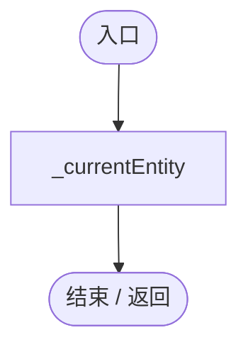

<a id="m89203179feda98b7"></a>

## Start · L65

`private void Start()`


### Editor / Player · Roslyn编译器控制流

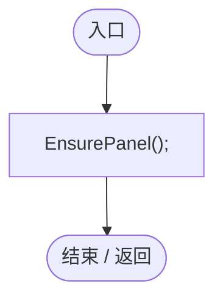

项目内调用/回调引用：

- [GeneInspectorUI.EnsurePanel · L71](924e27c34e7b1f0a.md#m6756f80ebc2df119)（方法）

<a id="m6756f80ebc2df119"></a>

## EnsurePanel · L71

`private bool EnsurePanel()`

★ 修复（防Bug回归）：信息面板属于屏幕 HUD；旧版挂到没有相机的 WorldCanvas，尺寸/射线与底栏不一致。

### Editor / Player · Roslyn编译器控制流

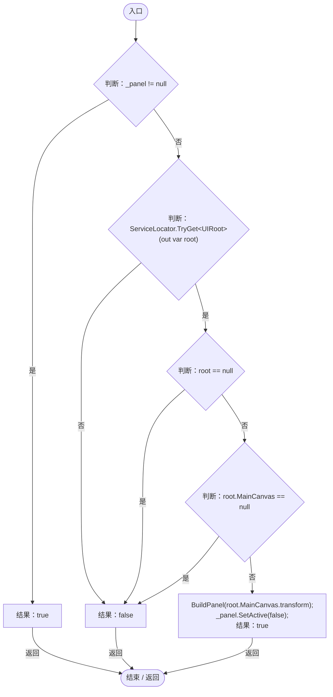

项目内调用/回调引用：

- [ServiceLocator.TryGet · L26](f2fdbe9f9ccd93cb.md#m143b24e6d58471b0)（方法）
- [UIRoot.MainCanvas.get · L14](9c1421378791f0e0.md#maa2cc9baf1248477)（访问器）
- [GeneInspectorUI.BuildPanel · L80](924e27c34e7b1f0a.md#m5f40c04e976634ed)（方法）

<a id="m5f40c04e976634ed"></a>

## BuildPanel · L80

`private void BuildPanel(Transform canvas)`


### Editor / Player · Roslyn编译器控制流

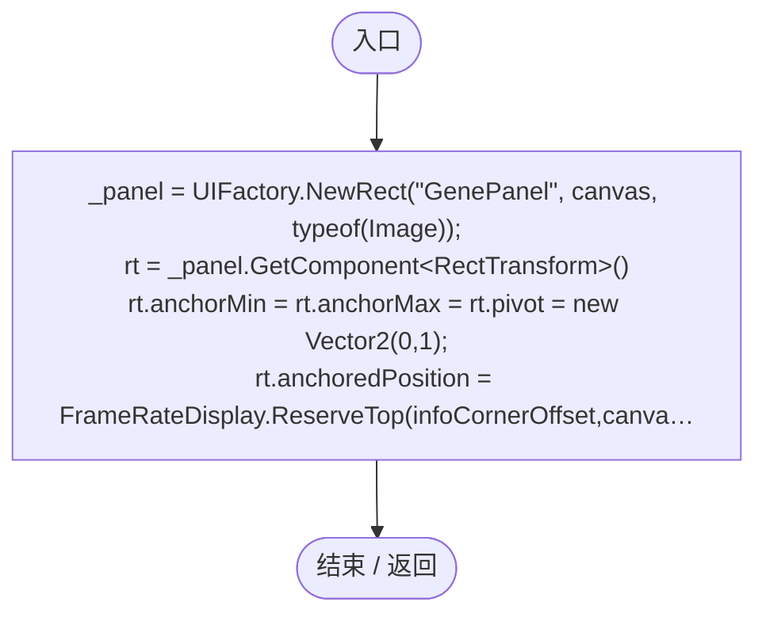

项目内调用/回调引用：

- [UIFactory.NewRect · L33](dd1096a6995423db.md#med612116f3152344)（方法）
- [FrameRateDisplay.ReserveTop · L32](4e898f3c11cb4578.md#m164c2b59a71d57d4)（方法）
- [UIVisualTheme.Paint · L58](ca525a798a08f966.md#m2d61a6b26ab24980)（方法）
- [UIVisualTheme.StyleButton · L67](ca525a798a08f966.md#mf2e64598de5115f3)（方法）
- [UIFactory.NewText · L57](dd1096a6995423db.md#m9dbccb5f0c38189e)（方法）
- [UIFactory.Stretch · L150](dd1096a6995423db.md#m11d8f6c6d00cc047)（方法）
- [UIVisualTheme.AddIcon · L79](ca525a798a08f966.md#mcae965e84a38acc6)（方法）
- [UIFactory.NewButton · L73](dd1096a6995423db.md#m5896f1b097c8bdde)（方法）
- [GeneInspectorUI.回调@128 · L128](924e27c34e7b1f0a.md#m38e9a6102f93f6eb)（回调/委托）
- [GeneInspectorUI.回调@131 · L131](924e27c34e7b1f0a.md#mabd8a28d708e094b)（回调/委托）
- [GeneInspectorUI.回调@180 · L180](924e27c34e7b1f0a.md#m1709292f8fc22467)（回调/委托）
- [GeneInspectorUI.回调@194 · L194](924e27c34e7b1f0a.md#m1052fb64b14be672)（回调/委托）
- [GeneInspectorUI.OnFavoriteClicked · L225](924e27c34e7b1f0a.md#me456b37533e5e8ef)（方法）
- [GeneInspectorUI.RenameCurrentEntity · L235](924e27c34e7b1f0a.md#mb19db94ed279d2ab)（方法）

<a id="m38e9a6102f93f6eb"></a>

## 回调@128 · L128

`( … => 回调`


### Editor / Player · Roslyn编译器控制流

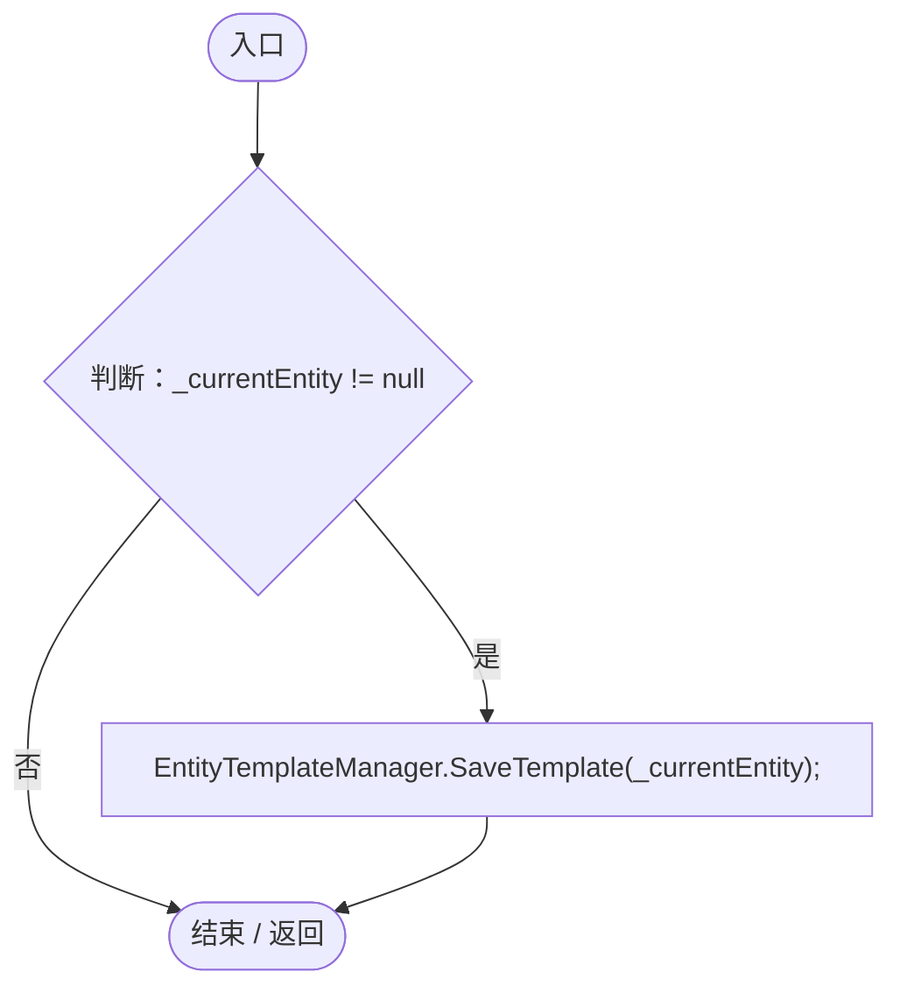

项目内调用/回调引用：

- [EntityTemplateManager.SaveTemplate · L30](ab5e6457e8a7aba0.md#me559754bdf2cc955)（方法）

<a id="mabd8a28d708e094b"></a>

## 回调@131 · L131

`( … => 回调`


### Editor / Player · Roslyn编译器控制流

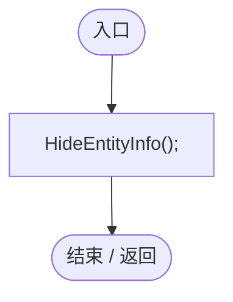

项目内调用/回调引用：

- [GeneInspectorUI.HideEntityInfo · L317](924e27c34e7b1f0a.md#mc9346c30e59e03d7)（方法）

<a id="m1709292f8fc22467"></a>

## 回调@180 · L180

`( … => 回调`


### Editor / Player · Roslyn编译器控制流

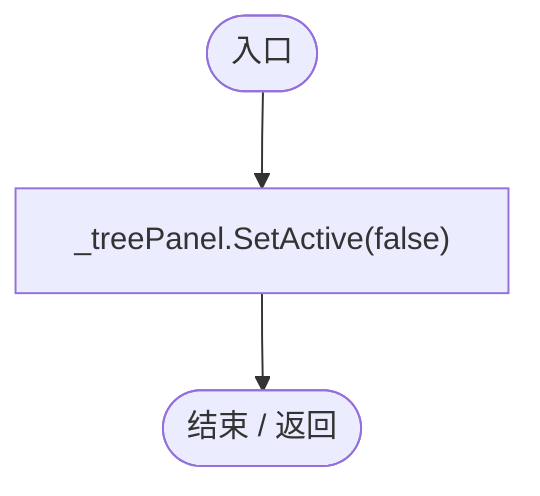

<a id="m1052fb64b14be672"></a>

## 回调@194 · L194

`( … => 回调`


### Editor / Player · Roslyn编译器控制流

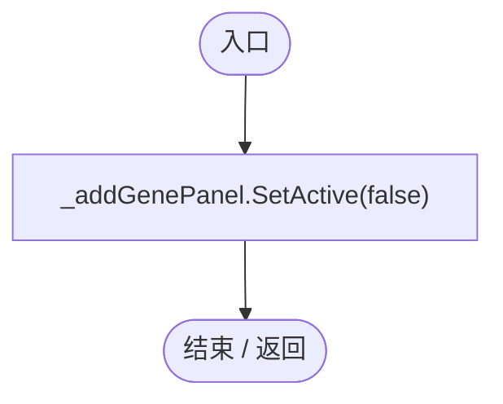

<a id="me456b37533e5e8ef"></a>

## OnFavoriteClicked · L225

`private void OnFavoriteClicked()`


### Editor / Player · Roslyn编译器控制流

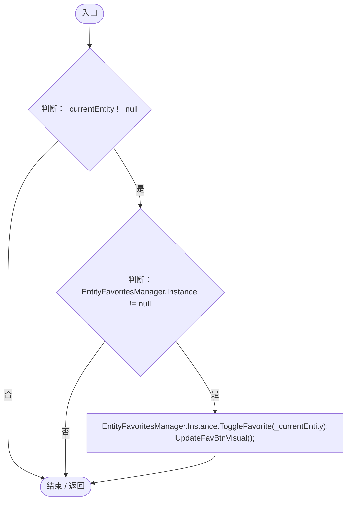

项目内调用/回调引用：

- [EntityFavoritesManager.Instance.get · L10](b60fb973e9d3815a.md#m0dac2feb106bac97)（访问器）
- [EntityFavoritesManager.ToggleFavorite · L55](b60fb973e9d3815a.md#m20d366a69a0f5fdd)（方法）
- [GeneInspectorUI.UpdateFavBtnVisual · L244](924e27c34e7b1f0a.md#m2785595eecbcd84d)（方法）

<a id="mb19db94ed279d2ab"></a>

## RenameCurrentEntity · L235

`public void RenameCurrentEntity(string value)`

★ 新增：名称文本框失焦/回车提交，空名称回退，收藏列表同步显示新名字。

### Editor / Player · Roslyn编译器控制流

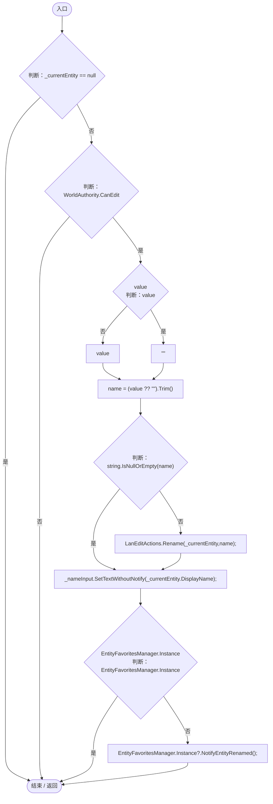

项目内调用/回调引用：

- [LanEditActions.Rename · L20](2816321496f6360e.md#m5b0d7d8f94cde369)（方法）
- [EntityFavoritesManager.Instance.get · L10](b60fb973e9d3815a.md#m0dac2feb106bac97)（访问器）
- [EntityFavoritesManager.NotifyEntityRenamed · L126](b60fb973e9d3815a.md#m70fce06ba0f299ca)（方法）

<a id="m2785595eecbcd84d"></a>

## UpdateFavBtnVisual · L244

`private void UpdateFavBtnVisual()`


### Editor / Player · Roslyn编译器控制流

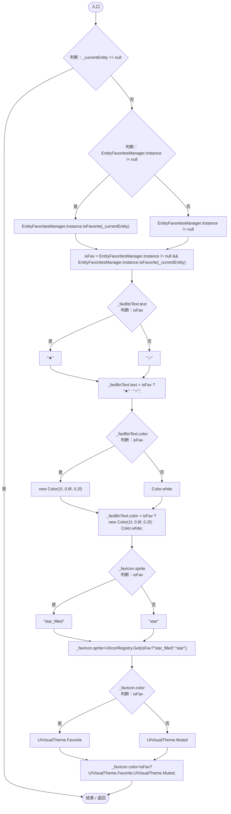

项目内调用/回调引用：

- [EntityFavoritesManager.Instance.get · L10](b60fb973e9d3815a.md#m0dac2feb106bac97)（访问器）
- [EntityFavoritesManager.IsFavorite · L46](b60fb973e9d3815a.md#m441337ce7ee05333)（方法）
- [UIIconRegistry.Get · L38](5e97f4545b48cac2.md#m95da89c0db2bbab9)（方法）

<a id="m71f7d6f733ecde47"></a>

## Update · L255

`private void Update()`


### Editor / Player · Roslyn编译器控制流

```mermaid
flowchart TD
  b0(["入口"])
  b1{"判断：DarwinPark.Core.GameInputGate.Blocked"}
  b2{"判断：EnsurePanel()"}
  b3{"判断：_nameInput!=null"}
  b4{"_nameInput.interactable<br/>判断：WorldAuthority.CanEdit"}
  b5["_currentCorpse==null"]
  b6["WorldAuthority.CanEdit"]
  b7["_nameInput.interactable=WorldAuthority.CanEdit&amp;&amp;_currentCorpse==null;"]
  b8["_panel.GetComponentsInChildren&lt;InputField&gt;(true)"]
  b9{"判断：_panel.GetComponentsInChildren&lt;InputField&gt;(true)"}
  b10["var"]
  b11{"field.interactable<br/>判断：WorldAuthority.CanEdit"}
  b12["_currentCorpse==null"]
  b13["WorldAuthority.CanEdit"]
  b14["field.interactable=WorldAuthority.CanEdit&amp;&amp;_currentCorpse==null;"]
  b15{"_panel.GetComponentsInChildren&lt;InputField&gt;(true)<br/>判断：_panel.GetComponentsInChildren&lt;InputField&gt;(true)"}
  b16["_panel.GetComponentsInChildren&lt;InputField&gt;(true)"]
  b17["连接 / 离开区域"]
  b18{"addControl=_panel.transform.Find(&quot;ScrollView/Viewport/Content/MutTitleRow/AddBtn&quot;)<br/>判断：addControl!=null"}
  b19{"addControl.gameObject<br/>判断：WorldAuthority.CanEdit"}
  b20["_currentCorpse==null"]
  b21["WorldAuthority.CanEdit"]
  b22["addControl.gameObject.SetActive(WorldAuthority.CanEdit&amp;&amp;_currentCorpse==null);"]
  b23{"templateControl=_panel.transform.Find(&quot;TitleBg/SaveTplBtn&quot;)<br/>判断：templateControl!=null"}
  b24{"templateControl.gameObject<br/>判断：WorldAuthority.CanEdit"}
  b25["_currentCorpse==null"]
  b26["WorldAuthority.CanEdit"]
  b27["templateControl.gameObject.SetActive(WorldAuthority.CanEdit&amp;&amp;_currentCorpse==null);"]
  b28{"判断：WorldAuthority.CanEdit"}
  b29["_addGenePanel.SetActive(false);"]
  b30["canvasHeight=(_panel.transform.parent as RectTransform).rect.height<br/>addRect=_addGenePanel.GetComponent&lt;RectTransform&gt;()<br/>addRect.sizeDelta=new Vector2(350,Mathf.Min(450,Mathf.Max(150,canvasHeight*.35f)));<br/>panelRect=_panel.GetComponent&lt;Rec…"]
  b31{"panelRect.sizeDelta<br/>Mathf.Min(infoPanelSize.x,Mathf.Max(160,canvasWidth-infoCornerOffset.x-24))<br/>infoPanelSize.y<br/>160<br/>canvasHeight-addCornerOffset.y-24<br/>判断：_addGenePanel.activeSelf"}
  b32["addRect.sizeDelta.y+16"]
  b33["0"]
  b34["panelRect.sizeDelta=new Vector2(Mathf.Min(infoPanelSize.x,Mathf.Max(160,canvasWidth-infoCornerOffset.x-24)),Mathf.Min(infoPanelSize.y,Mathf.Max(160,canvasHeight-addCornerOffset.y-24-(_addGenePanel.activeSelf?addRect.sizeDelta.y+16:0))));"]
  b35{"判断：_panel.activeSelf"}
  b36{"判断：_currentEntity==null"}
  b37{"判断：_currentCorpse==null"}
  b38["HideEntityInfo();"]
  b39{"判断：_panel.activeSelf"}
  b40["_addGenePanel.SetActive(false);<br/>_treePanel.SetActive(false);<br/>_tooltipPanel.SetActive(false);"]
  b41{"判断：Time.unscaledTime&gt;=_nextRefresh"}
  b42["_nextRefresh=Time.unscaledTime+refreshInterval;<br/>RefreshDisplayedInfo();"]
  b43{"判断：WorldAuthority.RtsMode"}
  b44{"判断：EntityPlacementTool.Instance != null"}
  b45{"判断：EntityPlacementTool.Instance.IsPlacing"}
  b46{"判断：EventSystem.current != null"}
  b47["EventSystem.current.IsPointerOverGameObject()"]
  b48["EventSystem.current != null"]
  b49["pointerOverUI = EventSystem.current != null &amp;&amp; EventSystem.current.IsPointerOverGameObject()"]
  b50{"判断：Camera.main != null"}
  b51{"判断：Camera.main.GetComponent&lt;OrbitCamera&gt;() is OrbitCamera orbit"}
  b52["orbit.EntityViewActive"]
  b53["Camera.main != null &amp;&amp; Camera.main.GetComponent&lt;OrbitCamera&gt;() is OrbitCamera orbit &amp;&amp; orbit.EntityViewActive"]
  b54["entityView = Camera.main != null &amp;&amp; Camera.main.GetComponent&lt;OrbitCamera&gt;() is OrbitCamera orbit &amp;&amp; orbit.EntityViewActive"]
  b55{"判断：entityView"}
  b56{"判断：pointerOverUI"}
  b57{"判断：Input.GetMouseButtonDown(1)"}
  b58{"pickCamera=Camera.main<br/>判断：pickCamera!=null"}
  b59["InspectAt(pickCamera.ScreenPointToRay(Input.mousePosition));"]
  b60["HideEntityInfo();"]
  b61{"WorldResourceInspector.Instance<br/>判断：WorldResourceInspector.Instance"}
  b62["WorldResourceInspector.Instance?.Hide();"]
  b63{"判断：Input.GetKeyDown(KeyCode.Escape)"}
  b64{"判断：_addGenePanel.activeSelf"}
  b65["_addGenePanel.SetActive(false);"]
  b66["HideEntityInfo();"]
  b67{"判断：_tooltipPanel.activeSelf"}
  b68{"mousePos = Input.mousePosition<br/>w = _tooltipPanel.GetComponent&lt;RectTransform&gt;().sizeDelta.x<br/>h = _tooltipPanel.GetComponent&lt;RectTransform&gt;().sizeDelta.y<br/>offX = 15f<br/>判断：mousePos.x + w + offX &gt; Screen.width"}
  b69["offX = -w - 15f;"]
  b70{"offY = -15f<br/>判断：mousePos.y - h + offY &lt; 0"}
  b71["offY = 15f + h;"]
  b72["_tooltipPanel.transform.position = mousePos + new Vector2(offX, offY);"]
  b73(["结束 / 返回"])
  b0 --> b1
  b1 -->|"是"| b73
  b1 -->|"否"| b2
  b2 -->|"否"| b73
  b2 -->|"是"| b3
  b3 -->|"是"| b4
  b3 -->|"否"| b8
  b4 -->|"是"| b5
  b4 -->|"否"| b6
  b5 --> b7
  b6 --> b7
  b7 --> b8
  b8 --> b9
  b9 -->|"是"| b10
  b9 -->|"否 · 经过finally 15"| b18
  b10 --> b11
  b11 -->|"是"| b12
  b11 -->|"否"| b13
  b12 --> b14
  b13 --> b14
  b14 --> b9
  b15 -->|"否"| b16
  b15 -->|"是"| b17
  b16 --> b17
  b18 -->|"是"| b19
  b18 -->|"否"| b23
  b19 -->|"是"| b20
  b19 -->|"否"| b21
  b20 --> b22
  b21 --> b22
  b22 --> b23
  b23 -->|"是"| b24
  b23 -->|"否"| b28
  b24 -->|"是"| b25
  b24 -->|"否"| b26
  b25 --> b27
  b26 --> b27
  b27 --> b28
  b28 -->|"否"| b29
  b28 -->|"是"| b30
  b29 --> b30
  b30 --> b31
  b31 -->|"是"| b32
  b31 -->|"否"| b33
  b32 --> b34
  b33 --> b34
  b34 --> b35
  b35 -->|"是"| b36
  b35 -->|"否"| b39
  b36 -->|"是"| b37
  b36 -->|"否"| b39
  b37 -->|"是"| b38
  b37 -->|"否"| b39
  b38 --> b39
  b39 -->|"否"| b40
  b39 -->|"是"| b41
  b40 --> b41
  b41 -->|"是"| b42
  b41 -->|"否"| b43
  b42 --> b43
  b43 -->|"是"| b73
  b43 -->|"否"| b44
  b44 -->|"是"| b45
  b44 -->|"否"| b46
  b45 -->|"是"| b73
  b45 -->|"否"| b46
  b46 -->|"是"| b47
  b46 -->|"否"| b48
  b47 --> b49
  b48 --> b49
  b49 --> b50
  b50 -->|"是"| b51
  b50 -->|"否"| b53
  b51 -->|"是"| b52
  b51 -->|"否"| b53
  b52 --> b54
  b53 --> b54
  b54 --> b55
  b55 -->|"否"| b56
  b55 -->|"是"| b63
  b56 -->|"否"| b57
  b56 -->|"是"| b63
  b57 -->|"是"| b58
  b57 -->|"否"| b63
  b58 -->|"是"| b59
  b58 -->|"否"| b60
  b59 --> b63
  b60 --> b61
  b61 -->|"否"| b62
  b61 -->|"是"| b63
  b62 --> b63
  b63 -->|"是"| b64
  b63 -->|"否"| b67
  b64 -->|"是"| b65
  b64 -->|"否"| b66
  b65 --> b67
  b66 --> b67
  b67 -->|"是"| b68
  b67 -->|"否"| b73
  b68 -->|"是"| b69
  b68 -->|"否"| b70
  b69 --> b70
  b70 -->|"是"| b71
  b70 -->|"否"| b72
  b71 --> b72
  b72 --> b73
  b9 -. "退出保护区时 finally（示意）" .-> b15

```

项目内调用/回调引用：

- [GameInputGate.Blocked.get · L8](52955daae7e592ab.md#m765763b665829633)（访问器）
- [GeneInspectorUI.EnsurePanel · L71](924e27c34e7b1f0a.md#m6756f80ebc2df119)（方法）
- [FrameRateDisplay.ReserveTop · L32](4e898f3c11cb4578.md#m164c2b59a71d57d4)（方法）
- [GeneInspectorUI.HideEntityInfo · L317](924e27c34e7b1f0a.md#mc9346c30e59e03d7)（方法）
- [GeneInspectorUI.RefreshDisplayedInfo · L326](924e27c34e7b1f0a.md#m1feb95a375dc3dcc)（方法）
- [EntityPlacementTool.Instance.get · L13](2ca993947b0a7e7a.md#mafb26991c0dfcb86)（访问器）
- [EntityPlacementTool.IsPlacing.get · L14](2ca993947b0a7e7a.md#ma73d17b3db4aa719)（访问器）
- [OrbitCamera.EntityViewActive.get · L39](42eb429559b42bcb.md#m4b320edff61e06a5)（访问器）
- [GeneInspectorUI.InspectAt · L310](924e27c34e7b1f0a.md#mc4c485ab1051c5f9)（方法）
- [WorldResourceInspector.Instance.get · L12](044d7e948b6de8b7.md#m7d7f466d7959eb79)（访问器）
- [WorldResourceInspector.Hide · L67](044d7e948b6de8b7.md#md02dd83e5021f3a5)（方法）

<a id="mc4c485ab1051c5f9"></a>

## InspectAt · L310

`public bool InspectAt(Ray ray)`

★ 适配：活体与没有碰撞体的尸体/能量块共用最近可见目标拾取，仍尊重地形遮挡。

### Editor / Player · Roslyn编译器控制流

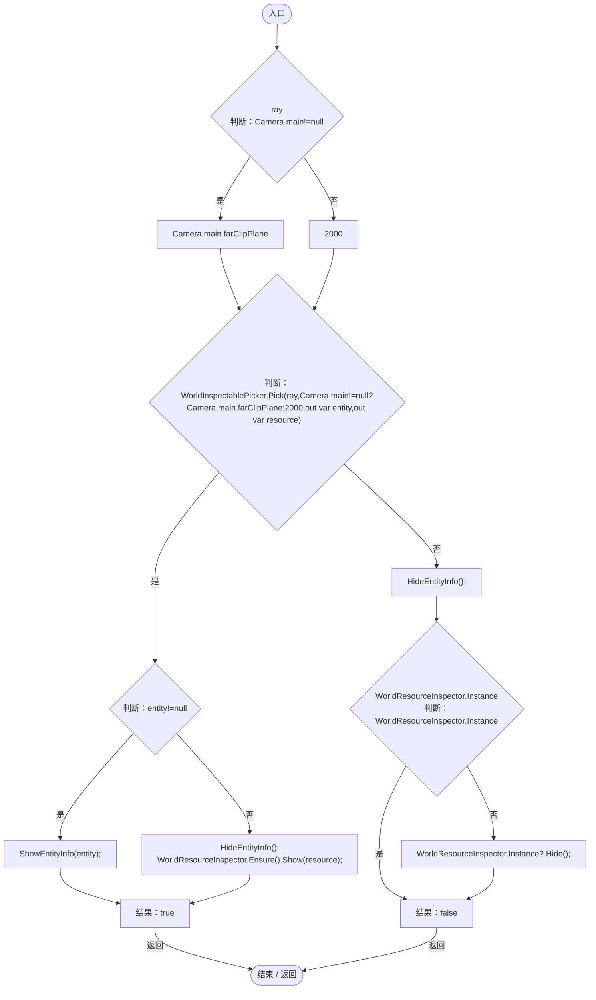

项目内调用/回调引用：

- [WorldInspectablePicker.Pick · L10](b30f6db5375f9436.md#m29ceec2fbb2deaa1)（方法）
- [GeneInspectorUI.ShowEntityInfo · L387](924e27c34e7b1f0a.md#mfbae827fa8eb1ff1)（方法）
- [GeneInspectorUI.HideEntityInfo · L317](924e27c34e7b1f0a.md#mc9346c30e59e03d7)（方法）
- [WorldResourceInspector.Show · L19](044d7e948b6de8b7.md#me57c7a1d7701b045)（方法）
- [WorldResourceInspector.Ensure · L18](044d7e948b6de8b7.md#meddb7ef47641f159)（方法）
- [WorldResourceInspector.Instance.get · L12](044d7e948b6de8b7.md#m7d7f466d7959eb79)（访问器）
- [WorldResourceInspector.Hide · L67](044d7e948b6de8b7.md#md02dd83e5021f3a5)（方法）

<a id="mc9346c30e59e03d7"></a>

## HideEntityInfo · L317

`public void HideEntityInfo()`


### Editor / Player · Roslyn编译器控制流

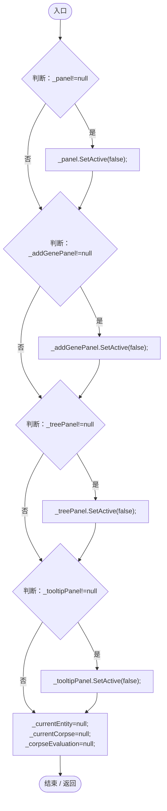

<a id="m56d4f0cea7e2662a"></a>

## StructureKey · L325

`private string StructureKey(EntityGeneController genes)`


### Editor / Player · Roslyn编译器控制流

```mermaid
flowchart TD
  b0(["入口"])
  b1["结果：string.Join(&quot;&#124;&quot;,genes.Genome.Genes.ConvertAll(g=&gt;g.InstanceId+&quot;:&quot;+g.DefinitionId))"]
  b2(["结束 / 返回"])
  b0 --> b1
  b1 -->|"返回"| b2

```

项目内调用/回调引用：

- [GeneInspectorUI.回调@325 · L325](924e27c34e7b1f0a.md#m827414d07d9b0750)（回调/委托）

<a id="m827414d07d9b0750"></a>

## 回调@325 · L325

`g … => 回调`


### Editor / Player · Roslyn编译器控制流

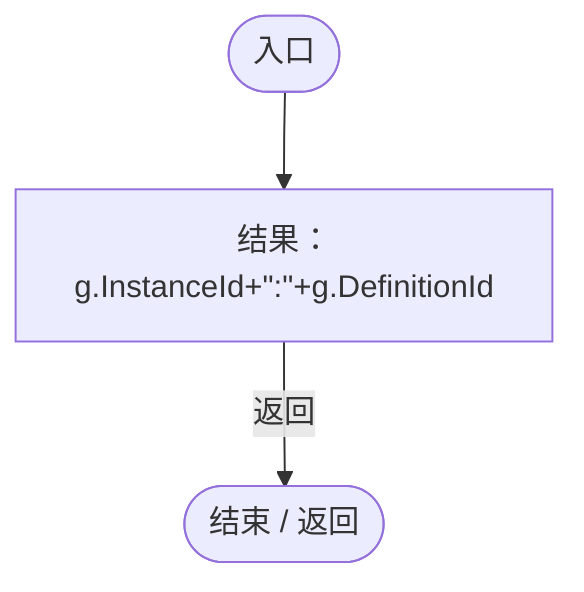

<a id="m1feb95a375dc3dcc"></a>

## RefreshDisplayedInfo · L326

`public void RefreshDisplayedInfo()`


### Editor / Player · Roslyn编译器控制流

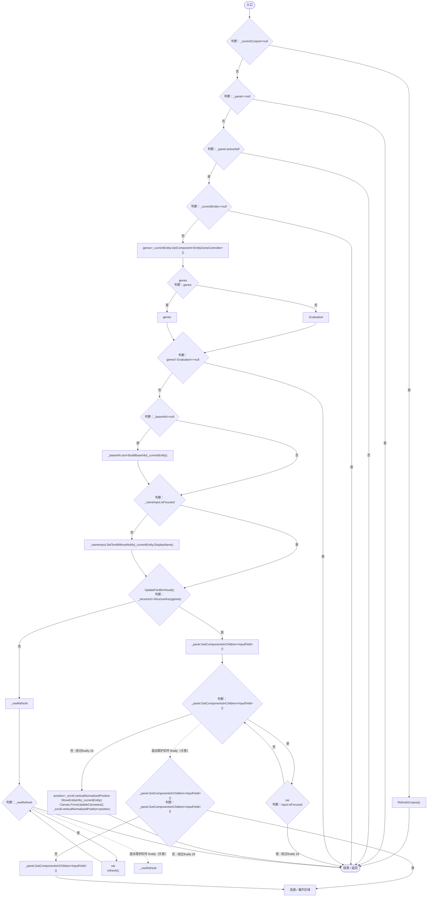

项目内调用/回调引用：

- [GeneInspectorUI.RefreshCorpse · L30](226a6835af361a0e.md#mb756a2ff80fbc94b)（方法）
- [EntityGeneController.Evaluation.get · L18](7494d53178552f0e.md#mc0039c100a31b455)（访问器）
- [GeneInspectorUI.BuildBaseInfo · L343](924e27c34e7b1f0a.md#m1e9281fe08c7511e)（方法）
- [GeneInspectorUI.UpdateFavBtnVisual · L244](924e27c34e7b1f0a.md#m2785595eecbcd84d)（方法）
- [GeneInspectorUI.StructureKey · L325](924e27c34e7b1f0a.md#m56d4f0cea7e2662a)（方法）
- [GeneInspectorUI.ShowEntityInfo · L387](924e27c34e7b1f0a.md#mfbae827fa8eb1ff1)（方法）

<a id="m1e9281fe08c7511e"></a>

## BuildBaseInfo · L343

`private string BuildBaseInfo(DarwinEntity entity)`


### Editor / Player · Roslyn编译器控制流

```mermaid
flowchart TD
  b0(["入口"])
  b1{"genes=entity.GetComponent&lt;EntityGeneController&gt;()<br/>sb = new StringBuilder()<br/>sb.AppendLine(&quot;&lt;color=#4EE5B5&gt;&lt;b&gt;【基础信息】&lt;/b&gt;&lt;/color&gt;&quot;);<br/>stats = entity.GetComponent&lt;EntityStats&gt;()<br/>判断：stats != null"}
  b2{"判断：stats.TryGet(&quot;health&quot;, out var hp)"}
  b3["sb.AppendLine($&quot;生命值: &lt;color=#FF6B6B&gt;{hp:F1}&lt;/color&gt;&quot;);"]
  b4{"判断：stats.TryGet(&quot;nutrient&quot;, out var nut)"}
  b5["sb.AppendLine($&quot;饱食度: &lt;color=#FFD166&gt;{nut:F1}&lt;/color&gt;&quot;);"]
  b6{"判断：stats.TryGet(&quot;size&quot;, out var size)"}
  b7["sb.AppendLine($&quot;体型: &lt;color=#4EE5B5&gt;{size:F2}&lt;/color&gt;&quot;);"]
  b8{"geneCtrl = entity.GetComponent&lt;EntityGeneController&gt;()<br/>判断：geneCtrl != null"}
  b9{"ageStr = &quot;幼年&quot;<br/>判断：geneCtrl.CurrentAge == AgeState.Adult"}
  b10["ageStr = &quot;成年&quot;;"]
  b11{"判断：geneCtrl.CurrentAge == AgeState.Elder"}
  b12["ageStr = &quot;老年&quot;;"]
  b13["sb.AppendLine($&quot;生命阶段: &lt;color=#4EE5B5&gt;{ageStr}&lt;/color&gt;&quot;);"]
  b14{"判断：genes.IsGestating"}
  b15["sb.AppendLine(&quot;&lt;color=#4EE5B5&gt;特殊状态: 孕育后代中...&lt;/color&gt;&quot;);"]
  b16{"sb.AppendLine(&quot;当前状态: &quot;+EntityStatePresentation.Current(entity));<br/>判断：PlanetClimateSystem.Instance != null"}
  b17["climate = PlanetClimateSystem.Instance.GetClimateAt(entity.transform.position)<br/>sb.AppendLine($&quot;当前温度: {climate.Temperature:F1}°C &#124; 湿度: {climate.Humidity:F1}%&quot;);"]
  b18{"hazard = entity.GetComponent&lt;DarwinPark.Entities.Vitals.EntityEnvironmentHazard&gt;()<br/>判断：hazard != null"}
  b19["sb.AppendLine($&quot;环境状态: {hazard.GetStatusLine()}&quot;);"]
  b20["sb.AppendLine(&quot;&lt;color=#294A5B&gt;──────────────────────────────&lt;/color&gt;&quot;);<br/>结果：sb.ToString()"]
  b21(["结束 / 返回"])
  b0 --> b1
  b1 -->|"是"| b2
  b1 -->|"否"| b8
  b2 -->|"是"| b3
  b2 -->|"否"| b4
  b3 --> b4
  b4 -->|"是"| b5
  b4 -->|"否"| b6
  b5 --> b6
  b6 -->|"是"| b7
  b6 -->|"否"| b8
  b7 --> b8
  b8 -->|"是"| b9
  b8 -->|"否"| b14
  b9 -->|"是"| b10
  b9 -->|"否"| b11
  b10 --> b13
  b11 -->|"是"| b12
  b11 -->|"否"| b13
  b12 --> b13
  b13 --> b14
  b14 -->|"是"| b15
  b14 -->|"否"| b16
  b15 --> b16
  b16 -->|"是"| b17
  b16 -->|"否"| b18
  b17 --> b18
  b18 -->|"是"| b19
  b18 -->|"否"| b20
  b19 --> b20
  b20 -->|"返回"| b21

```

项目内调用/回调引用：

- [EntityStats.TryGet · L90](75aa86a368efdf24.md#m24ee1433e4a70d94)（方法）
- [EntityGeneController.CurrentAge.get · L37](7494d53178552f0e.md#md08823d8f9a2fa16)（访问器）
- [EntityStatePresentation.Current · L11](cedd13b7a8825ed4.md#mb284f7b351983ca5)（方法）
- [PlanetClimateSystem.Instance.get · L32](ba86e31da9b7d0a5.md#mf8e5c7e126d7b598)（访问器）
- [PlanetClimateSystem.GetClimateAt · L69](ba86e31da9b7d0a5.md#m238e7907ac2c7c64)（方法）
- [EntityEnvironmentHazard.GetStatusLine · L295](5c434d0ba85333b1.md#meeeb336b49e3b3f7)（方法）

<a id="mfbae827fa8eb1ff1"></a>

## ShowEntityInfo · L387

`public void ShowEntityInfo(DarwinEntity entity)`


### Editor / Player · Roslyn编译器控制流

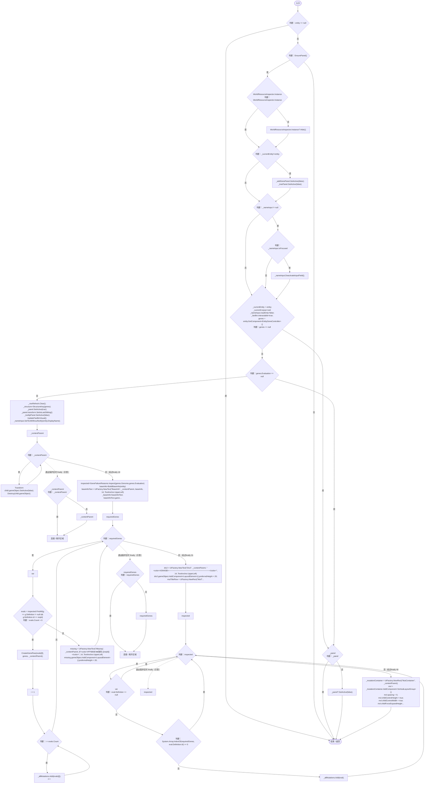

项目内调用/回调引用：

- [GeneInspectorUI.EnsurePanel · L71](924e27c34e7b1f0a.md#m6756f80ebc2df119)（方法）
- [WorldResourceInspector.Instance.get · L12](044d7e948b6de8b7.md#m7d7f466d7959eb79)（访问器）
- [WorldResourceInspector.Hide · L67](044d7e948b6de8b7.md#md02dd83e5021f3a5)（方法）
- [EntityGeneController.Evaluation.get · L18](7494d53178552f0e.md#mc0039c100a31b455)（访问器）
- [GeneInspectorUI.StructureKey · L325](924e27c34e7b1f0a.md#m56d4f0cea7e2662a)（方法）
- [GeneInspectorUI.UpdateFavBtnVisual · L244](924e27c34e7b1f0a.md#m2785595eecbcd84d)（方法）
- [GeneFailureReasons.Inspect · L9](e611915e807d8990.md#m1b46661dcda38ded)（方法）
- [GeneInspectorUI.BuildBaseInfo · L343](924e27c34e7b1f0a.md#m1e9281fe08c7511e)（方法）
- [UIFactory.NewText · L57](dd1096a6995423db.md#m9dbccb5f0c38189e)（方法）
- [EntitySummaryView.Build · L65](64394436d1ceb729.md#mff466b56751cf094)（方法）
- [EntityEditPopup.AddEntry · L19](79ed73ecd9855f79.md#m464a7d463c080743)（方法）
- [GeneInspectorUI.CreateGeneRow · L491](924e27c34e7b1f0a.md#m8214fecfdc774af1)（方法）
- [UIFactory.NewRect · L33](dd1096a6995423db.md#med612116f3152344)（方法）
- [UIFactory.NewButton · L73](dd1096a6995423db.md#m5896f1b097c8bdde)（方法）
- [GeneInspectorUI.RefreshMutations · L475](924e27c34e7b1f0a.md#m1e72d3d0cbc4c75e)（方法）
- [GeneInspectorUI.回调@432 · L432](924e27c34e7b1f0a.md#m009643726a35b50f)（回调/委托）
- [GeneInspectorUI.回调@458 · L458](924e27c34e7b1f0a.md#m13f17fa093120025)（回调/委托）

<a id="m009643726a35b50f"></a>

## 回调@432 · L432

`g … => 回调`


### Editor / Player · Roslyn编译器控制流

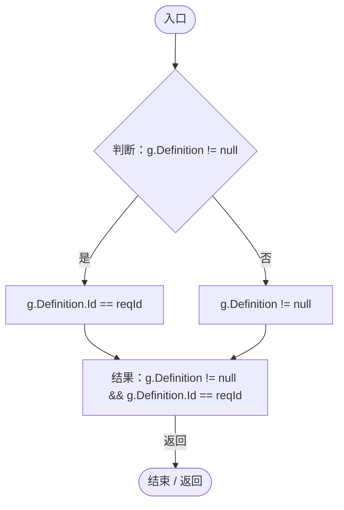

<a id="m13f17fa093120025"></a>

## 回调@458 · L458

`( … => 回调`


### Editor / Player · Roslyn编译器控制流

```mermaid
flowchart TD
  b0(["入口"])
  b1["ShowAddGeneMenu()"]
  b2(["结束 / 返回"])
  b0 --> b1
  b1 --> b2

```

项目内调用/回调引用：

- [GeneInspectorUI.ShowAddGeneMenu · L699](924e27c34e7b1f0a.md#m169e930a97cf5c74)（方法）

<a id="m1e72d3d0cbc4c75e"></a>

## RefreshMutations · L475

`private void RefreshMutations()`


### Editor / Player · Roslyn编译器控制流

```mermaid
flowchart TD
  b0(["入口"])
  b1{"判断：_mutationContainer == null"}
  b2["_mutationContainer.transform"]
  b3{"判断：_mutationContainer.transform"}
  b4["Transform<br/>Destroy(child.gameObject);"]
  b5{"_mutationContainer.transform<br/>判断：_mutationContainer.transform"}
  b6["_mutationContainer.transform"]
  b7["连接 / 离开区域"]
  b8{"判断：_allMutations.Count == 0"}
  b9["noMut = UIFactory.NewText(&quot;NoMut&quot;, _mutationContainer.transform, &quot;&lt;color=#888888&gt;暂无变异基因&lt;/color&gt;&quot;, 14, TextAnchor.UpperLeft)<br/>noMut.gameObject.AddComponent&lt;LayoutElement&gt;().preferredHeight = 20;"]
  b10["_allMutations"]
  b11{"判断：_allMutations"}
  b12["var<br/>CreateGeneRow(mutation,_currentEntity.GetComponent&lt;EntityGeneController&gt;(),_mutationContainer.transform);"]
  b13["_allMutations"]
  b14(["结束 / 返回"])
  b0 --> b1
  b1 -->|"是"| b14
  b1 -->|"否"| b2
  b2 --> b3
  b3 -->|"是"| b4
  b3 -->|"否 · 经过finally 5"| b8
  b4 --> b3
  b5 -->|"否"| b6
  b5 -->|"是"| b7
  b6 --> b7
  b8 -->|"是"| b9
  b8 -->|"否"| b10
  b9 --> b14
  b10 --> b11
  b11 -->|"是"| b12
  b11 -->|"否 · 经过finally 13"| b14
  b12 --> b11
  b3 -. "退出保护区时 finally（示意）" .-> b5
  b11 -. "退出保护区时 finally（示意）" .-> b13

```

项目内调用/回调引用：

- [UIFactory.NewText · L57](dd1096a6995423db.md#m9dbccb5f0c38189e)（方法）
- [GeneInspectorUI.CreateGeneRow · L491](924e27c34e7b1f0a.md#m8214fecfdc774af1)（方法）

<a id="m8214fecfdc774af1"></a>

## CreateGeneRow · L491

`private void CreateGeneRow(GeneEvaluation eval, EntityGeneController controller, Transform parent)`


### Editor / Player · Roslyn编译器控制流

```mermaid
flowchart TD
  b0(["入口"])
  b1{"判断：eval == null"}
  b2{"判断：eval.Definition == null"}
  b3["geneBlock = UIFactory.NewRect(&quot;Block_&quot; + eval.Definition.Id + &quot;_&quot; + eval.Gene.InstanceId.Substring(0, 4), parent,typeof(Image))<br/>UIVisualTheme.Paint(geneBlock.GetComponent&lt;Image&gt;(),&quot;button&quot;);<br/>geneBlock.GetComponent&lt;Image&gt;().raycastTarget=…"]
  b4{"blockLE.minHeight<br/>blockLE.preferredHeight<br/>判断：eval.Definition.EntityStateTags.Count&gt;0"}
  b5["94"]
  b6["70"]
  b7["blockLE.minHeight=blockLE.preferredHeight=eval.Definition.EntityStateTags.Count&gt;0?94:70;"]
  b8{"判断：eval.Definition.EntityStateTags.Count&gt;0"}
  b9["tag=UIFactory.NewText(&quot;EntityStateTags&quot;,geneBlock.transform,EntityStatePresentation.GeneTags(eval.Definition),12,TextAnchor.MiddleLeft)<br/>tag.rectTransform.anchorMin=new Vector2(0,1);<br/>tag.rectTransform.anchorMax=Vector2.one;<br/>tag.rectTransf…"]
  b10["row1 = UIFactory.NewRect(&quot;Row1&quot;, geneBlock.transform)<br/>r1rt = row1.GetComponent&lt;RectTransform&gt;()<br/>r1rt.anchorMin = new Vector2(0, 1);<br/>r1rt.anchorMax = new Vector2(1, 1);<br/>r1rt.pivot = new Vector2(0, 1);<br/>r1rt.anchoredPosition=new Vector2(8,-…"]
  b11{"geneIcon.color<br/>判断：eval.IsActive"}
  b12["UIVisualTheme.Accent"]
  b13["UIVisualTheme.Muted"]
  b14["geneIcon.color=eval.IsActive?UIVisualTheme.Accent:UIVisualTheme.Muted;"]
  b15["geneIcon.preserveAspect=true;<br/>geneIcon.raycastTarget=false;"]
  b16{"判断：eval.IsActive"}
  b17{"判断：controller==null"}
  b18["&quot;&lt;color=#4EE5B5&gt;生前生效&lt;/color&gt;&quot;"]
  b19["&quot;&lt;color=#4EE5B5&gt;生效中&lt;/color&gt;&quot;"]
  b20["&quot;&lt;color=#FF6B6B&gt;失效 · &quot;+GeneFailureReasons.Summary(eval)+&quot;&lt;/color&gt;&quot;"]
  b21["activeStr = eval.IsActive ? (controller==null?&quot;&lt;color=#4EE5B5&gt;生前生效&lt;/color&gt;&quot;:&quot;&lt;color=#4EE5B5&gt;生效中&lt;/color&gt;&quot;) : &quot;&lt;color=#FF6B6B&gt;失效 · &quot;+GeneFailureReasons.Summary(eval)+&quot;&lt;/color&gt;&quot;"]
  b22["nameTxt = UIFactory.NewText(&quot;Name&quot;, row1.transform, $&quot;&lt;b&gt;{eval.Definition.DisplayName}&lt;/b&gt; {activeStr}&quot;, 14, TextAnchor.MiddleLeft)<br/>ntrt = nameTxt.rectTransform<br/>ntrt.anchorMin = new Vector2(0, 0);<br/>ntrt.anchorMax = new Vector2(1, 1);<br/>ntrt…"]
  b23["new EventTrigger.Entry{eventID=EventTriggerType.Scroll}<br/>eventID=EventTriggerType.Scroll<br/>entryScroll=new EventTrigger.Entry{eventID=EventTriggerType.Scroll}"]
  b24["entryScroll.callback.AddListener(data=&gt;row1.GetComponentInParent&lt;ScrollRect&gt;()?.OnScroll((PointerEventData)data));<br/>trigger.triggers.Add(entryScroll);"]
  b25["new EventTrigger.Entry { eventID = EventTriggerType.PointerClick }<br/>eventID = EventTriggerType.PointerClick<br/>entryClick = new EventTrigger.Entry { eventID = EventTriggerType.PointerClick }"]
  b26["entryClick.callback.AddListener((data) =&gt; { var pe = (PointerEventData)data; if (pe.clickCount == 2) ShowGeneTree(eval.Definition.Id); });<br/>trigger.triggers.Add(entryClick);<br/>row2 = UIFactory.NewRect(&quot;Row2&quot;, geneBlock.transform)<br/>r2rt = row…"]
  b27{"inputField.interactable<br/>判断：controller!=null"}
  b28{"controller.GetComponent&lt;DarwinPark.Entities.Ecology.AntColonyMember&gt;()<br/>判断：controller.GetComponent&lt;DarwinPark.Entities.Ecology.AntColonyMember&gt;()"}
  b29[".Frozen"]
  b30["controller.GetComponent&lt;DarwinPark.Entities.Ecology.AntColonyMember&gt;()"]
  b31["controller.GetComponent&lt;DarwinPark.Entities.Ecology.AntColonyMember&gt;()?.Frozen!=true"]
  b32["controller!=null"]
  b33["inputField.interactable=controller!=null&amp;&amp;controller.GetComponent&lt;DarwinPark.Entities.Ecology.AntColonyMember&gt;()?.Frozen!=true;"]
  b34{"判断：eval.State != null"}
  b35["eval.State.DisplayName"]
  b36["&quot;无状态&quot;"]
  b37["stateName = eval.State != null ? eval.State.DisplayName : &quot;无状态&quot;"]
  b38["stateTxt = UIFactory.NewText(&quot;StateTxt&quot;, row2.transform, $&quot; &#124; 状态: {stateName}&quot;, 14, TextAnchor.MiddleLeft)<br/>strt = stateTxt.rectTransform<br/>strt.anchorMin = new Vector2(0, 0);<br/>strt.anchorMax = new Vector2(1, 1);<br/>strt.pivot = new Vector2(0, …"]
  b39(["结束 / 返回"])
  b0 --> b1
  b1 -->|"否"| b2
  b1 -->|"是"| b39
  b2 -->|"是"| b39
  b2 -->|"否"| b3
  b3 --> b4
  b4 -->|"是"| b5
  b4 -->|"否"| b6
  b5 --> b7
  b6 --> b7
  b7 --> b8
  b8 -->|"是"| b9
  b8 -->|"否"| b10
  b9 --> b10
  b10 --> b11
  b11 -->|"是"| b12
  b11 -->|"否"| b13
  b12 --> b14
  b13 --> b14
  b14 --> b15
  b15 --> b16
  b16 -->|"是"| b17
  b16 -->|"否"| b20
  b17 -->|"是"| b18
  b17 -->|"否"| b19
  b18 --> b21
  b19 --> b21
  b20 --> b21
  b21 --> b22
  b22 --> b23
  b23 --> b24
  b24 --> b25
  b25 --> b26
  b26 --> b27
  b27 -->|"是"| b28
  b27 -->|"否"| b32
  b28 -->|"否"| b29
  b28 -->|"是"| b30
  b29 --> b31
  b30 --> b31
  b31 --> b33
  b32 --> b33
  b33 --> b34
  b34 -->|"是"| b35
  b34 -->|"否"| b36
  b35 --> b37
  b36 --> b37
  b37 --> b38
  b38 --> b39

```

项目内调用/回调引用：

- [UIFactory.NewRect · L33](dd1096a6995423db.md#med612116f3152344)（方法）
- [UIVisualTheme.Paint · L58](ca525a798a08f966.md#m2d61a6b26ab24980)（方法）
- [GeneHoverSurface.Bind · L11](81dabe18446b0bf1.md#m38cf35c132ddd5e7)（方法）
- [UIFactory.NewText · L57](dd1096a6995423db.md#m9dbccb5f0c38189e)（方法）
- [EntityStatePresentation.GeneTags · L18](cedd13b7a8825ed4.md#m76574d42e6437edc)（方法）
- [UIIconRegistry.Get · L38](5e97f4545b48cac2.md#m95da89c0db2bbab9)（方法）
- [UIVisualTheme.GeneIcon · L53](ca525a798a08f966.md#m3219debd95233e85)（方法）
- [GeneFailureReasons.Summary · L41](e611915e807d8990.md#m3866bc2406793338)（方法）
- [UIFactory.Stretch · L150](dd1096a6995423db.md#m11d8f6c6d00cc047)（方法）
- [GeneInspectorUI.回调@499 · L499](924e27c34e7b1f0a.md#m250a1c03bc5521a2)（回调/委托）
- [GeneInspectorUI.回调@499 · L499](924e27c34e7b1f0a.md#m3eafa567f9d61b84)（回调/委托）
- [GeneInspectorUI.回调@533 · L533](924e27c34e7b1f0a.md#me0fe7b577d2cc956)（回调/委托）
- [GeneInspectorUI.回调@537 · L537](924e27c34e7b1f0a.md#mfad93f4413908f27)（回调/委托）
- [GeneInspectorUI.回调@573 · L573](924e27c34e7b1f0a.md#mdaebaac0dbc45fb7)（回调/委托）
- [GeneInspectorUI.回调@588 · L588](924e27c34e7b1f0a.md#m027098249e575ccd)（回调/委托）

<a id="m250a1c03bc5521a2"></a>

## 回调@499 · L499

`( … => 回调`


### Editor / Player · Roslyn编译器控制流

```mermaid
flowchart TD
  b0(["入口"])
  b1["ShowGeneTooltip(eval)"]
  b2(["结束 / 返回"])
  b0 --> b1
  b1 --> b2

```

项目内调用/回调引用：

- [GeneInspectorUI.ShowGeneTooltip · L599](924e27c34e7b1f0a.md#m62bad56a8e5ab532)（方法）

<a id="m3eafa567f9d61b84"></a>

## 回调@499 · L499

`( … => 回调`


### Editor / Player · Roslyn编译器控制流

```mermaid
flowchart TD
  b0(["入口"])
  b1{"判断：_tooltipPanel!=null"}
  b2["_tooltipPanel.SetActive(false);"]
  b3(["结束 / 返回"])
  b0 --> b1
  b1 -->|"是"| b2
  b1 -->|"否"| b3
  b2 --> b3

```

<a id="me0fe7b577d2cc956"></a>

## 回调@533 · L533

`data … => 回调`


### Editor / Player · Roslyn编译器控制流

```mermaid
flowchart TD
  b0(["入口"])
  b1{"row1.GetComponentInParent&lt;ScrollRect&gt;()<br/>判断：row1.GetComponentInParent&lt;ScrollRect&gt;()"}
  b2["row1.GetComponentInParent&lt;ScrollRect&gt;()?.OnScroll((PointerEventData)data)"]
  b3(["结束 / 返回"])
  b0 --> b1
  b1 -->|"否"| b2
  b1 -->|"是"| b3
  b2 --> b3

```

<a id="mfad93f4413908f27"></a>

## 回调@537 · L537

`( … => 回调`


### Editor / Player · Roslyn编译器控制流

```mermaid
flowchart TD
  b0(["入口"])
  b1{"pe = (PointerEventData)data<br/>判断：pe.clickCount == 2"}
  b2["ShowGeneTree(eval.Definition.Id);"]
  b3(["结束 / 返回"])
  b0 --> b1
  b1 -->|"是"| b2
  b1 -->|"否"| b3
  b2 --> b3

```

项目内调用/回调引用：

- [GeneInspectorUI.ShowGeneTree · L675](924e27c34e7b1f0a.md#m56906d725df7fd2c)（方法）

<a id="mdaebaac0dbc45fb7"></a>

## 回调@573 · L573

`( … => 回调`


### Editor / Player · Roslyn编译器控制流

```mermaid
flowchart TD
  b0(["入口"])
  b1{"判断：WorldAuthority.CanEdit"}
  b2{"判断：float.TryParse(input, out float newValue)"}
  b3{"newValue = Mathf.Clamp(newValue, 0f, 100f);<br/>判断：Mathf.Abs(newValue - eval.Gene.Value) &gt; 0.01f"}
  b4["LanEditActions.SetGene(_currentEntity,eval.Gene.InstanceId,newValue);<br/>ShowEntityInfo(_currentEntity);"]
  b5["inputField.text = eval.Gene.Value.ToString(&quot;F1&quot;);"]
  b6["inputField.text = eval.Gene.Value.ToString(&quot;F1&quot;);"]
  b7(["结束 / 返回"])
  b0 --> b1
  b1 -->|"否"| b7
  b1 -->|"是"| b2
  b2 -->|"是"| b3
  b2 -->|"否"| b6
  b3 -->|"是"| b4
  b3 -->|"否"| b5
  b4 --> b7
  b5 --> b7
  b6 --> b7

```

项目内调用/回调引用：

- [LanEditActions.SetGene · L18](2816321496f6360e.md#m5e154b041f4511a1)（方法）
- [GeneInspectorUI.ShowEntityInfo · L387](924e27c34e7b1f0a.md#mfbae827fa8eb1ff1)（方法）

<a id="m027098249e575ccd"></a>

## 回调@588 · L588

`( … => 回调`


### Editor / Player · Roslyn编译器控制流

```mermaid
flowchart TD
  b0(["入口"])
  b1{"判断：geneBlock==null"}
  b2{"判断：controller==null"}
  b3{"controller.GetEvaluation(eval.Gene)<br/>判断：controller.GetEvaluation(eval.Gene)"}
  b4["controller.GetEvaluation(eval.Gene)"]
  b5["GeneFailureReasons.Inspect(controller.Genome,controller.Evaluation).Find(e=&gt;e.Gene==eval.Gene)"]
  b6["live=controller.GetEvaluation(eval.Gene)??GeneFailureReasons.Inspect(controller.Genome,controller.Evaluation).Find(e=&gt;e.Gene==eval.Gene)"]
  b7{"判断：live==null"}
  b8{"nameTxt.text<br/>$&quot;&lt;b&gt;{live.Definition.DisplayName}&lt;/b&gt; &quot;<br/>判断：live.IsActive"}
  b9["&quot;&lt;color=#4EE5B5&gt;生效中&lt;/color&gt;&quot;"]
  b10["&quot;&lt;color=#FF6B6B&gt;失效 · &quot;+GeneFailureReasons.Summary(live)+&quot;&lt;/color&gt;&quot;"]
  b11["nameTxt.text=$&quot;&lt;b&gt;{live.Definition.DisplayName}&lt;/b&gt; &quot;+(live.IsActive?&quot;&lt;color=#4EE5B5&gt;生效中&lt;/color&gt;&quot;:&quot;&lt;color=#FF6B6B&gt;失效 · &quot;+GeneFailureReasons.Summary(live)+&quot;&lt;/color&gt;&quot;);"]
  b12["stateTxt.text<br/>&quot; &#124; 状态: &quot;"]
  b13{"live.State<br/>判断：live.State"}
  b14[".DisplayName"]
  b15["live.State"]
  b16{"判断：live.State?.DisplayName"}
  b17["live.State?.DisplayName"]
  b18["&quot;无状态&quot;"]
  b19["stateTxt.text=&quot; &#124; 状态: &quot;+(live.State?.DisplayName??&quot;无状态&quot;);"]
  b20{"判断：inputField.isFocused"}
  b21["inputField.SetTextWithoutNotify(live.Gene.Value.ToString(&quot;F1&quot;));"]
  b22{"geneIcon.color<br/>判断：live.IsActive"}
  b23["UIVisualTheme.Accent"]
  b24["UIVisualTheme.Muted"]
  b25["geneIcon.color=live.IsActive?UIVisualTheme.Accent:UIVisualTheme.Muted;"]
  b26(["结束 / 返回"])
  b0 --> b1
  b1 -->|"否"| b2
  b1 -->|"是"| b26
  b2 -->|"是"| b26
  b2 -->|"否"| b3
  b3 -->|"否"| b4
  b3 -->|"是"| b5
  b4 --> b6
  b5 --> b6
  b6 --> b7
  b7 -->|"是"| b26
  b7 -->|"否"| b8
  b8 -->|"是"| b9
  b8 -->|"否"| b10
  b9 --> b11
  b10 --> b11
  b11 --> b12
  b12 --> b13
  b13 -->|"否"| b14
  b13 -->|"是"| b15
  b14 --> b16
  b15 --> b16
  b16 -->|"否"| b17
  b16 -->|"是"| b18
  b17 --> b19
  b18 --> b19
  b19 --> b20
  b20 -->|"否"| b21
  b20 -->|"是"| b22
  b21 --> b22
  b22 -->|"是"| b23
  b22 -->|"否"| b24
  b23 --> b25
  b24 --> b25
  b25 --> b26

```

项目内调用/回调引用：

- [EntityGeneController.GetEvaluation · L234](7494d53178552f0e.md#m48dd8a9fad8c0058)（方法）
- [GeneFailureReasons.Inspect · L9](e611915e807d8990.md#m1b46661dcda38ded)（方法）
- [EntityGeneController.Evaluation.get · L18](7494d53178552f0e.md#mc0039c100a31b455)（访问器）
- [GeneFailureReasons.Summary · L41](e611915e807d8990.md#m3866bc2406793338)（方法）
- [GeneInspectorUI.回调@591 · L591](924e27c34e7b1f0a.md#ma1a3cde70e246441)（回调/委托）

<a id="ma1a3cde70e246441"></a>

## 回调@591 · L591

`e … => 回调`


### Editor / Player · Roslyn编译器控制流

```mermaid
flowchart TD
  b0(["入口"])
  b1["结果：e.Gene==eval.Gene"]
  b2(["结束 / 返回"])
  b0 --> b1
  b1 -->|"返回"| b2

```

<a id="m62bad56a8e5ab532"></a>

## ShowGeneTooltip · L599

`private void ShowGeneTooltip(GeneEvaluation eval)`


### Editor / Player · Roslyn编译器控制流

```mermaid
flowchart TD
  b0(["入口"])
  b1{"判断：eval == null"}
  b2["eval"]
  b3{"_currentEntity<br/>判断：_currentEntity"}
  b4[".Genes.GetEvaluation(eval.Gene)"]
  b5["_currentEntity"]
  b6{"判断：_currentEntity?.Genes.GetEvaluation(eval.Gene)"}
  b7["_currentEntity?.Genes.GetEvaluation(eval.Gene)"]
  b8["eval"]
  b9["eval=_currentEntity?.Genes.GetEvaluation(eval.Gene)??eval;"]
  b10["_tooltipPanel.SetActive(true);<br/>_tooltipPanel.transform.SetAsLastSibling();<br/>sb = new StringBuilder()<br/>sb.AppendLine($&quot;&lt;b&gt;{eval.Definition.DisplayName}&lt;/b&gt;&quot;);<br/>sb.AppendLine(&quot;────────────&quot;);"]
  b11{"_currentEntity<br/>判断：_currentEntity"}
  b12[".GetComponent&lt;EntityGeneController&gt;()"]
  b13["_currentEntity"]
  b14["geneCtrl = _currentEntity?.GetComponent&lt;EntityGeneController&gt;()"]
  b15{"geneCtrl<br/>判断：geneCtrl"}
  b16[".GetLogic(eval.Gene)"]
  b17["geneCtrl"]
  b18["logic = geneCtrl?.GetLogic(eval.Gene)"]
  b19{"判断：logic != null"}
  b20{"extraInfo = logic.GetTooltipInfo()<br/>判断：string.IsNullOrEmpty(extraInfo)"}
  b21["sb.AppendLine(extraInfo);"]
  b22{"判断：eval.Definition.AttributeCurves != null"}
  b23{"判断：eval.Definition.AttributeCurves.Count &gt; 0"}
  b24["sb.AppendLine(&quot;&lt;color=#888888&gt;────────────&lt;/color&gt;&quot;);<br/>t = Mathf.Clamp01(eval.EffectiveStrength / 100f)"]
  b25["eval.Definition.AttributeCurves"]
  b26{"判断：eval.Definition.AttributeCurves"}
  b27["var"]
  b28["baseVal = Mathf.Lerp(curve.minValue, curve.maxValue, t) * eval.Gene.CopyStrength"]
  b29{"判断：_attrNameMap.ContainsKey(curve.attributeId)"}
  b30["_attrNameMap[curve.attributeId]"]
  b31["curve.attributeId"]
  b32["name = _attrNameMap.ContainsKey(curve.attributeId) ? _attrNameMap[curve.attributeId] : curve.attributeId"]
  b33{"eval.AttributeContributions.TryGetValue(curve.attributeId,out float finalVal);<br/>判断：finalVal &lt; baseVal"}
  b34["sb.AppendLine($&quot;{name}: &lt;color=#FF6B6B&gt;+{finalVal:F2}&lt;/color&gt;&quot;);"]
  b35{"判断：finalVal &gt; baseVal"}
  b36["sb.AppendLine($&quot;{name}: &lt;color=#4EE5B5&gt;+{finalVal:F2}&lt;/color&gt;&quot;);"]
  b37["sb.AppendLine($&quot;{name}: +{finalVal:F2}&quot;);"]
  b38["eval.Definition.AttributeCurves"]
  b39{"判断：eval.Definition.Id == &quot;gene_nutrition&quot;"}
  b40{"判断：geneCtrl != null"}
  b41{"finalAbsorb = geneCtrl.GetAttribute(&quot;absorbEfficiency&quot;)<br/>判断：finalAbsorb &lt;= 0.01f"}
  b42{"判断：geneCtrl.Genome.HasDefinition(&quot;gene_locomotion&quot;)"}
  b43["sb.AppendLine(&quot;&lt;color=#FF6B6B&gt;※ 受行动基因绝对压制，吸收效率为 0。&lt;/color&gt;&quot;);"]
  b44{"_currentEntity<br/>判断：_currentEntity"}
  b45[".Genes.Genome"]
  b46["_currentEntity"]
  b47{"判断：_currentEntity?.Genes.Genome"}
  b48["_currentEntity?.Genes.Genome"]
  b49{"_currentCorpse<br/>判断：_currentCorpse"}
  b50[".State.source"]
  b51{"判断：.State.source"}
  b52[".genome"]
  b53["_currentCorpse?.State.source?.genome"]
  b54["inspectedGenome=_currentEntity?.Genes.Genome??_currentCorpse?.State.source?.genome"]
  b55{"判断：inspectedGenome!=null"}
  b56["GeneFailureReasons.Explain(inspectedGenome,eval)"]
  b57{"判断：GeneFailureReasons.Explain(inspectedGenome,eval)"}
  b58["var<br/>sb.AppendLine(&quot;&lt;color=#FF6B6B&gt;• &quot;+reason+&quot;&lt;/color&gt;&quot;);"]
  b59["GeneFailureReasons.Explain(inspectedGenome,eval)"]
  b60{"判断：eval.IsActive"}
  b61["sb.AppendLine(&quot;&lt;color=#FF6B6B&gt;当前未生效，不提供属性。&lt;/color&gt;&quot;);"]
  b62{"判断：GeneAttributeInheritance.Applies(eval.Definition)"}
  b63{"判断：eval.Definition.IsBaseGene"}
  b64["sb.AppendLine(&quot;&lt;color=#99AFBF&gt;共有行动能力由基础谱系统一提供。&lt;/color&gt;&quot;);"]
  b65["_tooltipText.text = sb.ToString();<br/>_tooltipPanel.GetComponent&lt;RectTransform&gt;().sizeDelta = new Vector2(280,100);<br/>height = _tooltipText.preferredHeight + 20<br/>_tooltipPanel.GetComponent&lt;RectTransform&gt;().sizeDelta = new Vector2(280, height);"]
  b66(["结束 / 返回"])
  b0 --> b1
  b1 -->|"是"| b66
  b1 -->|"否"| b2
  b2 --> b3
  b3 -->|"否"| b4
  b3 -->|"是"| b5
  b4 --> b6
  b5 --> b6
  b6 -->|"否"| b7
  b6 -->|"是"| b8
  b7 --> b9
  b8 --> b9
  b9 --> b10
  b10 --> b11
  b11 -->|"否"| b12
  b11 -->|"是"| b13
  b12 --> b14
  b13 --> b14
  b14 --> b15
  b15 -->|"否"| b16
  b15 -->|"是"| b17
  b16 --> b18
  b17 --> b18
  b18 --> b19
  b19 -->|"是"| b20
  b19 -->|"否"| b22
  b20 -->|"否"| b21
  b20 -->|"是"| b22
  b21 --> b22
  b22 -->|"是"| b23
  b22 -->|"否"| b44
  b23 -->|"是"| b24
  b23 -->|"否"| b44
  b24 --> b25
  b25 --> b26
  b26 -->|"是"| b27
  b26 -->|"否 · 经过finally 38"| b39
  b27 --> b28
  b28 --> b29
  b29 -->|"是"| b30
  b29 -->|"否"| b31
  b30 --> b32
  b31 --> b32
  b32 --> b33
  b33 -->|"是"| b34
  b33 -->|"否"| b35
  b34 --> b26
  b35 -->|"是"| b36
  b35 -->|"否"| b37
  b36 --> b26
  b37 --> b26
  b39 -->|"是"| b40
  b39 -->|"否"| b44
  b40 -->|"是"| b41
  b40 -->|"否"| b44
  b41 -->|"是"| b42
  b41 -->|"否"| b44
  b42 -->|"是"| b43
  b42 -->|"否"| b44
  b43 --> b44
  b44 -->|"否"| b45
  b44 -->|"是"| b46
  b45 --> b47
  b46 --> b47
  b47 -->|"否"| b48
  b47 -->|"是"| b49
  b48 --> b54
  b49 -->|"否"| b50
  b49 -->|"是"| b53
  b50 --> b51
  b51 -->|"否"| b52
  b51 -->|"是"| b53
  b52 --> b54
  b53 --> b54
  b54 --> b55
  b55 -->|"是"| b56
  b55 -->|"否"| b60
  b56 --> b57
  b57 -->|"是"| b58
  b57 -->|"否 · 经过finally 59"| b60
  b58 --> b57
  b60 -->|"否"| b61
  b60 -->|"是"| b62
  b61 --> b65
  b62 -->|"是"| b63
  b62 -->|"否"| b65
  b63 -->|"否"| b64
  b63 -->|"是"| b65
  b64 --> b65
  b65 --> b66
  b26 -. "退出保护区时 finally（示意）" .-> b38
  b57 -. "退出保护区时 finally（示意）" .-> b59

```

项目内调用/回调引用：

- [EntityGeneController.GetEvaluation · L234](7494d53178552f0e.md#m48dd8a9fad8c0058)（方法）
- [DarwinEntity.Genes.get · L14](70798dde169f2e8b.md#m622eb1adf401d431)（访问器）
- [EntityGeneController.GetLogic · L240](7494d53178552f0e.md#m9be6a2566c76c275)（方法）
- [IGeneLogic.GetTooltipInfo · L10](5304fdad773967f8.md#m537c8dbe80618f16)（方法）
- [EntityGeneController.GetAttribute · L286](7494d53178552f0e.md#m18bff2b38f95b556)（方法）
- [Genome.HasDefinition · L17](a2ef23f865bc7ee8.md#mcc1574af6feb9c6a)（方法）
- [ColonyResource.State.get · L24](293dbaecfff4b585.md#m41824f1a0e160aa5)（访问器）
- [GeneFailureReasons.Explain · L19](e611915e807d8990.md#mb026e84414afe795)（方法）
- [GeneAttributeInheritance.Applies · L13](cbba0870e05d6571.md#ma579d903bfc7580d)（方法）

<a id="m56906d725df7fd2c"></a>

## ShowGeneTree · L675

`private void ShowGeneTree(string currentGeneId)`


### Editor / Player · Roslyn编译器控制流

```mermaid
flowchart TD
  b0(["入口"])
  b1{"_treePanel.SetActive(true);<br/>_treePanel.transform.SetAsLastSibling();<br/>def = GeneDatabase.Get(currentGeneId)<br/>判断：def == null"}
  b2{"sb = new StringBuilder()<br/>sb.AppendLine(&quot;&lt;color=#4EE5B5&gt;&lt;b&gt;【基因树信息】&lt;/b&gt;&lt;/color&gt;\n&quot;);<br/>parentId = def.ParentGeneId<br/>判断：string.IsNullOrEmpty(parentId)"}
  b3["sb"]
  b4{"GeneDatabase.Get(parentId)<br/>判断：GeneDatabase.Get(parentId)"}
  b5[".DisplayName"]
  b6["GeneDatabase.Get(parentId)"]
  b7{"判断：GeneDatabase.Get(parentId)?.DisplayName"}
  b8["GeneDatabase.Get(parentId)?.DisplayName"]
  b9["parentId"]
  b10["sb.AppendLine($&quot;▲ 父级: {GeneDatabase.Get(parentId)?.DisplayName ?? parentId}&quot;);"]
  b11["sb.AppendLine(&quot;▲ 父级: 根源基因（无）&quot;);"]
  b12["sb.AppendLine($&quot;\n&lt;color=#FFD166&gt;■ 当前: {def.DisplayName} (Tier {def.Tier})&lt;/color&gt;&quot;);<br/>sb.AppendLine(&quot;\n▼ 变异方向 (子级):&quot;);<br/>hasChild = false"]
  b13["GeneDatabase.All"]
  b14{"判断：GeneDatabase.All"}
  b15{"var<br/>判断：g.ParentGeneId == currentGeneId"}
  b16["sb.AppendLine($&quot; └─ {g.DisplayName}&quot;);<br/>hasChild = true;"]
  b17{"判断：GeneDatabase.All"}
  b18["GeneDatabase.All"]
  b19["连接 / 离开区域"]
  b20{"判断：hasChild"}
  b21["sb.AppendLine(&quot; (暂无分支)&quot;);"]
  b22["sb.AppendLine(&quot;\n&lt;color=#888888&gt;(点击此面板关闭)&lt;/color&gt;&quot;);<br/>_treeText.text = sb.ToString();"]
  b23(["结束 / 返回"])
  b0 --> b1
  b1 -->|"是"| b23
  b1 -->|"否"| b2
  b2 -->|"否"| b3
  b2 -->|"是"| b11
  b3 --> b4
  b4 -->|"否"| b5
  b4 -->|"是"| b6
  b5 --> b7
  b6 --> b7
  b7 -->|"否"| b8
  b7 -->|"是"| b9
  b8 --> b10
  b9 --> b10
  b10 --> b12
  b11 --> b12
  b12 --> b13
  b13 --> b14
  b14 -->|"是"| b15
  b14 -->|"否 · 经过finally 17"| b20
  b15 -->|"是"| b16
  b15 -->|"否"| b14
  b16 --> b14
  b17 -->|"否"| b18
  b17 -->|"是"| b19
  b18 --> b19
  b20 -->|"否"| b21
  b20 -->|"是"| b22
  b21 --> b22
  b22 --> b23
  b14 -. "退出保护区时 finally（示意）" .-> b17

```

项目内调用/回调引用：

- [GeneDatabase.Get · L136](ec0a03483435a863.md#me6a5fefe6c3492f9)（方法）
- [GeneDatabase.All.get · L129](ec0a03483435a863.md#m6e0bbdec8f131ed0)（访问器）

<a id="m169e930a97cf5c74"></a>

## ShowAddGeneMenu · L699

`private void ShowAddGeneMenu()`


### Editor / Player · Roslyn编译器控制流

```mermaid
flowchart TD
  b0(["入口"])
  b1{"判断：_currentEntity == null"}
  b2{"判断：WorldAuthority.CanEdit"}
  b3{"判断：_addGenePanel.activeSelf"}
  b4["_addGenePanel.SetActive(false);"]
  b5["_addGenePanel.SetActive(true);<br/>_addGenePanel.transform.SetAsLastSibling();"]
  b6["_addGeneListParent"]
  b7{"判断：_addGeneListParent"}
  b8["Transform<br/>child.gameObject.SetActive(false);<br/>Destroy(child.gameObject);"]
  b9{"_addGeneListParent<br/>判断：_addGeneListParent"}
  b10["_addGeneListParent"]
  b11["连接 / 离开区域"]
  b12["definitions=GeneDatabase.All.OrderBy(d=&gt;d.Tier).ThenBy(d=&gt;d.DisplayName).ToArray()<br/>_addGenePanel.transform.Find(&quot;Title&quot;).GetComponent&lt;Text&gt;().text=&quot;添加 / 复制基因（&quot;+definitions.Length+&quot;种）&quot;;<br/>_addGeneListParent.GetComponentInParent&lt;ScrollRect&gt;(…"]
  b13["definitions"]
  b14{"判断：definitions"}
  b15["var"]
  b16["btnGO = UIFactory.NewButton(&quot;Btn_&quot; + def.Id, _addGeneListParent, def.DisplayName+&quot; · T&quot;+def.Tier, () =&gt; { // ★ 核心修复 1：先获取组件，再使用 var geneCtrl = _currentEntity.GetComponent&lt;EntityGeneController&gt;(); if (geneCtrl == null) return; // ★ 核心修复 2…"]
  b17{"definitions<br/>判断：definitions"}
  b18["definitions"]
  b19["连接 / 离开区域"]
  b20(["结束 / 返回"])
  b0 --> b1
  b1 -->|"否"| b2
  b1 -->|"是"| b20
  b2 -->|"否"| b20
  b2 -->|"是"| b3
  b3 -->|"是"| b4
  b3 -->|"否"| b5
  b4 --> b20
  b5 --> b6
  b6 --> b7
  b7 -->|"是"| b8
  b7 -->|"否 · 经过finally 9"| b12
  b8 --> b7
  b9 -->|"否"| b10
  b9 -->|"是"| b11
  b10 --> b11
  b12 --> b13
  b13 --> b14
  b14 -->|"是"| b15
  b14 -->|"否 · 经过finally 17"| b20
  b15 --> b16
  b16 --> b14
  b17 -->|"否"| b18
  b17 -->|"是"| b19
  b18 --> b19
  b7 -. "退出保护区时 finally（示意）" .-> b9
  b14 -. "退出保护区时 finally（示意）" .-> b17

```

项目内调用/回调引用：

- [GeneDatabase.All.get · L129](ec0a03483435a863.md#m6e0bbdec8f131ed0)（访问器）
- [UIFactory.NewButton · L73](dd1096a6995423db.md#m5896f1b097c8bdde)（方法）
- [UIVisualTheme.AddIcon · L79](ca525a798a08f966.md#mcae965e84a38acc6)（方法）
- [UIVisualTheme.GeneIcon · L53](ca525a798a08f966.md#m3219debd95233e85)（方法）
- [UIFactory.NewText · L57](dd1096a6995423db.md#m9dbccb5f0c38189e)（方法）
- [GeneInspectorUI.回调@709 · L709](924e27c34e7b1f0a.md#mcbf73d506ed4c542)（回调/委托）
- [GeneInspectorUI.回调@709 · L709](924e27c34e7b1f0a.md#m77e5a36962a63677)（回调/委托）
- [GeneInspectorUI.回调@715 · L715](924e27c34e7b1f0a.md#m53a2f33db1c52498)（回调/委托）

<a id="mcbf73d506ed4c542"></a>

## 回调@709 · L709

`d … => 回调`


### Editor / Player · Roslyn编译器控制流

```mermaid
flowchart TD
  b0(["入口"])
  b1["结果：d.Tier"]
  b2(["结束 / 返回"])
  b0 --> b1
  b1 -->|"返回"| b2

```

<a id="m77e5a36962a63677"></a>

## 回调@709 · L709

`d … => 回调`


### Editor / Player · Roslyn编译器控制流

```mermaid
flowchart TD
  b0(["入口"])
  b1["结果：d.DisplayName"]
  b2(["结束 / 返回"])
  b0 --> b1
  b1 -->|"返回"| b2

```

<a id="m53a2f33db1c52498"></a>

## 回调@715 · L715

`( … => 回调`


### Editor / Player · Roslyn编译器控制流

```mermaid
flowchart TD
  b0(["入口"])
  b1{"geneCtrl = _currentEntity.GetComponent&lt;EntityGeneController&gt;()<br/>判断：geneCtrl == null"}
  b2{"判断：WorldAuthority.CanEdit"}
  b3["LanEditActions.AddGene(_currentEntity,def.Id);<br/>_addGenePanel.SetActive(false);<br/>ShowEntityInfo(_currentEntity);"]
  b4(["结束 / 返回"])
  b0 --> b1
  b1 -->|"是"| b4
  b1 -->|"否"| b2
  b2 -->|"否"| b4
  b2 -->|"是"| b3
  b3 --> b4

```

项目内调用/回调引用：

- [LanEditActions.AddGene · L19](2816321496f6360e.md#mcc9fef1f2f3c58eb)（方法）
- [GeneInspectorUI.ShowEntityInfo · L387](924e27c34e7b1f0a.md#mfbae827fa8eb1ff1)（方法）
