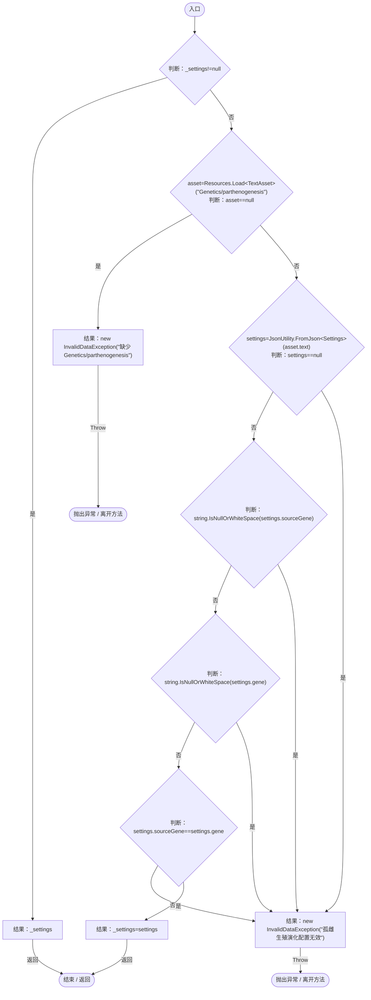
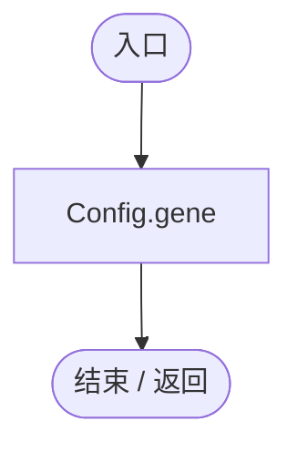
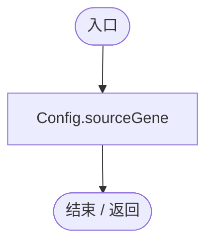
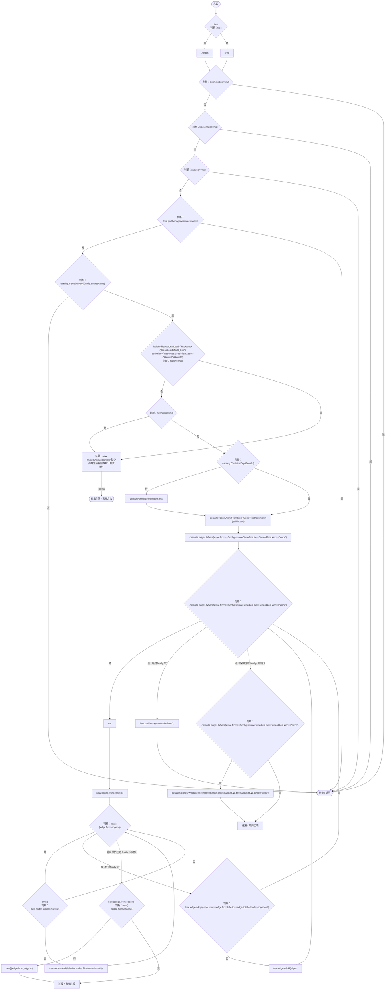
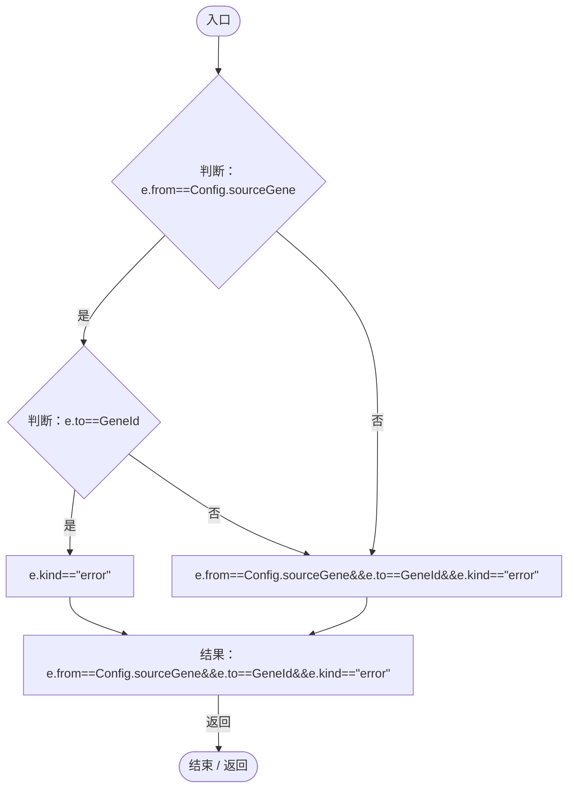
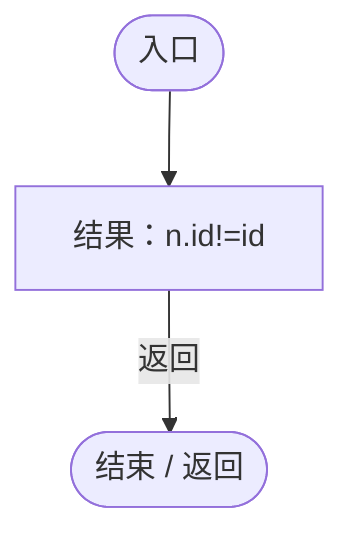
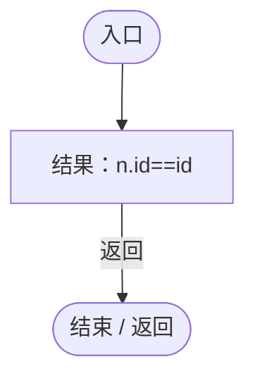
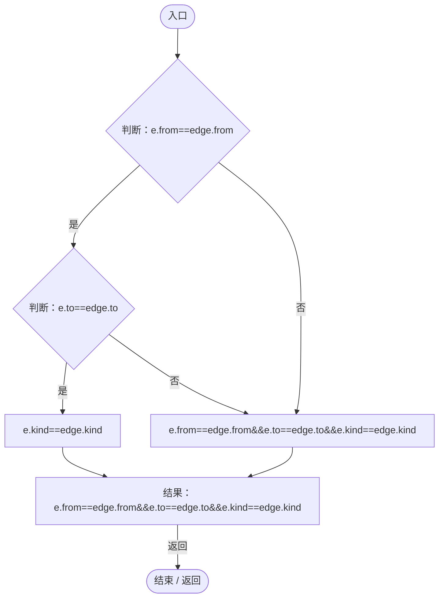

# ParthenogenesisEvolutionUpgrade.cs

[返回总索引](../README.md) · `Runtime` · `Assets/DarwinPark/Genetics/ParthenogenesisEvolutionUpgrade.cs`

[源文件](../../../Assets/DarwinPark/Genetics/ParthenogenesisEvolutionUpgrade.cs) · 源码校验：`3bc68b91e54e208e95bc9534dd6ce65060616e7642081564b1b5dbf5a514a3a1`

方法按源文件位置排列。事件/回调引用不表示立即执行；分支与异常说明见总索引。完整源码与可点击关系图请打开离线手册。

## Config.get · L16

`get`

### Editor / Player · Roslyn编译器控制流

## GeneId.get · L26

`public static string GeneId`

### Editor / Player · 语法控制结构 / 声明（非CFG）

项目内调用/回调引用：

- [ParthenogenesisEvolutionUpgrade.Config.get · L16](9270126d968c1a50.md#md50f1837e8a95c80)（访问器）

## SourceGeneId.get · L27

`public static string SourceGeneId`

### Editor / Player · 语法控制结构 / 声明（非CFG）

项目内调用/回调引用：

- [ParthenogenesisEvolutionUpgrade.Config.get · L16](9270126d968c1a50.md#md50f1837e8a95c80)（访问器）

## Apply · L28

`public static void Apply(GeneTreeDocument tree,Dictionary<string,string> catalog)`

### Editor / Player · Roslyn编译器控制流

项目内调用/回调引用：

- [ParthenogenesisEvolutionUpgrade.Config.get · L16](9270126d968c1a50.md#md50f1837e8a95c80)（访问器）
- [ParthenogenesisEvolutionUpgrade.回调@35 · L35](9270126d968c1a50.md#mc3e6e6b0dcc0faeb)（回调/委托）
- [ParthenogenesisEvolutionUpgrade.回调@37 · L37](9270126d968c1a50.md#m38a23fd577c9f046)（回调/委托）
- [ParthenogenesisEvolutionUpgrade.回调@37 · L37](9270126d968c1a50.md#m19bd149fbc320623)（回调/委托）
- [ParthenogenesisEvolutionUpgrade.回调@38 · L38](9270126d968c1a50.md#m193c36774834ed1e)（回调/委托）

## 回调@35 · L35

`e … => 回调`

### Editor / Player · Roslyn编译器控制流

项目内调用/回调引用：

- [ParthenogenesisEvolutionUpgrade.Config.get · L16](9270126d968c1a50.md#md50f1837e8a95c80)（访问器）

## 回调@37 · L37

`n … => 回调`

### Editor / Player · Roslyn编译器控制流

## 回调@37 · L37

`n … => 回调`

### Editor / Player · Roslyn编译器控制流

## 回调@38 · L38

`e … => 回调`

### Editor / Player · Roslyn编译器控制流

