# RuleCardExtensions.cs

[返回总索引](../README.md) · `Runtime` · `Assets/DarwinPark/UI/RuleCardExtensions.cs`

[源文件](../../../Assets/DarwinPark/UI/RuleCardExtensions.cs) · 源码校验：`3738431f334b69fab6e552c5f2083fb1fda89b7a02f59fa19919a92328db42d4`

方法按源文件位置排列。事件/回调引用不表示立即执行；分支与异常说明见总索引。完整源码与可点击关系图请打开离线手册。

<a id="m82cd86458c20264f"></a>

## Rules.get · L15

`get`


### Editor / Player · 语法控制结构 / 声明（非CFG）


<a id="m9d015d093479c2ee"></a>

## Rules.set · L15

`private set`


### Editor / Player · 语法控制结构 / 声明（非CFG）


<a id="m87bcb477e62fee5b"></a>

## SecondsEditable.get · L18

`public bool SecondsEditable`


### Editor / Player · 语法控制结构 / 声明（非CFG）

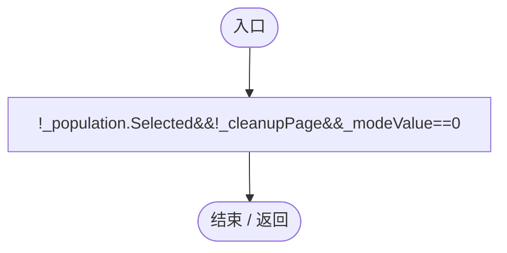

项目内调用/回调引用：

- [PopulationRatioRulePage.Selected.get · L15](fbcf38a1243f31af.md#mc60958ea7f06d2e4)（访问器）

<a id="mb084d0e1d91f5190"></a>

## Bind · L19

`public void Bind(SimulationRulesPanel owner,InputField fraction,InputField seconds,Button enabled)`


### Editor / Player · Roslyn编译器控制流

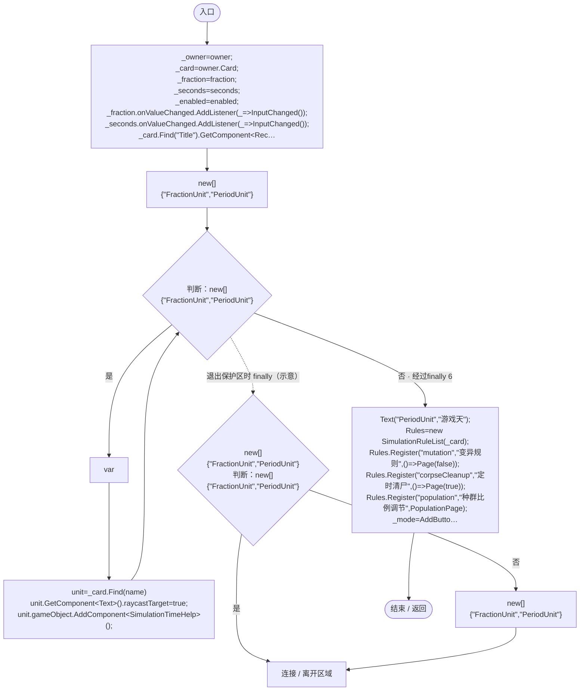

项目内调用/回调引用：

- [RuleCardExtensions.Text · L45](92d59cd12a5696c3.md#m1167f87a5350dbde)（方法）
- [RuleCardExtensions.Rules.set · L15](92d59cd12a5696c3.md#m9d015d093479c2ee)（访问器）
- [SimulationRuleList.SimulationRuleList.ctor · L13](8e0c9b70cd52abbf.md#mcd47bace7682d304)（构造函数）
- [SimulationRuleList.Register · L23](8e0c9b70cd52abbf.md#m3753c727dbdbe6be)（方法）
- [RuleCardExtensions.Rules.get · L15](92d59cd12a5696c3.md#m82cd86458c20264f)（访问器）
- [RuleCardExtensions.AddButton · L32](92d59cd12a5696c3.md#m8dfd087c19ad0070)（方法）
- [UIFactory.NewText · L57](dd1096a6995423db.md#m9dbccb5f0c38189e)（方法）
- [RuleCardExtensions.Place · L31](92d59cd12a5696c3.md#mb4185987997d6392)（方法）
- [PopulationRatioRulePage.PopulationRatioRulePage.ctor · L16](fbcf38a1243f31af.md#mc102e55e6fb5e6eb)（构造函数）
- [RuleCardExtensions.回调@22 · L22](92d59cd12a5696c3.md#med5d33d6f0f5cc60)（回调/委托）
- [RuleCardExtensions.回调@22 · L22](92d59cd12a5696c3.md#me4f923b08e3ac794)（回调/委托）
- [RuleCardExtensions.回调@26 · L26](92d59cd12a5696c3.md#m5c459b520fbb62d0)（回调/委托）
- [RuleCardExtensions.回调@26 · L26](92d59cd12a5696c3.md#m89005fc99962cdd2)（回调/委托）
- [RuleCardExtensions.PopulationPage · L41](92d59cd12a5696c3.md#m001ce950e63d4f32)（方法）
- [RuleCardExtensions.SwitchMode · L43](92d59cd12a5696c3.md#m5dacaf008658b3ce)（方法）

<a id="med5d33d6f0f5cc60"></a>

## 回调@22 · L22

`_ … => 回调`


### Editor / Player · Roslyn编译器控制流


项目内调用/回调引用：

- [RuleCardExtensions.InputChanged · L42](92d59cd12a5696c3.md#m664b170f07ec3031)（方法）

<a id="me4f923b08e3ac794"></a>

## 回调@22 · L22

`_ … => 回调`


### Editor / Player · Roslyn编译器控制流

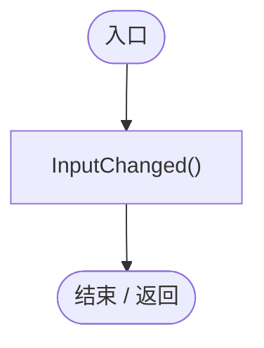

项目内调用/回调引用：

- [RuleCardExtensions.InputChanged · L42](92d59cd12a5696c3.md#m664b170f07ec3031)（方法）

<a id="m5c459b520fbb62d0"></a>

## 回调@26 · L26

`( … => 回调`


### Editor / Player · Roslyn编译器控制流


项目内调用/回调引用：

- [RuleCardExtensions.Page · L40](92d59cd12a5696c3.md#me5de6ba9f4d6d598)（方法）

<a id="m89005fc99962cdd2"></a>

## 回调@26 · L26

`( … => 回调`


### Editor / Player · Roslyn编译器控制流


项目内调用/回调引用：

- [RuleCardExtensions.Page · L40](92d59cd12a5696c3.md#me5de6ba9f4d6d598)（方法）

<a id="mb4185987997d6392"></a>

## Place · L31

`private static void Place(RectTransform rect,float x,float y,float width,float height)`


### Editor / Player · Roslyn编译器控制流


<a id="m8dfd087c19ad0070"></a>

## AddButton · L32

`private Button AddButton(string name,string label,UnityEngine.Events.UnityAction action,float x,float y,float width,float height)`


### Editor / Player · Roslyn编译器控制流


项目内调用/回调引用：

- [UIFactory.NewButton · L73](dd1096a6995423db.md#m5896f1b097c8bdde)（方法）
- [RuleCardExtensions.Place · L31](92d59cd12a5696c3.md#mb4185987997d6392)（方法）
- [RuleCardExtensions.回调@32 · L32](92d59cd12a5696c3.md#m731f46c2e9a353f3)（回调/委托）

<a id="m731f46c2e9a353f3"></a>

## 回调@32 · L32

`( … => 回调`


### Editor / Player · Roslyn编译器控制流

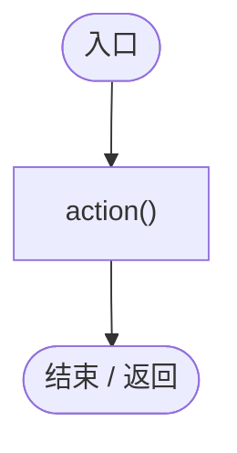

<a id="m815bd4f5230903c5"></a>

## Number · L33

`private static string Number(float value)`


### Editor / Player · Roslyn编译器控制流

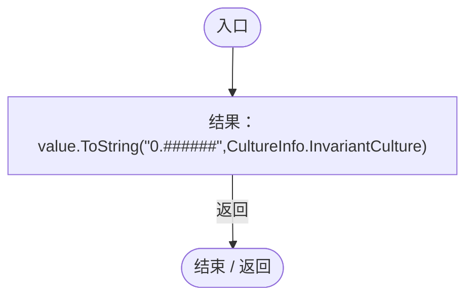

<a id="m8ff48eb58108d550"></a>

## Sync · L34

`public void Sync(GameplayTuning tuning)`


### Editor / Player · Roslyn编译器控制流

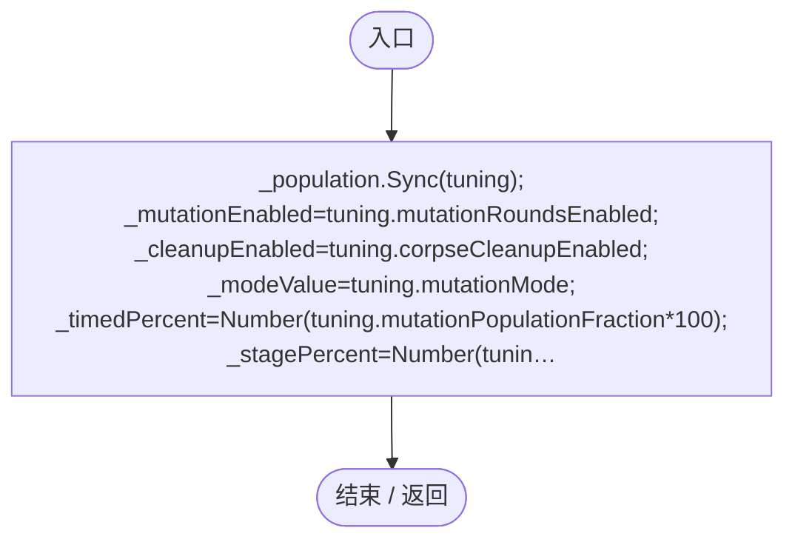

项目内调用/回调引用：

- [PopulationRatioRulePage.Sync · L18](fbcf38a1243f31af.md#mf1c2aef1c97ac08b)（方法）
- [RuleCardExtensions.Number · L33](92d59cd12a5696c3.md#m815bd4f5230903c5)（方法）
- [LifeCycleSettings.Load · L16](ace76969fe8f61de.md#m6fe263852e5a8989)（方法）
- [RuleCardExtensions.Render · L46](92d59cd12a5696c3.md#m123779b1fe2d94d0)（方法）

<a id="m1628ab37a94157df"></a>

## Stash · L39

`private void Stash()`


### Editor / Player · Roslyn编译器控制流

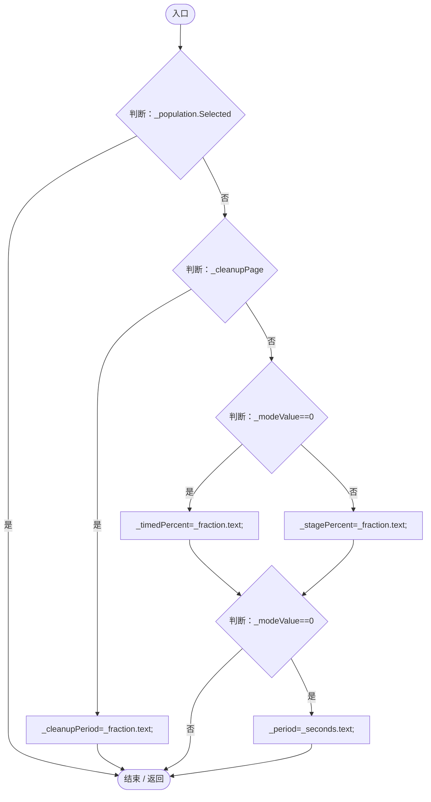

项目内调用/回调引用：

- [PopulationRatioRulePage.Selected.get · L15](fbcf38a1243f31af.md#mc60958ea7f06d2e4)（访问器）

<a id="me5de6ba9f4d6d598"></a>

## Page · L40

`private void Page(bool cleanup)`


### Editor / Player · Roslyn编译器控制流

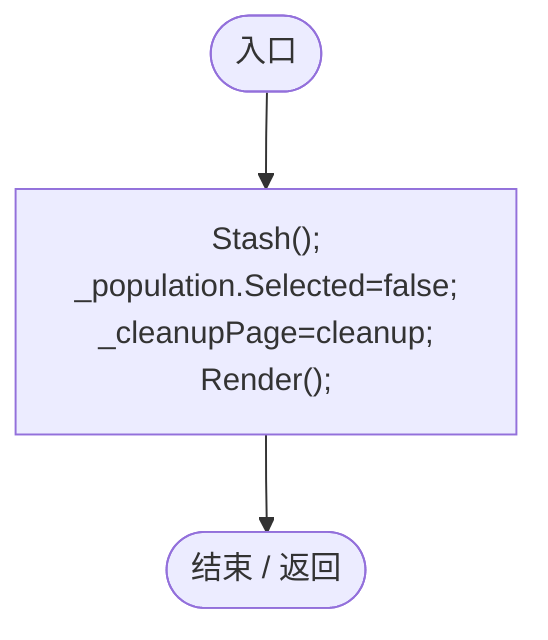

项目内调用/回调引用：

- [RuleCardExtensions.Stash · L39](92d59cd12a5696c3.md#m1628ab37a94157df)（方法）
- [PopulationRatioRulePage.Selected.set · L15](fbcf38a1243f31af.md#me11d3c1428d61549)（访问器）
- [RuleCardExtensions.Render · L46](92d59cd12a5696c3.md#m123779b1fe2d94d0)（方法）

<a id="m001ce950e63d4f32"></a>

## PopulationPage · L41

`private void PopulationPage()`


### Editor / Player · Roslyn编译器控制流

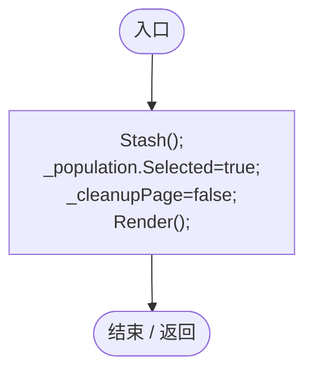

项目内调用/回调引用：

- [RuleCardExtensions.Stash · L39](92d59cd12a5696c3.md#m1628ab37a94157df)（方法）
- [PopulationRatioRulePage.Selected.set · L15](fbcf38a1243f31af.md#me11d3c1428d61549)（访问器）
- [RuleCardExtensions.Render · L46](92d59cd12a5696c3.md#m123779b1fe2d94d0)（方法）

<a id="m664b170f07ec3031"></a>

## InputChanged · L42

`private void InputChanged()`


### Editor / Player · Roslyn编译器控制流

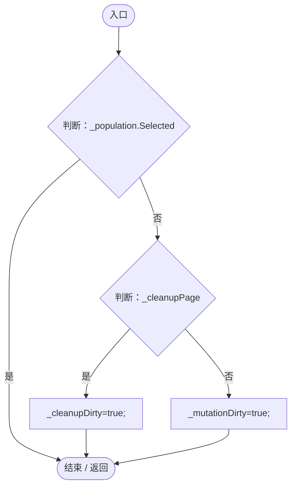

项目内调用/回调引用：

- [PopulationRatioRulePage.Selected.get · L15](fbcf38a1243f31af.md#mc60958ea7f06d2e4)（访问器）

<a id="m5dacaf008658b3ce"></a>

## SwitchMode · L43

`private void SwitchMode()`


### Editor / Player · Roslyn编译器控制流

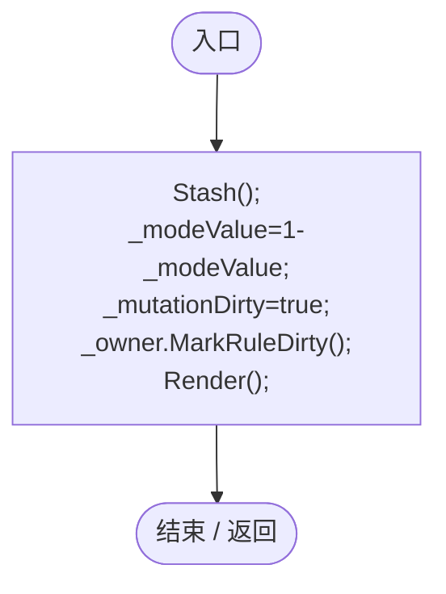

项目内调用/回调引用：

- [RuleCardExtensions.Stash · L39](92d59cd12a5696c3.md#m1628ab37a94157df)（方法）
- [SimulationRulesPanel.MarkRuleDirty · L17](dd1021765f4bd253.md#mc6297f873e7197ea)（方法）
- [RuleCardExtensions.Render · L46](92d59cd12a5696c3.md#m123779b1fe2d94d0)（方法）

<a id="ma2a7615b1e3f98aa"></a>

## Toggle · L44

`public void Toggle()`


### Editor / Player · Roslyn编译器控制流

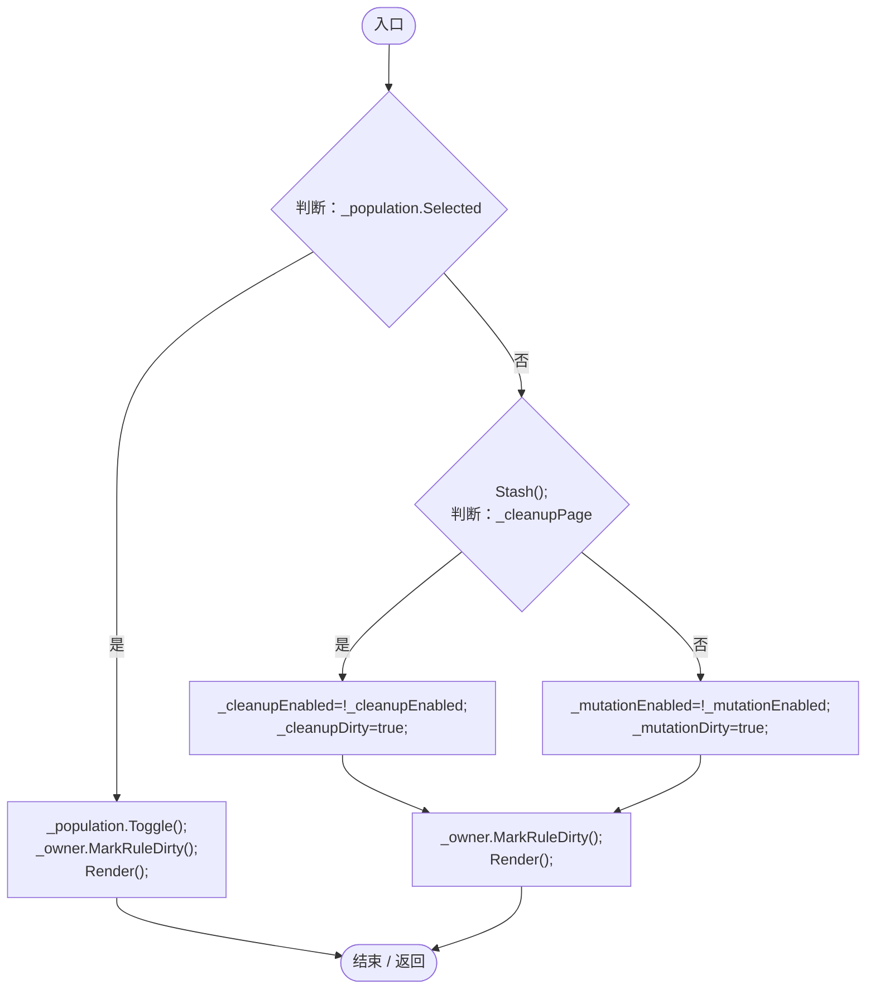

项目内调用/回调引用：

- [PopulationRatioRulePage.Selected.get · L15](fbcf38a1243f31af.md#mc60958ea7f06d2e4)（访问器）
- [PopulationRatioRulePage.Toggle · L19](fbcf38a1243f31af.md#m1f466ddaaed369dc)（方法）
- [SimulationRulesPanel.MarkRuleDirty · L17](dd1021765f4bd253.md#mc6297f873e7197ea)（方法）
- [RuleCardExtensions.Render · L46](92d59cd12a5696c3.md#m123779b1fe2d94d0)（方法）
- [RuleCardExtensions.Stash · L39](92d59cd12a5696c3.md#m1628ab37a94157df)（方法）

<a id="m1167f87a5350dbde"></a>

## Text · L45

`private void Text(string name,string value)`


### Editor / Player · Roslyn编译器控制流


<a id="m123779b1fe2d94d0"></a>

## Render · L46

`private void Render()`


### Editor / Player · Roslyn编译器控制流

```mermaid
flowchart TD
  b0(["入口"])
  b1["new[]{&quot;FractionUnit&quot;,&quot;PeriodUnit&quot;}"]
  b2{"判断：new[]{&quot;FractionUnit&quot;,&quot;PeriodUnit&quot;}"}
  b3["var"]
  b4{"_card.Find(name).GetComponent&lt;SimulationTimeHelp&gt;().enabled<br/>判断：_population.Selected"}
  b5{"判断：name==&quot;PeriodUnit&quot;"}
  b6["_cleanupPage"]
  b7["name==&quot;PeriodUnit&quot;"]
  b8["!_population.Selected"]
  b9["_card.Find(name).GetComponent&lt;SimulationTimeHelp&gt;().enabled=!_population.Selected&amp;&amp;(name==&quot;PeriodUnit&quot;&#124;&#124;_cleanupPage);"]
  b10{"new[]{&quot;FractionUnit&quot;,&quot;PeriodUnit&quot;}<br/>判断：new[]{&quot;FractionUnit&quot;,&quot;PeriodUnit&quot;}"}
  b11["new[]{&quot;FractionUnit&quot;,&quot;PeriodUnit&quot;}"]
  b12["连接 / 离开区域"]
  b13{"判断：_population.Selected"}
  b14["_mode.gameObject.SetActive(false);<br/>_population.Render();"]
  b15["_fraction.gameObject.SetActive(true);<br/>_mode.gameObject.SetActive(!_cleanupPage);"]
  b16{"_mode.GetComponentInChildren&lt;Text&gt;().text<br/>判断：_modeValue==0"}
  b17["&quot;模式：定时抽样 ⇄&quot;"]
  b18["&quot;模式：生命阶段 ⇄&quot;"]
  b19["_mode.GetComponentInChildren&lt;Text&gt;().text=_modeValue==0?&quot;模式：定时抽样 ⇄&quot;:&quot;模式：生命阶段 ⇄&quot;;"]
  b20["(RectTransform)_enabled.transform"]
  b21{"判断：_cleanupPage"}
  b22["10"]
  b23["175"]
  b24["_cleanupPage?10:175"]
  b25{"25<br/>判断：_cleanupPage"}
  b26["240"]
  b27["75"]
  b28["Place((RectTransform)_enabled.transform,_cleanupPage?10:175,25,_cleanupPage?240:75,23);"]
  b29{"_enabled.GetComponentInChildren&lt;Text&gt;().text<br/>判断：_cleanupPage"}
  b30{"&quot;定时清理尸体：&quot;<br/>判断：_cleanupEnabled"}
  b31["&quot;开&quot;"]
  b32["&quot;关&quot;"]
  b33["&quot;定时清理尸体：&quot;+(_cleanupEnabled?&quot;开&quot;:&quot;关&quot;)"]
  b34{"&quot;变异：&quot;<br/>判断：_mutationEnabled"}
  b35["&quot;开&quot;"]
  b36["&quot;关&quot;"]
  b37["&quot;变异：&quot;+(_mutationEnabled?&quot;开&quot;:&quot;关&quot;)"]
  b38["_enabled.GetComponentInChildren&lt;Text&gt;().text=_cleanupPage?&quot;定时清理尸体：&quot;+(_cleanupEnabled?&quot;开&quot;:&quot;关&quot;):&quot;变异：&quot;+(_mutationEnabled?&quot;开&quot;:&quot;关&quot;);"]
  b39{"Text<br/>&quot;FractionLabel&quot;<br/>判断：_cleanupPage"}
  b40["&quot;周期&quot;"]
  b41{"判断：_modeValue==0"}
  b42["&quot;抽样&quot;"]
  b43["&quot;概率&quot;"]
  b44["Text(&quot;FractionLabel&quot;,_cleanupPage?&quot;周期&quot;:_modeValue==0?&quot;抽样&quot;:&quot;概率&quot;);"]
  b45{"Text<br/>&quot;FractionUnit&quot;<br/>判断：_cleanupPage"}
  b46["&quot;游戏天&quot;"]
  b47{"判断：_modeValue==0"}
  b48["&quot;% 活体&quot;"]
  b49["&quot;% 每阶段&quot;"]
  b50["Text(&quot;FractionUnit&quot;,_cleanupPage?&quot;游戏天&quot;:_modeValue==0?&quot;% 活体&quot;:&quot;% 每阶段&quot;);"]
  b51{"_fraction<br/>判断：_cleanupPage"}
  b52["_cleanupPeriod"]
  b53{"判断：_modeValue==0"}
  b54["_timedPercent"]
  b55["_stagePercent"]
  b56["_fraction.SetTextWithoutNotify(_cleanupPage?_cleanupPeriod:_modeValue==0?_timedPercent:_stagePercent);"]
  b57["_seconds.SetTextWithoutNotify(_period);"]
  b58{"_seconds.gameObject<br/>判断：_cleanupPage"}
  b59["_modeValue==0"]
  b60["!_cleanupPage"]
  b61["_seconds.gameObject.SetActive(!_cleanupPage&amp;&amp;_modeValue==0);"]
  b62{"_card.Find(&quot;PeriodUnit&quot;).gameObject<br/>判断：_cleanupPage"}
  b63["_modeValue==0"]
  b64["!_cleanupPage"]
  b65["_card.Find(&quot;PeriodUnit&quot;).gameObject.SetActive(!_cleanupPage&amp;&amp;_modeValue==0);"]
  b66{"Text<br/>&quot;PeriodLabel&quot;<br/>判断：_cleanupPage"}
  b67["&quot;保护&quot;"]
  b68{"判断：_modeValue==0"}
  b69["&quot;周期&quot;"]
  b70["&quot;触发&quot;"]
  b71["Text(&quot;PeriodLabel&quot;,_cleanupPage?&quot;保护&quot;:_modeValue==0?&quot;周期&quot;:&quot;触发&quot;);"]
  b72{"_stageHint.gameObject<br/>判断：_cleanupPage"}
  b73["_modeValue==1"]
  b74["_cleanupPage"]
  b75["_stageHint.gameObject.SetActive(_cleanupPage&#124;&#124;_modeValue==1);"]
  b76{"_stageHint.text<br/>判断：_cleanupPage"}
  b77["&quot;跳过已领取 / 运输中的尸体&quot;"]
  b78["&quot;出生 / 成年 / 老年，各一次&quot;"]
  b79["_stageHint.text=_cleanupPage?&quot;跳过已领取 / 运输中的尸体&quot;:&quot;出生 / 成年 / 老年，各一次&quot;;"]
  b80(["结束 / 返回"])
  b0 --> b1
  b1 --> b2
  b2 -->|"是"| b3
  b2 -->|"否 · 经过finally 10"| b13
  b3 --> b4
  b4 -->|"否"| b5
  b4 -->|"是"| b8
  b5 -->|"否"| b6
  b5 -->|"是"| b7
  b6 --> b9
  b7 --> b9
  b8 --> b9
  b9 --> b2
  b10 -->|"否"| b11
  b10 -->|"是"| b12
  b11 --> b12
  b13 -->|"是"| b14
  b13 -->|"否"| b15
  b14 --> b80
  b15 --> b16
  b16 -->|"是"| b17
  b16 -->|"否"| b18
  b17 --> b19
  b18 --> b19
  b19 --> b20
  b20 --> b21
  b21 -->|"是"| b22
  b21 -->|"否"| b23
  b22 --> b24
  b23 --> b24
  b24 --> b25
  b25 -->|"是"| b26
  b25 -->|"否"| b27
  b26 --> b28
  b27 --> b28
  b28 --> b29
  b29 -->|"是"| b30
  b29 -->|"否"| b34
  b30 -->|"是"| b31
  b30 -->|"否"| b32
  b31 --> b33
  b32 --> b33
  b33 --> b38
  b34 -->|"是"| b35
  b34 -->|"否"| b36
  b35 --> b37
  b36 --> b37
  b37 --> b38
  b38 --> b39
  b39 -->|"是"| b40
  b39 -->|"否"| b41
  b40 --> b44
  b41 -->|"是"| b42
  b41 -->|"否"| b43
  b42 --> b44
  b43 --> b44
  b44 --> b45
  b45 -->|"是"| b46
  b45 -->|"否"| b47
  b46 --> b50
  b47 -->|"是"| b48
  b47 -->|"否"| b49
  b48 --> b50
  b49 --> b50
  b50 --> b51
  b51 -->|"是"| b52
  b51 -->|"否"| b53
  b52 --> b56
  b53 -->|"是"| b54
  b53 -->|"否"| b55
  b54 --> b56
  b55 --> b56
  b56 --> b57
  b57 --> b58
  b58 -->|"否"| b59
  b58 -->|"是"| b60
  b59 --> b61
  b60 --> b61
  b61 --> b62
  b62 -->|"否"| b63
  b62 -->|"是"| b64
  b63 --> b65
  b64 --> b65
  b65 --> b66
  b66 -->|"是"| b67
  b66 -->|"否"| b68
  b67 --> b71
  b68 -->|"是"| b69
  b68 -->|"否"| b70
  b69 --> b71
  b70 --> b71
  b71 --> b72
  b72 -->|"否"| b73
  b72 -->|"是"| b74
  b73 --> b75
  b74 --> b75
  b75 --> b76
  b76 -->|"是"| b77
  b76 -->|"否"| b78
  b77 --> b79
  b78 --> b79
  b79 --> b80
  b2 -. "退出保护区时 finally（示意）" .-> b10

```

项目内调用/回调引用：

- [PopulationRatioRulePage.Selected.get · L15](fbcf38a1243f31af.md#mc60958ea7f06d2e4)（访问器）
- [PopulationRatioRulePage.Render · L22](fbcf38a1243f31af.md#mc422ce7ad74a1257)（方法）
- [RuleCardExtensions.Place · L31](92d59cd12a5696c3.md#mb4185987997d6392)（方法）
- [RuleCardExtensions.Text · L45](92d59cd12a5696c3.md#m1167f87a5350dbde)（方法）

<a id="m621722bed1369fa5"></a>

## Parse · L62

`private static float Parse(string value)`


### Editor / Player · Roslyn编译器控制流

```mermaid
flowchart TD
  b0(["入口"])
  b1{"判断：float.TryParse(value,NumberStyles.Float,CultureInfo.InvariantCulture,out var result)"}
  b2{"判断：float.IsNaN(result)"}
  b3{"判断：float.IsInfinity(result)"}
  b4["结果：new FormatException(&quot;请输入有效数值&quot;)"]
  x4(["抛出异常 / 离开方法"])
  b5["结果：result"]
  b6(["结束 / 返回"])
  b0 --> b1
  b1 -->|"是"| b2
  b1 -->|"否"| b4
  b2 -->|"否"| b3
  b2 -->|"是"| b4
  b3 -->|"是"| b4
  b3 -->|"否"| b5
  b4 -->|"Throw"| x4
  b5 -->|"返回"| b6

```

<a id="m1aaeb4d5ef4a4aa7"></a>

## Save · L63

`public void Save()`


### Editor / Player · Roslyn编译器控制流

```mermaid
flowchart TD
  b0(["入口"])
  b1["Stash();<br/>RuleSelectionEdits.Save(text=&gt;{text=_population.Edit(text);if(_mutationDirty)text=RuleSelectionEdits.MutationModes(text,_mutationEnabled,_modeValue,Parse(_timedPercent)/100,Parse(_stagePercent)/100,SimulationTimeHelp.ToSeconds(P…"]
  b2(["结束 / 返回"])
  b0 --> b1
  b1 --> b2

```

项目内调用/回调引用：

- [RuleCardExtensions.Stash · L39](92d59cd12a5696c3.md#m1628ab37a94157df)（方法）
- [RuleSelectionEdits.Save · L24](f1d4e0eb3e10983c.md#m11eabf1af4cc88d5)（方法）
- [RuleCardExtensions.回调@67 · L67](92d59cd12a5696c3.md#m3c0f910f4e27eff5)（回调/委托）

<a id="m3c0f910f4e27eff5"></a>

## 回调@67 · L67

`text … => 回调`


### Editor / Player · Roslyn编译器控制流

```mermaid
flowchart TD
  b0(["入口"])
  b1{"text=_population.Edit(text);<br/>判断：_mutationDirty"}
  b2["text=RuleSelectionEdits.MutationModes(text,_mutationEnabled,_modeValue,Parse(_timedPercent)/100,Parse(_stagePercent)/100,SimulationTimeHelp.ToSeconds(Parse(_period)));"]
  b3{"判断：_cleanupDirty"}
  b4["text=RuleSelectionEdits.Cleanup(text,_cleanupEnabled,SimulationTimeHelp.ToSeconds(Parse(_cleanupPeriod)));"]
  b5["结果：text"]
  b6(["结束 / 返回"])
  b0 --> b1
  b1 -->|"是"| b2
  b1 -->|"否"| b3
  b2 --> b3
  b3 -->|"是"| b4
  b3 -->|"否"| b5
  b4 --> b5
  b5 -->|"返回"| b6

```

项目内调用/回调引用：

- [PopulationRatioRulePage.Edit · L20](fbcf38a1243f31af.md#me6cef3f6097ef320)（方法）
- [RuleSelectionEdits.MutationModes · L18](f1d4e0eb3e10983c.md#m0dbded335bcfafc6)（方法）
- [RuleCardExtensions.Parse · L62](92d59cd12a5696c3.md#m621722bed1369fa5)（方法）
- [SimulationTimeHelp.ToSeconds · L10](a6e8ca06f4cafa96.md#m7a09fdf6dec870ff)（方法）
- [RuleSelectionEdits.Cleanup · L16](f1d4e0eb3e10983c.md#mb9a5c888d24675d2)（方法）

<a id="m804dbba504bbbb8b"></a>

## SetEditable · L69

`public void SetEditable(bool editable)`


### Editor / Player · Roslyn编译器控制流

```mermaid
flowchart TD
  b0(["入口"])
  b1{"_mode.interactable=editable;<br/>判断：_population.Selected"}
  b2["_fraction.interactable=false;"]
  b3(["结束 / 返回"])
  b0 --> b1
  b1 -->|"是"| b2
  b1 -->|"否"| b3
  b2 --> b3

```

项目内调用/回调引用：

- [PopulationRatioRulePage.Selected.get · L15](fbcf38a1243f31af.md#mc60958ea7f06d2e4)（访问器）

<a id="m7940f1790c7e58d4"></a>

## Status · L70

`public string Status()`


### Editor / Player · Roslyn编译器控制流

```mermaid
flowchart TD
  b0(["入口"])
  b1{"判断：_population.Selected"}
  b2["_population.Status"]
  b3{"判断：_cleanupPage"}
  b4["&quot;已清理 &quot;+CorpseCleanupController.Removed+&quot; · 待清理 &quot;+CorpseCleanupController.Queued"]
  b5{"判断：_modeValue==1"}
  b6["&quot;阶段去重触发 · 成年 / 老年仅一次&quot;"]
  b7["&quot;第&quot;+MutationRoundController.Rounds+&quot;轮 · 抽取&quot;+MutationRoundController.LastSelected+&quot;/&quot;+MutationRoundController.LastPopulation+&quot; · 待&quot;+MutationRoundController.Queued"]
  b8["结果：_population.Selected?_population.Status:_cleanupPage?&quot;已清理 &quot;+CorpseCleanupController.Removed+&quot; · 待清理 &quot;+CorpseCleanupController.Queued:_modeValue==1?&quot;阶段去重触发 · 成年 / 老年仅一次&quot;:&quot;第&quot;+MutationRoundController.Rounds+&quot;轮 · 抽取&quot;+MutationRoundControll…"]
  b9(["结束 / 返回"])
  b0 --> b1
  b1 -->|"是"| b2
  b1 -->|"否"| b3
  b2 --> b8
  b3 -->|"是"| b4
  b3 -->|"否"| b5
  b4 --> b8
  b5 -->|"是"| b6
  b5 -->|"否"| b7
  b6 --> b8
  b7 --> b8
  b8 -->|"返回"| b9

```

项目内调用/回调引用：

- [PopulationRatioRulePage.Selected.get · L15](fbcf38a1243f31af.md#mc60958ea7f06d2e4)（访问器）
