# RuleCardExtensions.cs

[返回总索引](../README.md) · `Runtime` · `Assets/DarwinPark/UI/RuleCardExtensions.cs`

[源文件](../../../Assets/DarwinPark/UI/RuleCardExtensions.cs) · 源码校验：`4fd742517ee77f32dfd749b3906dc6a9514d19dd220b7ce6fc8642f12734de25`

方法按源文件位置排列。事件/回调引用不表示立即执行；分支与异常说明见总索引。完整源码与可点击关系图请打开离线手册。

<a id="m82cd86458c20264f"></a>

## Rules.get · L15

`get`


### Editor / Player · 语法控制结构 / 声明（非CFG）

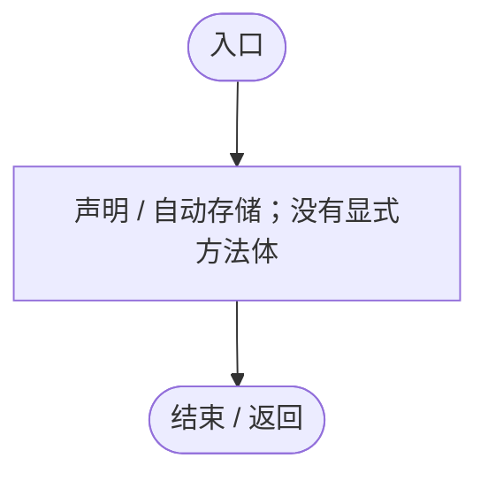

<a id="m9d015d093479c2ee"></a>

## Rules.set · L15

`private set`


### Editor / Player · 语法控制结构 / 声明（非CFG）


<a id="mb8a2e267d75455b0"></a>

## SecondsEditable.get · L17

`public bool SecondsEditable`


### Editor / Player · 语法控制结构 / 声明（非CFG）

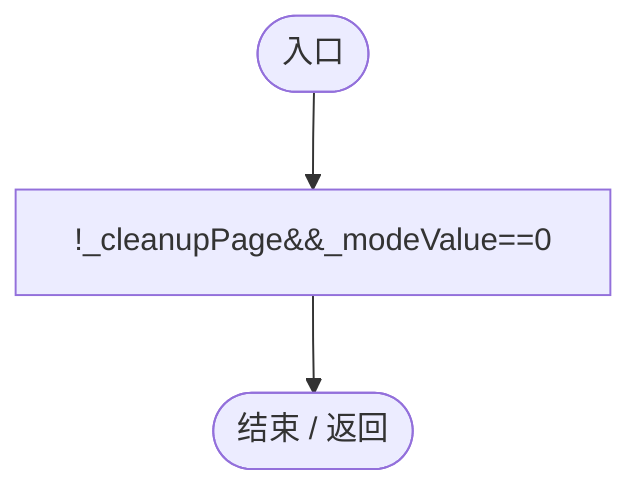

<a id="ma3ed5f94db0c76f1"></a>

## Bind · L18

`public void Bind(SimulationRulesPanel owner,InputField fraction,InputField seconds,Button enabled)`


### Editor / Player · Roslyn编译器控制流

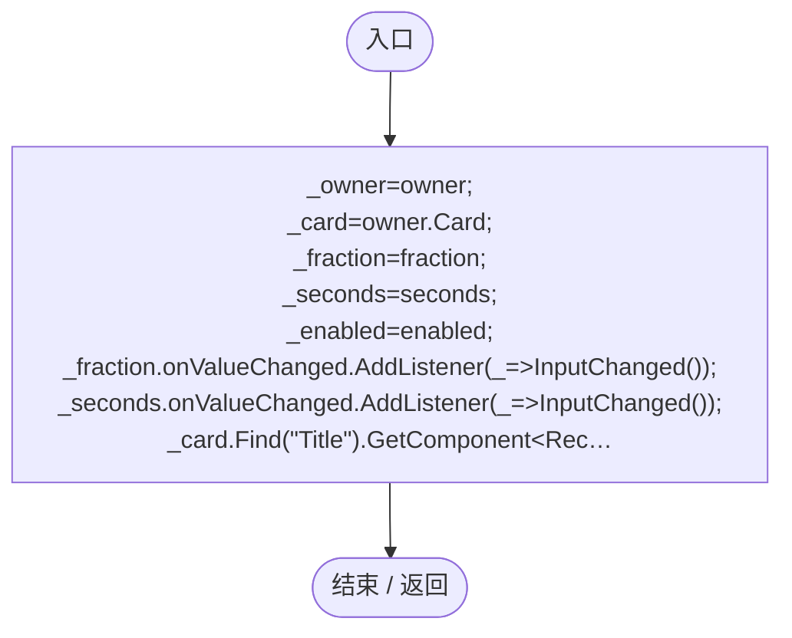

项目内调用/回调引用：

- [RuleCardExtensions.Rules.set · L15](92d59cd12a5696c3.md#m9d015d093479c2ee)（访问器）
- [SimulationRuleList.SimulationRuleList.ctor · L13](8e0c9b70cd52abbf.md#mcd47bace7682d304)（构造函数）
- [SimulationRuleList.Register · L23](8e0c9b70cd52abbf.md#m3753c727dbdbe6be)（方法）
- [RuleCardExtensions.Rules.get · L15](92d59cd12a5696c3.md#m82cd86458c20264f)（访问器）
- [RuleCardExtensions.AddButton · L28](92d59cd12a5696c3.md#ma2d9ba3ec26b12e8)（方法）
- [UIFactory.NewText · L57](dd1096a6995423db.md#m9dbccb5f0c38189e)（方法）
- [RuleCardExtensions.Place · L27](92d59cd12a5696c3.md#m445c4d097c932ed4)（方法）
- [RuleCardExtensions.回调@21 · L21](92d59cd12a5696c3.md#m40e4423fcc4944d7)（回调/委托）
- [RuleCardExtensions.回调@21 · L21](92d59cd12a5696c3.md#mca80e32ff72857c8)（回调/委托）
- [RuleCardExtensions.回调@23 · L23](92d59cd12a5696c3.md#md3445af4ca46e45f)（回调/委托）
- [RuleCardExtensions.回调@23 · L23](92d59cd12a5696c3.md#m6b421defe539409f)（回调/委托）
- [RuleCardExtensions.SwitchMode · L38](92d59cd12a5696c3.md#m13f87d8415cb11eb)（方法）

<a id="m40e4423fcc4944d7"></a>

## 回调@21 · L21

`_ … => 回调`


### Editor / Player · Roslyn编译器控制流


项目内调用/回调引用：

- [RuleCardExtensions.InputChanged · L37](92d59cd12a5696c3.md#m55d6d7ab8c3f0364)（方法）

<a id="mca80e32ff72857c8"></a>

## 回调@21 · L21

`_ … => 回调`


### Editor / Player · Roslyn编译器控制流


项目内调用/回调引用：

- [RuleCardExtensions.InputChanged · L37](92d59cd12a5696c3.md#m55d6d7ab8c3f0364)（方法）

<a id="md3445af4ca46e45f"></a>

## 回调@23 · L23

`( … => 回调`


### Editor / Player · Roslyn编译器控制流

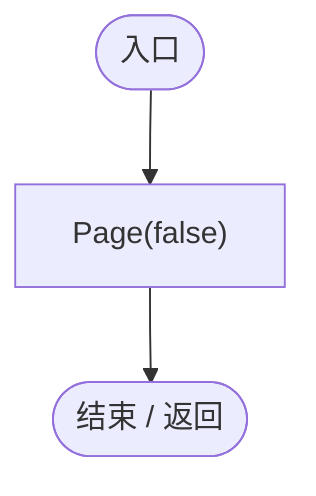

项目内调用/回调引用：

- [RuleCardExtensions.Page · L36](92d59cd12a5696c3.md#md1b19630001d006b)（方法）

<a id="m6b421defe539409f"></a>

## 回调@23 · L23

`( … => 回调`


### Editor / Player · Roslyn编译器控制流

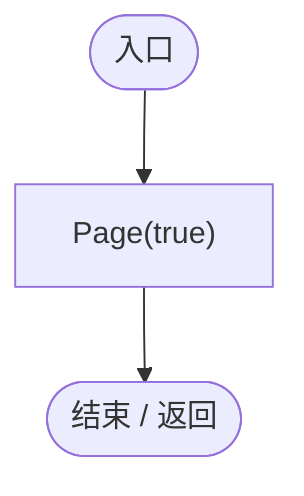

项目内调用/回调引用：

- [RuleCardExtensions.Page · L36](92d59cd12a5696c3.md#md1b19630001d006b)（方法）

<a id="m445c4d097c932ed4"></a>

## Place · L27

`private static void Place(RectTransform rect,float x,float y,float width,float height)`


### Editor / Player · Roslyn编译器控制流

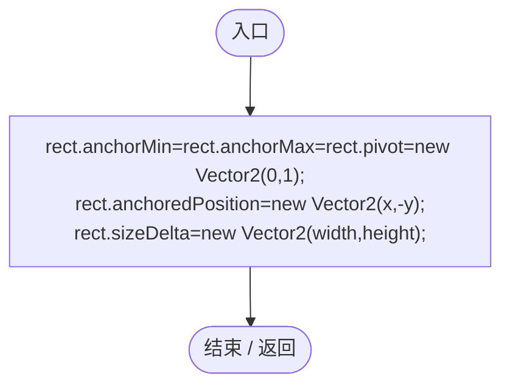

<a id="ma2d9ba3ec26b12e8"></a>

## AddButton · L28

`private Button AddButton(string name,string label,UnityEngine.Events.UnityAction action,float x,float y,float width,float height)`


### Editor / Player · Roslyn编译器控制流

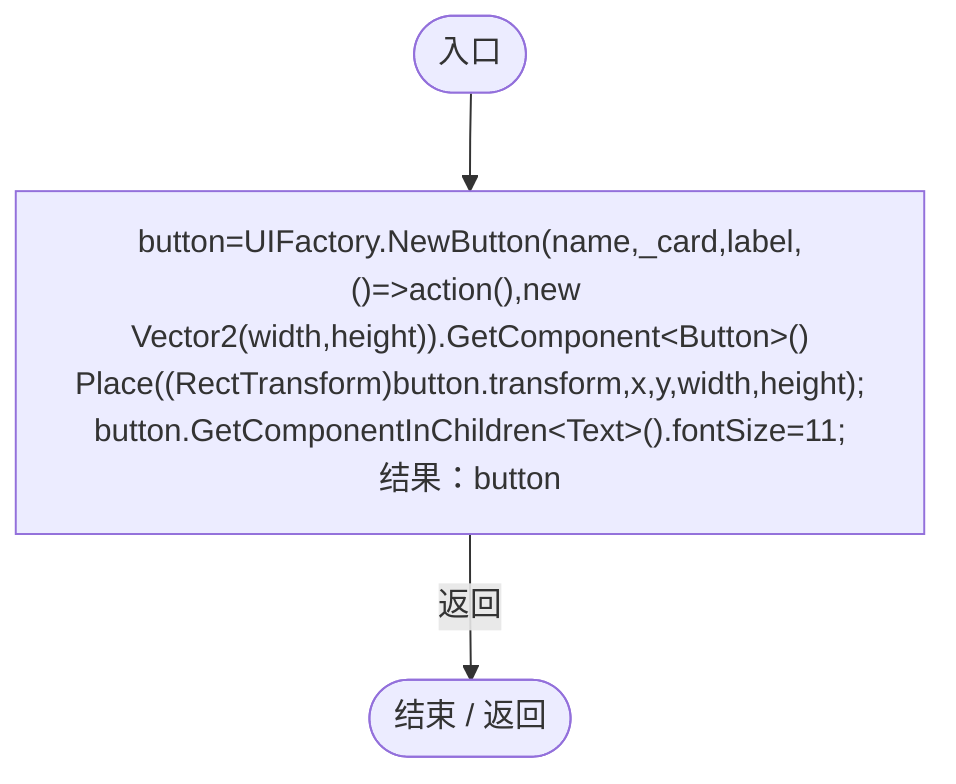

项目内调用/回调引用：

- [UIFactory.NewButton · L73](dd1096a6995423db.md#m5896f1b097c8bdde)（方法）
- [RuleCardExtensions.Place · L27](92d59cd12a5696c3.md#m445c4d097c932ed4)（方法）
- [RuleCardExtensions.回调@28 · L28](92d59cd12a5696c3.md#m7445d7af49d7d4ab)（回调/委托）

<a id="m7445d7af49d7d4ab"></a>

## 回调@28 · L28

`( … => 回调`


### Editor / Player · Roslyn编译器控制流


<a id="m3aa4793c12bcca80"></a>

## Number · L29

`private static string Number(float value)`


### Editor / Player · Roslyn编译器控制流

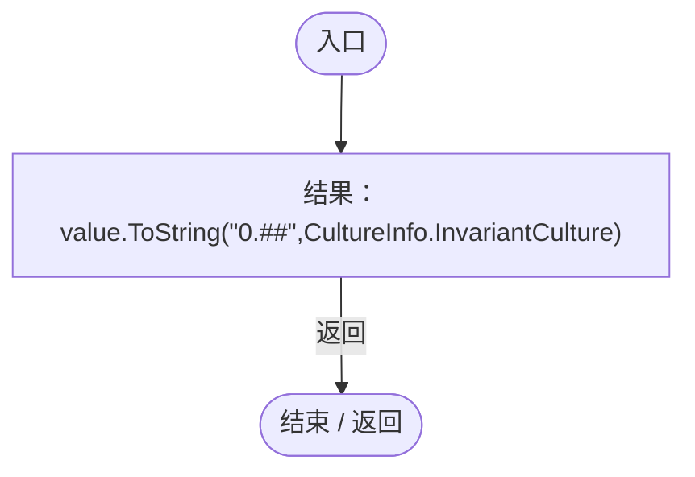

<a id="m3d75df12c1b976f7"></a>

## Sync · L30

`public void Sync(GameplayTuning tuning)`


### Editor / Player · Roslyn编译器控制流

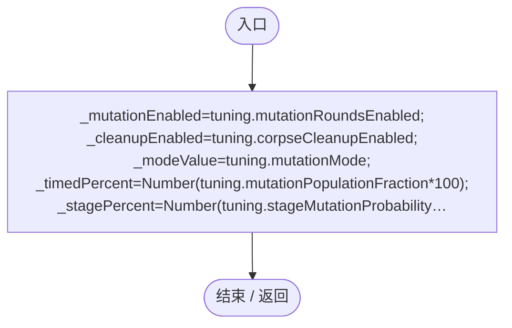

项目内调用/回调引用：

- [RuleCardExtensions.Number · L29](92d59cd12a5696c3.md#m3aa4793c12bcca80)（方法）
- [RuleCardExtensions.Render · L41](92d59cd12a5696c3.md#m8280060686c34d0e)（方法）

<a id="mbd375cd408ca4e35"></a>

## Stash · L35

`private void Stash()`


### Editor / Player · Roslyn编译器控制流

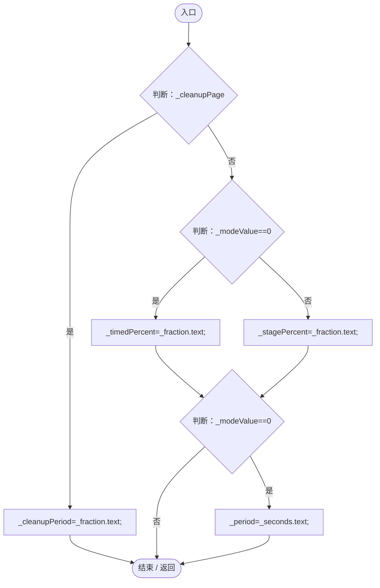

<a id="md1b19630001d006b"></a>

## Page · L36

`private void Page(bool cleanup)`


### Editor / Player · Roslyn编译器控制流

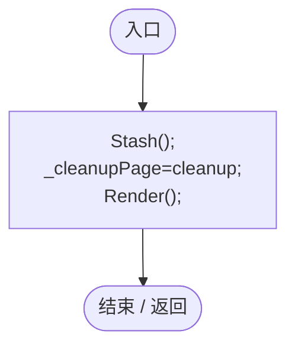

项目内调用/回调引用：

- [RuleCardExtensions.Stash · L35](92d59cd12a5696c3.md#mbd375cd408ca4e35)（方法）
- [RuleCardExtensions.Render · L41](92d59cd12a5696c3.md#m8280060686c34d0e)（方法）

<a id="m55d6d7ab8c3f0364"></a>

## InputChanged · L37

`private void InputChanged()`


### Editor / Player · Roslyn编译器控制流

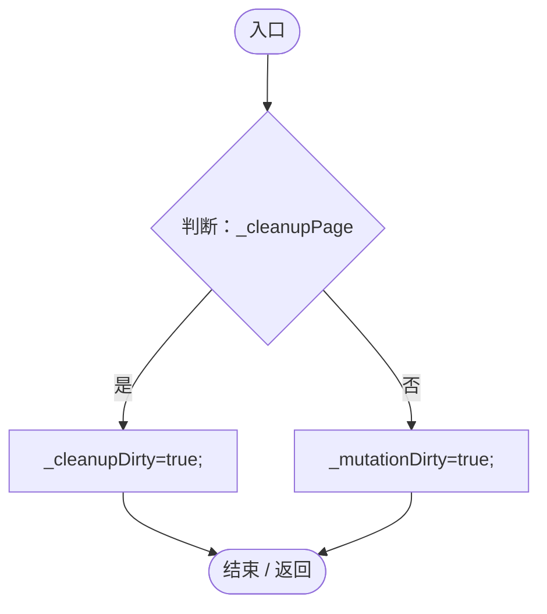

<a id="m13f87d8415cb11eb"></a>

## SwitchMode · L38

`private void SwitchMode()`


### Editor / Player · Roslyn编译器控制流

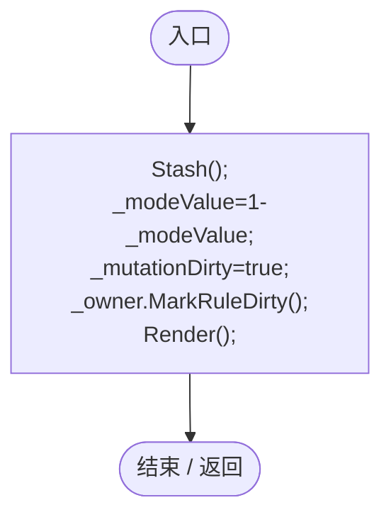

项目内调用/回调引用：

- [RuleCardExtensions.Stash · L35](92d59cd12a5696c3.md#mbd375cd408ca4e35)（方法）
- [SimulationRulesPanel.MarkRuleDirty · L17](dd1021765f4bd253.md#mc6297f873e7197ea)（方法）
- [RuleCardExtensions.Render · L41](92d59cd12a5696c3.md#m8280060686c34d0e)（方法）

<a id="ma83b0c57a6af5092"></a>

## Toggle · L39

`public void Toggle()`


### Editor / Player · Roslyn编译器控制流

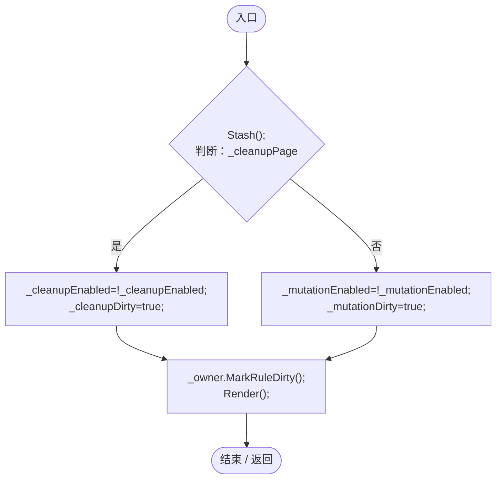

项目内调用/回调引用：

- [RuleCardExtensions.Stash · L35](92d59cd12a5696c3.md#mbd375cd408ca4e35)（方法）
- [SimulationRulesPanel.MarkRuleDirty · L17](dd1021765f4bd253.md#mc6297f873e7197ea)（方法）
- [RuleCardExtensions.Render · L41](92d59cd12a5696c3.md#m8280060686c34d0e)（方法）

<a id="mf907b5430be325a7"></a>

## Text · L40

`private void Text(string name,string value)`


### Editor / Player · Roslyn编译器控制流

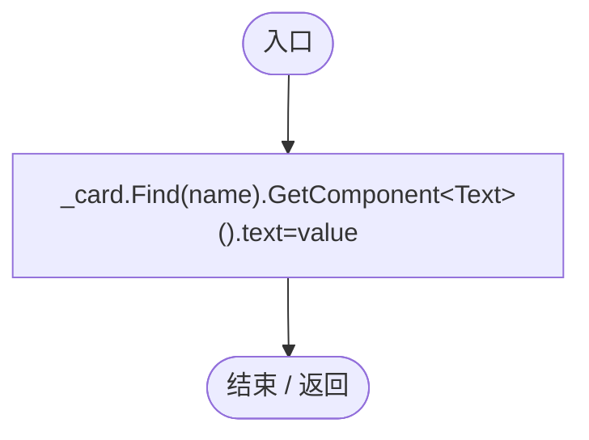

<a id="m8280060686c34d0e"></a>

## Render · L41

`private void Render()`


### Editor / Player · Roslyn编译器控制流

```mermaid
flowchart TD
  b0(["入口"])
  b1["_mode.gameObject.SetActive(!_cleanupPage);"]
  b2{"_mode.GetComponentInChildren&lt;Text&gt;().text<br/>判断：_modeValue==0"}
  b3["&quot;模式：定时抽样 ⇄&quot;"]
  b4["&quot;模式：生命阶段 ⇄&quot;"]
  b5["_mode.GetComponentInChildren&lt;Text&gt;().text=_modeValue==0?&quot;模式：定时抽样 ⇄&quot;:&quot;模式：生命阶段 ⇄&quot;;"]
  b6["(RectTransform)_enabled.transform"]
  b7{"判断：_cleanupPage"}
  b8["10"]
  b9["175"]
  b10["_cleanupPage?10:175"]
  b11{"25<br/>判断：_cleanupPage"}
  b12["240"]
  b13["75"]
  b14["Place((RectTransform)_enabled.transform,_cleanupPage?10:175,25,_cleanupPage?240:75,23);"]
  b15{"_enabled.GetComponentInChildren&lt;Text&gt;().text<br/>判断：_cleanupPage"}
  b16{"&quot;定时清理尸体：&quot;<br/>判断：_cleanupEnabled"}
  b17["&quot;开&quot;"]
  b18["&quot;关&quot;"]
  b19["&quot;定时清理尸体：&quot;+(_cleanupEnabled?&quot;开&quot;:&quot;关&quot;)"]
  b20{"&quot;变异：&quot;<br/>判断：_mutationEnabled"}
  b21["&quot;开&quot;"]
  b22["&quot;关&quot;"]
  b23["&quot;变异：&quot;+(_mutationEnabled?&quot;开&quot;:&quot;关&quot;)"]
  b24["_enabled.GetComponentInChildren&lt;Text&gt;().text=_cleanupPage?&quot;定时清理尸体：&quot;+(_cleanupEnabled?&quot;开&quot;:&quot;关&quot;):&quot;变异：&quot;+(_mutationEnabled?&quot;开&quot;:&quot;关&quot;);"]
  b25{"Text<br/>&quot;FractionLabel&quot;<br/>判断：_cleanupPage"}
  b26["&quot;周期&quot;"]
  b27{"判断：_modeValue==0"}
  b28["&quot;抽样&quot;"]
  b29["&quot;概率&quot;"]
  b30["Text(&quot;FractionLabel&quot;,_cleanupPage?&quot;周期&quot;:_modeValue==0?&quot;抽样&quot;:&quot;概率&quot;);"]
  b31{"Text<br/>&quot;FractionUnit&quot;<br/>判断：_cleanupPage"}
  b32["&quot;模拟秒&quot;"]
  b33{"判断：_modeValue==0"}
  b34["&quot;% 活体&quot;"]
  b35["&quot;% 每阶段&quot;"]
  b36["Text(&quot;FractionUnit&quot;,_cleanupPage?&quot;模拟秒&quot;:_modeValue==0?&quot;% 活体&quot;:&quot;% 每阶段&quot;);"]
  b37{"_fraction<br/>判断：_cleanupPage"}
  b38["_cleanupPeriod"]
  b39{"判断：_modeValue==0"}
  b40["_timedPercent"]
  b41["_stagePercent"]
  b42["_fraction.SetTextWithoutNotify(_cleanupPage?_cleanupPeriod:_modeValue==0?_timedPercent:_stagePercent);"]
  b43["_seconds.SetTextWithoutNotify(_period);"]
  b44{"_seconds.gameObject<br/>判断：_cleanupPage"}
  b45["_modeValue==0"]
  b46["!_cleanupPage"]
  b47["_seconds.gameObject.SetActive(!_cleanupPage&amp;&amp;_modeValue==0);"]
  b48{"_card.Find(&quot;PeriodUnit&quot;).gameObject<br/>判断：_cleanupPage"}
  b49["_modeValue==0"]
  b50["!_cleanupPage"]
  b51["_card.Find(&quot;PeriodUnit&quot;).gameObject.SetActive(!_cleanupPage&amp;&amp;_modeValue==0);"]
  b52{"Text<br/>&quot;PeriodLabel&quot;<br/>判断：_cleanupPage"}
  b53["&quot;保护&quot;"]
  b54{"判断：_modeValue==0"}
  b55["&quot;周期&quot;"]
  b56["&quot;触发&quot;"]
  b57["Text(&quot;PeriodLabel&quot;,_cleanupPage?&quot;保护&quot;:_modeValue==0?&quot;周期&quot;:&quot;触发&quot;);"]
  b58{"_stageHint.gameObject<br/>判断：_cleanupPage"}
  b59["_modeValue==1"]
  b60["_cleanupPage"]
  b61["_stageHint.gameObject.SetActive(_cleanupPage&#124;&#124;_modeValue==1);"]
  b62{"_stageHint.text<br/>判断：_cleanupPage"}
  b63["&quot;跳过已领取 / 运输中的尸体&quot;"]
  b64["&quot;出生 / 成年 / 老年，各一次&quot;"]
  b65["_stageHint.text=_cleanupPage?&quot;跳过已领取 / 运输中的尸体&quot;:&quot;出生 / 成年 / 老年，各一次&quot;;"]
  b66(["结束 / 返回"])
  b0 --> b1
  b1 --> b2
  b2 -->|"是"| b3
  b2 -->|"否"| b4
  b3 --> b5
  b4 --> b5
  b5 --> b6
  b6 --> b7
  b7 -->|"是"| b8
  b7 -->|"否"| b9
  b8 --> b10
  b9 --> b10
  b10 --> b11
  b11 -->|"是"| b12
  b11 -->|"否"| b13
  b12 --> b14
  b13 --> b14
  b14 --> b15
  b15 -->|"是"| b16
  b15 -->|"否"| b20
  b16 -->|"是"| b17
  b16 -->|"否"| b18
  b17 --> b19
  b18 --> b19
  b19 --> b24
  b20 -->|"是"| b21
  b20 -->|"否"| b22
  b21 --> b23
  b22 --> b23
  b23 --> b24
  b24 --> b25
  b25 -->|"是"| b26
  b25 -->|"否"| b27
  b26 --> b30
  b27 -->|"是"| b28
  b27 -->|"否"| b29
  b28 --> b30
  b29 --> b30
  b30 --> b31
  b31 -->|"是"| b32
  b31 -->|"否"| b33
  b32 --> b36
  b33 -->|"是"| b34
  b33 -->|"否"| b35
  b34 --> b36
  b35 --> b36
  b36 --> b37
  b37 -->|"是"| b38
  b37 -->|"否"| b39
  b38 --> b42
  b39 -->|"是"| b40
  b39 -->|"否"| b41
  b40 --> b42
  b41 --> b42
  b42 --> b43
  b43 --> b44
  b44 -->|"否"| b45
  b44 -->|"是"| b46
  b45 --> b47
  b46 --> b47
  b47 --> b48
  b48 -->|"否"| b49
  b48 -->|"是"| b50
  b49 --> b51
  b50 --> b51
  b51 --> b52
  b52 -->|"是"| b53
  b52 -->|"否"| b54
  b53 --> b57
  b54 -->|"是"| b55
  b54 -->|"否"| b56
  b55 --> b57
  b56 --> b57
  b57 --> b58
  b58 -->|"否"| b59
  b58 -->|"是"| b60
  b59 --> b61
  b60 --> b61
  b61 --> b62
  b62 -->|"是"| b63
  b62 -->|"否"| b64
  b63 --> b65
  b64 --> b65
  b65 --> b66

```

项目内调用/回调引用：

- [RuleCardExtensions.Place · L27](92d59cd12a5696c3.md#m445c4d097c932ed4)（方法）
- [RuleCardExtensions.Text · L40](92d59cd12a5696c3.md#mf907b5430be325a7)（方法）

<a id="m77c2081dd1592ebb"></a>

## Parse · L51

`private static float Parse(string value)`


### Editor / Player · Roslyn编译器控制流

```mermaid
flowchart TD
  b0(["入口"])
  b1{"判断：float.TryParse(value,NumberStyles.Float,CultureInfo.InvariantCulture,out var result)"}
  b2{"判断：float.IsNaN(result)"}
  b3{"判断：float.IsInfinity(result)"}
  b4["结果：new FormatException(&quot;请输入有效数值&quot;)"]
  x4(["抛出异常 / 离开方法"])
  b5["结果：result"]
  b6(["结束 / 返回"])
  b0 --> b1
  b1 -->|"是"| b2
  b1 -->|"否"| b4
  b2 -->|"否"| b3
  b2 -->|"是"| b4
  b3 -->|"是"| b4
  b3 -->|"否"| b5
  b4 -->|"Throw"| x4
  b5 -->|"返回"| b6

```

<a id="m8f3694e4150e3db4"></a>

## Save · L52

`public void Save()`


### Editor / Player · Roslyn编译器控制流

```mermaid
flowchart TD
  b0(["入口"])
  b1["Stash();<br/>RuleSelectionEdits.Save(text=&gt;{if(_mutationDirty)text=RuleSelectionEdits.MutationModes(text,_mutationEnabled,_modeValue,Parse(_timedPercent)/100,Parse(_stagePercent)/100,Parse(_period));if(_cleanupDirty)text=RuleSelectionEdits.C…"]
  b2(["结束 / 返回"])
  b0 --> b1
  b1 --> b2

```

项目内调用/回调引用：

- [RuleCardExtensions.Stash · L35](92d59cd12a5696c3.md#mbd375cd408ca4e35)（方法）
- [RuleSelectionEdits.Save · L24](f1d4e0eb3e10983c.md#m11eabf1af4cc88d5)（方法）
- [RuleCardExtensions.回调@56 · L56](92d59cd12a5696c3.md#m91e6ba97dcd63e7c)（回调/委托）

<a id="m91e6ba97dcd63e7c"></a>

## 回调@56 · L56

`text … => 回调`


### Editor / Player · Roslyn编译器控制流

```mermaid
flowchart TD
  b0(["入口"])
  b1{"判断：_mutationDirty"}
  b2["text=RuleSelectionEdits.MutationModes(text,_mutationEnabled,_modeValue,Parse(_timedPercent)/100,Parse(_stagePercent)/100,Parse(_period));"]
  b3{"判断：_cleanupDirty"}
  b4["text=RuleSelectionEdits.Cleanup(text,_cleanupEnabled,Parse(_cleanupPeriod));"]
  b5["结果：text"]
  b6(["结束 / 返回"])
  b0 --> b1
  b1 -->|"是"| b2
  b1 -->|"否"| b3
  b2 --> b3
  b3 -->|"是"| b4
  b3 -->|"否"| b5
  b4 --> b5
  b5 -->|"返回"| b6

```

项目内调用/回调引用：

- [RuleSelectionEdits.MutationModes · L18](f1d4e0eb3e10983c.md#m0dbded335bcfafc6)（方法）
- [RuleCardExtensions.Parse · L51](92d59cd12a5696c3.md#m77c2081dd1592ebb)（方法）
- [RuleSelectionEdits.Cleanup · L16](f1d4e0eb3e10983c.md#mb9a5c888d24675d2)（方法）

<a id="me923ae5e4f8bc595"></a>

## SetEditable · L58

`public void SetEditable(bool editable)`


### Editor / Player · Roslyn编译器控制流

```mermaid
flowchart TD
  b0(["入口"])
  b1["_mode.interactable=editable;"]
  b2(["结束 / 返回"])
  b0 --> b1
  b1 --> b2

```

<a id="mfdc646e2e3054141"></a>

## Status · L59

`public string Status()`


### Editor / Player · Roslyn编译器控制流

```mermaid
flowchart TD
  b0(["入口"])
  b1{"判断：_cleanupPage"}
  b2["&quot;已清理 &quot;+CorpseCleanupController.Removed+&quot; · 待清理 &quot;+CorpseCleanupController.Queued"]
  b3{"判断：_modeValue==1"}
  b4["&quot;阶段去重触发 · 成年 / 老年仅一次&quot;"]
  b5["&quot;第&quot;+MutationRoundController.Rounds+&quot;轮 · 抽取&quot;+MutationRoundController.LastSelected+&quot;/&quot;+MutationRoundController.LastPopulation+&quot; · 待&quot;+MutationRoundController.Queued"]
  b6["结果：_cleanupPage?&quot;已清理 &quot;+CorpseCleanupController.Removed+&quot; · 待清理 &quot;+CorpseCleanupController.Queued:_modeValue==1?&quot;阶段去重触发 · 成年 / 老年仅一次&quot;:&quot;第&quot;+MutationRoundController.Rounds+&quot;轮 · 抽取&quot;+MutationRoundController.LastSelected+&quot;/&quot;+MutationRoundControl…"]
  b7(["结束 / 返回"])
  b0 --> b1
  b1 -->|"是"| b2
  b1 -->|"否"| b3
  b2 --> b6
  b3 -->|"是"| b4
  b3 -->|"否"| b5
  b4 --> b6
  b5 --> b6
  b6 -->|"返回"| b7

```
