# LifeCycleCombatRegression.cs

[返回总索引](../README.md) · `Editor` · `Assets/DarwinPark/Editor/LifeCycleCombatRegression.cs`

[源文件](../../../Assets/DarwinPark/Editor/LifeCycleCombatRegression.cs) · 源码校验：`1e4288e87d8c92dd143752ffbba8fd5ff2b8cf27393fb419137e4e8d23e3bd16`

方法按源文件位置排列。事件/回调引用不表示立即执行；分支与异常说明见总索引。完整源码与可点击关系图请打开离线手册。

## Check · L26

`private static void Check(bool ok,string message)`

### Editor · Roslyn编译器控制流

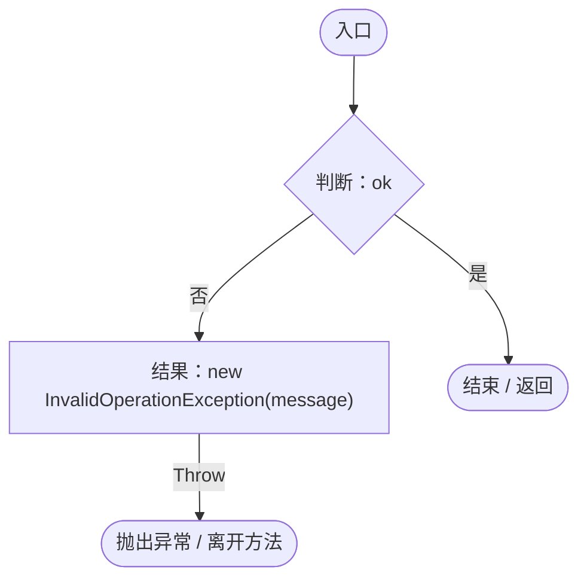

## Call · L27

`private static void Call(object o,string method)`

### Editor · Roslyn编译器控制流

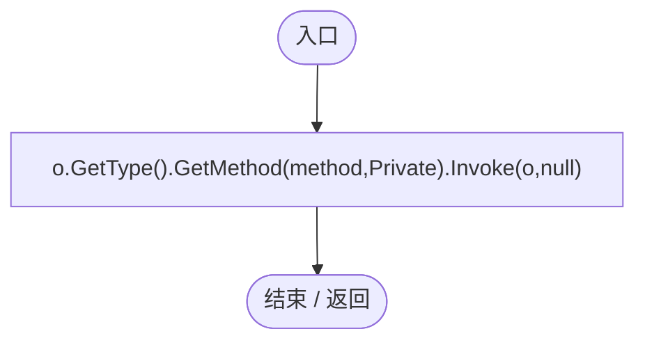

## Key · L28

`private static string Key(Genome genome)`

### Editor · Roslyn编译器控制流

```mermaid
flowchart TD
  b0(["入口"])
  b1["结果：string.Join(&quot;&#124;&quot;,genome.Genes.Select(g=&gt;g.InstanceId+&quot;:&quot;+g.Value))"]
  b2(["结束 / 返回"])
  b0 --> b1
  b1 -->|"返回"| b2

```

项目内调用/回调引用：

- [LifeCycleCombatRegression.回调@28 · L28](92ed3746ce41b5f8.md#m1b2a75cdd8562703)（回调/委托）

## 回调@28 · L28

`g … => 回调`

### Editor · Roslyn编译器控制流

## Spawn · L29

`private static DarwinEntity Spawn(Vector3 position,float action=-1,bool reproduction=false)`

### Editor · Roslyn编译器控制流

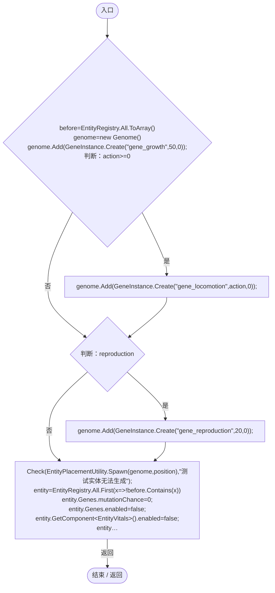

项目内调用/回调引用：

- [Genome.Add · L19](a2ef23f865bc7ee8.md#md9cfdc94b8b8d40f)（方法）
- [GeneInstance.Create · L20](f82e1498d67f5afd.md#m72e94c278de3cf8b)（方法）
- [LifeCycleCombatRegression.Check · L26](92ed3746ce41b5f8.md#ma8e144728aa4c9b8)（方法）
- [EntityPlacementUtility.Spawn · L77](6d2c32e632b9c147.md#m79ec74c5c23421cd)（方法）
- [DarwinEntity.Genes.get · L14](70798dde169f2e8b.md#m622eb1adf401d431)（访问器）
- [EntityLifeCycle.InitializeBirth · L17](9f4138bfbae654b7.md#m76374fa073e2a603)（方法）
- [LifeCycleCombatRegression.回调@34 · L34](92ed3746ce41b5f8.md#m8c02b54c09b802cd)（回调/委托）

## 回调@34 · L34

`x … => 回调`

### Editor · Roslyn编译器控制流

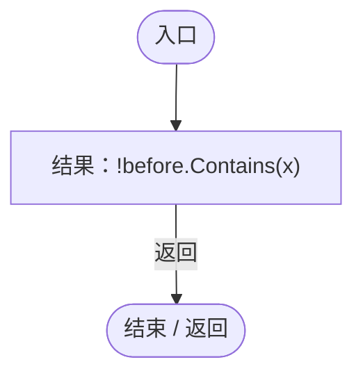

## Validate · L40

`[MenuItem("Tools/Darwin Park/Validate Lifecycle and Combat")] public static void Validate()`

### Editor · Roslyn编译器控制流

```mermaid
flowchart TD
  b0(["入口"])
  b1["Check(Application.isPlaying,&quot;先播放并等待星球生成&quot;);<br/>report=new StringBuilder()<br/>clock=ServiceLocator.Get&lt;SimulationClock&gt;()<br/>view=EntityViewController.Instance<br/>running=clock.IsRunning<br/>scale=clock.TimeScale<br/>initial=EntityRegistry.All.ToArray()<br/>rando…"]
  b2["new[]{&quot;x&quot;,&quot;y&quot;,&quot;targetDistance&quot;,&quot;_isFocusing&quot;,&quot;targetPosition&quot;,&quot;targetRotation&quot;}"]
  b3{"判断：new[]{&quot;x&quot;,&quot;y&quot;,&quot;targetDistance&quot;,&quot;_isFocusing&quot;,&quot;targetPosition&quot;,&quot;targetRotation&quot;}"}
  b4["string<br/>orbitState[field]=typeof(OrbitCamera).GetField(field,Private).GetValue(orbit);"]
  b5{"new[]{&quot;x&quot;,&quot;y&quot;,&quot;targetDistance&quot;,&quot;_isFocusing&quot;,&quot;targetPosition&quot;,&quot;targetRotation&quot;}<br/>判断：new[]{&quot;x&quot;,&quot;y&quot;,&quot;targetDistance&quot;,&quot;_isFocusing&quot;,&quot;targetPosition&quot;,&quot;targetRotation&quot;}"}
  b6["new[]{&quot;x&quot;,&quot;y&quot;,&quot;targetDistance&quot;,&quot;_isFocusing&quot;,&quot;targetPosition&quot;,&quot;targetRotation&quot;}"]
  b7["连接 / 离开区域"]
  b8["control=UnityEngine.Object.FindFirstObjectByType&lt;SimulationControlPanel&gt;()<br/>inspector=UnityEngine.Object.FindFirstObjectByType&lt;GeneInspectorUI&gt;()"]
  b9["clock.Play();<br/>clock.SetTimeScale(1);<br/>UnityEngine.Random.InitState(42626);<br/>settings=GeneMutationSettings.CreateDefault()"]
  b10{"判断：settings.ErrorWeight==.9f"}
  b11{"判断：settings.DuplicateWeight==.05f"}
  b12["settings.DeletionWeight==.05f"]
  b13["settings.ErrorWeight==.9f &amp;&amp; settings.DuplicateWeight==.05f &amp;&amp; settings.DeletionWeight==.05f"]
  b14["Check(settings.ErrorWeight==.9f &amp;&amp; settings.DuplicateWeight==.05f &amp;&amp; settings.DeletionWeight==.05f,&quot;变异配置不是90/5/5&quot;);"]
  b15["error=0<br/>duplicate=0<br/>deletion=0<br/>settings.AdaptationGeneId=&quot;gene_environment&quot;;<br/>settings.AdaptationMutationChance=1;<br/>settings.AdaptationTargetValue=80;"]
  b16["i=0"]
  b17{"判断：i&lt;20000"}
  b18{"genome=new Genome()<br/>genome.Add(GeneInstance.Create(&quot;gene_repair&quot;,50,0));<br/>result=GeneMutator.Mutate(genome,settings)<br/>判断：result.Type==MutationType.Error"}
  b19["error++;"]
  b20{"判断：result.Type==MutationType.Duplicate"}
  b21["duplicate++;"]
  b22{"判断：result.Type==MutationType.Deletion"}
  b23["deletion++;"]
  b24["Check(false,&quot;压力产生了未允许的插入类型&quot;);"]
  b25["i++"]
  b26{"判断：Mathf.Abs(error/20000f-.9f)&lt;.01f"}
  b27{"判断：Mathf.Abs(duplicate/20000f-.05f)&lt;.005f"}
  b28["Mathf.Abs(deletion/20000f-.05f)&lt;.005f"]
  b29["Mathf.Abs(error/20000f-.9f)&lt;.01f &amp;&amp; Mathf.Abs(duplicate/20000f-.05f)&lt;.005f &amp;&amp; Mathf.Abs(deletion/20000f-.05f)&lt;.005f"]
  b30["Check(Mathf.Abs(error/20000f-.9f)&lt;.01f &amp;&amp; Mathf.Abs(duplicate/20000f-.05f)&lt;.005f &amp;&amp; Mathf.Abs(deletion/20000f-.05f)&lt;.005f,&quot;变异类型采样偏离概率&quot;);"]
  b31["report.AppendLine($&quot;PASS: 20000 mutation samples including adaptation pressure: error {error}, duplicate {duplicate}, deletion {deletion}; no insertions&quot;);<br/>builder=UnityEngine.Object.FindFirstObjectByType&lt;PlanetTerrainMeshBuilder&gt;()<br/>up=V…"]
  b32["i=0"]
  b33{"判断：i&lt;512"}
  b34{"y=1-2f*(i+.5f)/512<br/>angle=i*2.39996323f<br/>d=new Vector3(Mathf.Sqrt(1-y*y)*Mathf.Cos(angle),y,Mathf.Sqrt(1-y*y)*Mathf.Sin(angle))<br/>radius=builder.radius+PlanetTerrainSampler.SampleHeight(builder.Data,d)*builder.heightScale<br/>判断：radius&gt;builder.W…"}
  b35["up=builder.transform.TransformDirection(d);<br/>ground=radius;"]
  b36["i++"]
  b37["pos=builder.transform.position+up*(ground+4)<br/>tangent=Vector3.Cross(up,Vector3.right).normalized<br/>actor=Spawn(pos,50)<br/>Check(view.EnterView(actor),&quot;无法进入真实实体视角&quot;);<br/>Call(view,&quot;LateUpdate&quot;);<br/>Check(Vector3.Distance(camera.transform.position,acto…"]
  b38{"判断：genes.StageMutationChecks==checks"}
  b39["Key(genes.Genome)==before"]
  b40["genes.StageMutationChecks==checks"]
  b41["Check(genes.StageMutationChecks==checks &amp;&amp; Key(genes.Genome)==before,&quot;阶段内定时推进仍触发变异&quot;);"]
  b42["typeof(EntityLifeCycle).GetField(&quot;&lt;Progress&gt;k__BackingField&quot;,Private).SetValue(life,29.99f);<br/>genes.AdvanceSimulation(1);"]
  b43{"判断：genes.CurrentAge==AgeState.Adult"}
  b44["genes.StageMutationChecks==checks+1"]
  b45["genes.CurrentAge==AgeState.Adult"]
  b46["Check(genes.CurrentAge==AgeState.Adult &amp;&amp; genes.StageMutationChecks==checks+1,&quot;成年未抽一次变异&quot;);"]
  b47["before=Key(genes.Genome);<br/>genes.TryStageMutation(AgeState.Adult);"]
  b48{"判断：genes.StageMutationChecks==checks+1"}
  b49["Key(genes.Genome)==before"]
  b50["genes.StageMutationChecks==checks+1"]
  b51["Check(genes.StageMutationChecks==checks+1 &amp;&amp; Key(genes.Genome)==before,&quot;同一阶段重复抽变异&quot;);"]
  b52["typeof(EntityLifeCycle).GetField(&quot;&lt;Progress&gt;k__BackingField&quot;,Private).SetValue(life,79.99f);<br/>genes.AdvanceSimulation(1);"]
  b53{"判断：genes.CurrentAge==AgeState.Elder"}
  b54["genes.StageMutationChecks==checks+2"]
  b55["genes.CurrentAge==AgeState.Elder"]
  b56["Check(genes.CurrentAge==AgeState.Elder &amp;&amp; genes.StageMutationChecks==checks+2,&quot;老年未抽一次变异&quot;);"]
  b57["genes.Genome.Genes"]
  b58{"判断：genes.Genome.Genes"}
  b59["var<br/>gene.Enabled=false;"]
  b60["genes.Genome.Genes"]
  b61["genes.Recalculate();<br/>typeof(EntityLifeCycle).GetField(&quot;&lt;Progress&gt;k__BackingField&quot;,Private).SetValue(life,99.99f);<br/>genes.AdvanceSimulation(1);<br/>aged.GetComponent&lt;EntityStats&gt;().TryGet(&quot;health&quot;,out float deadHp);"]
  b62{"判断：life.HasDied"}
  b63{"判断：deadHp==0"}
  b64["!aged.gameObject.activeSelf"]
  b65["life.HasDied &amp;&amp; deadHp==0 &amp;&amp; !aged.gameObject.activeSelf"]
  b66["Check(life.HasDied &amp;&amp; deadHp==0 &amp;&amp; !aged.gameObject.activeSelf,&quot;生长失效后的老年寿命耗尽仍不死亡&quot;);"]
  b67["report.AppendLine(&quot;PASS: no mutation within stage; one check at birth/adult/elder; repeated stage call ignored; disabled growth cannot prevent terminal death (health zero/inactive)&quot;);<br/>parent=Spawn(pos+tangent*35,-1,true)<br/>parent.Genes.Cur…"]
  b68{"判断：Mathf.Abs(rep.CalculateGestationTime(.01f)-70)&lt;.01f"}
  b69["Mathf.Abs(rep.CalculateGestationTime(100)-300)&lt;.01f"]
  b70["Mathf.Abs(rep.CalculateGestationTime(.01f)-70)&lt;.01f"]
  b71["Check(Mathf.Abs(rep.CalculateGestationTime(.01f)-70)&lt;.01f &amp;&amp; Mathf.Abs(rep.CalculateGestationTime(100)-300)&lt;.01f,&quot;孕育没有限制7～30天&quot;);"]
  b72["parentStats=parent.GetComponent&lt;EntityStats&gt;()<br/>parentStats.Modify(&quot;storedNutrient&quot;,100);<br/>oldChecks=parent.Genes.StageMutationChecks<br/>rep.OnUpdate(.1f);<br/>Check(parent.Genes.IsGestating,&quot;无性繁殖未开始&quot;);<br/>duration=(float)typeof(ReproductionGeneLogi…"]
  b73{"判断：delta.magnitude&gt;1.7f"}
  b74["delta.magnitude&lt;8.5f"]
  b75["delta.magnitude&gt;1.7f"]
  b76["Check(delta.magnitude&gt;1.7f &amp;&amp; delta.magnitude&lt;8.5f,&quot;无行动亲本幼体没有周围散布&quot;);"]
  b77{"判断：child.Genes.Genome.Genes.First(g=&gt;g.DefinitionId==&quot;gene_growth&quot;).Value==inherited"}
  b78["parent.Genes.StageMutationChecks==oldChecks"]
  b79["child.Genes.Genome.Genes.First(g=&gt;g.DefinitionId==&quot;gene_growth&quot;).Value==inherited"]
  b80["Check(child.Genes.Genome.Genes.First(g=&gt;g.DefinitionId==&quot;gene_growth&quot;).Value==inherited &amp;&amp; parent.Genes.StageMutationChecks==oldChecks,&quot;出生重写遗传值或生产触发阶段外变异&quot;);"]
  b81["radial=(child.transform.position-builder.transform.position).normalized<br/>outside=builder.GetComponent&lt;MeshCollider&gt;().bounds.extents.magnitude+10<br/>Check(builder.GetComponent&lt;MeshCollider&gt;().Raycast(new Ray(builder.transform.position+radial…"]
  b82["view.ExitView();"]
  b83{"EntityPlacementTool.Instance<br/>判断：EntityPlacementTool.Instance"}
  b84["EntityPlacementTool.Instance?.CancelPlacement();"]
  b85["inspector.HideEntityInfo();<br/>Call(control,&quot;DestroyMenus&quot;);"]
  b86["EntityRegistry.All.ToArray()"]
  b87{"判断：EntityRegistry.All.ToArray()"}
  b88{"var<br/>判断：initial.Contains(entity)"}
  b89["entity.gameObject.SetActive(false);<br/>UnityEngine.Object.Destroy(entity.gameObject);"]
  b90{"EntityRegistry.All.ToArray()<br/>判断：EntityRegistry.All.ToArray()"}
  b91["EntityRegistry.All.ToArray()"]
  b92["连接 / 离开区域"]
  b93["camera.transform.SetPositionAndRotation(oldPos,oldRot);<br/>orbit.distance=oldDistance;"]
  b94["orbitState"]
  b95{"判断：orbitState"}
  b96["var<br/>typeof(OrbitCamera).GetField(pair.Key,Private).SetValue(orbit,pair.Value);"]
  b97["orbitState"]
  b98["UnityEngine.Random.state=random;"]
  b99{"clock<br/>判断：scale&gt;0"}
  b100["scale"]
  b101["1"]
  b102["clock.SetTimeScale(scale&gt;0?scale:1);"]
  b103{"判断：running"}
  b104["clock.Play();"]
  b105["clock.Pause();"]
  b106["连接 / 离开区域"]
  b107(["结束 / 返回"])
  b0 --> b1
  b1 --> b2
  b2 --> b3
  b3 -->|"是"| b4
  b3 -->|"否 · 经过finally 5"| b8
  b4 --> b3
  b5 -->|"否"| b6
  b5 -->|"是"| b7
  b6 --> b7
  b8 --> b9
  b9 --> b10
  b10 -->|"是"| b11
  b10 -->|"否"| b13
  b11 -->|"是"| b12
  b11 -->|"否"| b13
  b12 --> b14
  b13 --> b14
  b14 --> b15
  b15 --> b16
  b16 --> b17
  b17 -->|"是"| b18
  b17 -->|"否"| b26
  b18 -->|"是"| b19
  b18 -->|"否"| b20
  b19 --> b25
  b20 -->|"是"| b21
  b20 -->|"否"| b22
  b21 --> b25
  b22 -->|"是"| b23
  b22 -->|"否"| b24
  b23 --> b25
  b24 --> b25
  b25 --> b17
  b26 -->|"是"| b27
  b26 -->|"否"| b29
  b27 -->|"是"| b28
  b27 -->|"否"| b29
  b28 --> b30
  b29 --> b30
  b30 --> b31
  b31 --> b32
  b32 --> b33
  b33 -->|"是"| b34
  b33 -->|"否"| b37
  b34 -->|"是"| b35
  b34 -->|"否"| b36
  b35 --> b37
  b36 --> b33
  b37 --> b38
  b38 -->|"是"| b39
  b38 -->|"否"| b40
  b39 --> b41
  b40 --> b41
  b41 --> b42
  b42 --> b43
  b43 -->|"是"| b44
  b43 -->|"否"| b45
  b44 --> b46
  b45 --> b46
  b46 --> b47
  b47 --> b48
  b48 -->|"是"| b49
  b48 -->|"否"| b50
  b49 --> b51
  b50 --> b51
  b51 --> b52
  b52 --> b53
  b53 -->|"是"| b54
  b53 -->|"否"| b55
  b54 --> b56
  b55 --> b56
  b56 --> b57
  b57 --> b58
  b58 -->|"是"| b59
  b58 -->|"否 · 经过finally 60"| b61
  b59 --> b58
  b61 --> b62
  b62 -->|"是"| b63
  b62 -->|"否"| b65
  b63 -->|"是"| b64
  b63 -->|"否"| b65
  b64 --> b66
  b65 --> b66
  b66 --> b67
  b67 --> b68
  b68 -->|"是"| b69
  b68 -->|"否"| b70
  b69 --> b71
  b70 --> b71
  b71 --> b72
  b72 --> b73
  b73 -->|"是"| b74
  b73 -->|"否"| b75
  b74 --> b76
  b75 --> b76
  b76 --> b77
  b77 -->|"是"| b78
  b77 -->|"否"| b79
  b78 --> b80
  b79 --> b80
  b80 --> b81
  b81 -->|"经过finally 82"| b107
  b82 --> b83
  b83 -->|"否"| b84
  b83 -->|"是"| b85
  b84 --> b85
  b85 --> b86
  b86 --> b87
  b87 -->|"是"| b88
  b87 -->|"否 · 经过finally 90"| b93
  b88 -->|"否"| b89
  b88 -->|"是"| b87
  b89 --> b87
  b90 -->|"否"| b91
  b90 -->|"是"| b92
  b91 --> b92
  b93 --> b94
  b94 --> b95
  b95 -->|"是"| b96
  b95 -->|"否 · 经过finally 97"| b98
  b96 --> b95
  b98 --> b99
  b99 -->|"是"| b100
  b99 -->|"否"| b101
  b100 --> b102
  b101 --> b102
  b102 --> b103
  b103 -->|"是"| b104
  b103 -->|"否"| b105
  b104 --> b106
  b105 --> b106
  b3 -. "退出保护区时 finally（示意）" .-> b5
  b58 -. "退出保护区时 finally（示意）" .-> b60
  b9 -. "退出保护区时 finally（示意）" .-> b82
  b87 -. "退出保护区时 finally（示意）" .-> b90
  b95 -. "退出保护区时 finally（示意）" .-> b97

```

项目内调用/回调引用：

- [LifeCycleCombatRegression.Check · L26](92ed3746ce41b5f8.md#ma8e144728aa4c9b8)（方法）
- [ServiceLocator.Get · L33](f2fdbe9f9ccd93cb.md#m2ae625299520c56d)（方法）
- [EntityViewController.Instance.get · L15](0ad0345f83229ef0.md#mb3b8144b56e80842)（访问器）
- [SimulationClock.IsRunning.get · L22](a8f444aec9614b0a.md#m10f4fe307faca0f0)（访问器）
- [SimulationClock.Play · L78](a8f444aec9614b0a.md#m7aa9e64b7de60ed0)（方法）
- [SimulationClock.SetTimeScale · L81](a8f444aec9614b0a.md#mecaa463a0561aca3)（方法）
- [GeneMutationSettings.CreateDefault · L14](202f10318a181ae1.md#mf2c33daa013981eb)（方法）
- [Genome.Add · L19](a2ef23f865bc7ee8.md#md9cfdc94b8b8d40f)（方法）
- [GeneInstance.Create · L20](f82e1498d67f5afd.md#m72e94c278de3cf8b)（方法）
- [GeneMutator.Mutate · L18](f297edbfb98ef475.md#m4444eb9ce9b6a55a)（方法）
- [PlanetTerrainMeshBuilder.WaterRadius.get · L94](415285cf043354a9.md#m28d8809083881ec1)（访问器）
- [PlanetTerrainSampler.SampleHeight · L32](fd5c1d83b88a7c8b.md#m759508f0c5a04b21)（方法）
- [PlanetTerrainMeshBuilder.Data.get · L78](415285cf043354a9.md#m8382f579717fbc6d)（访问器）
- [LifeCycleCombatRegression.Spawn · L29](92ed3746ce41b5f8.md#m25debc19fda2d5ae)（方法）
- [EntityViewController.EnterView · L73](0ad0345f83229ef0.md#mbd7be6d2bbd0ec83)（方法）
- [LifeCycleCombatRegression.Call · L27](92ed3746ce41b5f8.md#mbcd48a8dc4b073c1)（方法）
- [EntityManualControl.GetAttackTarget · L28](a6969896da35e1f0.md#mb046508bf5d61cb1)（方法）
- [EntityManualControl.QueueAttack · L24](a6969896da35e1f0.md#md160ef2315358c16)（方法）
- [EntityManualControl.SetInput · L33](a6969896da35e1f0.md#m7c7f5613b3bebc74)（方法）
- [DarwinEntity.Genes.get · L14](70798dde169f2e8b.md#m622eb1adf401d431)（访问器）
- [IGeneLogic.OnUpdate · L9](5304fdad773967f8.md#m829188d65276f8e5)（方法）
- [EntityGeneController.GetLogic · L211](7494d53178552f0e.md#maadb710e89e60395)（方法）
- [EntityStats.TryGet · L90](75aa86a368efdf24.md#m24ee1433e4a70d94)（方法）
- [LocomotionSettings.Load · L17](8cce83c7d4563cf0.md#m06b74c04dd63fb4a)（方法）
- [EntityViewController.ExitView · L105](0ad0345f83229ef0.md#mca8619c7f27942c9)（方法）
- [EntityManualControl.ConsumeAttack · L25](a6969896da35e1f0.md#m3427183a9d7fd9f6)（方法）
- [LifeCycleCombatRegression.Key · L28](92ed3746ce41b5f8.md#mbfbf418b50048f4e)（方法）
- [EntityGeneController.StageMutationChecks.get · L48](7494d53178552f0e.md#ma27bd0556514825b)（访问器）
- [EntityGeneController.AdvanceSimulation · L66](7494d53178552f0e.md#m477fb905eeed3e79)（方法）
- [EntityGeneController.CurrentAge.get · L34](7494d53178552f0e.md#m83a42c16950b22a4)（访问器）
- [EntityGeneController.TryStageMutation · L263](7494d53178552f0e.md#m91860b3eca0fc8eb)（方法）
- [EntityGeneController.Recalculate · L97](7494d53178552f0e.md#m65ea735c1e0e37a1)（方法）
- [EntityLifeCycle.HasDied.get · L11](9f4138bfbae654b7.md#mf2406e6830e0007e)（访问器）
- [EntityGeneController.CurrentAge.set · L34](7494d53178552f0e.md#me616ca96310ad01c)（访问器）
- [ReproductionGeneLogic.CalculateGestationTime · L150](ac319ea70bd8b723.md#m1d2dd13f863c0d75)（方法）
- [EntityStats.Modify · L104](75aa86a368efdf24.md#m858c2a75d852ecc1)（方法）
- [ReproductionGeneLogic.OnUpdate · L36](ac319ea70bd8b723.md#mf050ec0ba2694604)（方法）
- [GeneInspectorUI.ShowEntityInfo · L385](924e27c34e7b1f0a.md#mea69a0457b885287)（方法）
- [UIRoot.MainCanvas.get · L14](9c1421378791f0e0.md#maa2cc9baf1248477)（访问器）
- [EntityPlacementTool.Instance.get · L13](2ca993947b0a7e7a.md#mafb26991c0dfcb86)（访问器）
- [EntityPlacementTool.BeginPlacement · L27](2ca993947b0a7e7a.md#m6e111ed92099dcf2)（方法）
- [EntityPlacementTool.IsPlacing.get · L14](2ca993947b0a7e7a.md#ma73d17b3db4aa719)（访问器）
- [EntityPlacementTool.CancelPlacement · L81](2ca993947b0a7e7a.md#m5a9374d2c71f0a2d)（方法）
- [GeneInspectorUI.HideEntityInfo · L316](924e27c34e7b1f0a.md#m11944eddcac871c2)（方法）
- [SimulationClock.Pause · L79](a8f444aec9614b0a.md#m30929d45a885d0f1)（方法）
- [LifeCycleCombatRegression.回调@74 · L74](92ed3746ce41b5f8.md#m33b695ad26665c34)（回调/委托）
- [LifeCycleCombatRegression.回调@80 · L80](92ed3746ce41b5f8.md#md30bf545a41cc05d)（回调/委托）
- [LifeCycleCombatRegression.回调@107 · L107](92ed3746ce41b5f8.md#m2a12f4882477563a)（回调/委托）
- [LifeCycleCombatRegression.回调@112 · L112](92ed3746ce41b5f8.md#mf6e6d5b91fd7b643)（回调/委托）
- [LifeCycleCombatRegression.回调@114 · L114](92ed3746ce41b5f8.md#m87c40f10bdb99556)（回调/委托）
- [LifeCycleCombatRegression.回调@117 · L117](92ed3746ce41b5f8.md#md81df55707cc14a7)（回调/委托）
- [LifeCycleCombatRegression.回调@124 · L124](92ed3746ce41b5f8.md#ma07dd7221b6d9b94)（回调/委托）

## 回调@74 · L74

`r … => 回调`

### Editor · Roslyn编译器控制流

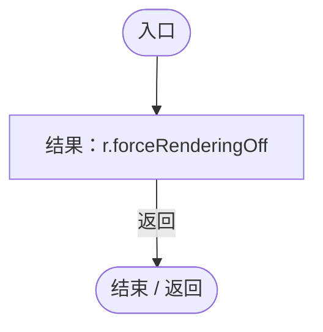

## 回调@80 · L80

`g … => 回调`

### Editor · Roslyn编译器控制流

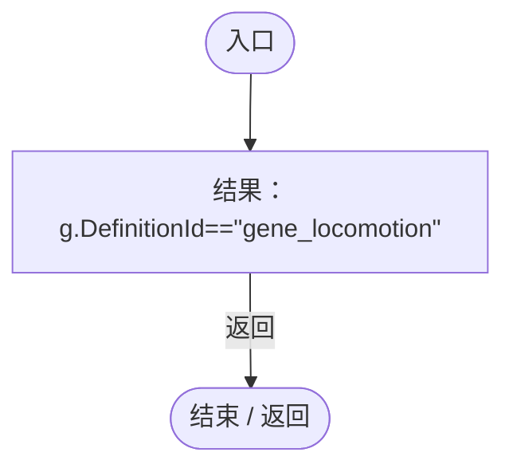

## 回调@107 · L107

`g … => 回调`

### Editor · Roslyn编译器控制流

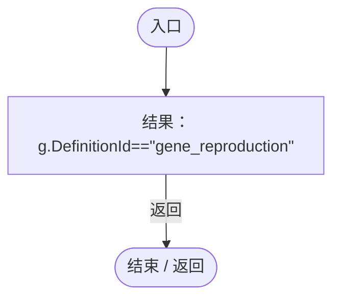

## 回调@112 · L112

`g … => 回调`

### Editor · Roslyn编译器控制流

## 回调@114 · L114

`e … => 回调`

### Editor · Roslyn编译器控制流

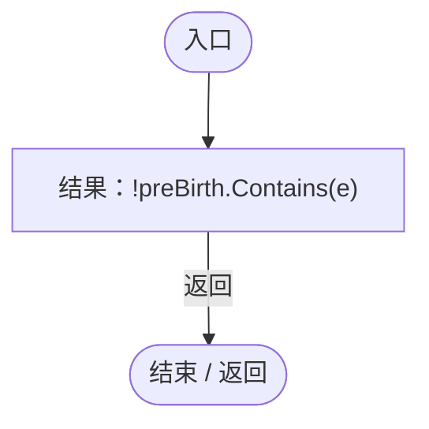

## 回调@117 · L117

`g … => 回调`

### Editor · Roslyn编译器控制流

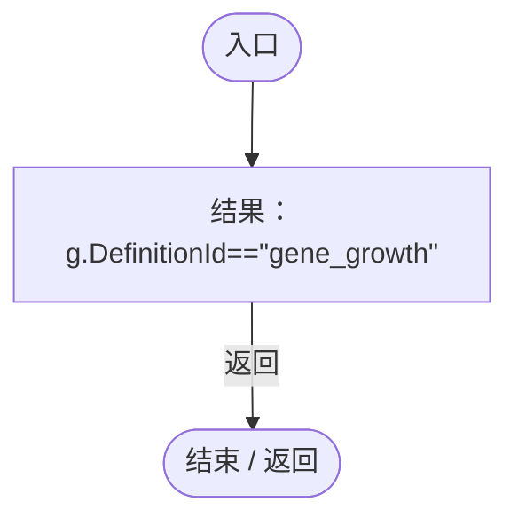

## 回调@124 · L124

`b … => 回调`

### Editor · Roslyn编译器控制流

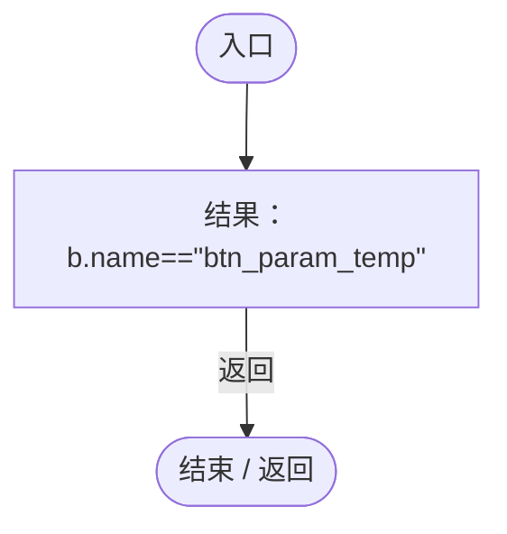
