# ColonyContinuityRegression.cs

[返回总索引](../README.md) · `Editor` · `Assets/DarwinPark/Editor/ColonyContinuityRegression.cs`

[源文件](../../../Assets/DarwinPark/Editor/ColonyContinuityRegression.cs) · 源码校验：`98a1baefce732fcc51e05eeaddf7a9aa6110b0e4caede669ce9da1250f35e832`

方法按源文件位置排列。事件/回调引用不表示立即执行；分支与异常说明见总索引。完整源码与可点击关系图请打开离线手册。

<a id="mafd8988bb93106fb"></a>

## Folder.get · L28

`private static string Folder`


### Editor · 语法控制结构 / 声明（非CFG）

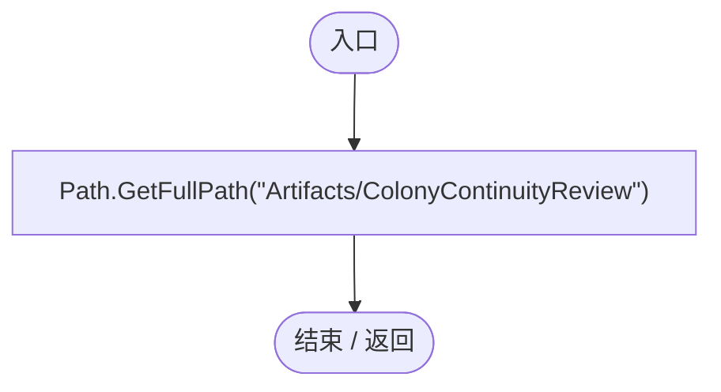

<a id="mfd1a1e333f42bfd7"></a>

## ColonyContinuityRegression.ctor · L30

`static ColonyContinuityRegression()`


### Editor · Roslyn编译器控制流

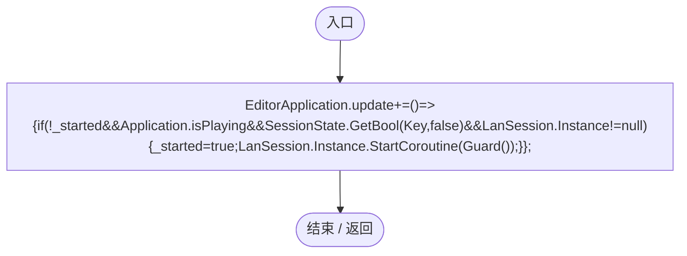

项目内调用/回调引用：

- [ColonyContinuityRegression.回调@30 · L30](9386360ce717a3bf.md#mda983977e026081d)（回调/委托）

<a id="mda983977e026081d"></a>

## 回调@30 · L30

`( … => 回调`


### Editor · Roslyn编译器控制流

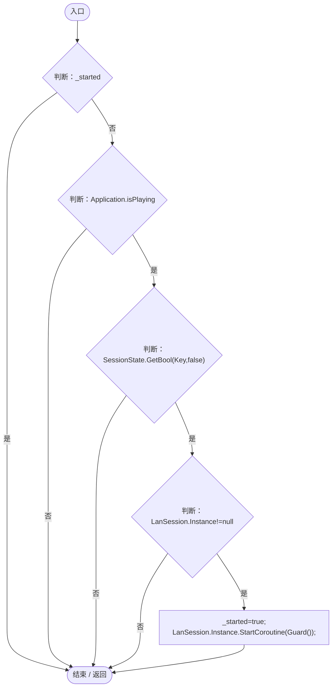

项目内调用/回调引用：

- [LanSession.Instance.get · L23](9fb633eebffe669c.md#mbf83306994878383)（访问器）
- [ColonyContinuityRegression.Guard · L33](9386360ce717a3bf.md#m1851b0e088ad75a1)（方法）

<a id="m7d60c78e39fdcef4"></a>

## RunBatch · L31

`public static void RunBatch()`


### Editor · Roslyn编译器控制流

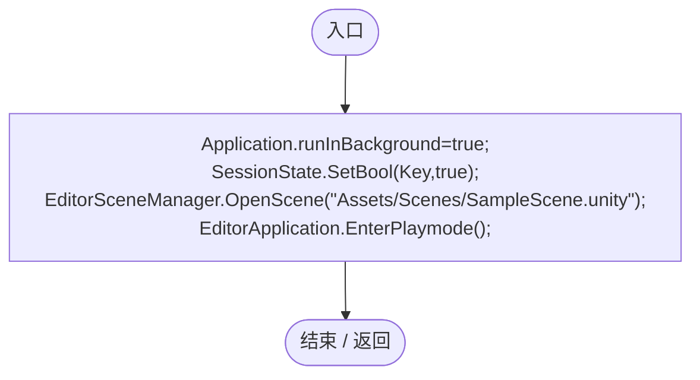

<a id="m7676e6130bf46932"></a>

## Check · L32

`private static void Check(bool value,string text)`


### Editor · Roslyn编译器控制流

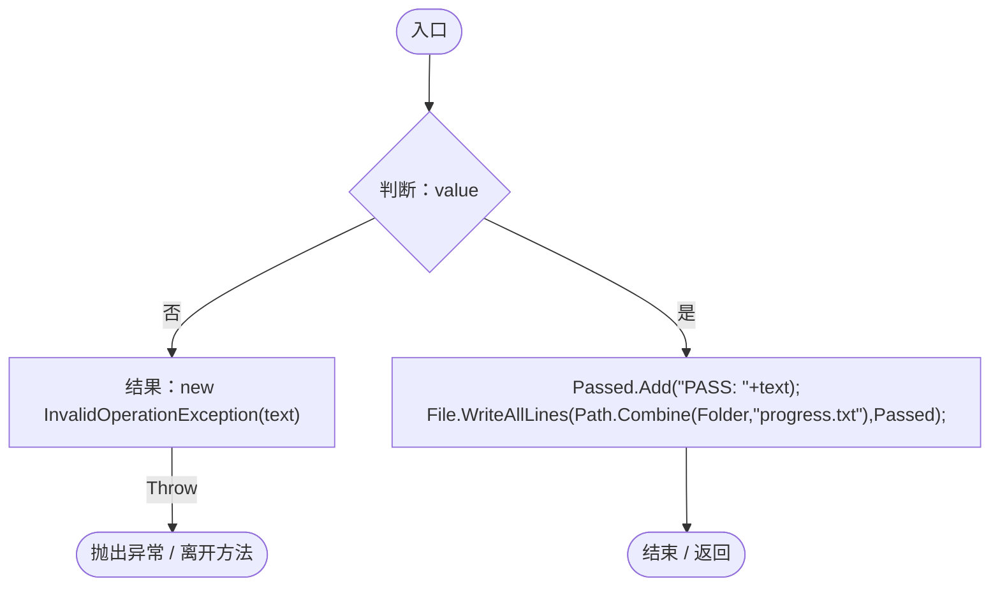

<a id="m1851b0e088ad75a1"></a>

## Guard · L33

`private static IEnumerator Guard()`


### Editor · Roslyn编译器控制流

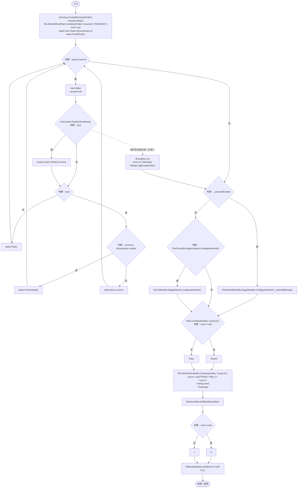

项目内调用/回调引用：

- [ColonyContinuityRegression.Run · L56](9386360ce717a3bf.md#m7c48f7d2fc8606cb)（方法）

<a id="mf06e79150169bc89"></a>

## RunShortBatch · L40

`public static void RunShortBatch()`


### Editor · Roslyn编译器控制流

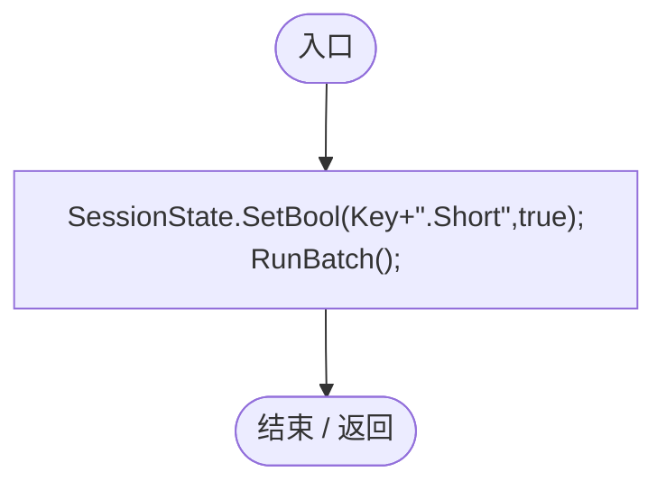

项目内调用/回调引用：

- [ColonyContinuityRegression.RunBatch · L31](9386360ce717a3bf.md#m7d60c78e39fdcef4)（方法）

<a id="m22ef5ff5d210f176"></a>

## Wait · L41

`private static IEnumerator Wait(Func<bool> done,string name,float timeout=45)`


### Editor · Roslyn编译器控制流

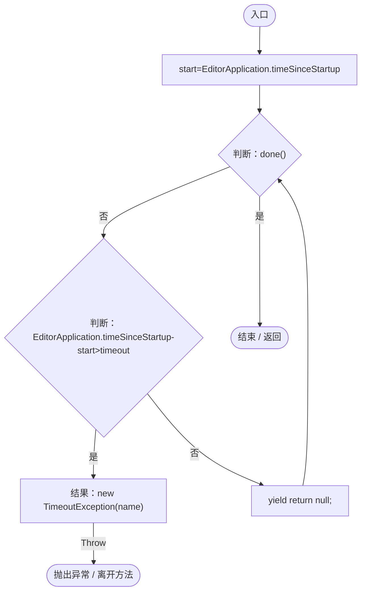

<a id="m59ce462adac0cbb1"></a>

## Clear · L43

`private static void Clear()`


### Editor · Roslyn编译器控制流

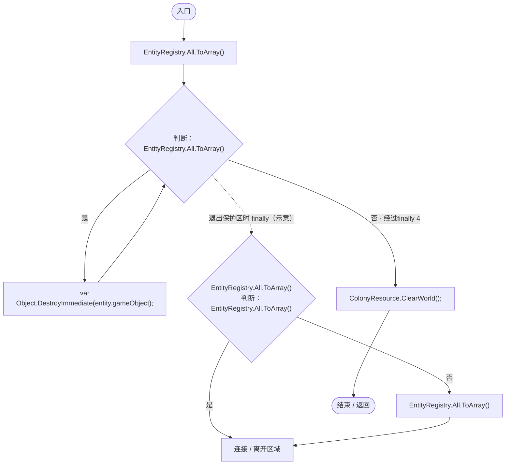

项目内调用/回调引用：

- [ColonyResource.ClearWorld · L103](293dbaecfff4b585.md#mc8a8963f331b38de)（方法）

<a id="mdd79041d79c4ccfb"></a>

## Spawn · L44

`private static DarwinEntity Spawn(RandomSpawnRecipe source,Vector3 position,bool adult=true)`


### Editor · Roslyn编译器控制流

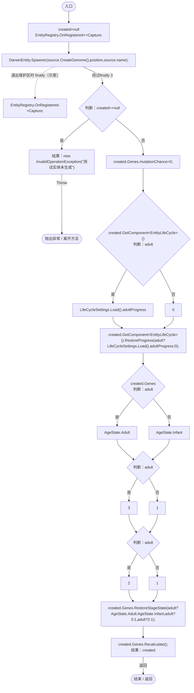

项目内调用/回调引用：

- [RandomSpawnRecipe.CreateGenome · L25](923ccc4e86c4786c.md#m2612c79fe3848e08)（方法）
- [DarwinEntity.Genes.get · L14](70798dde169f2e8b.md#m622eb1adf401d431)（访问器）
- [EntityLifeCycle.RestoreProgress · L50](9f4138bfbae654b7.md#m1e9381f9a38ed7be)（方法）
- [LifeCycleSettings.Load · L16](ace76969fe8f61de.md#mbd2925785484f343)（方法）
- [EntityGeneController.RestoreStageState · L53](7494d53178552f0e.md#m79f314a95ddba9bf)（方法）
- [EntityGeneController.Recalculate · L101](7494d53178552f0e.md#m3b78ff9955767303)（方法）
- [ColonyContinuityRegression.Capture · L46](9386360ce717a3bf.md#ma27e2e918d285aac)（局部函数）

<a id="ma27e2e918d285aac"></a>

## Capture · L46

`void Capture(DarwinEntity entity)`


### Editor · Roslyn编译器控制流

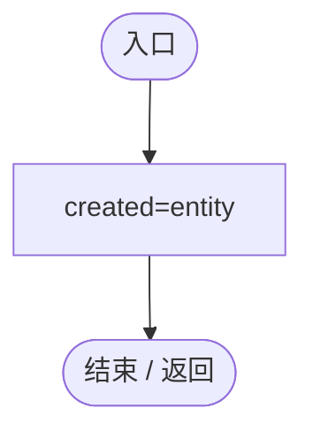

<a id="mf320c96ff8f36eff"></a>

## Home · L51

`private static Vector3 Home(PlanetTerrainMeshBuilder planet)`


### Editor · Roslyn编译器控制流

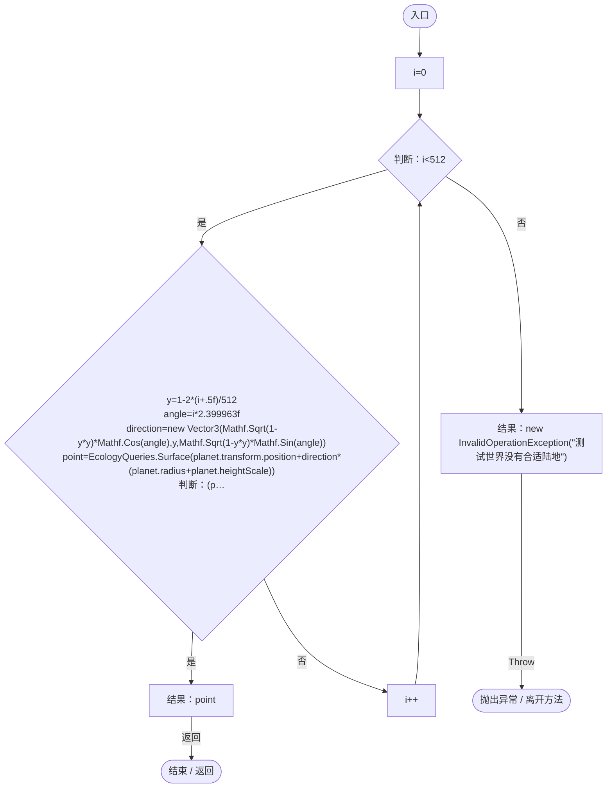

项目内调用/回调引用：

- [EcologyQueries.Surface · L47](bdf7ccc2c9c0452f.md#m2f1f6873ee5fc8df)（方法）
- [PlanetTerrainMeshBuilder.WaterRadius.get · L94](415285cf043354a9.md#m28d8809083881ec1)（访问器）

<a id="m85ab19b1d62646c9"></a>

## Capture · L55

`private static IEnumerator Capture(string name)`


### Editor · Roslyn编译器控制流

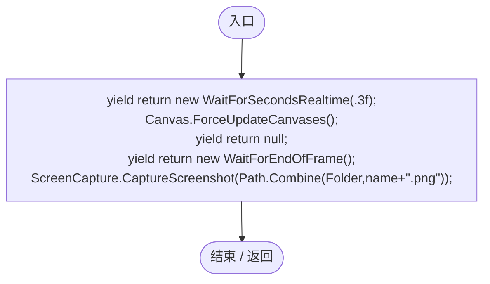

<a id="m7c48f7d2fc8606cb"></a>

## Run · L56

`private static IEnumerator Run()`


### Editor · Roslyn编译器控制流

```mermaid
flowchart TD
  b0(["入口"])
  b1{"_externalExisted=File.Exists(EcologyDefaults.ConfigurationPath);<br/>判断：_externalExisted"}
  b2["_externalBackup=File.ReadAllText(EcologyDefaults.ConfigurationPath);"]
  b3["defaults=Resources.Load&lt;TextAsset&gt;(&quot;Entities/ecology_defaults&quot;).text<br/>Directory.CreateDirectory(Path.GetDirectoryName(EcologyDefaults.ConfigurationPath));<br/>File.WriteAllText(EcologyDefaults.ConfigurationPath,defaults);<br/>EcologyDefaults.UseS…"]
  b4{"判断：config.producerRatio==.7f"}
  b5{"判断：config.mobileRatio==.3f"}
  b6["config.minimumPopulation==100"]
  b7["config.producerRatio==.7f&amp;&amp;config.mobileRatio==.3f&amp;&amp;config.minimumPopulation==100"]
  b8["Check(config.producerRatio==.7f&amp;&amp;config.mobileRatio==.3f&amp;&amp;config.minimumPopulation==100,&quot;默认70/30和100个体保底来自可外调JSON&quot;);"]
  b9["session=Object.FindFirstObjectByType&lt;WorldSessionManager&gt;()<br/>session.autoSaveInterval=36000;<br/>planet=Object.FindFirstObjectByType&lt;PlanetTerrainMeshBuilder&gt;()<br/>planet.subdivisions=24;<br/>typeof(WorldSessionManager).GetField(&quot;_initialTerrain&quot;,Pr…"]
  b10{"判断：session.Current!=null"}
  b11{"判断：PopulationMaintenance.Rules.Count==2"}
  b12["PopulationMaintenance.Rules.All(r=&gt;r.enabled)"]
  b13["session.Current!=null&amp;&amp;PopulationMaintenance.Rules.Count==2&amp;&amp;PopulationMaintenance.Rules.All(r=&gt;r.enabled)"]
  b14["Check(session.Current!=null&amp;&amp;PopulationMaintenance.Rules.Count==2&amp;&amp;PopulationMaintenance.Rules.All(r=&gt;r.enabled),&quot;新世界自动启用两条生态规则&quot;);"]
  b15["producer=PopulationMaintenance.Rules.Single(r=&gt;r.category==PopulationRuleCategory.Producers)<br/>mobile=PopulationMaintenance.Rules.Single(r=&gt;r.category==PopulationRuleCategory.Mobile)<br/>clock.Play();<br/>yield return Wait(()=&gt;PopulationMaintenanc…"]
  b16{"判断：PopulationMaintenance.Count(producer)==70"}
  b17["PopulationMaintenance.Count(mobile)==30"]
  b18["PopulationMaintenance.Count(producer)==70"]
  b19["Check(PopulationMaintenance.Count(producer)==70&amp;&amp;PopulationMaintenance.Count(mobile)==30,&quot;真实自动生成70个静止自养生产者和30个移动消化者&quot;);"]
  b20["altered=EntityRegistry.All.First(e=&gt;EcologyEnergyBudget.IsProducer(e.Genes))<br/>altered.Genes.Genome.Genes.First(g=&gt;g.DefinitionId==&quot;gene_repair&quot;).Value=61;<br/>altered.Genes.Recalculate();<br/>yield return null;"]
  b21{"判断：producer.source.Matches(altered.Genes.Genome)"}
  b22["PopulationMaintenance.Count(producer)==70"]
  b23["!producer.source.Matches(altered.Genes.Genome)"]
  b24["Check(!producer.source.Matches(altered.Genes.Genome)&amp;&amp;PopulationMaintenance.Count(producer)==70,&quot;变异后的生产者仍计入实际能力比例，不依赖精确模板&quot;);"]
  b25["home=Home(planet)"]
  b26["new RandomSpawnRecipe{template=new Genome()}<br/>template=new Genome()<br/>inert=new RandomSpawnRecipe{template=new Genome()}"]
  b27["inert.template.Add(GeneInstance.Create(&quot;gene_growth&quot;,20,0));<br/>outside=Spawn(inert,home+Vector3.up*2)<br/>yield return null;"]
  b28{"判断：PopulationMaintenance.Denominator(producer)==100"}
  b29{"判断：PopulationMaintenance.Total==101"}
  b30{"判断：PopulationMaintenance.RequiresRefill(producer)"}
  b31["!PopulationMaintenance.RequiresRefill(mobile)"]
  b32["PopulationMaintenance.Denominator(producer)==100&amp;&amp;PopulationMaintenance.Total==101&amp;&amp;!PopulationMaintenance.RequiresRefill(producer)&amp;&amp;!PopulationMaintenance.RequiresRefill(mobile)"]
  b33["Check(PopulationMaintenance.Denominator(producer)==100&amp;&amp;PopulationMaintenance.Total==101&amp;&amp;!PopulationMaintenance.RequiresRefill(producer)&amp;&amp;!PopulationMaintenance.RequiresRefill(mobile),&quot;分区外静止个体不造成70/30无解或无限增生&quot;);"]
  b34["Object.DestroyImmediate(outside.gameObject);<br/>controlled=EntityRegistry.All.First(e=&gt;e.Genes.GetAttribute(&quot;moveSpeed&quot;)&gt;0)<br/>view=EntityViewController.Instance<br/>Check(view.EnterView(controlled),&quot;可进入实际实体操控用于补充回归&quot;);<br/>Object.DestroyImmediate(Enti…"]
  b35{"判断：view.Target==controlled"}
  b36["controlled.GetComponent&lt;EntityManualControl&gt;().IsControlled"]
  b37["view.Target==controlled"]
  b38["Check(view.Target==controlled&amp;&amp;controlled.GetComponent&lt;EntityManualControl&gt;().IsControlled,&quot;实际自动补充不会退出实体操控&quot;);"]
  b39["view.ExitView();<br/>placement=EntityPlacementTool.Instance<br/>placement.BeginPlacement(Object.FindFirstObjectByType&lt;SimulationControlPanel&gt;().EntityPrefab,null);<br/>Check(placement.IsPlacing,&quot;可进入真实放置预览用于补充回归&quot;);<br/>Object.DestroyImmediate(EntityRegis…"]
  b40{"判断：work.MaintenanceSources().Any(s=&gt;s.name.Contains(&quot;创始王后&quot;))"}
  b41["work.MaintenanceSources().Any(s=&gt;s.name.Contains(&quot;清道夫&quot;))"]
  b42["work.MaintenanceSources().Any(s=&gt;s.name.Contains(&quot;创始王后&quot;))"]
  b43["Check(work.MaintenanceSources().Any(s=&gt;s.name.Contains(&quot;创始王后&quot;))&amp;&amp;work.MaintenanceSources().Any(s=&gt;s.name.Contains(&quot;清道夫&quot;)),&quot;可繁衍的生产者、移动者、王后和食腐模板自动列出&quot;);"]
  b44["new PopulationMaintenanceRule{id=Guid.NewGuid().ToString(&quot;N&quot;),ratio=.1f,source=new RandomSpawnRecipe{method=RandomSpawnMethod.Genes,name=&quot;保留自定义&quot;,included=new(){&quot;gene_growth&quot;}}}<br/>id=Guid.NewGuid().ToString(&quot;N&quot;)<br/>ratio=.1f"]
  b45["new RandomSpawnRecipe{method=RandomSpawnMethod.Genes,name=&quot;保留自定义&quot;,included=new(){&quot;gene_growth&quot;}}<br/>method=RandomSpawnMethod.Genes<br/>name=&quot;保留自定义&quot;"]
  b46["new(){&quot;gene_growth&quot;}<br/>&quot;gene_growth&quot;<br/>included=new(){&quot;gene_growth&quot;}"]
  b47["source=new RandomSpawnRecipe{method=RandomSpawnMethod.Genes,name=&quot;保留自定义&quot;,included=new(){&quot;gene_growth&quot;}}"]
  b48["extra=new PopulationMaintenanceRule{id=Guid.NewGuid().ToString(&quot;N&quot;),ratio=.1f,source=new RandomSpawnRecipe{method=RandomSpawnMethod.Genes,name=&quot;保留自定义&quot;,included=new(){&quot;gene_growth&quot;}}}"]
  b49["Check(PopulationMaintenance.Set(extra),&quot;可保留自定义重叠规则&quot;);<br/>root.GetComponentsInChildren&lt;Button&gt;().Single(b=&gt;b.name==&quot;EcologyDefaults&quot;).onClick.Invoke();<br/>yield return null;"]
  b50{"判断：PopulationMaintenance.Rules.Count==3"}
  b51["PopulationMaintenance.Rules.Any(r=&gt;r.id==extra.id)"]
  b52["PopulationMaintenance.Rules.Count==3"]
  b53["Check(PopulationMaintenance.Rules.Count==3&amp;&amp;PopulationMaintenance.Rules.Any(r=&gt;r.id==extra.id),&quot;实际按钮原子应用默认项且保留自定义规则，不重复添加默认行&quot;);"]
  b54["yield return Capture(&quot;default-maintenance&quot;);<br/>work.Close();<br/>session.SaveNow(false);<br/>disk=WorldSaveStore.Read(WorldSaveStore.FileFor(session.Current.id))"]
  b55{"判断：disk.maintenance.rules.Single(r=&gt;r.id==EcologyDefaults.ProducerRuleId).minimumCount==70"}
  b56["!string.IsNullOrEmpty(disk.colony.ecologyDefaults)"]
  b57["disk.maintenance.rules.Single(r=&gt;r.id==EcologyDefaults.ProducerRuleId).minimumCount==70"]
  b58["Check(disk.maintenance.rules.Single(r=&gt;r.id==EcologyDefaults.ProducerRuleId).minimumCount==70&amp;&amp;!string.IsNullOrEmpty(disk.colony.ecologyDefaults),&quot;比例分类、保底和生态配置实际写盘&quot;);"]
  b59["Check(LanWorldSnapshot.Frame(1).maintenance.rules.Any(r=&gt;r.category==PopulationRuleCategory.Mobile),&quot;联机帧携带生态分类规则&quot;);<br/>legacy=JsonUtility.FromJson&lt;WorldSaveData&gt;(JsonUtility.ToJson(disk))<br/>legacy.entities.Clear();<br/>legacy.maintenance=null;<br/>le…"]
  b60{"判断：PopulationMaintenance.Rules.Count==0"}
  b61["EntityRegistry.All.Count==0"]
  b62["PopulationMaintenance.Rules.Count==0"]
  b63["Check(PopulationMaintenance.Rules.Count==0&amp;&amp;EntityRegistry.All.Count==0,&quot;旧世界没有规则时不偷偷覆盖或启动默认生成&quot;);"]
  b64["EcologyDefaults.UseSnapshot(defaults);<br/>PopulationMaintenance.Restore(EcologyDefaults.CreateRules());<br/>Clear();<br/>founder=Spawn(EcologyDefaults.Template(&quot;ant_founder&quot;),home)<br/>queen=AntColonyMember.Ensure(founder.GetComponent&lt;PopulationBehavio…"]
  b65{"queen.State.startup<br/>判断：queen.State.startup"}
  b66[".version"]
  b67["queen.State.startup"]
  b68{"判断：queen.State.startup?.version==1"}
  b69{"判断：queen.State.startup.foodIssued==config.foundingFood"}
  b70["ColonyResource.All.Sum(r=&gt;r.State.energy)==config.foundingFood"]
  b71["queen.State.startup?.version==1&amp;&amp;queen.State.startup.foodIssued==config.foundingFood&amp;&amp;ColonyResource.All.Sum(r=&gt;r.State.energy)==config.foundingFood"]
  b72["Check(queen.State.startup?.version==1&amp;&amp;queen.State.startup.foodIssued==config.foundingFood&amp;&amp;ColonyResource.All.Sum(r=&gt;r.State.energy)==config.foundingFood,&quot;只有一只王后的新群可领一次有限育幼储粮&quot;);"]
  b73["i=0"]
  b74{"判断：i&lt;200"}
  b75{"判断：founder.Genes.IsGestating"}
  b76["queen.Advance(.1f);<br/>i++"]
  b77{"判断：founder.Genes.IsGestating"}
  b78["queen.State.reproductionTimer&gt;0"]
  b79["founder.Genes.IsGestating"]
  b80["Check(founder.Genes.IsGestating&amp;&amp;queen.State.reproductionTimer&gt;0,&quot;创业储粮实际进入储备并支付首次孕育费用&quot;);"]
  b81["Check(queen.ChooseBirthRole()==AntRole.Worker,&quot;首胎强制补齐工匠而非随机士兵&quot;);<br/>id=EcologyIdentity.Of(founder)<br/>session.SaveNow(false);<br/>disk=WorldSaveStore.Read(WorldSaveStore.FileFor(session.Current.id));<br/>savedResource=disk.colony.resources.Sum(r=&gt;r.en…"]
  b82{"判断：EcologyDefaults.Current.foundingFood==64"}
  b83{"判断：queen.State.startup.foodIssued==64"}
  b84["ColonyResource.All.Sum(r=&gt;r.State.energy)&lt;=savedResource"]
  b85["EcologyDefaults.Current.foundingFood==64&amp;&amp;queen.State.startup.foodIssued==64&amp;&amp;ColonyResource.All.Sum(r=&gt;r.State.energy)&lt;=savedResource"]
  b86["Check(EcologyDefaults.Current.foundingFood==64&amp;&amp;queen.State.startup.foodIssued==64&amp;&amp;ColonyResource.All.Sum(r=&gt;r.State.energy)&lt;=savedResource,&quot;读档保留世界配置和已领标志，外部修改不重复发粮&quot;);"]
  b87["bad=JsonUtility.FromJson&lt;WorldSaveData&gt;(JsonUtility.ToJson(disk))<br/>bad.entities[0].ecology.ant.startup.version=99;<br/>rejected=false"]
  b88["WorldSaveStore.Validate(bad);"]
  b89["rejected=true;"]
  b90{"判断：rejected"}
  b91["EcologyQueries.Alive(queen.Entity)"]
  b92["rejected"]
  b93["Check(rejected&amp;&amp;EcologyQueries.Alive(queen.Entity),&quot;错误创业状态在清场前拒绝&quot;);"]
  b94{"WorldAuthority.IsReplica=true;<br/>before=queen.State.reproductionTimer<br/>queen.Advance(1);<br/>WorldAuthority.IsReplica=false;<br/>Check(queen.State.reproductionTimer==before,&quot;联机副本不独立领取创业补给或繁殖&quot;);<br/>Check(LanWorldSnapshot.Frame(2,true).ecologyDefaults==…"}
  b95["yield return Sustain(queen,clock,planet);"]
  b96["SessionState.SetBool(Key+&quot;.Short&quot;,false);"]
  b97(["结束 / 返回"])
  b0 --> b1
  b1 -->|"是"| b2
  b1 -->|"否"| b3
  b2 --> b3
  b3 --> b4
  b4 -->|"是"| b5
  b4 -->|"否"| b7
  b5 -->|"是"| b6
  b5 -->|"否"| b7
  b6 --> b8
  b7 --> b8
  b8 --> b9
  b9 --> b10
  b10 -->|"是"| b11
  b10 -->|"否"| b13
  b11 -->|"是"| b12
  b11 -->|"否"| b13
  b12 --> b14
  b13 --> b14
  b14 --> b15
  b15 --> b16
  b16 -->|"是"| b17
  b16 -->|"否"| b18
  b17 --> b19
  b18 --> b19
  b19 --> b20
  b20 --> b21
  b21 -->|"否"| b22
  b21 -->|"是"| b23
  b22 --> b24
  b23 --> b24
  b24 --> b25
  b25 --> b26
  b26 --> b27
  b27 --> b28
  b28 -->|"是"| b29
  b28 -->|"否"| b32
  b29 -->|"是"| b30
  b29 -->|"否"| b32
  b30 -->|"否"| b31
  b30 -->|"是"| b32
  b31 --> b33
  b32 --> b33
  b33 --> b34
  b34 --> b35
  b35 -->|"是"| b36
  b35 -->|"否"| b37
  b36 --> b38
  b37 --> b38
  b38 --> b39
  b39 --> b40
  b40 -->|"是"| b41
  b40 -->|"否"| b42
  b41 --> b43
  b42 --> b43
  b43 --> b44
  b44 --> b45
  b45 --> b46
  b46 --> b47
  b47 --> b48
  b48 --> b49
  b49 --> b50
  b50 -->|"是"| b51
  b50 -->|"否"| b52
  b51 --> b53
  b52 --> b53
  b53 --> b54
  b54 --> b55
  b55 -->|"是"| b56
  b55 -->|"否"| b57
  b56 --> b58
  b57 --> b58
  b58 --> b59
  b59 --> b60
  b60 -->|"是"| b61
  b60 -->|"否"| b62
  b61 --> b63
  b62 --> b63
  b63 --> b64
  b64 --> b65
  b65 -->|"否"| b66
  b65 -->|"是"| b67
  b66 --> b68
  b67 --> b68
  b68 -->|"是"| b69
  b68 -->|"否"| b71
  b69 -->|"是"| b70
  b69 -->|"否"| b71
  b70 --> b72
  b71 --> b72
  b72 --> b73
  b73 --> b74
  b74 -->|"是"| b75
  b74 -->|"否"| b77
  b75 -->|"否"| b76
  b75 -->|"是"| b77
  b76 --> b74
  b77 -->|"是"| b78
  b77 -->|"否"| b79
  b78 --> b80
  b79 --> b80
  b80 --> b81
  b81 --> b82
  b82 -->|"是"| b83
  b82 -->|"否"| b85
  b83 -->|"是"| b84
  b83 -->|"否"| b85
  b84 --> b86
  b85 --> b86
  b86 --> b87
  b87 --> b88
  b88 --> b90
  b89 --> b90
  b90 -->|"是"| b91
  b90 -->|"否"| b92
  b91 --> b93
  b92 --> b93
  b93 --> b94
  b94 -->|"否"| b95
  b94 -->|"是"| b96
  b95 --> b96
  b96 --> b97
  b88 -. "保护区可能异常（示意）" .-> b89

```

项目内调用/回调引用：

- [EcologyDefaults.UseSnapshot · L67](5b565b57de741d98.md#m5bc9f872fc491c57)（方法）
- [EcologyDefaults.Current.get · L35](5b565b57de741d98.md#m75cb60b88e3cc1c7)（访问器）
- [ColonyContinuityRegression.Check · L32](9386360ce717a3bf.md#m7676e6130bf46932)（方法）
- [PlanetClimateMap.Instance.get · L16](b4e9726c1bcf4c37.md#m3add54a419aeef9f)（访问器）
- [PlanetOreSystem.Instance.get · L8](86b3fbb4d9436121.md#m53f6a6af4b6dc252)（访问器）
- [WorldSessionManager.Create · L41](08741c7b7b9d9344.md#m6aadfeee8b90aacd)（方法）
- [ColonyContinuityRegression.Wait · L41](9386360ce717a3bf.md#m22ef5ff5d210f176)（方法）
- [ServiceLocator.Get · L33](f2fdbe9f9ccd93cb.md#m2ae625299520c56d)（方法）
- [SimulationClock.Pause · L79](a8f444aec9614b0a.md#m30929d45a885d0f1)（方法）
- [GameInputGate.Blocked.set · L8](52955daae7e592ab.md#m578697f6379686f4)（访问器）
- [WorldSessionManager.Current.get · L21](08741c7b7b9d9344.md#m5d26a5eb846a8504)（访问器）
- [SimulationClock.Play · L78](a8f444aec9614b0a.md#m7aa9e64b7de60ed0)（方法）
- [PopulationMaintenance.Count · L97](923ccc4e86c4786c.md#mbe9ad2ebe3b97624)（方法）
- [DarwinEntity.Genes.get · L14](70798dde169f2e8b.md#m622eb1adf401d431)（访问器）
- [EntityGeneController.Recalculate · L101](7494d53178552f0e.md#m3b78ff9955767303)（方法）
- [RandomSpawnRecipe.Matches · L34](923ccc4e86c4786c.md#mb2348b1f360c1cce)（方法）
- [ColonyContinuityRegression.Home · L51](9386360ce717a3bf.md#mf320c96ff8f36eff)（方法）
- [Genome.Add · L19](a2ef23f865bc7ee8.md#md9cfdc94b8b8d40f)（方法）
- [GeneInstance.Create · L20](f82e1498d67f5afd.md#m72e94c278de3cf8b)（方法）
- [ColonyContinuityRegression.Spawn · L44](9386360ce717a3bf.md#mdd79041d79c4ccfb)（方法）
- [PopulationMaintenance.Denominator · L99](923ccc4e86c4786c.md#me76cdd08358ff4f0)（方法）
- [PopulationMaintenance.Total.get · L88](923ccc4e86c4786c.md#medbdb8bcbd2f1195)（访问器）
- [PopulationMaintenance.RequiresRefill · L115](923ccc4e86c4786c.md#ma3d63afa633ccab8)（方法）
- [EntityViewController.Instance.get · L15](0ad0345f83229ef0.md#mb3b8144b56e80842)（访问器）
- [EntityViewController.EnterView · L73](0ad0345f83229ef0.md#mbd7be6d2bbd0ec83)（方法）
- [EntityViewController.Target.get · L16](0ad0345f83229ef0.md#m87ca090092a884ab)（访问器）
- [EntityManualControl.IsControlled.get · L12](a6969896da35e1f0.md#m125d8f7da7ab33bf)（访问器）
- [EntityViewController.ExitView · L105](0ad0345f83229ef0.md#mca8619c7f27942c9)（方法）
- [EntityPlacementTool.Instance.get · L13](2ca993947b0a7e7a.md#mafb26991c0dfcb86)（访问器）
- [EntityPlacementTool.BeginPlacement · L27](2ca993947b0a7e7a.md#m6e111ed92099dcf2)（方法）
- [EntityPlacementTool.IsPlacing.get · L14](2ca993947b0a7e7a.md#ma73d17b3db4aa719)（访问器）
- [EntityPlacementTool.CancelPlacement · L81](2ca993947b0a7e7a.md#m5a9374d2c71f0a2d)（方法）
- [RandomSpawnWorkbench.Ensure · L27](0763b7475b3c75db.md#m52d26640eca61349)（方法）
- [RandomSpawnWorkbench.Open · L29](0763b7475b3c75db.md#m0c118b57d249ff5d)（方法）
- [UIRoot.MainCanvas.get · L14](9c1421378791f0e0.md#maa2cc9baf1248477)（访问器）
- [RandomSpawnWorkbench.MaintenanceSources · L195](0763b7475b3c75db.md#me639ef0d234e2972)（方法）
- [PopulationMaintenance.Set · L132](923ccc4e86c4786c.md#m5d4ff664cadd6b3b)（方法）
- [ColonyContinuityRegression.Capture · L55](9386360ce717a3bf.md#m85ab19b1d62646c9)（方法）
- [RandomSpawnWorkbench.Close · L42](0763b7475b3c75db.md#mb3132a8d58c9ba62)（方法）
- [WorldSessionManager.SaveNow · L159](08741c7b7b9d9344.md#m750fe992c0cd477a)（方法）
- [WorldSaveStore.Read · L72](d67a35e5e3814c15.md#mca362c7675a5800c)（方法）
- [WorldSaveStore.FileFor · L48](d67a35e5e3814c15.md#m419a625e2bcc70f8)（方法）
- [LanWorldSnapshot.Frame · L32](02a722701106da02.md#m85d6595c09ac428c)（方法）
- [WorldSessionManager.Open · L60](08741c7b7b9d9344.md#m7bd56ef45131b4e5)（方法）
- [PopulationMaintenance.Restore · L155](923ccc4e86c4786c.md#m239f01f9bc44dc27)（方法）
- [EcologyDefaults.CreateRules · L69](5b565b57de741d98.md#m7dd7eabbc97d1e15)（方法）
- [ColonyContinuityRegression.Clear · L43](9386360ce717a3bf.md#m59ce462adac0cbb1)（方法）
- [EcologyDefaults.Template · L68](5b565b57de741d98.md#m98d16ffadd19320f)（方法）
- [AntColonyMember.Ensure · L59](baebd85c05598377.md#m331ea914dd42912a)（方法）
- [AntColonyMember.Assign · L62](baebd85c05598377.md#m186a6481debb310b)（方法）
- [EntityStats.TryGet · L90](75aa86a368efdf24.md#m24ee1433e4a70d94)（方法）
- [EntityStats.Modify · L111](75aa86a368efdf24.md#m9c837be197158240)（方法）
- [AntColonyMember.Advance · L89](baebd85c05598377.md#m9debe7e325e53fdb)（方法）
- [AntColonyMember.State.get · L32](baebd85c05598377.md#m426db6a7c12dd7aa)（访问器）
- [AntColonyMember.ChooseBirthRole · L77](baebd85c05598377.md#m1ff00b9acd3a6da3)（方法）
- [EcologyIdentity.Of · L21](bdf7ccc2c9c0452f.md#m1143cf9570a93b72)（方法）
- [EcologyIdentity.Find · L20](bdf7ccc2c9c0452f.md#m58f756a3ba9ec990)（方法）
- [WorldSaveStore.Validate · L73](d67a35e5e3814c15.md#mb2f88d55be126f07)（方法）
- [EcologyQueries.Alive · L38](bdf7ccc2c9c0452f.md#mb2877c487f449970)（方法）
- [AntColonyMember.Entity.get · L34](baebd85c05598377.md#m490b8793043471d0)（访问器）
- [EcologyDefaults.CurrentJson.get · L36](5b565b57de741d98.md#m13f87cf489668daf)（访问器）
- [ColonyContinuityRegression.Sustain · L110](9386360ce717a3bf.md#mcdf67282811f1ebb)（方法）
- [ColonyContinuityRegression.回调@62 · L62](9386360ce717a3bf.md#m52db6bb45b005dcb)（回调/委托）
- [ColonyContinuityRegression.回调@63 · L63](9386360ce717a3bf.md#ma5bb749615211d86)（回调/委托）
- [ColonyContinuityRegression.回调@64 · L64](9386360ce717a3bf.md#m50613be896820ceb)（回调/委托）
- [ColonyContinuityRegression.回调@64 · L64](9386360ce717a3bf.md#m6926c79ae0a7eb32)（回调/委托）
- [ColonyContinuityRegression.回调@65 · L65](9386360ce717a3bf.md#m0625e9bb60fc4aa5)（回调/委托）
- [ColonyContinuityRegression.回调@67 · L67](9386360ce717a3bf.md#me3b75c90aa0935f5)（回调/委托）
- [ColonyContinuityRegression.回调@67 · L67](9386360ce717a3bf.md#m089b7e06426b57c1)（回调/委托）
- [ColonyContinuityRegression.回调@72 · L72](9386360ce717a3bf.md#m862efed5b141b73f)（回调/委托）
- [ColonyContinuityRegression.回调@73 · L73](9386360ce717a3bf.md#m90c81e6c4b2501cc)（回调/委托）
- [ColonyContinuityRegression.回调@74 · L74](9386360ce717a3bf.md#m9e861252d1d8be16)（回调/委托）
- [ColonyContinuityRegression.回调@77 · L77](9386360ce717a3bf.md#m1b2d2e06181d0928)（回调/委托）
- [ColonyContinuityRegression.回调@78 · L78](9386360ce717a3bf.md#m6732a36fc8b13fe9)（回调/委托）
- [ColonyContinuityRegression.回调@81 · L81](9386360ce717a3bf.md#m28ff7b65dbc332df)（回调/委托）
- [ColonyContinuityRegression.回调@81 · L81](9386360ce717a3bf.md#m6b750786e91eba06)（回调/委托）
- [ColonyContinuityRegression.回调@83 · L83](9386360ce717a3bf.md#m38dbad2c51ddfd7d)（回调/委托）
- [ColonyContinuityRegression.回调@84 · L84](9386360ce717a3bf.md#maeee2967db16af05)（回调/委托）
- [ColonyContinuityRegression.回调@85 · L85](9386360ce717a3bf.md#ma3d4a498d77f9f59)（回调/委托）
- [ColonyContinuityRegression.回调@85 · L85](9386360ce717a3bf.md#mdab0a75ffac5a6c8)（回调/委托）
- [ColonyContinuityRegression.回调@86 · L86](9386360ce717a3bf.md#mc39ff4e04de2506c)（回调/委托）
- [ColonyContinuityRegression.回调@89 · L89](9386360ce717a3bf.md#mbfc7ae31cb3799d4)（回调/委托）
- [ColonyContinuityRegression.回调@92 · L92](9386360ce717a3bf.md#mc607bcb3e7b7274b)（回调/委托）
- [ColonyContinuityRegression.回调@93 · L93](9386360ce717a3bf.md#m475466f94211569d)（回调/委托）
- [ColonyContinuityRegression.回调@94 · L94](9386360ce717a3bf.md#m7d020812b64961b0)（回调/委托）

<a id="m52db6bb45b005dcb"></a>

## 回调@62 · L62

`( … => 回调`


### Editor · Roslyn编译器控制流

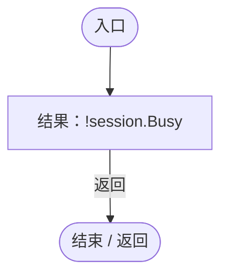

项目内调用/回调引用：

- [WorldSessionManager.Busy.get · L24](08741c7b7b9d9344.md#m4483e2e4f28f7c85)（访问器）

<a id="ma5bb749615211d86"></a>

## 回调@63 · L63

`r … => 回调`


### Editor · Roslyn编译器控制流

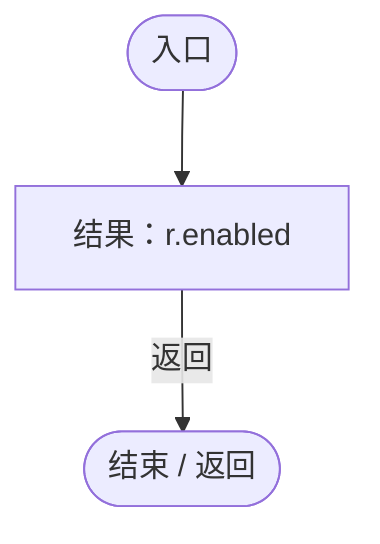

<a id="m50613be896820ceb"></a>

## 回调@64 · L64

`r … => 回调`


### Editor · Roslyn编译器控制流

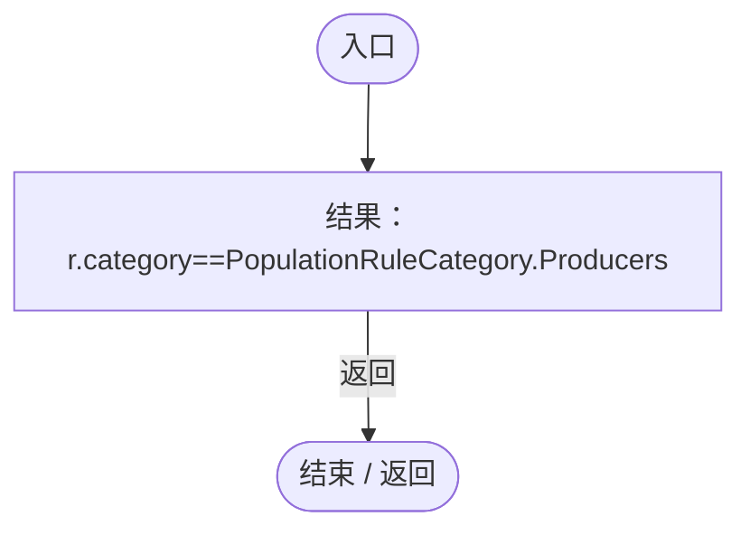

<a id="m6926c79ae0a7eb32"></a>

## 回调@64 · L64

`r … => 回调`


### Editor · Roslyn编译器控制流

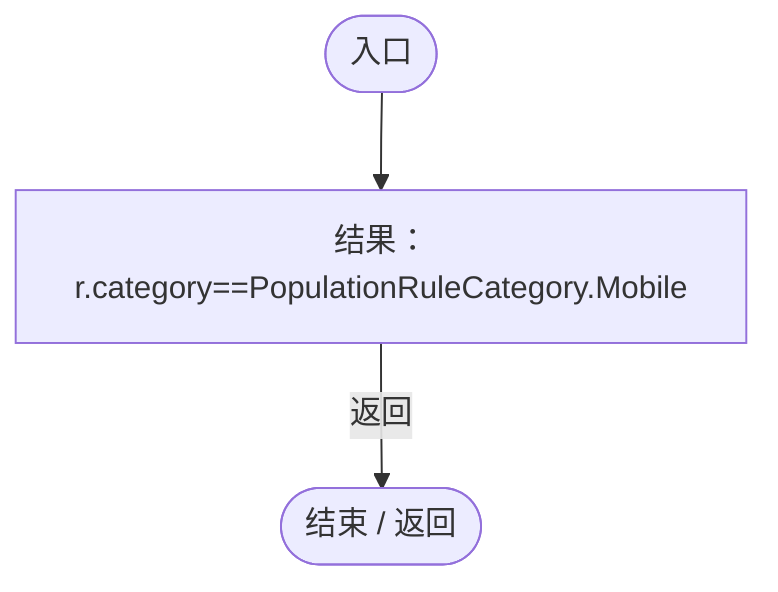

<a id="m0625e9bb60fc4aa5"></a>

## 回调@65 · L65

`( … => 回调`


### Editor · Roslyn编译器控制流

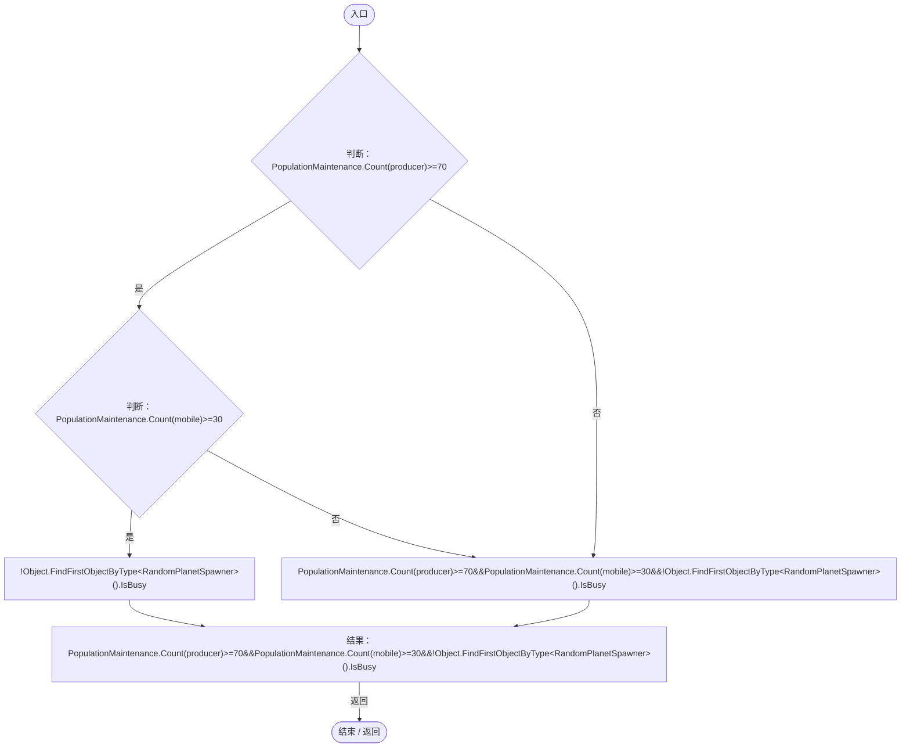

项目内调用/回调引用：

- [PopulationMaintenance.Count · L97](923ccc4e86c4786c.md#mbe9ad2ebe3b97624)（方法）
- [RandomPlanetSpawner.IsBusy.get · L19](1c13222a547b265c.md#mfcbb58f20e164d8c)（访问器）

<a id="me3b75c90aa0935f5"></a>

## 回调@67 · L67

`e … => 回调`


### Editor · Roslyn编译器控制流

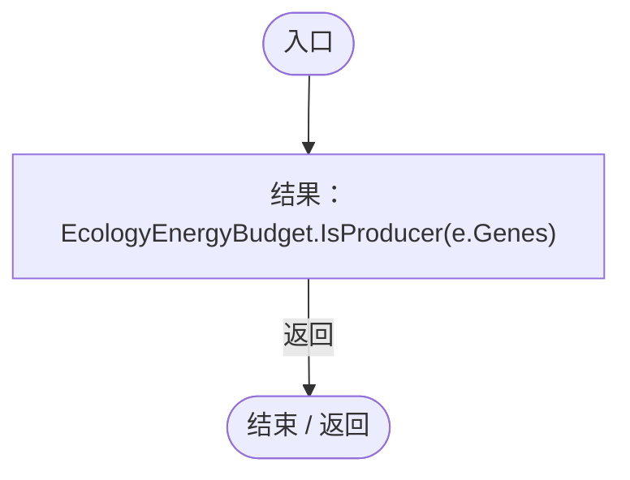

项目内调用/回调引用：

- [EcologyEnergyBudget.IsProducer · L25](06a91c8201f26593.md#mbee0635baeeb86db)（方法）
- [DarwinEntity.Genes.get · L14](70798dde169f2e8b.md#m622eb1adf401d431)（访问器）

<a id="m089b7e06426b57c1"></a>

## 回调@67 · L67

`g … => 回调`


### Editor · Roslyn编译器控制流

```mermaid
flowchart TD
  b0(["入口"])
  b1["结果：g.DefinitionId==&quot;gene_repair&quot;"]
  b2(["结束 / 返回"])
  b0 --> b1
  b1 -->|"返回"| b2

```

<a id="m862efed5b141b73f"></a>

## 回调@72 · L72

`e … => 回调`


### Editor · Roslyn编译器控制流

```mermaid
flowchart TD
  b0(["入口"])
  b1["结果：e.Genes.GetAttribute(&quot;moveSpeed&quot;)&gt;0"]
  b2(["结束 / 返回"])
  b0 --> b1
  b1 -->|"返回"| b2

```

项目内调用/回调引用：

- [EntityGeneController.GetAttribute · L262](7494d53178552f0e.md#mfead0db2249507df)（方法）
- [DarwinEntity.Genes.get · L14](70798dde169f2e8b.md#m622eb1adf401d431)（访问器）

<a id="m90c81e6c4b2501cc"></a>

## 回调@73 · L73

`e … => 回调`


### Editor · Roslyn编译器控制流

```mermaid
flowchart TD
  b0(["入口"])
  b1["结果：EcologyEnergyBudget.IsProducer(e.Genes)"]
  b2(["结束 / 返回"])
  b0 --> b1
  b1 -->|"返回"| b2

```

项目内调用/回调引用：

- [EcologyEnergyBudget.IsProducer · L25](06a91c8201f26593.md#mbee0635baeeb86db)（方法）
- [DarwinEntity.Genes.get · L14](70798dde169f2e8b.md#m622eb1adf401d431)（访问器）

<a id="m9e861252d1d8be16"></a>

## 回调@74 · L74

`( … => 回调`


### Editor · Roslyn编译器控制流

```mermaid
flowchart TD
  b0(["入口"])
  b1{"判断：PopulationMaintenance.Count(producer)&gt;=70"}
  b2["!Object.FindFirstObjectByType&lt;RandomPlanetSpawner&gt;().IsBusy"]
  b3["PopulationMaintenance.Count(producer)&gt;=70"]
  b4["结果：PopulationMaintenance.Count(producer)&gt;=70&amp;&amp;!Object.FindFirstObjectByType&lt;RandomPlanetSpawner&gt;().IsBusy"]
  b5(["结束 / 返回"])
  b0 --> b1
  b1 -->|"是"| b2
  b1 -->|"否"| b3
  b2 --> b4
  b3 --> b4
  b4 -->|"返回"| b5

```

项目内调用/回调引用：

- [PopulationMaintenance.Count · L97](923ccc4e86c4786c.md#mbe9ad2ebe3b97624)（方法）
- [RandomPlanetSpawner.IsBusy.get · L19](1c13222a547b265c.md#mfcbb58f20e164d8c)（访问器）

<a id="m1b2d2e06181d0928"></a>

## 回调@77 · L77

`e … => 回调`


### Editor · Roslyn编译器控制流

```mermaid
flowchart TD
  b0(["入口"])
  b1["结果：EcologyEnergyBudget.IsProducer(e.Genes)"]
  b2(["结束 / 返回"])
  b0 --> b1
  b1 -->|"返回"| b2

```

项目内调用/回调引用：

- [EcologyEnergyBudget.IsProducer · L25](06a91c8201f26593.md#mbee0635baeeb86db)（方法）
- [DarwinEntity.Genes.get · L14](70798dde169f2e8b.md#m622eb1adf401d431)（访问器）

<a id="m6732a36fc8b13fe9"></a>

## 回调@78 · L78

`( … => 回调`


### Editor · Roslyn编译器控制流

```mermaid
flowchart TD
  b0(["入口"])
  b1{"判断：PopulationMaintenance.Count(producer)&gt;=70"}
  b2["!Object.FindFirstObjectByType&lt;RandomPlanetSpawner&gt;().IsBusy"]
  b3["PopulationMaintenance.Count(producer)&gt;=70"]
  b4["结果：PopulationMaintenance.Count(producer)&gt;=70&amp;&amp;!Object.FindFirstObjectByType&lt;RandomPlanetSpawner&gt;().IsBusy"]
  b5(["结束 / 返回"])
  b0 --> b1
  b1 -->|"是"| b2
  b1 -->|"否"| b3
  b2 --> b4
  b3 --> b4
  b4 -->|"返回"| b5

```

项目内调用/回调引用：

- [PopulationMaintenance.Count · L97](923ccc4e86c4786c.md#mbe9ad2ebe3b97624)（方法）
- [RandomPlanetSpawner.IsBusy.get · L19](1c13222a547b265c.md#mfcbb58f20e164d8c)（访问器）

<a id="m28ff7b65dbc332df"></a>

## 回调@81 · L81

`s … => 回调`


### Editor · Roslyn编译器控制流

```mermaid
flowchart TD
  b0(["入口"])
  b1["结果：s.name.Contains(&quot;创始王后&quot;)"]
  b2(["结束 / 返回"])
  b0 --> b1
  b1 -->|"返回"| b2

```

<a id="m6b750786e91eba06"></a>

## 回调@81 · L81

`s … => 回调`


### Editor · Roslyn编译器控制流

```mermaid
flowchart TD
  b0(["入口"])
  b1["结果：s.name.Contains(&quot;清道夫&quot;)"]
  b2(["结束 / 返回"])
  b0 --> b1
  b1 -->|"返回"| b2

```

<a id="m38dbad2c51ddfd7d"></a>

## 回调@83 · L83

`b … => 回调`


### Editor · Roslyn编译器控制流

```mermaid
flowchart TD
  b0(["入口"])
  b1["结果：b.name==&quot;EcologyDefaults&quot;"]
  b2(["结束 / 返回"])
  b0 --> b1
  b1 -->|"返回"| b2

```

<a id="maeee2967db16af05"></a>

## 回调@84 · L84

`r … => 回调`


### Editor · Roslyn编译器控制流

```mermaid
flowchart TD
  b0(["入口"])
  b1["结果：r.id==extra.id"]
  b2(["结束 / 返回"])
  b0 --> b1
  b1 -->|"返回"| b2

```

<a id="ma3d4a498d77f9f59"></a>

## 回调@85 · L85

`r … => 回调`


### Editor · Roslyn编译器控制流

```mermaid
flowchart TD
  b0(["入口"])
  b1["结果：r.id==EcologyDefaults.ProducerRuleId"]
  b2(["结束 / 返回"])
  b0 --> b1
  b1 -->|"返回"| b2

```

<a id="mdab0a75ffac5a6c8"></a>

## 回调@85 · L85

`r … => 回调`


### Editor · Roslyn编译器控制流

```mermaid
flowchart TD
  b0(["入口"])
  b1["结果：r.category==PopulationRuleCategory.Mobile"]
  b2(["结束 / 返回"])
  b0 --> b1
  b1 -->|"返回"| b2

```

<a id="mc39ff4e04de2506c"></a>

## 回调@86 · L86

`( … => 回调`


### Editor · Roslyn编译器控制流

```mermaid
flowchart TD
  b0(["入口"])
  b1["结果：!session.Busy"]
  b2(["结束 / 返回"])
  b0 --> b1
  b1 -->|"返回"| b2

```

项目内调用/回调引用：

- [WorldSessionManager.Busy.get · L24](08741c7b7b9d9344.md#m4483e2e4f28f7c85)（访问器）

<a id="mbfc7ae31cb3799d4"></a>

## 回调@89 · L89

`r … => 回调`


### Editor · Roslyn编译器控制流

```mermaid
flowchart TD
  b0(["入口"])
  b1["结果：r.State.energy"]
  b2(["结束 / 返回"])
  b0 --> b1
  b1 -->|"返回"| b2

```

项目内调用/回调引用：

- [ColonyResource.State.get · L23](293dbaecfff4b585.md#m65ff21bb6da1a2da)（访问器）

<a id="mc607bcb3e7b7274b"></a>

## 回调@92 · L92

`r … => 回调`


### Editor · Roslyn编译器控制流

```mermaid
flowchart TD
  b0(["入口"])
  b1["结果：r.energy"]
  b2(["结束 / 返回"])
  b0 --> b1
  b1 -->|"返回"| b2

```

<a id="m475466f94211569d"></a>

## 回调@93 · L93

`( … => 回调`


### Editor · Roslyn编译器控制流

```mermaid
flowchart TD
  b0(["入口"])
  b1["结果：!session.Busy"]
  b2(["结束 / 返回"])
  b0 --> b1
  b1 -->|"返回"| b2

```

项目内调用/回调引用：

- [WorldSessionManager.Busy.get · L24](08741c7b7b9d9344.md#m4483e2e4f28f7c85)（访问器）

<a id="m7d020812b64961b0"></a>

## 回调@94 · L94

`r … => 回调`


### Editor · Roslyn编译器控制流

```mermaid
flowchart TD
  b0(["入口"])
  b1["结果：r.State.energy"]
  b2(["结束 / 返回"])
  b0 --> b1
  b1 -->|"返回"| b2

```

项目内调用/回调引用：

- [ColonyResource.State.get · L23](293dbaecfff4b585.md#m65ff21bb6da1a2da)（访问器）

<a id="m2a90dddb704dbeee"></a>

## Freeze · L101

`private static void Freeze(DarwinEntity entity)`


### Editor · Roslyn编译器控制流

```mermaid
flowchart TD
  b0(["入口"])
  b1{"entity.Genes.mutationChance=0;<br/>entity.Genes.enabled=false;<br/>entity.GetComponent&lt;EntityVitals&gt;().enabled=false;<br/>entity.GetComponent&lt;EntityEnvironmentHazard&gt;().enabled=false;<br/>entity.GetComponent&lt;PlanetGravity&gt;().enabled=false;<br/>entity.GetCom…"}
  b2["pop.enabled=false;<br/>pop.EnsureMembership();"]
  b3["entity.GetComponent&lt;Rigidbody&gt;().interpolation=RigidbodyInterpolation.None;"]
  b4(["结束 / 返回"])
  b0 --> b1
  b1 -->|"是"| b2
  b1 -->|"否"| b3
  b2 --> b3
  b3 --> b4

```

项目内调用/回调引用：

- [DarwinEntity.Genes.get · L14](70798dde169f2e8b.md#m622eb1adf401d431)（访问器）
- [EntityLifeCycle.InitializeBirth · L17](9f4138bfbae654b7.md#m76374fa073e2a603)（方法）
- [PopulationBehavior.EnsureMembership · L107](21e4f62f75a9a80f.md#medb038b51f8cd8e6)（方法）

<a id="m89b3d3263d15ee46"></a>

## StationaryValues · L108

`private static string StationaryValues(AntColonyMember member)`

★ 适配：长期验证记录真实生命/粮食/任务，区分被捕食、断粮与上限等待。

### Editor · Roslyn编译器控制流

```mermaid
flowchart TD
  b0(["入口"])
  b1["stats=member.GetComponent&lt;EntityStats&gt;()<br/>stats.TryGet(&quot;health&quot;,out var hp);<br/>stats.TryGet(&quot;nutrient&quot;,out var food);<br/>stats.TryGet(&quot;storedNutrient&quot;,out var reserve);<br/>结果：&quot;hp=&quot;+hp+&quot;,food=&quot;+food+&quot;,reserve=&quot;+reserve+&quot;,task=&quot;+member.Activity"]
  b2(["结束 / 返回"])
  b0 --> b1
  b1 -->|"返回"| b2

```

项目内调用/回调引用：

- [EntityStats.TryGet · L90](75aa86a368efdf24.md#m24ee1433e4a70d94)（方法）
- [AntColonyMember.Activity.get · L50](baebd85c05598377.md#m50ece4c10946f98c)（访问器）

<a id="mcdf67282811f1ebb"></a>

## Sustain · L110

`private static IEnumerator Sustain(AntColonyMember queen,SimulationClock clock,PlanetTerrainMeshBuilder planet)`


### Editor · Roslyn编译器控制流

```mermaid
flowchart TD
  b0(["入口"])
  b1["dt=.05f<br/>steps=14000<br/>prepared=new HashSet&lt;DarwinEntity&gt;()"]
  b2["new HashSet&lt;string&gt;{queen.Id}<br/>queen.Id<br/>seenAnts=new HashSet&lt;string&gt;{queen.Id}"]
  b3["firstRoles=new List&lt;AntRole&gt;()<br/>trace=new List&lt;string&gt;()<br/>queenCollected=false<br/>workerCollected=false<br/>peak=1<br/>spawner=Object.FindFirstObjectByType&lt;RandomPlanetSpawner&gt;()<br/>spawner.enabled=false;<br/>clock.enabled=false;<br/>ServiceLocator.Register(clo…"]
  b4["new WorldGameSettings{entityLimit=180}<br/>entityLimit=180<br/>EntityPopulationLimit.UseSnapshot(new WorldGameSettings{entityLimit=180});"]
  b5["simulation=Physics.simulationMode<br/>Physics.simulationMode=SimulationMode.Script;<br/>gameTime=typeof(SimulationClock).GetField(&quot;&lt;GameTime&gt;k__BackingField&quot;,Private)<br/>delta=typeof(SimulationClock).GetField(&quot;&lt;GameDeltaTime&gt;k__BackingField&quot;,Privat…"]
  b6["step=0"]
  b7{"判断：step&lt;steps"}
  b8["time=step*dt<br/>gameTime.SetValue(clock,startTime+time);<br/>delta.SetValue(clock,dt);<br/>budget.SetValue(clock,false);"]
  b9["EntityRegistry.All.ToArray()"]
  b10{"判断：EntityRegistry.All.ToArray()"}
  b11{"var<br/>判断：EcologyQueries.Alive(entity)"}
  b12{"判断：prepared.Add(entity)"}
  b13["Freeze(entity);"]
  b14{"EntityRegistry.All.ToArray()<br/>判断：EntityRegistry.All.ToArray()"}
  b15["EntityRegistry.All.ToArray()"]
  b16["连接 / 离开区域"]
  b17["EntityRegistry.All.ToArray()"]
  b18{"判断：EntityRegistry.All.ToArray()"}
  b19{"var<br/>判断：EcologyQueries.Alive(entity)"}
  b20{"entity.GetComponent&lt;PopulationBehavior&gt;()<br/>判断：entity.GetComponent&lt;PopulationBehavior&gt;()"}
  b21["entity.GetComponent&lt;PopulationBehavior&gt;()?.Advance(dt);"]
  b22{"entity.Genes.AdvanceSimulation(dt);<br/>判断：EcologyQueries.Alive(entity)"}
  b23["vitals.Invoke(entity.GetComponent&lt;EntityVitals&gt;(),new object[]{dt});"]
  b24{"判断：EcologyQueries.Alive(entity)"}
  b25["gravity.Invoke(entity.GetComponent&lt;PlanetGravity&gt;(),null);"]
  b26{"EntityRegistry.All.ToArray()<br/>判断：EntityRegistry.All.ToArray()"}
  b27["EntityRegistry.All.ToArray()"]
  b28["连接 / 离开区域"]
  b29["AntColonyMember.All.ToArray()"]
  b30{"判断：AntColonyMember.All.ToArray()"}
  b31{"var<br/>判断：seenAnts.Add(member.Id)"}
  b32["firstRoles.Add(member.Role);"]
  b33{"判断：string.IsNullOrEmpty(member.State.carriedLiving)"}
  b34{"判断：string.IsNullOrEmpty(member.State.carriedResource)"}
  b35{"判断：member.Role==AntRole.Queen"}
  b36["queenCollected=true;"]
  b37{"判断：member.Role==AntRole.Worker"}
  b38["workerCollected=true;"]
  b39{"AntColonyMember.All.ToArray()<br/>判断：AntColonyMember.All.ToArray()"}
  b40["AntColonyMember.All.ToArray()"]
  b41["连接 / 离开区域"]
  b42{"peak=Mathf.Max(peak,AntColonyMember.All.Count());<br/>Physics.SyncTransforms();<br/>Physics.Simulate(dt);<br/>判断：step%20==0"}
  b43["refill.Invoke(spawner,null);<br/>yield return null;"]
  b44{"判断：step%1000==0"}
  b45["trace.Add(&quot;t=&quot;+time+&quot; alive=&quot;+EntityRegistry.All.Count+&quot; ants=&quot;+AntColonyMember.All.Count()+&quot; workers=&quot;+AntColonyMember.All.Count(m=&gt;m.Role==AntRole.Worker&amp;&amp;!m.Young)+&quot; resources=&quot;+ColonyResource.All.Sum(r=&gt;r.State.energy)+&quot; queenCollect…"]
  b46["step++"]
  b47["clock.Pause();"]
  b48{"判断：firstRoles.Count&gt;=2"}
  b49["firstRoles.Take(2).All(role=&gt;role==AntRole.Worker)"]
  b50["firstRoles.Count&gt;=2"]
  b51["Check(firstRoles.Count&gt;=2&amp;&amp;firstRoles.Take(2).All(role=&gt;role==AntRole.Worker),&quot;实际前两胎均为工匠，未靠预生成成年工匠跳过成长&quot;);"]
  b52["Check(queenCollected,&quot;实际物理步中缺工匠王后完成过采集取货&quot;);<br/>Check(workerCollected,&quot;工匠成年后实际接手采集取货&quot;);"]
  b53{"判断：peak&gt;=6"}
  b54["AntColonyMember.All.Any(m=&gt;m.Role==AntRole.Queen)"]
  b55["peak&gt;=6"]
  b56["Check(peak&gt;=6&amp;&amp;AntColonyMember.All.Any(m=&gt;m.Role==AntRole.Queen),&quot;700模拟秒后仍有王后与存活蚁群，超过首批王后的常规寿命窗口&quot;);"]
  b57["Check(AntColonyMember.All.Where(m=&gt;m.Role==AntRole.Queen).All(m=&gt;m.State.startup==null&#124;&#124;m.State.startup.foodIssued&lt;=EcologyDefaults.Current.foundingFood),&quot;长期模拟没有单只王后重复发放创业储粮&quot;);<br/>session=Object.FindFirstObjectByType&lt;WorldSessionManager&gt;()<br/>…"]
  b58["clock.Pause();<br/>clock.enabled=true;<br/>Physics.simulationMode=simulation;"]
  b59(["结束 / 返回"])
  b0 --> b1
  b1 --> b2
  b2 --> b3
  b3 --> b4
  b4 --> b5
  b5 --> b6
  b6 --> b7
  b7 -->|"是"| b8
  b7 -->|"否"| b47
  b8 --> b9
  b9 --> b10
  b10 -->|"是"| b11
  b10 -->|"否 · 经过finally 14"| b17
  b11 -->|"是"| b12
  b11 -->|"否"| b10
  b12 -->|"是"| b13
  b12 -->|"否"| b10
  b13 --> b10
  b14 -->|"否"| b15
  b14 -->|"是"| b16
  b15 --> b16
  b17 --> b18
  b18 -->|"是"| b19
  b18 -->|"否 · 经过finally 26"| b29
  b19 -->|"是"| b20
  b19 -->|"否"| b18
  b20 -->|"否"| b21
  b20 -->|"是"| b22
  b21 --> b22
  b22 -->|"是"| b23
  b22 -->|"否"| b24
  b23 --> b24
  b24 -->|"是"| b25
  b24 -->|"否"| b18
  b25 --> b18
  b26 -->|"否"| b27
  b26 -->|"是"| b28
  b27 --> b28
  b29 --> b30
  b30 -->|"是"| b31
  b30 -->|"否 · 经过finally 39"| b42
  b31 -->|"是"| b32
  b31 -->|"否"| b33
  b32 --> b33
  b33 -->|"是"| b34
  b33 -->|"否"| b35
  b34 -->|"否"| b35
  b34 -->|"是"| b30
  b35 -->|"是"| b36
  b35 -->|"否"| b37
  b36 --> b37
  b37 -->|"是"| b38
  b37 -->|"否"| b30
  b38 --> b30
  b39 -->|"否"| b40
  b39 -->|"是"| b41
  b40 --> b41
  b42 -->|"是"| b43
  b42 -->|"否"| b44
  b43 --> b44
  b44 -->|"是"| b45
  b44 -->|"否"| b46
  b45 --> b46
  b46 --> b7
  b47 --> b48
  b48 -->|"是"| b49
  b48 -->|"否"| b50
  b49 --> b51
  b50 --> b51
  b51 --> b52
  b52 --> b53
  b53 -->|"是"| b54
  b53 -->|"否"| b55
  b54 --> b56
  b55 --> b56
  b56 --> b57
  b57 -->|"经过finally 58"| b59
  b10 -. "退出保护区时 finally（示意）" .-> b14
  b18 -. "退出保护区时 finally（示意）" .-> b26
  b30 -. "退出保护区时 finally（示意）" .-> b39
  b6 -. "退出保护区时 finally（示意）" .-> b58

```

项目内调用/回调引用：

- [ServiceLocator.Register · L16](f2fdbe9f9ccd93cb.md#m26753aeca74b231e)（方法）
- [SimulationClock.GameTime.get · L23](a8f444aec9614b0a.md#m74adfa39a896652f)（访问器）
- [SimulationClock.RestoreState · L74](a8f444aec9614b0a.md#m8f617e95e1282846)（方法）
- [SimulationClock.Play · L78](a8f444aec9614b0a.md#m7aa9e64b7de60ed0)（方法）
- [GameInputGate.Blocked.set · L8](52955daae7e592ab.md#m578697f6379686f4)（访问器）
- [EntityPopulationLimit.UseSnapshot · L30](44f717c5df79d270.md#m735185cedc969868)（方法）
- [EcologyQueries.Alive · L38](bdf7ccc2c9c0452f.md#mb2877c487f449970)（方法）
- [ColonyContinuityRegression.Freeze · L101](9386360ce717a3bf.md#m2a90dddb704dbeee)（方法）
- [PopulationBehavior.Advance · L78](21e4f62f75a9a80f.md#m3b1594d99e3bdf28)（方法）
- [EntityGeneController.AdvanceSimulation · L70](7494d53178552f0e.md#m8d432f097da8bbf7)（方法）
- [DarwinEntity.Genes.get · L14](70798dde169f2e8b.md#m622eb1adf401d431)（访问器）
- [AntColonyMember.Role.get · L38](baebd85c05598377.md#mab30d459d599e4df)（访问器）
- [AntColonyMember.State.get · L32](baebd85c05598377.md#m426db6a7c12dd7aa)（访问器）
- [SimulationClock.Pause · L79](a8f444aec9614b0a.md#m30929d45a885d0f1)（方法）
- [ColonyContinuityRegression.Check · L32](9386360ce717a3bf.md#m7676e6130bf46932)（方法）
- [WorldSessionManager.SaveNow · L159](08741c7b7b9d9344.md#m750fe992c0cd477a)（方法）
- [WorldSaveStore.Read · L72](d67a35e5e3814c15.md#mca362c7675a5800c)（方法）
- [WorldSaveStore.FileFor · L48](d67a35e5e3814c15.md#m419a625e2bcc70f8)（方法）
- [WorldSessionManager.Current.get · L21](08741c7b7b9d9344.md#m5d26a5eb846a8504)（访问器）
- [OrbitCamera.FocusOn · L170](42eb429559b42bcb.md#m90f6d4818e064f1d)（方法）
- [ColonyContinuityRegression.Capture · L55](9386360ce717a3bf.md#m85ab19b1d62646c9)（方法）
- [ColonyContinuityRegression.回调@131 · L131](9386360ce717a3bf.md#m0dc82321c2bd26c4)（回调/委托）
- [ColonyContinuityRegression.回调@131 · L131](9386360ce717a3bf.md#m47f1fd2a71e2c70a)（回调/委托）
- [ColonyContinuityRegression.回调@131 · L131](9386360ce717a3bf.md#mbb8a47630b4fe3c0)（回调/委托）
- [ColonyContinuityRegression.回调@131 · L131](9386360ce717a3bf.md#md155a689501e8f64)（回调/委托）
- [ColonyContinuityRegression.回调@134 · L134](9386360ce717a3bf.md#m7eb7a1805e0afae3)（回调/委托）
- [ColonyContinuityRegression.回调@136 · L136](9386360ce717a3bf.md#mb4616de54547d686)（回调/委托）
- [ColonyContinuityRegression.回调@137 · L137](9386360ce717a3bf.md#m886ca0fd6d312e56)（回调/委托）
- [ColonyContinuityRegression.回调@137 · L137](9386360ce717a3bf.md#m13bcfaa9bca32bb2)（回调/委托）
- [ColonyContinuityRegression.回调@138 · L138](9386360ce717a3bf.md#m9a30ad8fa01a374e)（回调/委托）
- [ColonyContinuityRegression.回调@139 · L139](9386360ce717a3bf.md#mb77245c52e655916)（回调/委托）

<a id="m0dc82321c2bd26c4"></a>

## 回调@131 · L131

`m … => 回调`


### Editor · Roslyn编译器控制流

```mermaid
flowchart TD
  b0(["入口"])
  b1{"判断：m.Role==AntRole.Worker"}
  b2["!m.Young"]
  b3["m.Role==AntRole.Worker"]
  b4["结果：m.Role==AntRole.Worker&amp;&amp;!m.Young"]
  b5(["结束 / 返回"])
  b0 --> b1
  b1 -->|"是"| b2
  b1 -->|"否"| b3
  b2 --> b4
  b3 --> b4
  b4 -->|"返回"| b5

```

项目内调用/回调引用：

- [AntColonyMember.Role.get · L38](baebd85c05598377.md#mab30d459d599e4df)（访问器）

<a id="m47f1fd2a71e2c70a"></a>

## 回调@131 · L131

`r … => 回调`


### Editor · Roslyn编译器控制流

```mermaid
flowchart TD
  b0(["入口"])
  b1["结果：r.State.energy"]
  b2(["结束 / 返回"])
  b0 --> b1
  b1 -->|"返回"| b2

```

项目内调用/回调引用：

- [ColonyResource.State.get · L23](293dbaecfff4b585.md#m65ff21bb6da1a2da)（访问器）

<a id="mbb8a47630b4fe3c0"></a>

## 回调@131 · L131

`m … => 回调`


### Editor · Roslyn编译器控制流

```mermaid
flowchart TD
  b0(["入口"])
  b1["结果：m.Role==AntRole.Queen"]
  b2(["结束 / 返回"])
  b0 --> b1
  b1 -->|"返回"| b2

```

项目内调用/回调引用：

- [AntColonyMember.Role.get · L38](baebd85c05598377.md#mab30d459d599e4df)（访问器）

<a id="md155a689501e8f64"></a>

## 回调@131 · L131

`m … => 回调`


### Editor · Roslyn编译器控制流

```mermaid
flowchart TD
  b0(["入口"])
  b1["结果：m.Id.Substring(0,4)+&quot;/&quot;+m.Genes.IsGestating+&quot;/&quot;+m.State.reproductionTimer+&quot;/&quot;+m.GetComponent&lt;EntityLifeCycle&gt;().Progress+&quot;/&quot;+StationaryValues(m)"]
  b2(["结束 / 返回"])
  b0 --> b1
  b1 -->|"返回"| b2

```

项目内调用/回调引用：

- [AntColonyMember.Genes.get · L33](baebd85c05598377.md#m7331eee1fdd98961)（访问器）
- [AntColonyMember.State.get · L32](baebd85c05598377.md#m426db6a7c12dd7aa)（访问器）
- [EntityLifeCycle.Progress.get · L10](9f4138bfbae654b7.md#m178185fd5f5a0d74)（访问器）
- [ColonyContinuityRegression.StationaryValues · L108](9386360ce717a3bf.md#m89b3d3263d15ee46)（方法）

<a id="m7eb7a1805e0afae3"></a>

## 回调@134 · L134

`role … => 回调`


### Editor · Roslyn编译器控制流

```mermaid
flowchart TD
  b0(["入口"])
  b1["结果：role==AntRole.Worker"]
  b2(["结束 / 返回"])
  b0 --> b1
  b1 -->|"返回"| b2

```

<a id="mb4616de54547d686"></a>

## 回调@136 · L136

`m … => 回调`


### Editor · Roslyn编译器控制流

```mermaid
flowchart TD
  b0(["入口"])
  b1["结果：m.Role==AntRole.Queen"]
  b2(["结束 / 返回"])
  b0 --> b1
  b1 -->|"返回"| b2

```

项目内调用/回调引用：

- [AntColonyMember.Role.get · L38](baebd85c05598377.md#mab30d459d599e4df)（访问器）

<a id="m886ca0fd6d312e56"></a>

## 回调@137 · L137

`m … => 回调`


### Editor · Roslyn编译器控制流

```mermaid
flowchart TD
  b0(["入口"])
  b1["结果：m.Role==AntRole.Queen"]
  b2(["结束 / 返回"])
  b0 --> b1
  b1 -->|"返回"| b2

```

项目内调用/回调引用：

- [AntColonyMember.Role.get · L38](baebd85c05598377.md#mab30d459d599e4df)（访问器）

<a id="m13bcfaa9bca32bb2"></a>

## 回调@137 · L137

`m … => 回调`


### Editor · Roslyn编译器控制流

```mermaid
flowchart TD
  b0(["入口"])
  b1{"判断：m.State.startup==null"}
  b2["m.State.startup.foodIssued&lt;=EcologyDefaults.Current.foundingFood"]
  b3["m.State.startup==null"]
  b4["结果：m.State.startup==null&#124;&#124;m.State.startup.foodIssued&lt;=EcologyDefaults.Current.foundingFood"]
  b5(["结束 / 返回"])
  b0 --> b1
  b1 -->|"否"| b2
  b1 -->|"是"| b3
  b2 --> b4
  b3 --> b4
  b4 -->|"返回"| b5

```

项目内调用/回调引用：

- [AntColonyMember.State.get · L32](baebd85c05598377.md#m426db6a7c12dd7aa)（访问器）
- [EcologyDefaults.Current.get · L35](5b565b57de741d98.md#m75cb60b88e3cc1c7)（访问器）

<a id="m9a30ad8fa01a374e"></a>

## 回调@138 · L138

`e … => 回调`


### Editor · Roslyn编译器控制流

```mermaid
flowchart TD
  b0(["入口"])
  b1{"e.ecology<br/>判断：e.ecology"}
  b2[".ant"]
  b3{"判断：.ant"}
  b4[".role"]
  b5["e.ecology?.ant?.role"]
  b6["结果：e.ecology?.ant?.role==AntRole.Queen.ToString()"]
  b7(["结束 / 返回"])
  b0 --> b1
  b1 -->|"否"| b2
  b1 -->|"是"| b5
  b2 --> b3
  b3 -->|"否"| b4
  b3 -->|"是"| b5
  b4 --> b6
  b5 --> b6
  b6 -->|"返回"| b7

```

<a id="mb77245c52e655916"></a>

## 回调@139 · L139

`m … => 回调`


### Editor · Roslyn编译器控制流

```mermaid
flowchart TD
  b0(["入口"])
  b1["结果：m.Role==AntRole.Queen"]
  b2(["结束 / 返回"])
  b0 --> b1
  b1 -->|"返回"| b2

```

项目内调用/回调引用：

- [AntColonyMember.Role.get · L38](baebd85c05598377.md#mab30d459d599e4df)（访问器）
