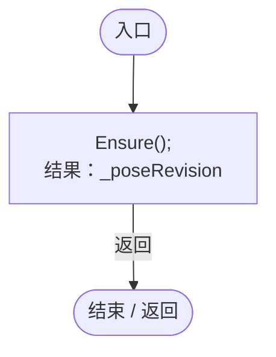
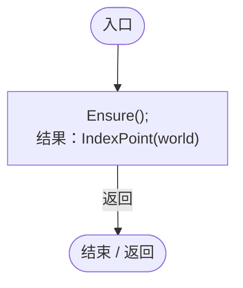
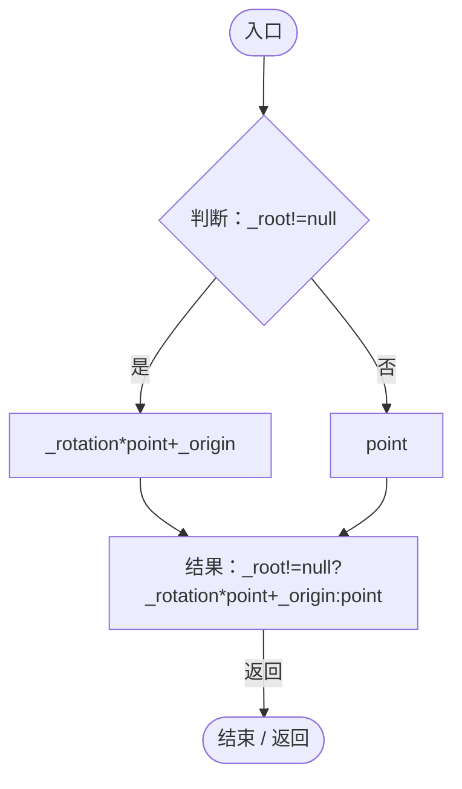
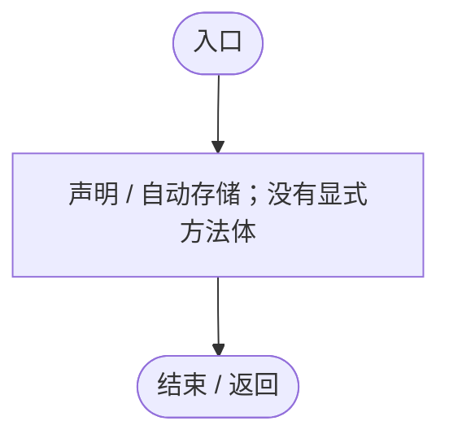
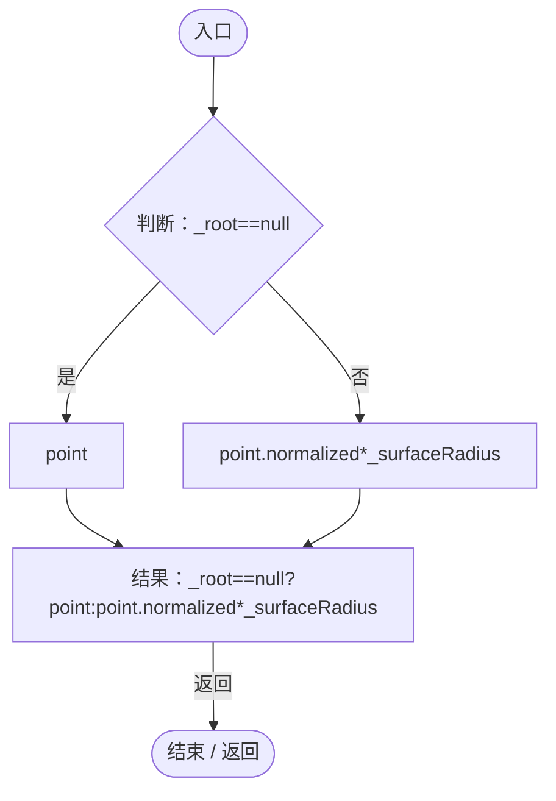
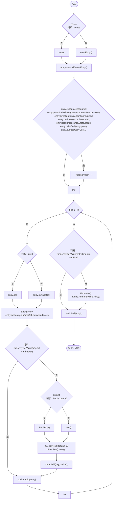
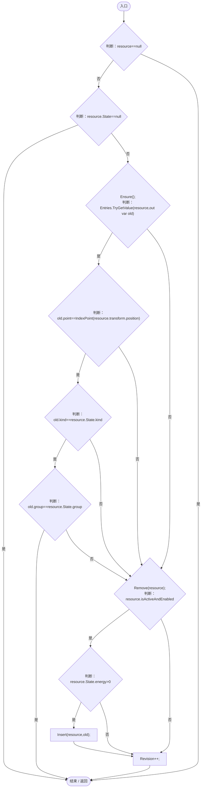
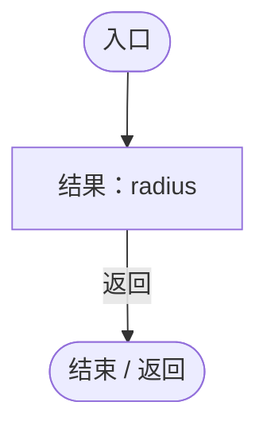

```mermaid
flowchart TD
  b0(["入口"])
  b1{"判断：EcologyQueries.Planet!=null"}
  b2["EcologyQueries.Planet.transform"]
  b3["null"]
  b4["root=EcologyQueries.Planet!=null?EcologyQueries.Planet.transform:null"]
  b5{"判断：root!=null"}
  b6["root.localToWorldMatrix"]
  b7["Matrix4x4.identity"]
  b8["matrix=root!=null?root.localToWorldMatrix:Matrix4x4.identity"]
  b9["size=SimulationOptimization.Current.resourceCellSize"]
  b10{"判断：EcologyQueries.Planet!=null"}
  b11["Mathf.Max(EcologyQueries.Planet.radius,EcologyQueries.Planet.WaterRadius)"]
  b12["0"]
  b13["surface=EcologyQueries.Planet!=null?Mathf.Max(EcologyQueries.Planet.radius,EcologyQueries.Planet.WaterRadius):0"]
  b14{"判断：_size==size"}
  b15{"判断：_root==root"}
  b16{"判断：_planet==matrix"}
  b17{"判断：_surfaceRadius==surface"}
  b18{"判断：root!=null"}
  b19["root.rotation"]
  b20["Quaternion.identity"]
  b21["rotation=root!=null?root.rotation:Quaternion.identity"]
  b22["inverse=Quaternion.Inverse(rotation)<br/>shape=Matrix4x4.Rotate(inverse)*matrix<br/>shape.m03=shape.m13=shape.m23=0;"]
  b23{"判断：_size==size"}
  b24{"判断：_root==root"}
  b25{"判断：_surfaceRadius==surface"}
  b26["_shape==shape"]
  b27["_size==size&amp;&amp;_root==root&amp;&amp;_surfaceRadius==surface&amp;&amp;_shape==shape"]
  b28["rigid=_size==size&amp;&amp;_root==root&amp;&amp;_surfaceRadius==surface&amp;&amp;_shape==shape"]
  b29["_rotation=rotation;<br/>_inverse=inverse;"]
  b30{"_origin<br/>判断：root!=null"}
  b31["root.position"]
  b32["Vector3.zero"]
  b33["_origin=root!=null?root.position:Vector3.zero;"]
  b34{"_shape=shape;<br/>_poseRevision++;<br/>_surfaceRadius=surface;<br/>_size=size;<br/>_root=root;<br/>_planet=matrix;<br/>判断：rigid"}
  b35["Revision++;"]
  b36["Rebuilds++;<br/>_foodRevision++;<br/>Refresh.Clear();"]
  b37["Entries.Keys"]
  b38{"判断：Entries.Keys"}
  b39["var<br/>Refresh.Add(resource);"]
  b40["Entries.Keys"]
  b41["Cells.Values"]
  b42{"判断：Cells.Values"}
  b43["var<br/>list.Clear();<br/>Pool.Push(list);"]
  b44["Cells.Values"]
  b45["Cells.Clear();<br/>Kinds.Clear();<br/>Entries.Clear();"]
  b46["Refresh"]
  b47{"判断：Refresh"}
  b48{"var<br/>判断：resource!=null"}
  b49{"判断：resource.isActiveAndEnabled"}
  b50["Insert(resource);"]
  b51["Refresh"]
  b52["Refresh.Clear();<br/>Revision++;"]
  b53(["结束 / 返回"])
  b0 --> b1
  b1 -->|"是"| b2
  b1 -->|"否"| b3
  b2 --> b4
  b3 --> b4
  b4 --> b5
  b5 -->|"是"| b6
  b5 -->|"否"| b7
  b6 --> b8
  b7 --> b8
  b8 --> b9
  b9 --> b10
  b10 -->|"是"| b11
  b10 -->|"否"| b12
  b11 --> b13
  b12 --> b13
  b13 --> b14
  b14 -->|"是"| b15
  b14 -->|"否"| b18
  b15 -->|"是"| b16
  b15 -->|"否"| b18
  b16 -->|"是"| b17
  b16 -->|"否"| b18
  b17 -->|"是"| b53
  b17 -->|"否"| b18
  b18 -->|"是"| b19
  b18 -->|"否"| b20
  b19 --> b21
  b20 --> b21
  b21 --> b22
  b22 --> b23
  b23 -->|"是"| b24
  b23 -->|"否"| b27
  b24 -->|"是"| b25
  b24 -->|"否"| b27
  b25 -->|"是"| b26
  b25 -->|"否"| b27
  b26 --> b28
  b27 --> b28
  b28 --> b29
  b29 --> b30
  b30 -->|"是"| b31
  b30 -->|"否"| b32
  b31 --> b33
  b32 --> b33
  b33 --> b34
  b34 -->|"是"| b35
  b34 -->|"否"| b36
  b35 --> b53
  b36 --> b37
  b37 --> b38
  b38 -->|"是"| b39
  b38 -->|"否 · 经过finally 40"| b41
  b39 --> b38
  b41 --> b42
  b42 -->|"是"| b43
  b42 -->|"否 · 经过finally 44"| b45
  b43 --> b42
  b45 --> b46
  b46 --> b47
  b47 -->|"是"| b48
  b47 -->|"否 · 经过finally 51"| b52
  b48 -->|"是"| b49
  b48 -->|"否"| b47
  b49 -->|"是"| b50
  b49 -->|"否"| b47
  b50 --> b47
  b52 --> b53
  b38 -. "退出保护区时 finally（示意）" .-> b40
  b42 -. "退出保护区时 finally（示意）" .-> b44
  b47 -. "退出保护区时 finally（示意）" .-> b51

```

# ResourceCoordinates.cs

[返回总索引](../README.md) · `Runtime` · `Assets/DarwinPark/Entities/Ecology/ResourceCoordinates.cs`

[源文件](../../../Assets/DarwinPark/Entities/Ecology/ResourceCoordinates.cs) · 源码校验：`018fb15c7a17bd0292f772c5da1c556715d76a1b34730d4f0f34d8b902e1d6ab`

方法按源文件位置排列。事件/回调引用不表示立即执行；分支与异常说明见总索引。完整源码与可点击关系图请打开离线手册。

<a id="ma4983fb1891a67cf"></a>

## ResourceCoordinate.ctor · L10

`public ResourceCoordinate(ColonyResource value,Vector3 point)`


### Editor / Player · Roslyn编译器控制流


<a id="m078a94a2ebef07d3"></a>

## PoseRevision.get · L23

`get`


### Editor / Player · Roslyn编译器控制流



项目内调用/回调引用：

- [ResourceCoordinates.Ensure · L33](93d731ac01e3af48.md#m39789a3fc074335c)（方法）

<a id="m8d7daf91ba26e421"></a>

## Rebuilds.get · L24

`get`


### Editor / Player · 语法控制结构 / 声明（非CFG）


<a id="m5244b6243dc6c8f1"></a>

## Rebuilds.set · L24

`private set`


### Editor / Player · 语法控制结构 / 声明（非CFG）


<a id="mfa95c41000df4811"></a>

## RelativePoint · L25

`public static Vector3 RelativePoint(Vector3 world)`


### Editor / Player · Roslyn编译器控制流



项目内调用/回调引用：

- [ResourceCoordinates.Ensure · L33](93d731ac01e3af48.md#m39789a3fc074335c)（方法）
- [ResourceCoordinates.IndexPoint · L26](93d731ac01e3af48.md#m4b9f745d5e99ae7e)（方法）

<a id="m4b9f745d5e99ae7e"></a>

## IndexPoint · L26

`private static Vector3 IndexPoint(Vector3 world)`


### Editor / Player · Roslyn编译器控制流


<a id="m0edf1ba7c5c4ede1"></a>

## WorldPoint · L27

`private static Vector3 WorldPoint(Vector3 point)`


### Editor / Player · Roslyn编译器控制流



<a id="m440fe2044b08481a"></a>

## FoodRevision.get · L29

`get`


### Editor / Player · Roslyn编译器控制流


项目内调用/回调引用：

- [ResourceCoordinates.Ensure · L33](93d731ac01e3af48.md#m39789a3fc074335c)（方法）

<a id="mb7f53578a9039cf2"></a>

## Revision.get · L30

`get`


### Editor / Player · 语法控制结构 / 声明（非CFG）


<a id="m21d297bb6f87f8b4"></a>

## Revision.set · L30

`private set`


### Editor / Player · 语法控制结构 / 声明（非CFG）



<a id="m30a427d018fa4718"></a>

## CandidateVisits.get · L30

`get`


### Editor / Player · 语法控制结构 / 声明（非CFG）


<a id="m9f58e129eb2c4a63"></a>

## CandidateVisits.set · L30

`private set`


### Editor / Player · 语法控制结构 / 声明（非CFG）


<a id="mb087ec16cff2724f"></a>

## Count.get · L31

`public static int Count`


### Editor / Player · 语法控制结构 / 声明（非CFG）


<a id="m4d6e13997ac03e99"></a>

## Cell · L32

`private static Vector3Int Cell(Vector3 p)`


### Editor / Player · Roslyn编译器控制流


<a id="m39789a3fc074335c"></a>

## Ensure · L33

`private static void Ensure()`


### Editor / Player · Roslyn编译器控制流



项目内调用/回调引用：

- [SimulationOptimization.Current.get · L30](11c9091e70893352.md#mcfa8eb2e650e57b1)（访问器）
- [PlanetTerrainMeshBuilder.WaterRadius.get · L99](415285cf043354a9.md#m76719c213b06ba56)（访问器）
- [ResourceCoordinates.Revision.set · L30](93d731ac01e3af48.md#m21d297bb6f87f8b4)（访问器）
- [ResourceCoordinates.Revision.get · L30](93d731ac01e3af48.md#mb7f53578a9039cf2)（访问器）
- [ResourceCoordinates.Rebuilds.set · L24](93d731ac01e3af48.md#m5244b6243dc6c8f1)（访问器）
- [ResourceCoordinates.Rebuilds.get · L24](93d731ac01e3af48.md#m8d7daf91ba26e421)（访问器）
- [ResourceCoordinates.Insert · L49](93d731ac01e3af48.md#m5c510b56e64494f0)（方法）

<a id="meb2811801a71ca2e"></a>

## SurfacePoint · L47

`private static Vector3 SurfacePoint(Vector3 point)`


### Editor / Player · Roslyn编译器控制流



<a id="m5c510b56e64494f0"></a>

## Insert · L49

`private static void Insert(ColonyResource resource,Entry reuse=null)`


### Editor / Player · Roslyn编译器控制流



项目内调用/回调引用：

- [ResourceCoordinates.IndexPoint · L26](93d731ac01e3af48.md#m4b9f745d5e99ae7e)（方法）
- [ColonyResource.State.get · L24](293dbaecfff4b585.md#m41824f1a0e160aa5)（访问器）
- [ResourceCoordinates.Cell · L32](93d731ac01e3af48.md#m4d6e13997ac03e99)（方法）
- [ResourceCoordinates.SurfacePoint · L47](93d731ac01e3af48.md#meb2811801a71ca2e)（方法）

<a id="m78e074204b8da0a9"></a>

## Observe · L55

`public static void Observe(ColonyResource resource)`


### Editor / Player · Roslyn编译器控制流



项目内调用/回调引用：

- [ColonyResource.State.get · L24](293dbaecfff4b585.md#m41824f1a0e160aa5)（访问器）
- [ResourceCoordinates.Ensure · L33](93d731ac01e3af48.md#m39789a3fc074335c)（方法）
- [ResourceCoordinates.IndexPoint · L26](93d731ac01e3af48.md#m4b9f745d5e99ae7e)（方法）
- [ResourceCoordinates.Remove · L61](93d731ac01e3af48.md#mf37d0cac8b27b09b)（方法）
- [ResourceCoordinates.Insert · L49](93d731ac01e3af48.md#m5c510b56e64494f0)（方法）
- [ResourceCoordinates.Revision.set · L30](93d731ac01e3af48.md#m21d297bb6f87f8b4)（访问器）
- [ResourceCoordinates.Revision.get · L30](93d731ac01e3af48.md#mb7f53578a9039cf2)（访问器）

<a id="mf37d0cac8b27b09b"></a>

## Remove · L61

`public static void Remove(ColonyResource resource)`


### Editor / Player · Roslyn编译器控制流


项目内调用/回调引用：

- [ResourceCoordinates.Revision.set · L30](93d731ac01e3af48.md#m21d297bb6f87f8b4)（访问器）
- [ResourceCoordinates.Revision.get · L30](93d731ac01e3af48.md#mb7f53578a9039cf2)（访问器）

<a id="m49560cf6f99b0949"></a>

## BroadRadius · L68

`public static float BroadRadius(Vector3 point,float radius)`

★ 适配：活体仍保留原3D搜索半径；资源球面查询使用投影格，避免高山同方向资源漏检。

### Editor / Player · Roslyn编译器控制流



<a id="mf169cf6ba025c1ca"></a>

## Query · L69

`public static void Query(Vector3 point,float radius,bool surfaceDistance,bool corpses,List<ResourceCoordinate> result)`


### Editor / Player · Roslyn编译器控制流

```mermaid
flowchart TD
  b0(["入口"])
  b1["performance=PerformanceTimings.Measure(PerformanceTimings.Area.ResourceSearch)"]
  b2["result.Clear();<br/>Ensure();<br/>point=IndexPoint(point);<br/>broad=radius<br/>unlimited=float.IsPositiveInfinity(radius)"]
  b3{"判断：surfaceDistance"}
  b4["SurfacePoint(point)"]
  b5["point"]
  b6["center=surfaceDistance?SurfacePoint(point):point"]
  b7{"判断：unlimited"}
  b8["default"]
  b9["Cell(center-Vector3.one*broad)"]
  b10["min=unlimited?default:Cell(center-Vector3.one*broad)"]
  b11{"判断：unlimited"}
  b12["default"]
  b13["Cell(center+Vector3.one*broad)"]
  b14["max=unlimited?default:Cell(center+Vector3.one*broad)"]
  b15{"判断：surfaceDistance"}
  b16["_root!=null"]
  b17["surfaceDistance"]
  b18["spherical=surfaceDistance&amp;&amp;_root!=null"]
  b19{"判断：spherical"}
  b20["point.normalized"]
  b21["Vector3.zero"]
  b22["direction=spherical?point.normalized:Vector3.zero"]
  b23{"判断：unlimited"}
  b24["double.PositiveInfinity"]
  b25["((double)max.x-min.x+1)*((double)max.y-min.y+1)*((double)max.z-min.z+1)"]
  b26["volume=unlimited?double.PositiveInfinity:((double)max.x-min.x+1)*((double)max.y-min.y+1)*((double)max.z-min.z+1)"]
  b27["k=0"]
  b28{"判断：k&lt;4"}
  b29{"kind=(ColonyResourceKind)k<br/>判断：(kind==ColonyResourceKind.Corpse)!=corpses"}
  b30{"判断：Kinds.TryGetValue(kind,out var all)"}
  b31{"判断：all.Count==0"}
  b32{"判断：volume&gt;SimulationOptimization.Current.maximumResourceCells"}
  b33{"判断：volume&gt;all.Count"}
  b34["all"]
  b35{"判断：all"}
  b36["var<br/>Add(entry,point,direction,radius,spherical,result);"]
  b37["all"]
  b38["x=min.x"]
  b39{"判断：x&lt;=max.x"}
  b40["y=min.y"]
  b41{"判断：y&lt;=max.y"}
  b42["z=min.z"]
  b43{"判断：z&lt;=max.z"}
  b44{"判断：Cells.TryGetValue((new Vector3Int(x,y,z),kind,surfaceDistance),out var bucket)"}
  b45["bucket"]
  b46{"判断：bucket"}
  b47["var<br/>Add(entry,point,direction,radius,spherical,result);"]
  b48["bucket"]
  b49["z++"]
  b50["y++"]
  b51["x++"]
  b52["k++"]
  b53["performance=PerformanceTimings.Measure(PerformanceTimings.Area.ResourceSearch)"]
  b54(["结束 / 返回"])
  b0 --> b1
  b1 --> b2
  b2 --> b3
  b3 -->|"是"| b4
  b3 -->|"否"| b5
  b4 --> b6
  b5 --> b6
  b6 --> b7
  b7 -->|"是"| b8
  b7 -->|"否"| b9
  b8 --> b10
  b9 --> b10
  b10 --> b11
  b11 -->|"是"| b12
  b11 -->|"否"| b13
  b12 --> b14
  b13 --> b14
  b14 --> b15
  b15 -->|"是"| b16
  b15 -->|"否"| b17
  b16 --> b18
  b17 --> b18
  b18 --> b19
  b19 -->|"是"| b20
  b19 -->|"否"| b21
  b20 --> b22
  b21 --> b22
  b22 --> b23
  b23 -->|"是"| b24
  b23 -->|"否"| b25
  b24 --> b26
  b25 --> b26
  b26 --> b27
  b27 --> b28
  b28 -->|"是"| b29
  b28 -->|"否 · 经过finally 53"| b54
  b29 -->|"是"| b52
  b29 -->|"否"| b30
  b30 -->|"是"| b31
  b30 -->|"否"| b52
  b31 -->|"是"| b52
  b31 -->|"否"| b32
  b32 -->|"否"| b33
  b32 -->|"是"| b34
  b33 -->|"是"| b34
  b33 -->|"否"| b38
  b34 --> b35
  b35 -->|"是"| b36
  b35 -->|"否 · 经过finally 37"| b52
  b36 --> b35
  b38 --> b39
  b39 -->|"是"| b40
  b39 -->|"否"| b52
  b40 --> b41
  b41 -->|"是"| b42
  b41 -->|"否"| b51
  b42 --> b43
  b43 -->|"是"| b44
  b43 -->|"否"| b50
  b44 -->|"是"| b45
  b44 -->|"否"| b49
  b45 --> b46
  b46 -->|"是"| b47
  b46 -->|"否 · 经过finally 48"| b49
  b47 --> b46
  b49 --> b43
  b50 --> b41
  b51 --> b39
  b52 --> b28
  b35 -. "退出保护区时 finally（示意）" .-> b37
  b46 -. "退出保护区时 finally（示意）" .-> b48
  b2 -. "退出保护区时 finally（示意）" .-> b53

```

项目内调用/回调引用：

- [PerformanceTimings.Measure · L25](a8403a4c7503726d.md#m36fde3c234084192)（方法）
- [ResourceCoordinates.Ensure · L33](93d731ac01e3af48.md#m39789a3fc074335c)（方法）
- [ResourceCoordinates.IndexPoint · L26](93d731ac01e3af48.md#m4b9f745d5e99ae7e)（方法）
- [ResourceCoordinates.SurfacePoint · L47](93d731ac01e3af48.md#meb2811801a71ca2e)（方法）
- [ResourceCoordinates.Cell · L32](93d731ac01e3af48.md#m4d6e13997ac03e99)（方法）
- [SimulationOptimization.Current.get · L30](11c9091e70893352.md#mcfa8eb2e650e57b1)（访问器）
- [ResourceCoordinates.Add · L85](93d731ac01e3af48.md#m5d66e37231f53412)（方法）

<a id="m5d66e37231f53412"></a>

## Add · L85

`private static void Add(Entry entry,Vector3 point,Vector3 direction,float radius,bool spherical,List<ResourceCoordinate> result)`


### Editor / Player · Roslyn编译器控制流

```mermaid
flowchart TD
  b0(["入口"])
  b1{"CandidateVisits++;<br/>判断：entry.resource==null"}
  b2{"判断：entry.resource.isActiveAndEnabled"}
  b3{"判断：entry.resource.State.energy&lt;=0"}
  b4{"判断：float.IsPositiveInfinity(radius)"}
  b5{"判断：spherical"}
  b6{"判断：Mathf.Acos(Mathf.Clamp(Vector3.Dot(direction,entry.direction),-1,1))*_surfaceRadius&lt;=radius"}
  b7{"判断：(point-entry.point).sqrMagnitude&lt;=radius*radius"}
  b8["result.Add(new(entry.resource,WorldPoint(entry.point)));"]
  b9(["结束 / 返回"])
  b0 --> b1
  b1 -->|"否"| b2
  b1 -->|"是"| b9
  b2 -->|"是"| b3
  b2 -->|"否"| b9
  b3 -->|"是"| b9
  b3 -->|"否"| b4
  b4 -->|"否"| b5
  b4 -->|"是"| b8
  b5 -->|"是"| b6
  b5 -->|"否"| b7
  b6 -->|"是"| b8
  b6 -->|"否"| b9
  b7 -->|"是"| b8
  b7 -->|"否"| b9
  b8 --> b9

```

项目内调用/回调引用：

- [ResourceCoordinates.CandidateVisits.set · L30](93d731ac01e3af48.md#m9f58e129eb2c4a63)（访问器）
- [ResourceCoordinates.CandidateVisits.get · L30](93d731ac01e3af48.md#m30a427d018fa4718)（访问器）
- [ColonyResource.State.get · L24](293dbaecfff4b585.md#m41824f1a0e160aa5)（访问器）
- [ResourceCoordinate.ResourceCoordinate.ctor · L10](93d731ac01e3af48.md#ma4983fb1891a67cf)（构造函数）
- [ResourceCoordinates.WorldPoint · L27](93d731ac01e3af48.md#m0edf1ba7c5c4ede1)（方法）

<a id="m167af02287b0d8c5"></a>

## AppendKind · L88

`public static void AppendKind(ColonyResourceKind kind,List<ResourceCoordinate> result)`

★ 新增：分类追加用于远食候选，不接触其他活群的专用食物桶。

### Editor / Player · Roslyn编译器控制流

```mermaid
flowchart TD
  b0(["入口"])
  b1{"Ensure();<br/>判断：Kinds.TryGetValue(kind,out var list)"}
  b2["list"]
  b3{"判断：list"}
  b4{"var<br/>CandidateVisits++;<br/>判断：entry.resource!=null"}
  b5{"判断：entry.resource.isActiveAndEnabled"}
  b6{"判断：entry.resource.State.energy&gt;0"}
  b7["result.Add(new(entry.resource,WorldPoint(entry.point)));"]
  b8["list"]
  b9(["结束 / 返回"])
  b0 --> b1
  b1 -->|"是"| b2
  b1 -->|"否"| b9
  b2 --> b3
  b3 -->|"是"| b4
  b3 -->|"否 · 经过finally 8"| b9
  b4 -->|"是"| b5
  b4 -->|"否"| b3
  b5 -->|"是"| b6
  b5 -->|"否"| b3
  b6 -->|"是"| b7
  b6 -->|"否"| b3
  b7 --> b3
  b3 -. "退出保护区时 finally（示意）" .-> b8

```

项目内调用/回调引用：

- [ResourceCoordinates.Ensure · L33](93d731ac01e3af48.md#m39789a3fc074335c)（方法）
- [ResourceCoordinates.CandidateVisits.set · L30](93d731ac01e3af48.md#m9f58e129eb2c4a63)（访问器）
- [ResourceCoordinates.CandidateVisits.get · L30](93d731ac01e3af48.md#m30a427d018fa4718)（访问器）
- [ColonyResource.State.get · L24](293dbaecfff4b585.md#m41824f1a0e160aa5)（访问器）
- [ResourceCoordinate.ResourceCoordinate.ctor · L10](93d731ac01e3af48.md#ma4983fb1891a67cf)（构造函数）
- [ResourceCoordinates.WorldPoint · L27](93d731ac01e3af48.md#m0edf1ba7c5c4ede1)（方法）

<a id="mac62f72f9d561756"></a>

## Food · L90

`public static void Food(List<ResourceCoordinate> result)`


### Editor / Player · Roslyn编译器控制流

```mermaid
flowchart TD
  b0(["入口"])
  b1["performance=PerformanceTimings.Measure(PerformanceTimings.Area.ResourceSearch)"]
  b2["result.Clear();<br/>Ensure();"]
  b3["Kinds"]
  b4{"判断：Kinds"}
  b5{"var<br/>判断：pair.Key!=ColonyResourceKind.Corpse"}
  b6["pair.Value"]
  b7{"判断：pair.Value"}
  b8{"var<br/>CandidateVisits++;<br/>判断：entry.resource!=null"}
  b9{"判断：entry.resource.isActiveAndEnabled"}
  b10{"判断：entry.resource.State.energy&gt;0"}
  b11["result.Add(new(entry.resource,WorldPoint(entry.point)));"]
  b12["pair.Value"]
  b13["Kinds"]
  b14["performance=PerformanceTimings.Measure(PerformanceTimings.Area.ResourceSearch)"]
  b15(["结束 / 返回"])
  b0 --> b1
  b1 --> b2
  b2 --> b3
  b3 --> b4
  b4 -->|"是"| b5
  b4 -->|"否 · 经过finally 13,14"| b15
  b5 -->|"是"| b6
  b5 -->|"否"| b4
  b6 --> b7
  b7 -->|"是"| b8
  b7 -->|"否 · 经过finally 12"| b4
  b8 -->|"是"| b9
  b8 -->|"否"| b7
  b9 -->|"是"| b10
  b9 -->|"否"| b7
  b10 -->|"是"| b11
  b10 -->|"否"| b7
  b11 --> b7
  b7 -. "退出保护区时 finally（示意）" .-> b12
  b4 -. "退出保护区时 finally（示意）" .-> b13
  b2 -. "退出保护区时 finally（示意）" .-> b14

```

项目内调用/回调引用：

- [PerformanceTimings.Measure · L25](a8403a4c7503726d.md#m36fde3c234084192)（方法）
- [ResourceCoordinates.Ensure · L33](93d731ac01e3af48.md#m39789a3fc074335c)（方法）
- [ResourceCoordinates.CandidateVisits.set · L30](93d731ac01e3af48.md#m9f58e129eb2c4a63)（访问器）
- [ResourceCoordinates.CandidateVisits.get · L30](93d731ac01e3af48.md#m30a427d018fa4718)（访问器）
- [ColonyResource.State.get · L24](293dbaecfff4b585.md#m41824f1a0e160aa5)（访问器）
- [ResourceCoordinate.ResourceCoordinate.ctor · L10](93d731ac01e3af48.md#ma4983fb1891a67cf)（构造函数）
- [ResourceCoordinates.WorldPoint · L27](93d731ac01e3af48.md#m0edf1ba7c5c4ede1)（方法）

<a id="m1b44d83a47482abb"></a>

## Clear · L92

`public static void Clear()`


### Editor / Player · Roslyn编译器控制流

```mermaid
flowchart TD
  b0(["入口"])
  b1["ResourceGroups.Clear();<br/>ActivityCircleCache.Clear();<br/>Entries.Clear();<br/>Cells.Clear();<br/>Kinds.Clear();<br/>Pool.Clear();<br/>Refresh.Clear();<br/>_root=null;<br/>_size=0;<br/>_rotation=_inverse=Quaternion.identity;<br/>_origin=Vector3.zero;<br/>_shape=default;<br/>Rebuild…"]
  b2(["结束 / 返回"])
  b0 --> b1
  b1 --> b2

```

项目内调用/回调引用：

- [ResourceGroups.Clear · L17](97a3c8522367343a.md#mc79d59f34ad5a39b)（方法）
- [ActivityCircleCache.Clear · L35](97a3c8522367343a.md#mf3f13c933d2a6e05)（方法）
- [ResourceCoordinates.Rebuilds.set · L24](93d731ac01e3af48.md#m5244b6243dc6c8f1)（访问器）
- [ResourceCoordinates.Revision.set · L30](93d731ac01e3af48.md#m21d297bb6f87f8b4)（访问器）
- [ResourceCoordinates.Revision.get · L30](93d731ac01e3af48.md#mb7f53578a9039cf2)（访问器）
- [ResourceCoordinates.CandidateVisits.set · L30](93d731ac01e3af48.md#m9f58e129eb2c4a63)（访问器）

<a id="me3ca143bdae71753"></a>

## Reset · L93

`[RuntimeInitializeOnLoadMethod(RuntimeInitializeLoadType.SubsystemRegistration)]private static void Reset()`


### Editor / Player · Roslyn编译器控制流

```mermaid
flowchart TD
  b0(["入口"])
  b1["Clear()"]
  b2(["结束 / 返回"])
  b0 --> b1
  b1 --> b2

```

项目内调用/回调引用：

- [ResourceCoordinates.Clear · L92](93d731ac01e3af48.md#m1b44d83a47482abb)（方法）
