# ResourceCoordinates.cs

[返回总索引](../README.md) · `Runtime` · `Assets/DarwinPark/Entities/Ecology/ResourceCoordinates.cs`

[源文件](../../../Assets/DarwinPark/Entities/Ecology/ResourceCoordinates.cs) · 源码校验：`b38031ce67c330b8488773c347b026aaa46737ae00b7bec33ffd399bf4561d8c`

方法按源文件位置排列。事件/回调引用不表示立即执行；分支与异常说明见总索引。完整源码与可点击关系图请打开离线手册。

## ResourceCoordinate.ctor · L10

`public ResourceCoordinate(ColonyResource value,Vector3 point)`

### Editor / Player · Roslyn编译器控制流

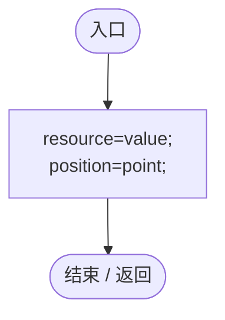

## FoodRevision.get · L22

`get`

### Editor / Player · Roslyn编译器控制流

项目内调用/回调引用：

- [ResourceCoordinates.Ensure · L26](93d731ac01e3af48.md#m343ad84ccd876750)（方法）

## Revision.get · L23

`get`

### Editor / Player · 语法控制结构 / 声明（非CFG）

## Revision.set · L23

`private set`

### Editor / Player · 语法控制结构 / 声明（非CFG）

## CandidateVisits.get · L23

`get`

### Editor / Player · 语法控制结构 / 声明（非CFG）

## CandidateVisits.set · L23

`private set`

### Editor / Player · 语法控制结构 / 声明（非CFG）

## Count.get · L24

`public static int Count`

### Editor / Player · 语法控制结构 / 声明（非CFG）

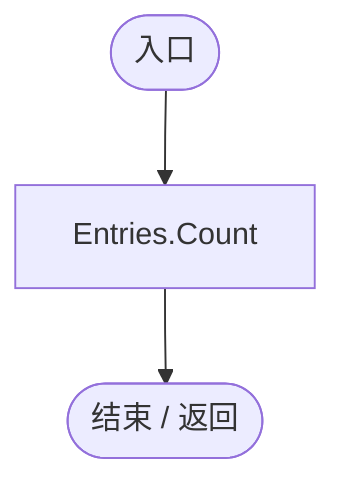

## Cell · L25

`private static Vector3Int Cell(Vector3 p)`

### Editor / Player · Roslyn编译器控制流

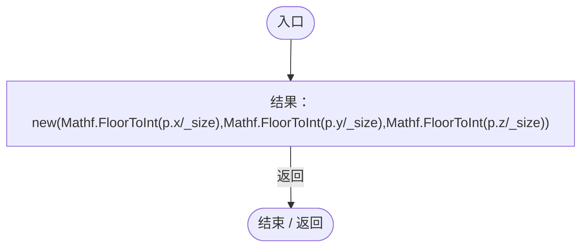

## Ensure · L26

`private static void Ensure()`

### Editor / Player · Roslyn编译器控制流

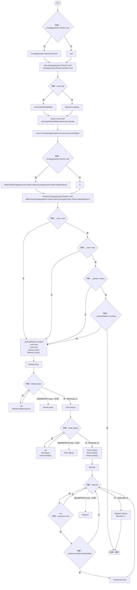

项目内调用/回调引用：

- [SimulationOptimization.Current.get · L23](11c9091e70893352.md#m354909aa8678017c)（访问器）
- [PlanetTerrainMeshBuilder.WaterRadius.get · L96](415285cf043354a9.md#md3a3867afb75f981)（访问器）
- [ResourceCoordinates.Insert · L38](93d731ac01e3af48.md#m885cb01ee4015eaa)（方法）
- [ResourceCoordinates.Revision.set · L23](93d731ac01e3af48.md#mca14a0c6d946e545)（访问器）
- [ResourceCoordinates.Revision.get · L23](93d731ac01e3af48.md#mc303de6a67098e6a)（访问器）

## SurfacePoint · L36

`private static Vector3 SurfacePoint(Vector3 point)`

### Editor / Player · Roslyn编译器控制流

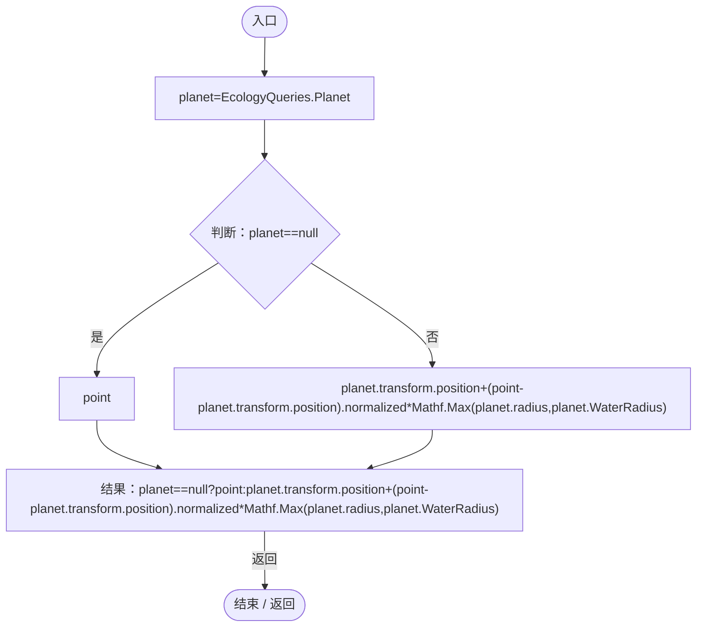

项目内调用/回调引用：

- [PlanetTerrainMeshBuilder.WaterRadius.get · L96](415285cf043354a9.md#md3a3867afb75f981)（访问器）

## Insert · L38

`private static void Insert(ColonyResource resource,Entry reuse=null)`

### Editor / Player · Roslyn编译器控制流

项目内调用/回调引用：

- [ColonyResource.State.get · L24](293dbaecfff4b585.md#m41824f1a0e160aa5)（访问器）
- [ResourceCoordinates.Cell · L25](93d731ac01e3af48.md#mf49ccc7a1ef0380e)（方法）
- [ResourceCoordinates.SurfacePoint · L36](93d731ac01e3af48.md#m591282d31c0bfafd)（方法）

## Observe · L44

`public static void Observe(ColonyResource resource)`

### Editor / Player · Roslyn编译器控制流

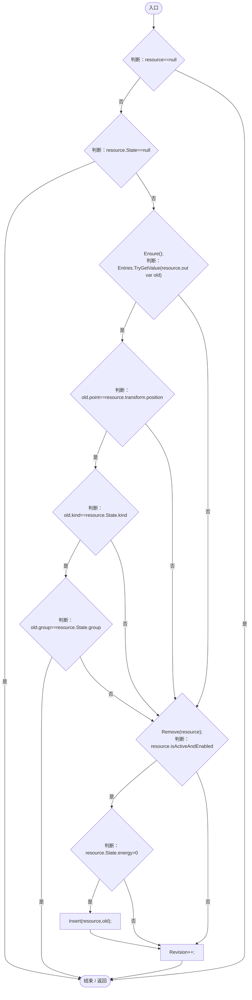

项目内调用/回调引用：

- [ColonyResource.State.get · L24](293dbaecfff4b585.md#m41824f1a0e160aa5)（访问器）
- [ResourceCoordinates.Ensure · L26](93d731ac01e3af48.md#m343ad84ccd876750)（方法）
- [ResourceCoordinates.Remove · L50](93d731ac01e3af48.md#m29ecd6e2a265fa8e)（方法）
- [ResourceCoordinates.Insert · L38](93d731ac01e3af48.md#m885cb01ee4015eaa)（方法）
- [ResourceCoordinates.Revision.set · L23](93d731ac01e3af48.md#mca14a0c6d946e545)（访问器）
- [ResourceCoordinates.Revision.get · L23](93d731ac01e3af48.md#mc303de6a67098e6a)（访问器）

## Remove · L50

`public static void Remove(ColonyResource resource)`

### Editor / Player · Roslyn编译器控制流

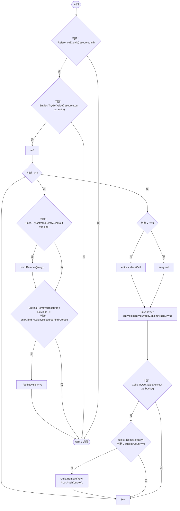

项目内调用/回调引用：

- [ResourceCoordinates.Revision.set · L23](93d731ac01e3af48.md#mca14a0c6d946e545)（访问器）
- [ResourceCoordinates.Revision.get · L23](93d731ac01e3af48.md#mc303de6a67098e6a)（访问器）

## BroadRadius · L57

`public static float BroadRadius(Vector3 point,float radius)`

★ 适配：活体仍保留原3D搜索半径；资源球面查询使用投影格，避免高山同方向资源漏检。

### Editor / Player · Roslyn编译器控制流

## Query · L58

`public static void Query(Vector3 point,float radius,bool surfaceDistance,bool corpses,List<ResourceCoordinate> result)`

### Editor / Player · Roslyn编译器控制流

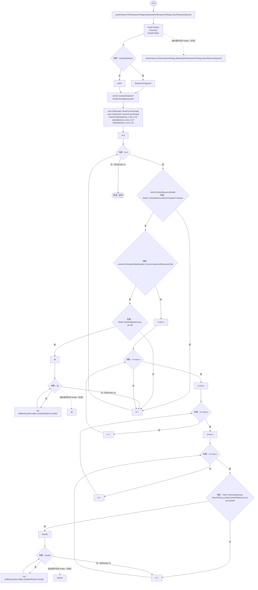

项目内调用/回调引用：

- [PerformanceTimings.Measure · L24](a8403a4c7503726d.md#m0ac3c3f9c550edb2)（方法）
- [ResourceCoordinates.Ensure · L26](93d731ac01e3af48.md#m343ad84ccd876750)（方法）
- [ResourceCoordinates.SurfacePoint · L36](93d731ac01e3af48.md#m591282d31c0bfafd)（方法）
- [ResourceCoordinates.Cell · L25](93d731ac01e3af48.md#mf49ccc7a1ef0380e)（方法）
- [SimulationOptimization.Current.get · L23](11c9091e70893352.md#m354909aa8678017c)（访问器）
- [ResourceCoordinates.Add · L70](93d731ac01e3af48.md#m6e4e30cbb6eafd34)（方法）

## Add · L70

`private static void Add(Entry entry,Vector3 point,float radius,bool surface,List<ResourceCoordinate> result)`

### Editor / Player · Roslyn编译器控制流

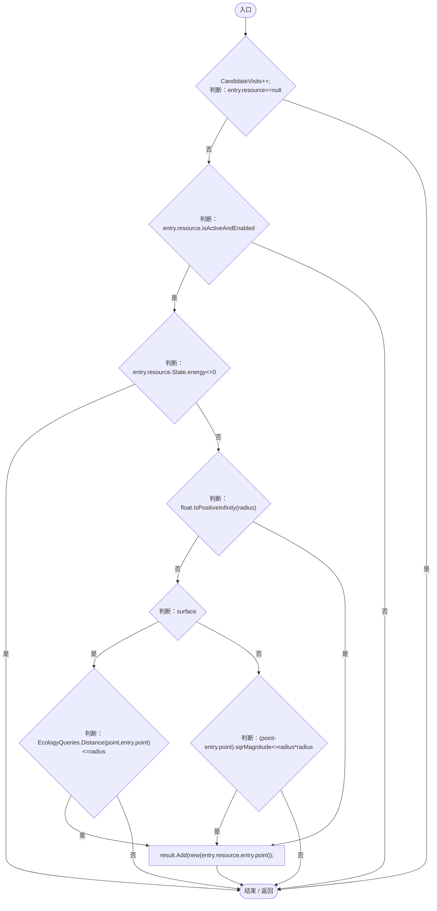

项目内调用/回调引用：

- [ResourceCoordinates.CandidateVisits.set · L23](93d731ac01e3af48.md#m232ee9e46856ec31)（访问器）
- [ResourceCoordinates.CandidateVisits.get · L23](93d731ac01e3af48.md#m1fe76c4d38a8a630)（访问器）
- [ColonyResource.State.get · L24](293dbaecfff4b585.md#m41824f1a0e160aa5)（访问器）
- [EcologyQueries.Distance · L42](bdf7ccc2c9c0452f.md#mba9c3e3c95d0f2dd)（方法）
- [ResourceCoordinate.ResourceCoordinate.ctor · L10](93d731ac01e3af48.md#ma4983fb1891a67cf)（构造函数）

## Food · L72

`public static void Food(List<ResourceCoordinate> result)`

### Editor / Player · Roslyn编译器控制流

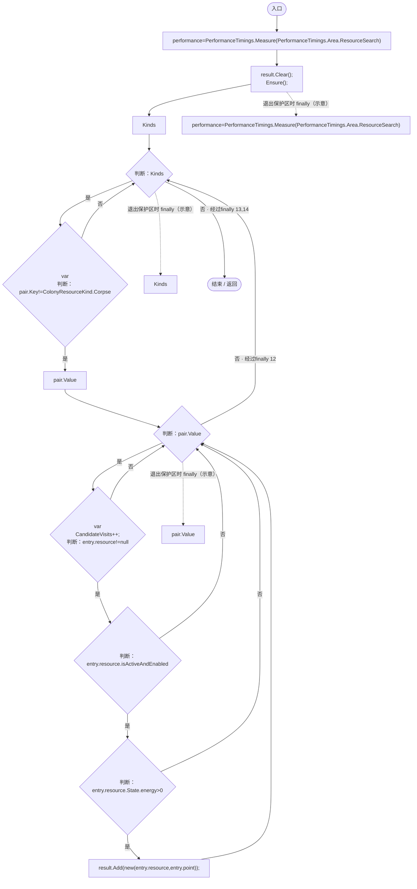

项目内调用/回调引用：

- [PerformanceTimings.Measure · L24](a8403a4c7503726d.md#m0ac3c3f9c550edb2)（方法）
- [ResourceCoordinates.Ensure · L26](93d731ac01e3af48.md#m343ad84ccd876750)（方法）
- [ResourceCoordinates.CandidateVisits.set · L23](93d731ac01e3af48.md#m232ee9e46856ec31)（访问器）
- [ResourceCoordinates.CandidateVisits.get · L23](93d731ac01e3af48.md#m1fe76c4d38a8a630)（访问器）
- [ColonyResource.State.get · L24](293dbaecfff4b585.md#m41824f1a0e160aa5)（访问器）
- [ResourceCoordinate.ResourceCoordinate.ctor · L10](93d731ac01e3af48.md#ma4983fb1891a67cf)（构造函数）

## Clear · L74

`public static void Clear()`

### Editor / Player · Roslyn编译器控制流

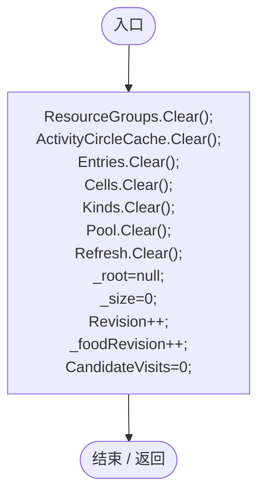

项目内调用/回调引用：

- [ResourceGroups.Clear · L17](97a3c8522367343a.md#m3f1ca4023b6e32cf)（方法）
- [ActivityCircleCache.Clear · L35](97a3c8522367343a.md#m11b41a2661adfeff)（方法）
- [ResourceCoordinates.Revision.set · L23](93d731ac01e3af48.md#mca14a0c6d946e545)（访问器）
- [ResourceCoordinates.Revision.get · L23](93d731ac01e3af48.md#mc303de6a67098e6a)（访问器）
- [ResourceCoordinates.CandidateVisits.set · L23](93d731ac01e3af48.md#m232ee9e46856ec31)（访问器）

## Reset · L75

`[RuntimeInitializeOnLoadMethod(RuntimeInitializeLoadType.SubsystemRegistration)]private static void Reset()`

### Editor / Player · Roslyn编译器控制流

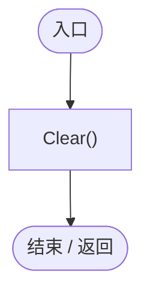

项目内调用/回调引用：

- [ResourceCoordinates.Clear · L74](93d731ac01e3af48.md#m747bfb1c7693a3c4)（方法）
