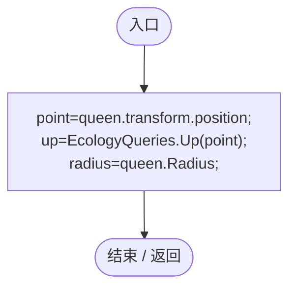
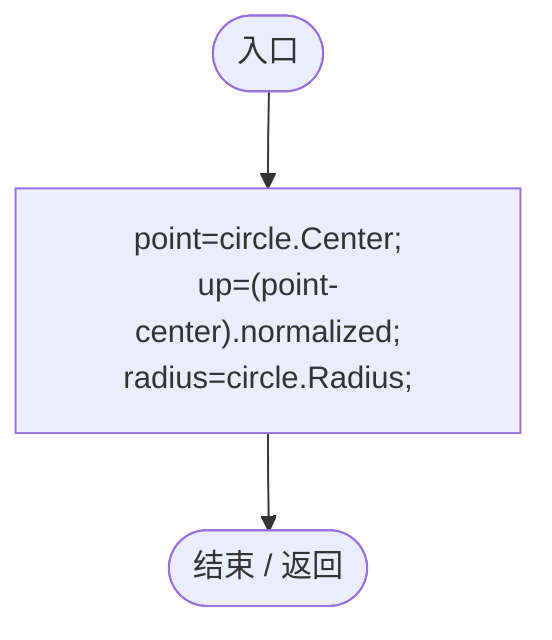
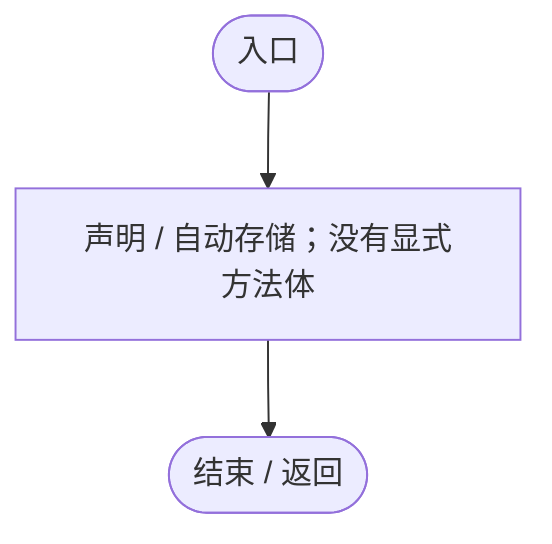
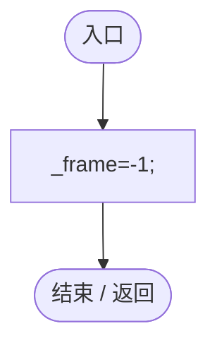
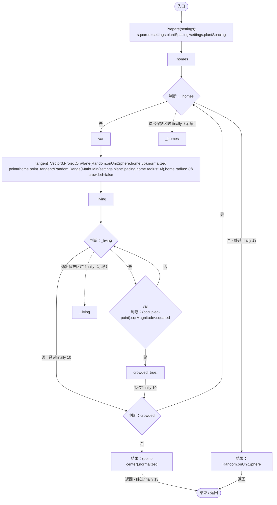

```mermaid
flowchart TD
  b0(["入口"])
  b1{"判断：_frame==Time.frameCount"}
  b2{"判断：_membership==EntityRegistry.MembershipRevision"}
  b3{"判断：ReferenceEquals(settings,_settings)"}
  b4{"判断：_target==settings.localProducerTarget"}
  b5["_living.Clear();<br/>_producers.Clear();<br/>_producerUps.Clear();<br/>_homes.Clear();<br/>planet=EcologyQueries.Planet<br/>spherical=planet!=null"]
  b6{"判断：spherical"}
  b7["planet.transform.position"]
  b8["Vector3.zero"]
  b9["center=spherical?planet.transform.position:Vector3.zero"]
  b10{"判断：spherical"}
  b11["Mathf.Max(planet.radius,planet.WaterRadius)"]
  b12["0"]
  b13["scale=spherical?Mathf.Max(planet.radius,planet.WaterRadius):0"]
  b14["EntityRegistry.All"]
  b15{"判断：EntityRegistry.All"}
  b16{"var<br/>判断：EcologyQueries.Alive(entity)"}
  b17{"point=entity.transform.position<br/>_living.Add(point);<br/>判断：EcologyEnergyBudget.IsProducer(entity.Genes)"}
  b18["_producers.Add(point);<br/>_producerUps.Add((point-center).normalized);"]
  b19{"判断：EntityRegistry.All"}
  b20["EntityRegistry.All"]
  b21["连接 / 离开区域"]
  b22["AntColonyMember.All"]
  b23{"判断：AntColonyMember.All"}
  b24["var"]
  b25{"判断：queen.Role!=AntRole.Queen"}
  b26{"判断：queen.State.founding"}
  b27["circles=ActivityCircleCache.Read(queen.Population)<br/>count=0<br/>_areas.Clear();"]
  b28["circles"]
  b29{"判断：circles"}
  b30["var<br/>_areas.Add(new Area(circle,center));"]
  b31{"判断：circles"}
  b32["circles"]
  b33["连接 / 离开区域"]
  b34["i=0"]
  b35{"判断：i&lt;_producers.Count"}
  b36["ProducerChecks++;<br/>inside=false"]
  b37["_areas"]
  b38{"判断：_areas"}
  b39["var"]
  b40{"判断：spherical"}
  b41["Mathf.Acos(Mathf.Clamp(Vector3.Dot(area.up,_producerUps[i]),-1,1))*scale"]
  b42["Vector3.Distance(area.point,_producers[i])"]
  b43["distance=spherical?Mathf.Acos(Mathf.Clamp(Vector3.Dot(area.up,_producerUps[i]),-1,1))*scale:Vector3.Distance(area.point,_producers[i])"]
  b44{"判断：distance&lt;=area.radius"}
  b45["inside=true;"]
  b46["_areas"]
  b47{"判断：inside"}
  b48{"判断：++count&gt;=settings.localProducerTarget"}
  b49["i++"]
  b50{"判断：count&lt;settings.localProducerTarget"}
  b51["_homes.Add(new Home(queen));"]
  b52{"判断：AntColonyMember.All"}
  b53["AntColonyMember.All"]
  b54["连接 / 离开区域"]
  b55["_frame=Time.frameCount;<br/>_membership=EntityRegistry.MembershipRevision;<br/>_settings=settings;<br/>_target=settings.localProducerTarget;<br/>Builds++;"]
  b56(["结束 / 返回"])
  b0 --> b1
  b1 -->|"是"| b2
  b1 -->|"否"| b5
  b2 -->|"是"| b3
  b2 -->|"否"| b5
  b3 -->|"是"| b4
  b3 -->|"否"| b5
  b4 -->|"是"| b56
  b4 -->|"否"| b5
  b5 --> b6
  b6 -->|"是"| b7
  b6 -->|"否"| b8
  b7 --> b9
  b8 --> b9
  b9 --> b10
  b10 -->|"是"| b11
  b10 -->|"否"| b12
  b11 --> b13
  b12 --> b13
  b13 --> b14
  b14 --> b15
  b15 -->|"是"| b16
  b15 -->|"否 · 经过finally 19"| b22
  b16 -->|"是"| b17
  b16 -->|"否"| b15
  b17 -->|"是"| b18
  b17 -->|"否"| b15
  b18 --> b15
  b19 -->|"否"| b20
  b19 -->|"是"| b21
  b20 --> b21
  b22 --> b23
  b23 -->|"是"| b24
  b23 -->|"否 · 经过finally 52"| b55
  b24 --> b25
  b25 -->|"否"| b26
  b25 -->|"是"| b23
  b26 -->|"是"| b23
  b26 -->|"否"| b27
  b27 --> b28
  b28 --> b29
  b29 -->|"是"| b30
  b29 -->|"否 · 经过finally 31"| b34
  b30 --> b29
  b31 -->|"否"| b32
  b31 -->|"是"| b33
  b32 --> b33
  b34 --> b35
  b35 -->|"是"| b36
  b35 -->|"否"| b50
  b36 --> b37
  b37 --> b38
  b38 -->|"是"| b39
  b38 -->|"否 · 经过finally 46"| b47
  b39 --> b40
  b40 -->|"是"| b41
  b40 -->|"否"| b42
  b41 --> b43
  b42 --> b43
  b43 --> b44
  b44 -->|"是"| b45
  b44 -->|"否"| b38
  b45 -->|"经过finally 46"| b47
  b47 -->|"是"| b48
  b47 -->|"否"| b49
  b48 -->|"是"| b50
  b48 -->|"否"| b49
  b49 --> b35
  b50 -->|"是"| b51
  b50 -->|"否"| b23
  b51 --> b23
  b52 -->|"否"| b53
  b52 -->|"是"| b54
  b53 --> b54
  b55 --> b56
  b15 -. "退出保护区时 finally（示意）" .-> b19
  b29 -. "退出保护区时 finally（示意）" .-> b31
  b38 -. "退出保护区时 finally（示意）" .-> b46
  b23 -. "退出保护区时 finally（示意）" .-> b52

```

# ProducerPlacementSnapshot.cs

[返回总索引](../README.md) · `Runtime` · `Assets/DarwinPark/Entities/Ecology/ProducerPlacementSnapshot.cs`

[源文件](../../../Assets/DarwinPark/Entities/Ecology/ProducerPlacementSnapshot.cs) · 源码校验：`eb3f7553a035c653a0158f1ff3eeae9eb29237105dabd97cf436dc105da3d234`

方法按源文件位置排列。事件/回调引用不表示立即执行；分支与异常说明见总索引。完整源码与可点击关系图请打开离线手册。

## Home.ctor · L9

`public Home(AntColonyMember queen)`

### Editor / Player · Roslyn编译器控制流

项目内调用/回调引用：

- [EcologyQueries.Up · L42](bdf7ccc2c9c0452f.md#ma73e6bbbc726282f)（方法）

## Area.ctor · L10

`public Area(ActivityCircle circle,Vector3 center)`

### Editor / Player · Roslyn编译器控制流

## Builds.get · L13

`get`

### Editor / Player · 语法控制结构 / 声明（非CFG）

## Builds.set · L13

`private set`

### Editor / Player · 语法控制结构 / 声明（非CFG）

## ProducerChecks.get · L13

`get`

### Editor / Player · 语法控制结构 / 声明（非CFG）

## ProducerChecks.set · L13

`private set`

### Editor / Player · 语法控制结构 / 声明（非CFG）

## Invalidate · L14

`public void Invalidate()`

### Editor / Player · Roslyn编译器控制流

## Prepare · L15

`private void Prepare(EcologyDefaultsSettings settings)`

### Editor / Player · Roslyn编译器控制流

项目内调用/回调引用：

- [EntityRegistry.MembershipRevision.get · L15](2093aaf08559c9f2.md#m6afb6f184d119e11)（访问器）
- [PlanetTerrainMeshBuilder.WaterRadius.get · L99](415285cf043354a9.md#m76719c213b06ba56)（访问器）
- [EcologyQueries.Alive · L39](bdf7ccc2c9c0452f.md#m8352bfacbe2996a8)（方法）
- [EcologyEnergyBudget.IsProducer · L27](06a91c8201f26593.md#mdf11c493dfe1c754)（方法）
- [DarwinEntity.Genes.get · L14](70798dde169f2e8b.md#m622eb1adf401d431)（访问器）
- [AntColonyMember.Role.get · L39](baebd85c05598377.md#mbe541ad55a93b0dd)（访问器）
- [AntColonyMember.State.get · L33](baebd85c05598377.md#ma804eb9f68138343)（访问器）
- [ActivityCircleCache.Read · L24](97a3c8522367343a.md#mef9553f88695636c)（方法）
- [AntColonyMember.Population.get · L36](baebd85c05598377.md#m3fa1d6d15c7c95ba)（访问器）
- [ProducerPlacementSnapshot.Area.Area.ctor · L10](94d51265e18d4726.md#m0a2a83d1d04ce199)（构造函数）
- [ProducerPlacementSnapshot.ProducerChecks.set · L13](94d51265e18d4726.md#m66ea60e8c37da36c)（访问器）
- [ProducerPlacementSnapshot.ProducerChecks.get · L13](94d51265e18d4726.md#m4ef3abca64f06223)（访问器）
- [ProducerPlacementSnapshot.Home.Home.ctor · L9](94d51265e18d4726.md#me2012b299020c7eb)（构造函数）
- [ProducerPlacementSnapshot.Builds.set · L13](94d51265e18d4726.md#m8ee20fff242fffad)（访问器）
- [ProducerPlacementSnapshot.Builds.get · L13](94d51265e18d4726.md#m139d0065fefec41d)（访问器）

## Direction · L35

`public Vector3 Direction(Vector3 center,EcologyDefaultsSettings settings)`

### Editor / Player · Roslyn编译器控制流

项目内调用/回调引用：

- [ProducerPlacementSnapshot.Prepare · L15](94d51265e18d4726.md#mf58415dd86a14d6d)（方法）
