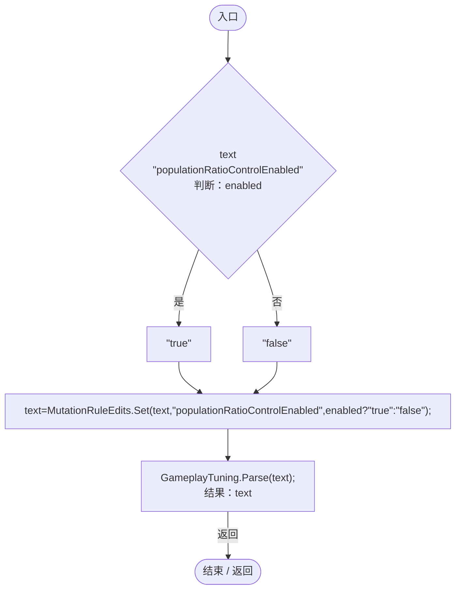

# PopulationRatioRuleEdits.cs

[返回总索引](../README.md) · `Runtime` · `Assets/DarwinPark/Core/PopulationRatioRuleEdits.cs`

[源文件](../../../Assets/DarwinPark/Core/PopulationRatioRuleEdits.cs) · 源码校验：`f15acd4b303d03e896bd9f359c870855d141cae587430b59fd89eece930ef806`

方法按源文件位置排列。事件/回调引用不表示立即执行；分支与异常说明见总索引。完整源码与可点击关系图请打开离线手册。

## Edit · L6

`public static string Edit(string text,bool enabled)`

### Editor / Player · Roslyn编译器控制流

项目内调用/回调引用：

- [MutationRuleEdits.Set · L17](063e584187dad139.md#mb57ff937cff59680)（方法）
- [GameplayTuning.Parse · L47](db546e5713b32d53.md#ma257d3ec126af87c)（方法）
