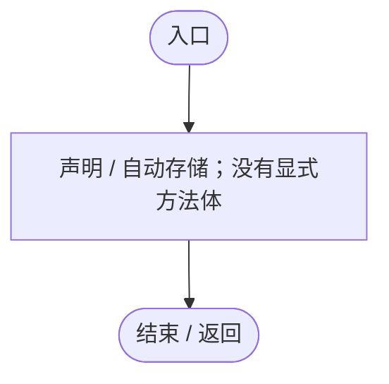
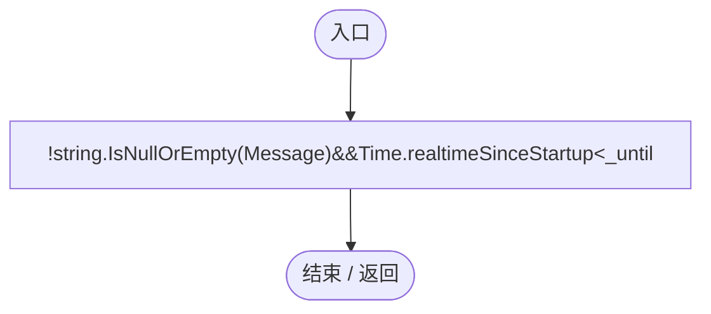
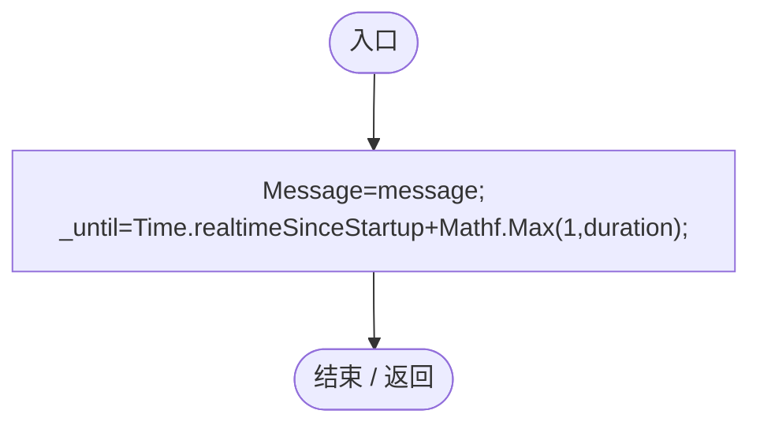
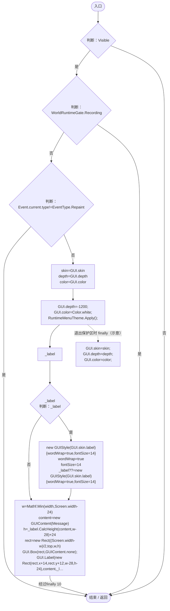

# PerformanceCaptureNotice.cs

[返回总索引](../README.md) · `Runtime` · `Assets/DarwinPark/UI/PerformanceCaptureNotice.cs`

[源文件](../../../Assets/DarwinPark/UI/PerformanceCaptureNotice.cs) · 源码校验：`84c8fd310f9892cd3dafd97862cedc072f5fc1bb09006d841f3c047b871fa5ab`

方法按源文件位置排列。事件/回调引用不表示立即执行；分支与异常说明见总索引。完整源码与可点击关系图请打开离线手册。

## Message.get · L9

`get`

### Editor / Player · 语法控制结构 / 声明（非CFG）

## Message.set · L9

`private set`

### Editor / Player · 语法控制结构 / 声明（非CFG）

## Visible.get · L11

`public bool Visible`

### Editor / Player · 语法控制结构 / 声明（非CFG）

项目内调用/回调引用：

- [PerformanceCaptureNotice.Message.get · L9](9586755aef05e502.md#mc72d829d8f12a271)（访问器）

## Show · L12

`public void Show(string message)`

### Editor / Player · Roslyn编译器控制流

项目内调用/回调引用：

- [PerformanceCaptureNotice.Message.set · L9](9586755aef05e502.md#m9795daa2ce018caf)（访问器）

## OnGUI · L13

`private void OnGUI()`

### Editor / Player · Roslyn编译器控制流

项目内调用/回调引用：

- [RuntimeMenuTheme.Apply · L39](b9d8455882f2a532.md#m587a63eff5a85605)（方法）
- [PerformanceCaptureNotice.Message.get · L9](9586755aef05e502.md#mc72d829d8f12a271)（访问器）
