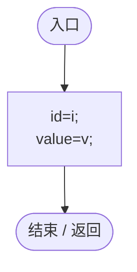
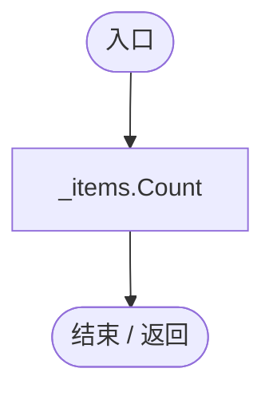
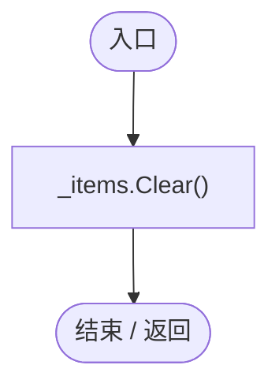
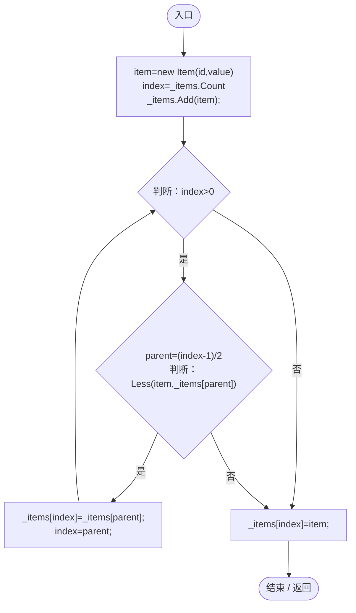
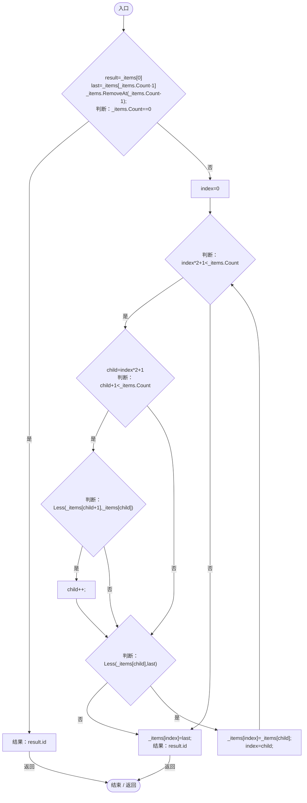

# SurfaceMinHeap.cs

[返回总索引](../README.md) · `Runtime` · `Assets/DarwinPark/Planet/Terrain/SurfaceMinHeap.cs`

[源文件](../../../Assets/DarwinPark/Planet/Terrain/SurfaceMinHeap.cs) · 源码校验：`4da27a87517e04f63d0ea094255bbc10e42b33992e23736cee1408530c8a7ee3`

方法按源文件位置排列。事件/回调引用不表示立即执行；分支与异常说明见总索引。完整源码与可点击关系图请打开离线手册。

## Item.ctor · L7

`public Item(int i,float v)`

### Editor / Player · Roslyn编译器控制流

## Count.get · L8

`public int Count`

### Editor / Player · 语法控制结构 / 声明（非CFG）

## Clear · L9

`public void Clear()`

### Editor / Player · Roslyn编译器控制流

## Less · L10

`private static bool Less(Item a,Item b)`

### Editor / Player · Roslyn编译器控制流

```mermaid
flowchart TD
  b0(["入口"])
  b1{"判断：a.value&lt;b.value"}
  b2{"判断：a.value==b.value"}
  b3["a.id&lt;b.id"]
  b4["a.value==b.value"]
  b5["a.value&lt;b.value"]
  b6["结果：a.value&lt;b.value&#124;&#124;a.value==b.value&amp;&amp;a.id&lt;b.id"]
  b7(["结束 / 返回"])
  b0 --> b1
  b1 -->|"否"| b2
  b1 -->|"是"| b5
  b2 -->|"是"| b3
  b2 -->|"否"| b4
  b3 --> b6
  b4 --> b6
  b5 --> b6
  b6 -->|"返回"| b7

```

## Push · L11

`public void Push(int id,float value)`

### Editor / Player · Roslyn编译器控制流

项目内调用/回调引用：

- [SurfaceMinHeap.Item.Item.ctor · L7](958cbffd86775bce.md#m4591d0422b7e61d8)（构造函数）
- [SurfaceMinHeap.Less · L10](958cbffd86775bce.md#md271c23e688f7d03)（方法）

## Pop · L12

`public int Pop()`

### Editor / Player · Roslyn编译器控制流

项目内调用/回调引用：

- [SurfaceMinHeap.Less · L10](958cbffd86775bce.md#md271c23e688f7d03)（方法）
