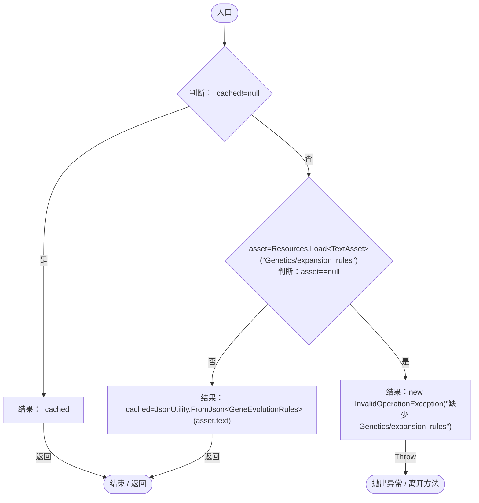
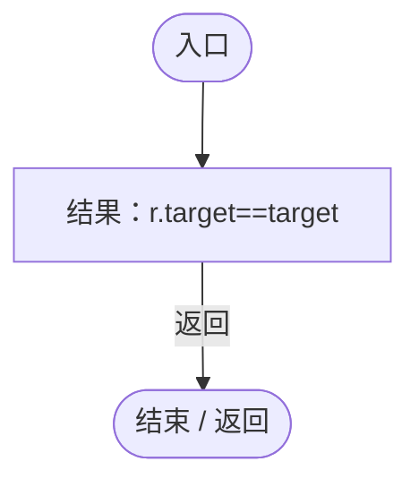
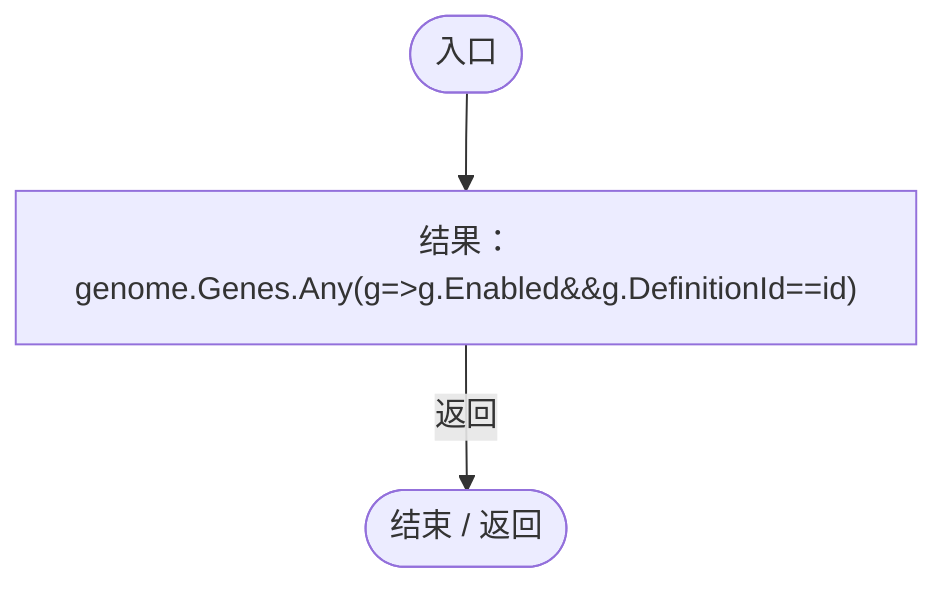
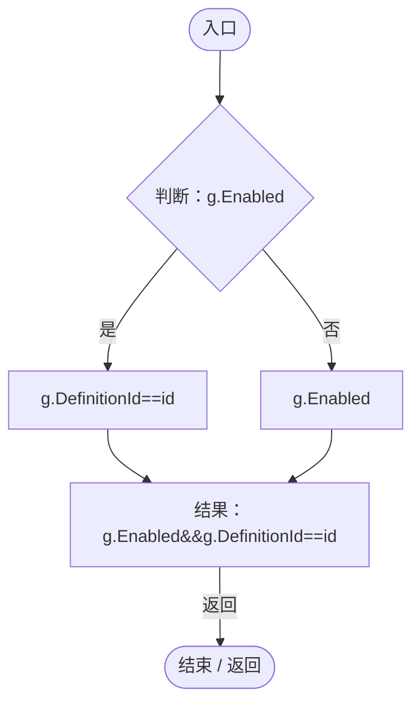

```mermaid
flowchart TD
  b0(["入口"])
  b1{"rules=Load().requirements.Where(r=&gt;r.target==target).ToArray()<br/>判断：rules.Length==0"}
  b2["结果：true"]
  b3["结果：rules.Any(r=&gt;r.source==source&amp;&amp;r.kind==kind&amp;&amp;(float.IsNaN(value)&#124;&#124;((r.minExclusive?value&gt;r.minValue:value&gt;=r.minValue)&amp;&amp;value&lt;=r.maxValue))&amp;&amp; (genome==null&#124;&#124;r.requiredGenes.All(id=&gt;genome.Genes.Any(g=&gt;g.Enabled&amp;&amp;g.DefinitionId==id))))"]
  b4(["结束 / 返回"])
  b0 --> b1
  b1 -->|"是"| b2
  b1 -->|"否"| b3
  b2 -->|"返回"| b4
  b3 -->|"返回"| b4

```

```mermaid
flowchart TD
  b0(["入口"])
  b1{"判断：r.source==source"}
  b2{"判断：r.kind==kind"}
  b3{"判断：float.IsNaN(value)"}
  b4{"判断：r.minExclusive"}
  b5{"判断：value&gt;r.minValue"}
  b6{"判断：value&gt;=r.minValue"}
  b7{"判断：value&lt;=r.maxValue"}
  b8{"判断：genome==null"}
  b9["r.requiredGenes.All(id=&gt;genome.Genes.Any(g=&gt;g.Enabled&amp;&amp;g.DefinitionId==id))"]
  b10["genome==null"]
  b11["r.source==source&amp;&amp;r.kind==kind&amp;&amp;(float.IsNaN(value)&#124;&#124;((r.minExclusive?value&gt;r.minValue:value&gt;=r.minValue)&amp;&amp;value&lt;=r.maxValue))&amp;&amp; (genome==null&#124;&#124;r.requiredGenes.All(id=&gt;genome.Genes.Any(g=&gt;g.Enabled&amp;&amp;g.DefinitionId==id)))"]
  b12["结果：r.source==source&amp;&amp;r.kind==kind&amp;&amp;(float.IsNaN(value)&#124;&#124;((r.minExclusive?value&gt;r.minValue:value&gt;=r.minValue)&amp;&amp;value&lt;=r.maxValue))&amp;&amp; (genome==null&#124;&#124;r.requiredGenes.All(id=&gt;genome.Genes.Any(g=&gt;g.Enabled&amp;&amp;g.DefinitionId==id)))"]
  b13(["结束 / 返回"])
  b0 --> b1
  b1 -->|"是"| b2
  b1 -->|"否"| b11
  b2 -->|"是"| b3
  b2 -->|"否"| b11
  b3 -->|"否"| b4
  b3 -->|"是"| b8
  b4 -->|"是"| b5
  b4 -->|"否"| b6
  b5 -->|"是"| b7
  b5 -->|"否"| b11
  b6 -->|"是"| b7
  b6 -->|"否"| b11
  b7 -->|"是"| b8
  b7 -->|"否"| b11
  b8 -->|"否"| b9
  b8 -->|"是"| b10
  b9 --> b12
  b10 --> b12
  b11 --> b12
  b12 -->|"返回"| b13

```

# GeneEvolutionRules.cs

[返回总索引](../README.md) · `Runtime` · `Assets/DarwinPark/Genetics/GeneEvolutionRules.cs`

[源文件](../../../Assets/DarwinPark/Genetics/GeneEvolutionRules.cs) · 源码校验：`0d05caae8c7834503ff4f67c2bd0e840da894d29a8002c51867040ab360a1a62`

方法按源文件位置排列。事件/回调引用不表示立即执行；分支与异常说明见总索引。完整源码与可点击关系图请打开离线手册。

## Load · L18

`public static GeneEvolutionRules Load()`

★ 新增：特殊演化条件独立配置；工具连线与自然变异使用相同约束，不能把寄生连到任意基因。

### Editor / Player · Roslyn编译器控制流

## Allows · L25

`public static bool Allows(string source,string target,string kind,float value,Genome genome=null)`

### Editor / Player · Roslyn编译器控制流

项目内调用/回调引用：

- [GeneEvolutionRules.Load · L18](95d3abc5e23f05d3.md#m12ff68e2dee2f640)（方法）
- [GeneEvolutionRules.回调@27 · L27](95d3abc5e23f05d3.md#mfbba19bd0f26f764)（回调/委托）
- [GeneEvolutionRules.回调@29 · L29](95d3abc5e23f05d3.md#m16e3f3b27c9d0324)（回调/委托）

## 回调@27 · L27

`r … => 回调`

### Editor / Player · Roslyn编译器控制流

## 回调@29 · L29

`r … => 回调`

### Editor / Player · Roslyn编译器控制流

项目内调用/回调引用：

- [GeneEvolutionRules.回调@30 · L30](95d3abc5e23f05d3.md#m0854958d532f4d2b)（回调/委托）

## 回调@30 · L30

`id … => 回调`

### Editor / Player · Roslyn编译器控制流

项目内调用/回调引用：

- [GeneEvolutionRules.回调@30 · L30](95d3abc5e23f05d3.md#m2ef699361bdb5308)（回调/委托）

## 回调@30 · L30

`g … => 回调`

### Editor / Player · Roslyn编译器控制流

