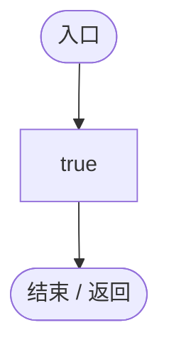
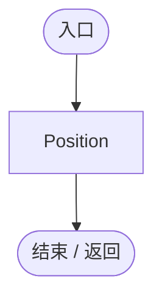
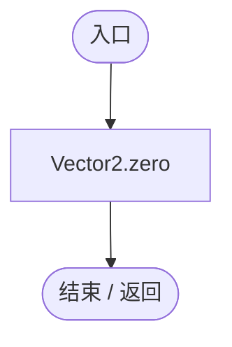
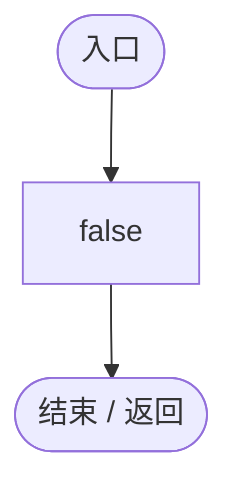
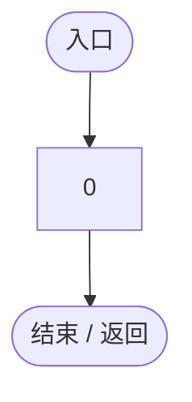
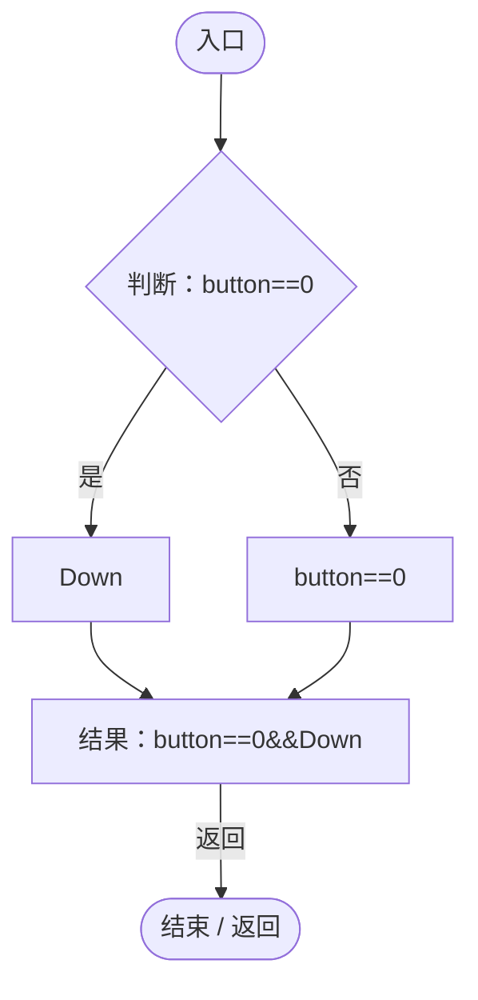
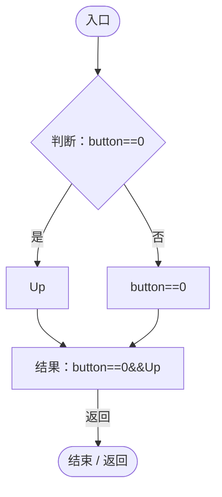
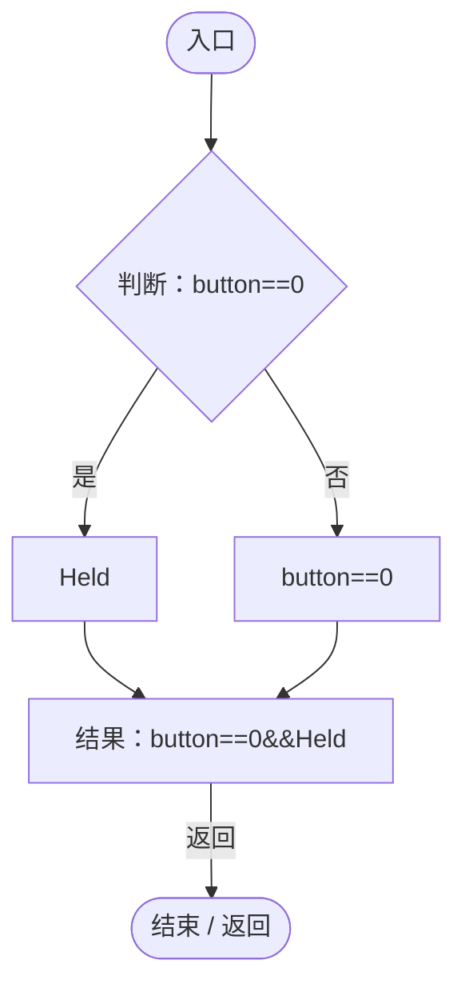
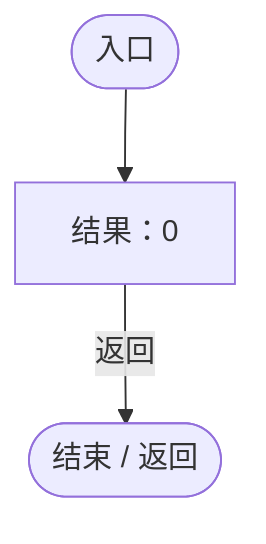
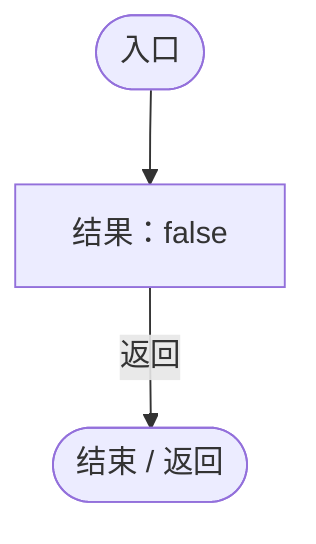

# HudRegressionInput.cs

[返回总索引](../README.md) · `Runtime` · `Assets/DarwinPark/UI/HudRegressionInput.cs`

[源文件](../../../Assets/DarwinPark/UI/HudRegressionInput.cs) · 源码校验：`87013360f0b1dec5823e228c82617db8edc86aa0c9f6327b844923304c2db7b9`

方法按源文件位置排列。事件/回调引用不表示立即执行；分支与异常说明见总索引。完整源码与可点击关系图请打开离线手册。

## mousePresent.get · L11

`public override bool mousePresent`

### Editor · 语法控制结构 / 声明（非CFG）

## mousePosition.get · L12

`public override Vector2 mousePosition`

### Editor · 语法控制结构 / 声明（非CFG）

## mouseScrollDelta.get · L13

`public override Vector2 mouseScrollDelta`

### Editor · 语法控制结构 / 声明（非CFG）

## touchSupported.get · L14

`public override bool touchSupported`

### Editor · 语法控制结构 / 声明（非CFG）

## touchCount.get · L15

`public override int touchCount`

### Editor · 语法控制结构 / 声明（非CFG）

## GetMouseButtonDown · L16

`public override bool GetMouseButtonDown(int button)`

### Editor · Roslyn编译器控制流

## GetMouseButtonUp · L17

`public override bool GetMouseButtonUp(int button)`

### Editor · Roslyn编译器控制流

## GetMouseButton · L18

`public override bool GetMouseButton(int button)`

### Editor · Roslyn编译器控制流

## GetAxisRaw · L19

`public override float GetAxisRaw(string axisName)`

### Editor · Roslyn编译器控制流

## GetButtonDown · L20

`public override bool GetButtonDown(string buttonName)`

### Editor · Roslyn编译器控制流

