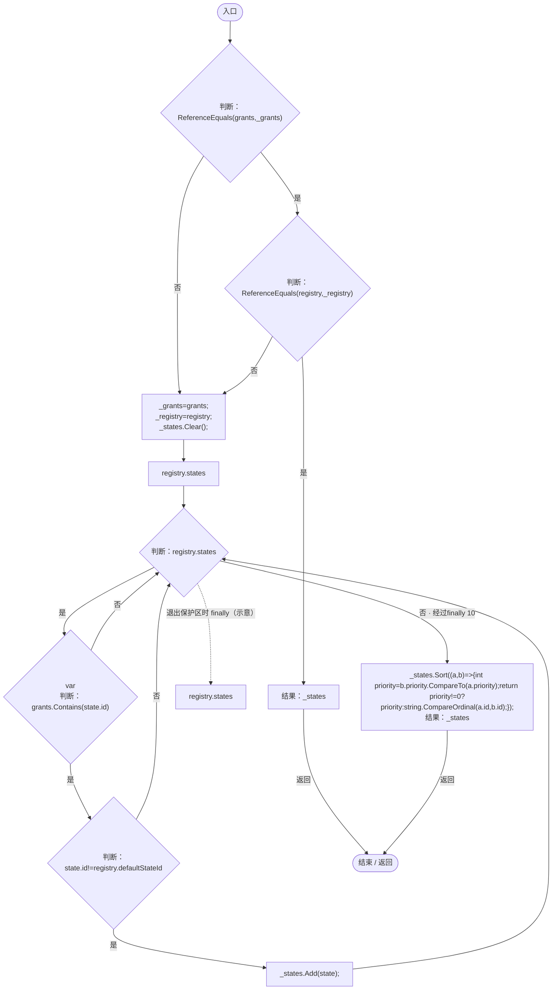
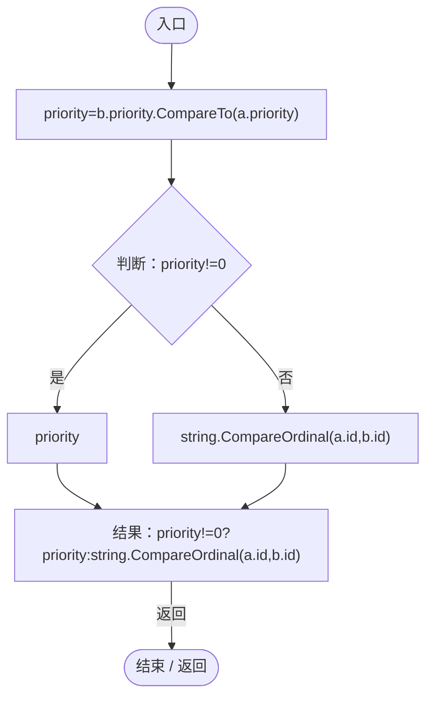

# StatePriorityCache.cs

[返回总索引](../README.md) · `Runtime` · `Assets/DarwinPark/Entities/Ecology/StatePriorityCache.cs`

[源文件](../../../Assets/DarwinPark/Entities/Ecology/StatePriorityCache.cs) · 源码校验：`02a199b9c9eff18099e922a1256939d403b32115d5d9d486cd39ffb90cf6b7e3`

方法按源文件位置排列。事件/回调引用不表示立即执行；分支与异常说明见总索引。完整源码与可点击关系图请打开离线手册。

## Read · L8

`public IReadOnlyList<DarwinPark.Genetics.EntityStateDefinition> Read(HashSet<string> grants,DarwinPark.Genetics.EntityStateDocument registry)`

### Editor / Player · Roslyn编译器控制流

项目内调用/回调引用：

- [StatePriorityCache.回调@9 · L9](96e08a1a0ab523b5.md#m242bc7868b7c22d6)（回调/委托）

## 回调@9 · L9

`( … => 回调`

### Editor / Player · Roslyn编译器控制流

