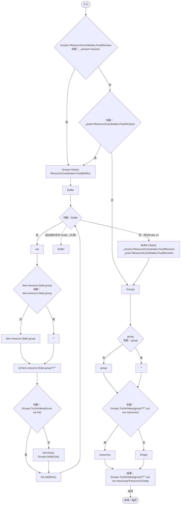
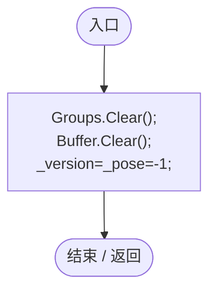
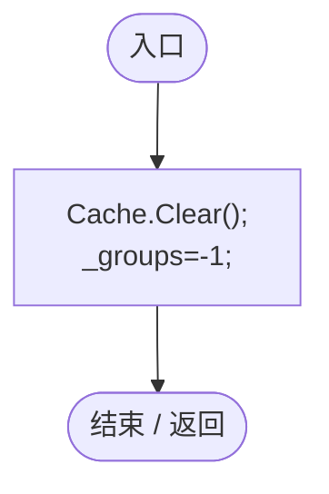

```mermaid
flowchart TD
  b0(["入口"])
  b1{"判断：_groups!=PopulationGroupIndex.Revision"}
  b2["Cache.Clear();<br/>_groups=PopulationGroupIndex.Revision;"]
  b3{"判断：pop==null"}
  b4{"判断：pop.Active"}
  b5["结果：System.Array.Empty&lt;ActivityCircle&gt;()"]
  b6["queen=AntColonyMember.QueenFor(pop)"]
  b7{"判断：queen!=null"}
  b8["queen.Population"]
  b9["pop.Leader"]
  b10["leader=queen!=null?queen.Population:pop.Leader"]
  b11{"判断：leader==null"}
  b12["结果：System.Array.Empty&lt;ActivityCircle&gt;()"]
  b13{"判断：queen!=null"}
  b14["queen.Radius"]
  b15["Mathf.Max(AntColonySettings.Current.minimumColonyRadius,leader.GetComponent&lt;EntityGeneController&gt;().GetAttribute(&quot;territory_radius&quot;))*DarwinPark.Core.GameplayTuning.Current.colonyActivityRadiusMultiplier"]
  b16["radius=queen!=null?queen.Radius:Mathf.Max(AntColonySettings.Current.minimumColonyRadius,leader.GetComponent&lt;EntityGeneController&gt;().GetAttribute(&quot;territory_radius&quot;))*DarwinPark.Core.GameplayTuning.Current.colonyActivityRadiusMultiplier"]
  b17{"pop.GroupId<br/>判断：pop.GroupId"}
  b18["pop.GroupId"]
  b19["&quot;&quot;"]
  b20["key=pop.GroupId??&quot;&quot;"]
  b21{"判断：Cache.TryGetValue(key,out var entry)"}
  b22["entry=new();<br/>Cache.Add(key,entry);"]
  b23{"ratio=DarwinPark.Core.GameplayTuning.Current.supplyActivityRadiusRatio<br/>food=ResourceCoordinates.FoodRevision<br/>判断：entry.leader==leader"}
  b24{"判断：entry.point==leader.transform.position"}
  b25{"判断：entry.radius==radius"}
  b26{"判断：entry.ratio==ratio"}
  b27{"判断：entry.food==food"}
  b28{"判断：entry.pose==ResourceCoordinates.PoseRevision"}
  b29{"判断：entry.queen==(queen!=null)"}
  b30["结果：entry.circles"]
  b31{"entry.leader=leader;<br/>entry.point=leader.transform.position;<br/>entry.radius=radius;<br/>entry.ratio=ratio;<br/>entry.food=food;<br/>entry.pose=ResourceCoordinates.PoseRevision;<br/>entry.queen=queen!=null;<br/>entry.circles.Clear();<br/>entry.circles.Add(new Activ…"}
  b32["ResourceGroups.Read(pop.GroupId)"]
  b33{"判断：ResourceGroups.Read(pop.GroupId)"}
  b34["var"]
  b35{"resource=item.resource<br/>判断：resource.State.energy&lt;=0"}
  b36{"判断：resource.State.kind!=ColonyResourceKind.Supply"}
  b37{"判断：resource.State.kind!=ColonyResourceKind.Nursery"}
  b38{"判断：Mathf.Approximately(radius,radius*ratio)"}
  b39{"判断：Vector3.Distance(item.position,entry.point)&lt;.01f"}
  b40["entry.circles.Add(new ActivityCircle(&quot;resource-&quot;+resource.State.id,item.position,radius*ratio));"]
  b41{"判断：ResourceGroups.Read(pop.GroupId)"}
  b42["ResourceGroups.Read(pop.GroupId)"]
  b43["连接 / 离开区域"]
  b44["结果：entry.circles"]
  b45(["结束 / 返回"])
  b0 --> b1
  b1 -->|"是"| b2
  b1 -->|"否"| b3
  b2 --> b3
  b3 -->|"否"| b4
  b3 -->|"是"| b5
  b4 -->|"否"| b5
  b4 -->|"是"| b6
  b5 -->|"返回"| b45
  b6 --> b7
  b7 -->|"是"| b8
  b7 -->|"否"| b9
  b8 --> b10
  b9 --> b10
  b10 --> b11
  b11 -->|"是"| b12
  b11 -->|"否"| b13
  b12 -->|"返回"| b45
  b13 -->|"是"| b14
  b13 -->|"否"| b15
  b14 --> b16
  b15 --> b16
  b16 --> b17
  b17 -->|"否"| b18
  b17 -->|"是"| b19
  b18 --> b20
  b19 --> b20
  b20 --> b21
  b21 -->|"否"| b22
  b21 -->|"是"| b23
  b22 --> b23
  b23 -->|"是"| b24
  b23 -->|"否"| b31
  b24 -->|"是"| b25
  b24 -->|"否"| b31
  b25 -->|"是"| b26
  b25 -->|"否"| b31
  b26 -->|"是"| b27
  b26 -->|"否"| b31
  b27 -->|"是"| b28
  b27 -->|"否"| b31
  b28 -->|"是"| b29
  b28 -->|"否"| b31
  b29 -->|"是"| b30
  b29 -->|"否"| b31
  b30 -->|"返回"| b45
  b31 -->|"是"| b32
  b31 -->|"否"| b44
  b32 --> b33
  b33 -->|"是"| b34
  b33 -->|"否 · 经过finally 41"| b44
  b34 --> b35
  b35 -->|"否"| b36
  b35 -->|"是"| b33
  b36 -->|"是"| b37
  b36 -->|"否"| b38
  b37 -->|"是"| b33
  b37 -->|"否"| b38
  b38 -->|"是"| b39
  b38 -->|"否"| b40
  b39 -->|"是"| b33
  b39 -->|"否"| b40
  b40 --> b33
  b41 -->|"否"| b42
  b41 -->|"是"| b43
  b42 --> b43
  b44 -->|"返回"| b45
  b33 -. "退出保护区时 finally（示意）" .-> b41

```

# ResourceGroups.cs

[返回总索引](../README.md) · `Runtime` · `Assets/DarwinPark/Entities/Ecology/ResourceGroups.cs`

[源文件](../../../Assets/DarwinPark/Entities/Ecology/ResourceGroups.cs) · 源码校验：`f3dc0e69fbc143c057881299097033aa8fe1c0af35592ca4991a18c52368434d`

方法按源文件位置排列。事件/回调引用不表示立即执行；分支与异常说明见总索引。完整源码与可点击关系图请打开离线手册。

## Read · L9

`public static IReadOnlyList<ResourceCoordinate> Read(string group)`

### Editor / Player · Roslyn编译器控制流

项目内调用/回调引用：

- [ResourceCoordinates.FoodRevision.get · L29](93d731ac01e3af48.md#m440fe2044b08481a)（访问器）
- [ResourceCoordinates.PoseRevision.get · L23](93d731ac01e3af48.md#m078a94a2ebef07d3)（访问器）
- [ResourceCoordinates.Food · L90](93d731ac01e3af48.md#mac62f72f9d561756)（方法）
- [ColonyResource.State.get · L24](293dbaecfff4b585.md#m41824f1a0e160aa5)（访问器）

## Has · L16

`public static bool Has(string group,ColonyResourceKind kind)`

### Editor / Player · Roslyn编译器控制流

项目内调用/回调引用：

- [ResourceGroups.Read · L9](97a3c8522367343a.md#m155d5ab724041bf7)（方法）
- [ColonyResource.State.get · L24](293dbaecfff4b585.md#m41824f1a0e160aa5)（访问器）

## Clear · L17

`public static void Clear()`

### Editor / Player · Roslyn编译器控制流

## Reset · L18

`[RuntimeInitializeOnLoadMethod(RuntimeInitializeLoadType.SubsystemRegistration)]private static void Reset()`

### Editor / Player · Roslyn编译器控制流

项目内调用/回调引用：

- [ResourceGroups.Clear · L17](97a3c8522367343a.md#mc79d59f34ad5a39b)（方法）

## Read · L24

`public static IReadOnlyList<ActivityCircle> Read(PopulationBehavior pop)`

### Editor / Player · Roslyn编译器控制流

项目内调用/回调引用：

- [PopulationGroupIndex.Revision.get · L20](6bb343d8be5beae5.md#m54a3b3992914501f)（访问器）
- [AntColonyMember.QueenFor · L62](baebd85c05598377.md#m6ee49d38283d34d1)（方法）
- [AntColonyMember.Population.get · L37](baebd85c05598377.md#m8a87d3d378490df9)（访问器）
- [AntColonySettings.Current.get · L31](cb0a937e97c8fbb3.md#mcd121159f407ccdf)（访问器）
- [EntityGeneController.GetAttribute · L288](7494d53178552f0e.md#m45127bcdd833aaf5)（方法）
- [GameplayTuning.Current.get · L46](db546e5713b32d53.md#m4fa691bd8a3b9618)（访问器）
- [PopulationBehavior.GroupId.get · L22](21e4f62f75a9a80f.md#me471d0106be463ca)（访问器）
- [ResourceCoordinates.FoodRevision.get · L29](93d731ac01e3af48.md#m440fe2044b08481a)（访问器）
- [ResourceCoordinates.PoseRevision.get · L23](93d731ac01e3af48.md#m078a94a2ebef07d3)（访问器）
- [ActivityCircle.ActivityCircle.ctor · L10](e8d854132f563257.md#m7ad6684817aa9fd4)（构造函数）
- [ResourceGroups.Read · L9](97a3c8522367343a.md#m155d5ab724041bf7)（方法）
- [ColonyResource.State.get · L24](293dbaecfff4b585.md#m41824f1a0e160aa5)（访问器）

## Clear · L35

`public static void Clear()`

### Editor / Player · Roslyn编译器控制流

## Reset · L36

`[RuntimeInitializeOnLoadMethod(RuntimeInitializeLoadType.SubsystemRegistration)]private static void Reset()`

### Editor / Player · Roslyn编译器控制流

项目内调用/回调引用：

- [ActivityCircleCache.Clear · L35](97a3c8522367343a.md#mf3f13c933d2a6e05)（方法）
