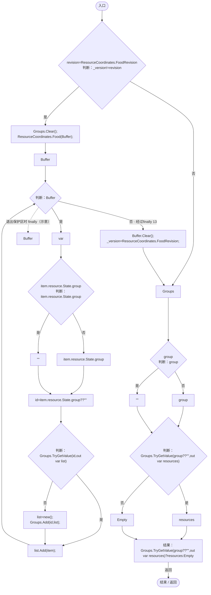
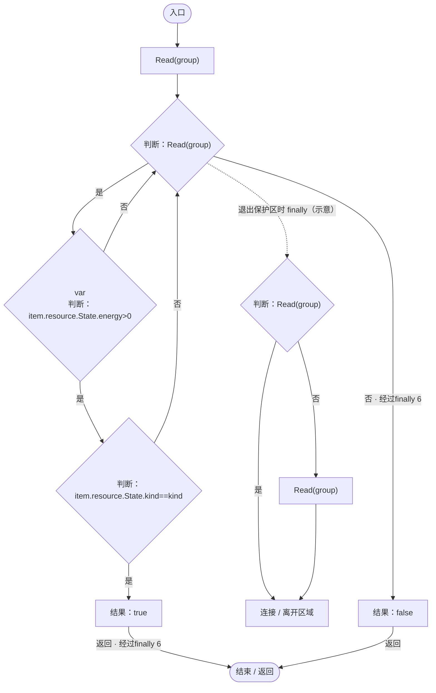
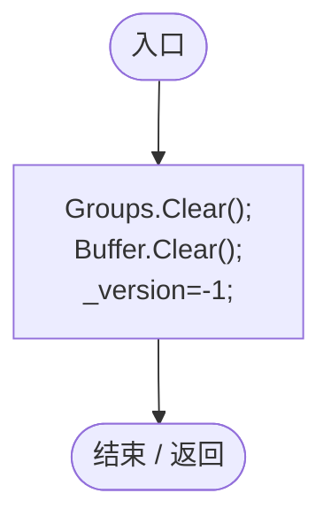
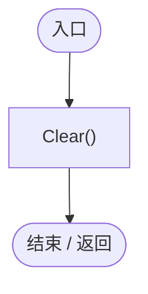

```mermaid
flowchart TD
  b0(["入口"])
  b1{"判断：_groups!=PopulationGroupIndex.Revision"}
  b2["Cache.Clear();<br/>_groups=PopulationGroupIndex.Revision;"]
  b3{"判断：pop==null"}
  b4{"判断：pop.Active"}
  b5["结果：System.Array.Empty&lt;ActivityCircle&gt;()"]
  b6["queen=AntColonyMember.QueenFor(pop)"]
  b7{"判断：queen!=null"}
  b8["queen.Population"]
  b9["pop.Leader"]
  b10["leader=queen!=null?queen.Population:pop.Leader"]
  b11{"判断：leader==null"}
  b12["结果：System.Array.Empty&lt;ActivityCircle&gt;()"]
  b13{"判断：queen!=null"}
  b14["queen.Radius"]
  b15["Mathf.Max(AntColonySettings.Current.minimumColonyRadius,leader.GetComponent&lt;EntityGeneController&gt;().GetAttribute(&quot;territory_radius&quot;))*DarwinPark.Core.GameplayTuning.Current.colonyActivityRadiusMultiplier"]
  b16["radius=queen!=null?queen.Radius:Mathf.Max(AntColonySettings.Current.minimumColonyRadius,leader.GetComponent&lt;EntityGeneController&gt;().GetAttribute(&quot;territory_radius&quot;))*DarwinPark.Core.GameplayTuning.Current.colonyActivityRadiusMultiplier"]
  b17{"pop.GroupId<br/>判断：pop.GroupId"}
  b18["pop.GroupId"]
  b19["&quot;&quot;"]
  b20["key=pop.GroupId??&quot;&quot;"]
  b21{"判断：Cache.TryGetValue(key,out var entry)"}
  b22["entry=new();<br/>Cache.Add(key,entry);"]
  b23{"ratio=DarwinPark.Core.GameplayTuning.Current.supplyActivityRadiusRatio<br/>food=ResourceCoordinates.FoodRevision<br/>判断：entry.leader==leader"}
  b24{"判断：entry.point==leader.transform.position"}
  b25{"判断：entry.radius==radius"}
  b26{"判断：entry.ratio==ratio"}
  b27{"判断：entry.food==food"}
  b28{"判断：entry.queen==(queen!=null)"}
  b29["结果：entry.circles"]
  b30{"entry.leader=leader;<br/>entry.point=leader.transform.position;<br/>entry.radius=radius;<br/>entry.ratio=ratio;<br/>entry.food=food;<br/>entry.queen=queen!=null;<br/>entry.circles.Clear();<br/>entry.circles.Add(new ActivityCircle(&quot;leader&quot;,entry.point,radius));<br/>判断：q…"}
  b31["ResourceGroups.Read(pop.GroupId)"]
  b32{"判断：ResourceGroups.Read(pop.GroupId)"}
  b33["var"]
  b34{"resource=item.resource<br/>判断：resource.State.energy&lt;=0"}
  b35{"判断：resource.State.kind!=ColonyResourceKind.Supply"}
  b36{"判断：resource.State.kind!=ColonyResourceKind.Nursery"}
  b37{"判断：Mathf.Approximately(radius,radius*ratio)"}
  b38{"判断：Vector3.Distance(item.position,entry.point)&lt;.01f"}
  b39["entry.circles.Add(new ActivityCircle(&quot;resource-&quot;+resource.State.id,item.position,radius*ratio));"]
  b40{"判断：ResourceGroups.Read(pop.GroupId)"}
  b41["ResourceGroups.Read(pop.GroupId)"]
  b42["连接 / 离开区域"]
  b43["结果：entry.circles"]
  b44(["结束 / 返回"])
  b0 --> b1
  b1 -->|"是"| b2
  b1 -->|"否"| b3
  b2 --> b3
  b3 -->|"否"| b4
  b3 -->|"是"| b5
  b4 -->|"否"| b5
  b4 -->|"是"| b6
  b5 -->|"返回"| b44
  b6 --> b7
  b7 -->|"是"| b8
  b7 -->|"否"| b9
  b8 --> b10
  b9 --> b10
  b10 --> b11
  b11 -->|"是"| b12
  b11 -->|"否"| b13
  b12 -->|"返回"| b44
  b13 -->|"是"| b14
  b13 -->|"否"| b15
  b14 --> b16
  b15 --> b16
  b16 --> b17
  b17 -->|"否"| b18
  b17 -->|"是"| b19
  b18 --> b20
  b19 --> b20
  b20 --> b21
  b21 -->|"否"| b22
  b21 -->|"是"| b23
  b22 --> b23
  b23 -->|"是"| b24
  b23 -->|"否"| b30
  b24 -->|"是"| b25
  b24 -->|"否"| b30
  b25 -->|"是"| b26
  b25 -->|"否"| b30
  b26 -->|"是"| b27
  b26 -->|"否"| b30
  b27 -->|"是"| b28
  b27 -->|"否"| b30
  b28 -->|"是"| b29
  b28 -->|"否"| b30
  b29 -->|"返回"| b44
  b30 -->|"是"| b31
  b30 -->|"否"| b43
  b31 --> b32
  b32 -->|"是"| b33
  b32 -->|"否 · 经过finally 40"| b43
  b33 --> b34
  b34 -->|"否"| b35
  b34 -->|"是"| b32
  b35 -->|"是"| b36
  b35 -->|"否"| b37
  b36 -->|"是"| b32
  b36 -->|"否"| b37
  b37 -->|"是"| b38
  b37 -->|"否"| b39
  b38 -->|"是"| b32
  b38 -->|"否"| b39
  b39 --> b32
  b40 -->|"否"| b41
  b40 -->|"是"| b42
  b41 --> b42
  b43 -->|"返回"| b44
  b32 -. "退出保护区时 finally（示意）" .-> b40

```

# ResourceGroups.cs

[返回总索引](../README.md) · `Runtime` · `Assets/DarwinPark/Entities/Ecology/ResourceGroups.cs`

[源文件](../../../Assets/DarwinPark/Entities/Ecology/ResourceGroups.cs) · 源码校验：`7448cfe25318005bf75a000d7d343ac9822d56df113319c5c84da74c55462554`

方法按源文件位置排列。事件/回调引用不表示立即执行；分支与异常说明见总索引。完整源码与可点击关系图请打开离线手册。

## Read · L9

`public static IReadOnlyList<ResourceCoordinate> Read(string group)`

### Editor / Player · Roslyn编译器控制流

项目内调用/回调引用：

- [ResourceCoordinates.FoodRevision.get · L22](93d731ac01e3af48.md#m9bf8d14b6b6e158a)（访问器）
- [ResourceCoordinates.Food · L72](93d731ac01e3af48.md#m831c8361da1ade54)（方法）
- [ColonyResource.State.get · L24](293dbaecfff4b585.md#m41824f1a0e160aa5)（访问器）

## Has · L16

`public static bool Has(string group,ColonyResourceKind kind)`

### Editor / Player · Roslyn编译器控制流

项目内调用/回调引用：

- [ResourceGroups.Read · L9](97a3c8522367343a.md#mffa234cc9b41040c)（方法）
- [ColonyResource.State.get · L24](293dbaecfff4b585.md#m41824f1a0e160aa5)（访问器）

## Clear · L17

`public static void Clear()`

### Editor / Player · Roslyn编译器控制流

## Reset · L18

`[RuntimeInitializeOnLoadMethod(RuntimeInitializeLoadType.SubsystemRegistration)]private static void Reset()`

### Editor / Player · Roslyn编译器控制流

项目内调用/回调引用：

- [ResourceGroups.Clear · L17](97a3c8522367343a.md#m3f1ca4023b6e32cf)（方法）

## Read · L24

`public static IReadOnlyList<ActivityCircle> Read(PopulationBehavior pop)`

### Editor / Player · Roslyn编译器控制流

项目内调用/回调引用：

- [PopulationGroupIndex.Revision.get · L19](6bb343d8be5beae5.md#m42c682636166d39b)（访问器）
- [AntColonyMember.QueenFor · L61](baebd85c05598377.md#m55f10e5ba68803bc)（方法）
- [AntColonyMember.Population.get · L36](baebd85c05598377.md#m3fa1d6d15c7c95ba)（访问器）
- [AntColonySettings.Current.get · L31](cb0a937e97c8fbb3.md#mcd121159f407ccdf)（访问器）
- [EntityGeneController.GetAttribute · L286](7494d53178552f0e.md#m18bff2b38f95b556)（方法）
- [GameplayTuning.Current.get · L44](db546e5713b32d53.md#m5713e7f86902b6fa)（访问器）
- [PopulationBehavior.GroupId.get · L20](21e4f62f75a9a80f.md#m5145936fa914ba8c)（访问器）
- [ResourceCoordinates.FoodRevision.get · L22](93d731ac01e3af48.md#m9bf8d14b6b6e158a)（访问器）
- [ActivityCircle.ActivityCircle.ctor · L10](e8d854132f563257.md#m7ad6684817aa9fd4)（构造函数）
- [ResourceGroups.Read · L9](97a3c8522367343a.md#mffa234cc9b41040c)（方法）
- [ColonyResource.State.get · L24](293dbaecfff4b585.md#m41824f1a0e160aa5)（访问器）

## Clear · L35

`public static void Clear()`

### Editor / Player · Roslyn编译器控制流

## Reset · L36

`[RuntimeInitializeOnLoadMethod(RuntimeInitializeLoadType.SubsystemRegistration)]private static void Reset()`

### Editor / Player · Roslyn编译器控制流

项目内调用/回调引用：

- [ActivityCircleCache.Clear · L35](97a3c8522367343a.md#m11b41a2661adfeff)（方法）
