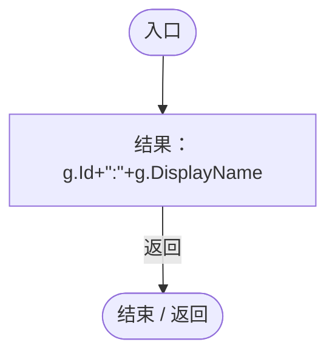
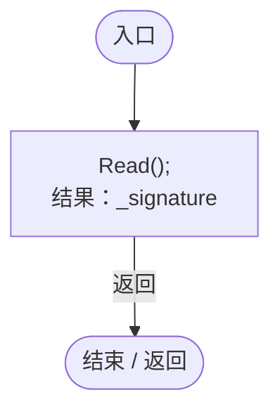
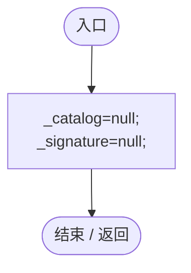

```mermaid
flowchart TD
  b0(["入口"])
  b1{"判断：_catalog==null"}
  b2["_catalog=GeneDatabase.All.ToList();<br/>_signature=string.Join(&quot;&#124;&quot;,_catalog.Select(g=&gt;g.Id+&quot;:&quot;+g.DisplayName));"]
  b3["结果：_catalog"]
  b4(["结束 / 返回"])
  b0 --> b1
  b1 -->|"是"| b2
  b1 -->|"否"| b3
  b2 --> b3
  b3 -->|"返回"| b4

```

# GeneCatalogSnapshot.cs

[返回总索引](../README.md) · `Runtime` · `Assets/DarwinPark/Genetics/GeneCatalogSnapshot.cs`

[源文件](../../../Assets/DarwinPark/Genetics/GeneCatalogSnapshot.cs) · 源码校验：`c9103aa6406d76e9f5ccf963e75adfe6f5c05b71b4ca2aad871b183c964b2820`

方法按源文件位置排列。事件/回调引用不表示立即执行；分支与异常说明见总索引。完整源码与可点击关系图请打开离线手册。

## Read · L9

`public static IReadOnlyList<GeneDefinition> Read()`

### Editor / Player · Roslyn编译器控制流

项目内调用/回调引用：

- [GeneDatabase.All.get · L129](ec0a03483435a863.md#m6e0bbdec8f131ed0)（访问器）
- [GeneCatalogSnapshot.回调@9 · L9](97ea6cb5dbb38dfd.md#m9421e1b0e17ea17c)（回调/委托）

## 回调@9 · L9

`g … => 回调`

### Editor / Player · Roslyn编译器控制流

## Signature.get · L10

`get`

### Editor / Player · Roslyn编译器控制流

项目内调用/回调引用：

- [GeneCatalogSnapshot.Read · L9](97ea6cb5dbb38dfd.md#m641ff0c61b403bae)（方法）

## Clear · L11

`public static void Clear()`

### Editor / Player · Roslyn编译器控制流

