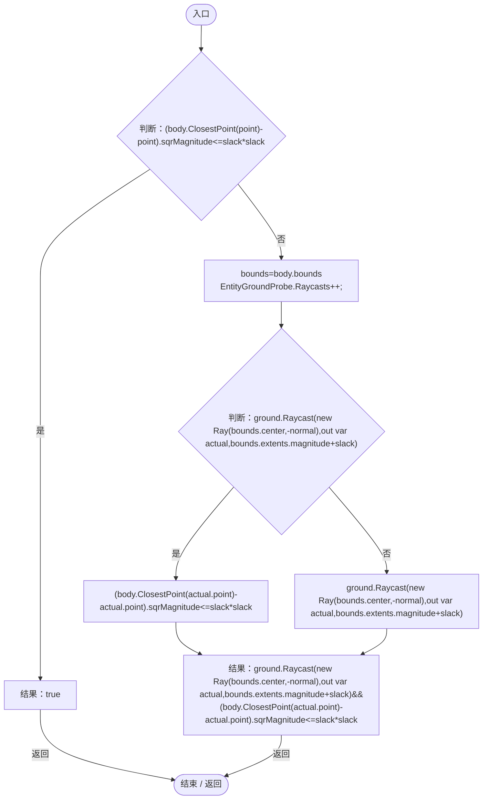

# VerifiedGroundRest.cs

[返回总索引](../README.md) · `Runtime` · `Assets/DarwinPark/Entities/VerifiedGroundRest.cs`

[源文件](../../../Assets/DarwinPark/Entities/VerifiedGroundRest.cs) · 源码校验：`c8c47396904ced0933eee1cd0b0796ff7ab87f08ead54835f1b173851b5e31f1`

方法按源文件位置排列。事件/回调引用不表示立即执行；分支与异常说明见总索引。完整源码与可点击关系图请打开离线手册。

## Touching · L7

`public static bool Touching(Collider body,Collider ground,Vector3 point,Vector3 normal,float slack)`

### Editor / Player · Roslyn编译器控制流

