# RuntimeCostBreakdown.cs

[返回总索引](../README.md) · `Runtime` · `Assets/DarwinPark/Core/RuntimeCostBreakdown.cs`

[源文件](../../../Assets/DarwinPark/Core/RuntimeCostBreakdown.cs) · 源码校验：`5926d83b147f365bc870bf988f57155b0f54d01fcb67a324b7c67df0a80273b7`

方法按源文件位置排列。事件/回调引用不表示立即执行；分支与异常说明见总索引。完整源码与可点击关系图请打开离线手册。

## Key.ctor · L17

`public Key(PerformanceTimings.Area a,string f,string m)`

### Editor / Player · Roslyn编译器控制流

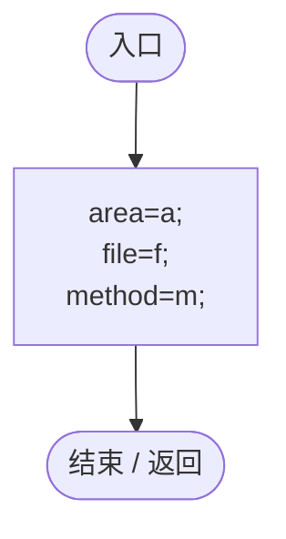

## Equals · L19

`public bool Equals(Key a,Key b)`

### Editor / Player · Roslyn编译器控制流

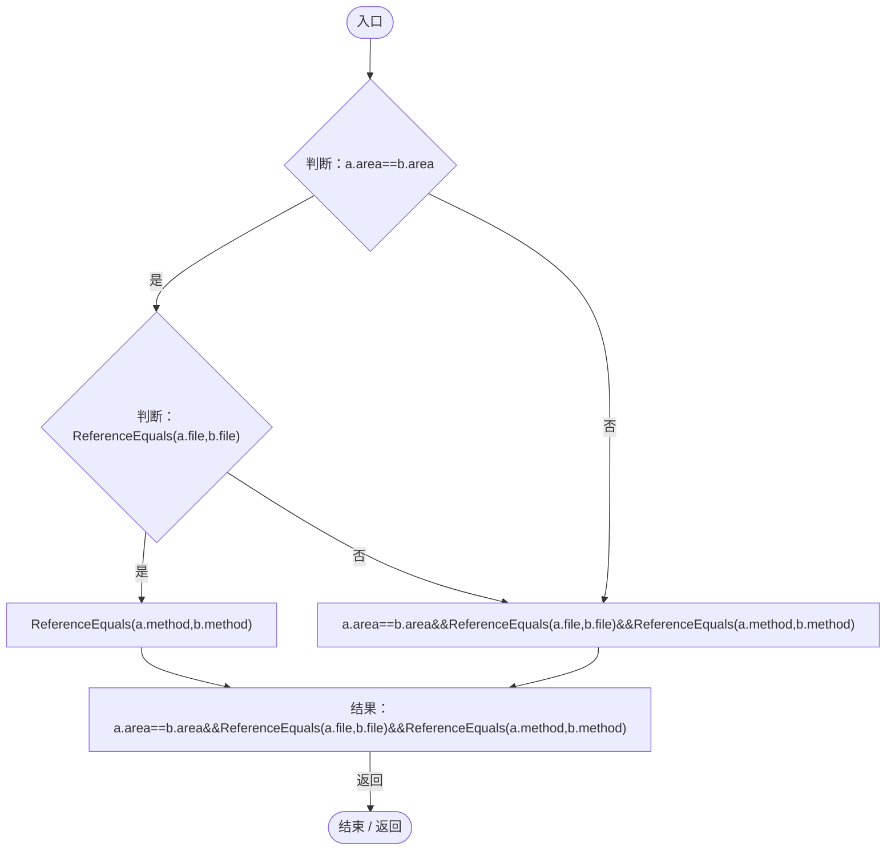

## GetHashCode · L19

`public int GetHashCode(Key k)`

### Editor / Player · Roslyn编译器控制流

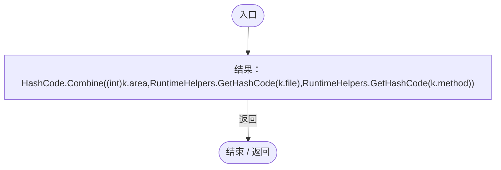

## DroppedScopes.get · L24

`get`

### Editor / Player · 语法控制结构 / 声明（非CFG）

## DroppedScopes.set · L24

`private set`

### Editor / Player · 语法控制结构 / 声明（非CFG）

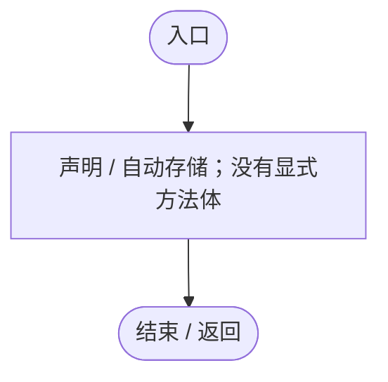

## Begin · L25

`internal static void Begin(int capacity)`

### Editor / Player · Roslyn编译器控制流

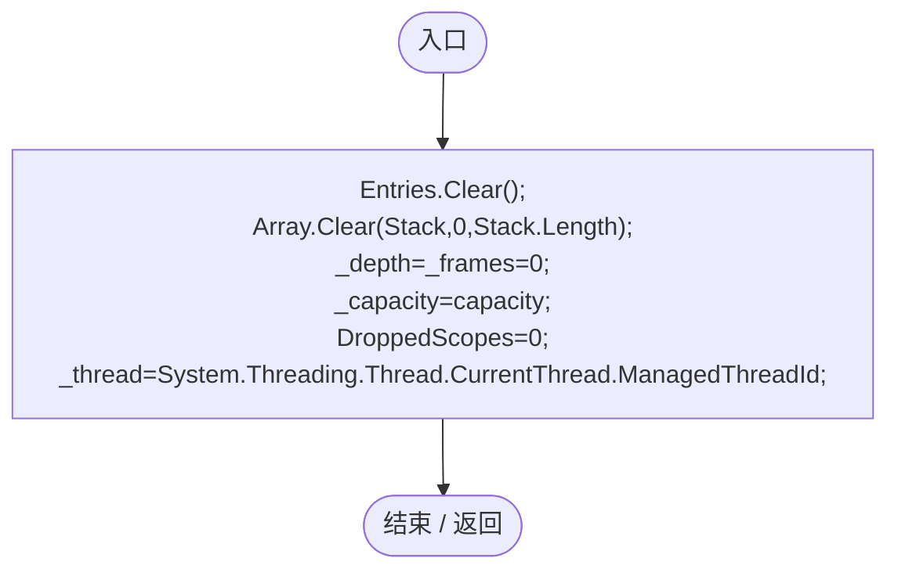

项目内调用/回调引用：

- [RuntimeCostBreakdown.DroppedScopes.set · L24](98eb455b20a05753.md#me5b8c1d76b731876)（访问器）

## Enter · L26

`internal static int Enter(PerformanceTimings.Area area,string file,string method)`

### Editor / Player · Roslyn编译器控制流

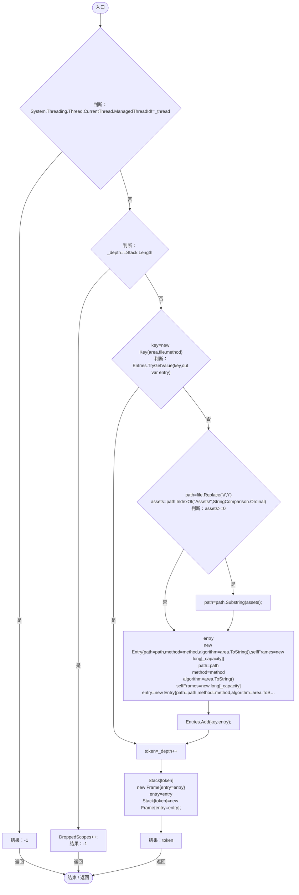

项目内调用/回调引用：

- [RuntimeCostBreakdown.DroppedScopes.set · L24](98eb455b20a05753.md#me5b8c1d76b731876)（访问器）
- [RuntimeCostBreakdown.DroppedScopes.get · L24](98eb455b20a05753.md#me6b24aba5aeac3c6)（访问器）
- [RuntimeCostBreakdown.Key.Key.ctor · L17](98eb455b20a05753.md#m46dc92a183f14978)（构造函数）

## Leave · L34

`internal static void Leave(int token,long ticks)`

### Editor / Player · Roslyn编译器控制流

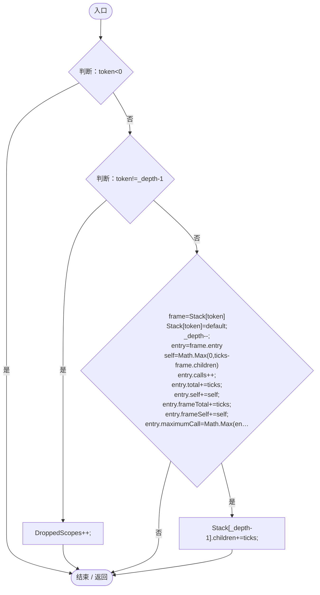

项目内调用/回调引用：

- [RuntimeCostBreakdown.DroppedScopes.set · L24](98eb455b20a05753.md#me5b8c1d76b731876)（访问器）
- [RuntimeCostBreakdown.DroppedScopes.get · L24](98eb455b20a05753.md#me6b24aba5aeac3c6)（访问器）

## RecordFrame · L40

`internal static void RecordFrame()`

### Editor / Player · Roslyn编译器控制流

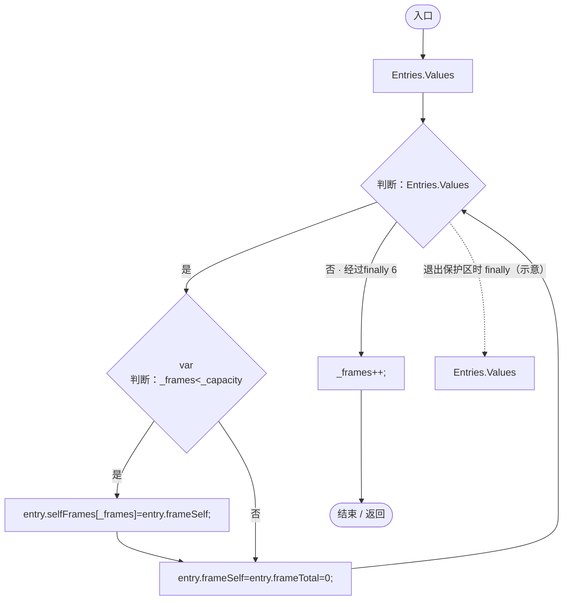

## Ms · L41

`private static double Ms(long ticks)`

### Editor / Player · Roslyn编译器控制流

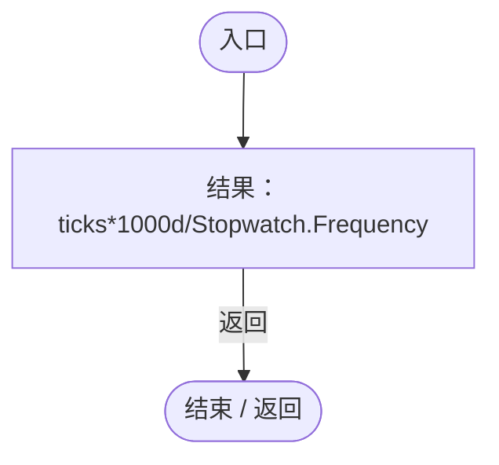

## Percentile · L42

`private static double Percentile(long[] values,int used)`

### Editor / Player · Roslyn编译器控制流

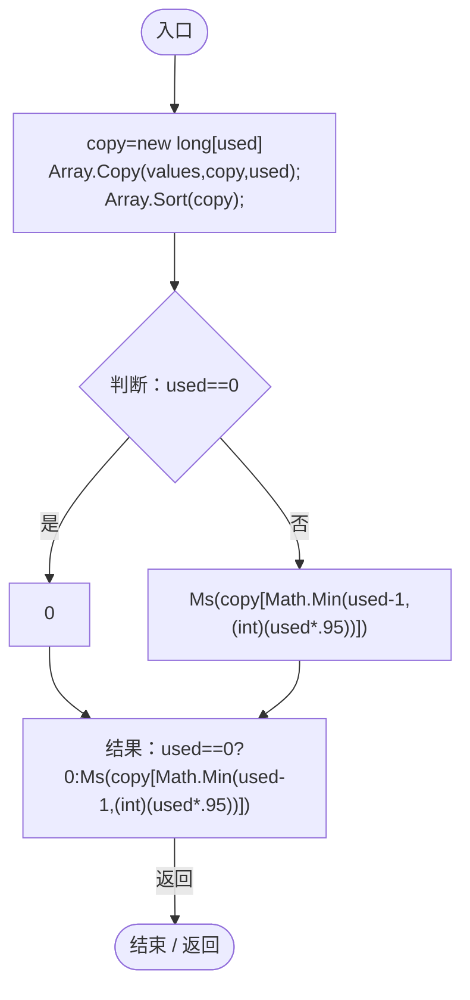

项目内调用/回调引用：

- [RuntimeCostBreakdown.Ms · L41](98eb455b20a05753.md#mfed2c88da8368bed)（方法）

## Finish · L43

`internal static void Finish(PerformanceReport report,double frameMean)`

### Editor / Player · Roslyn编译器控制流

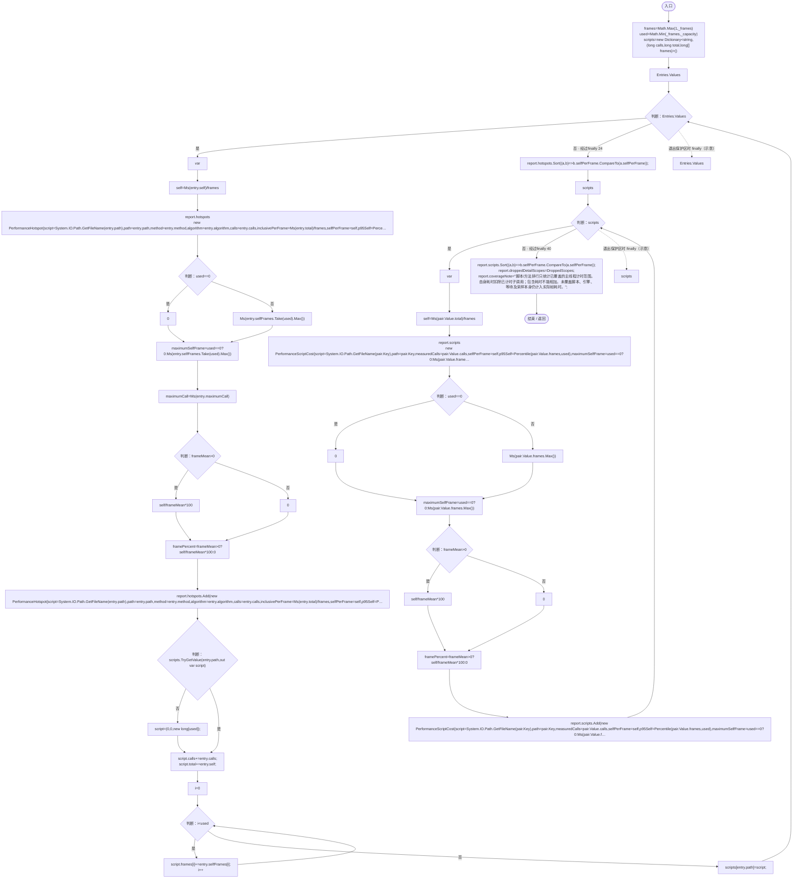

项目内调用/回调引用：

- [RuntimeCostBreakdown.Ms · L41](98eb455b20a05753.md#mfed2c88da8368bed)（方法）
- [RuntimeCostBreakdown.Percentile · L42](98eb455b20a05753.md#m6cc74e4e20613633)（方法）
- [RuntimeCostBreakdown.DroppedScopes.get · L24](98eb455b20a05753.md#me6b24aba5aeac3c6)（访问器）
- [RuntimeCostBreakdown.回调@51 · L51](98eb455b20a05753.md#m7455d5ed5f7fd22f)（回调/委托）
- [RuntimeCostBreakdown.回调@53 · L53](98eb455b20a05753.md#m644d8312431423d6)（回调/委托）

## 回调@51 · L51

`( … => 回调`

### Editor / Player · Roslyn编译器控制流

## 回调@53 · L53

`( … => 回调`

### Editor / Player · Roslyn编译器控制流

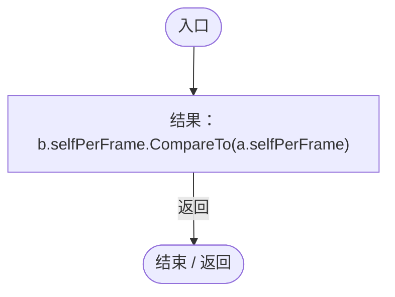

## Clear · L56

`internal static void Clear()`

### Editor / Player · Roslyn编译器控制流

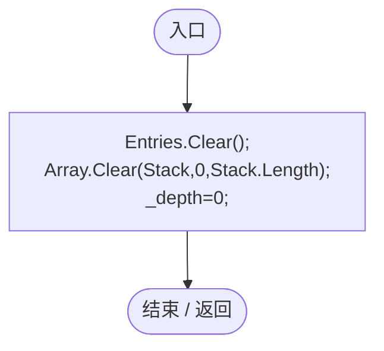
