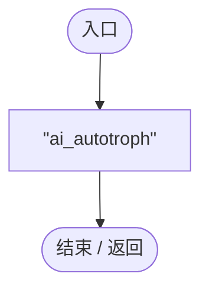
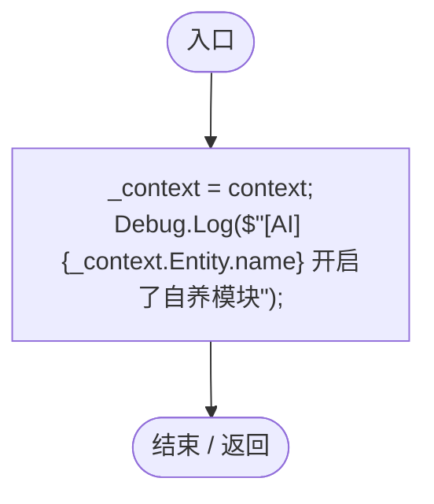
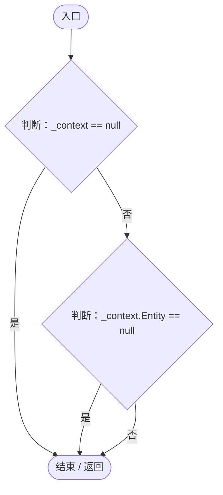
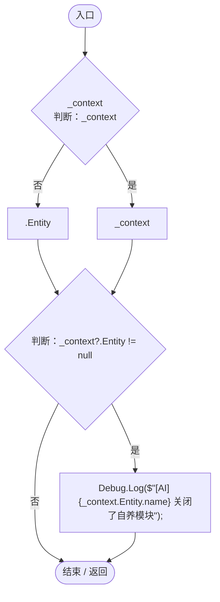

# AutotrophAIModule.cs

[返回总索引](../README.md) · `Runtime` · `Assets/DarwinPark/AI/Modules/AutotrophAIModule.cs`

[源文件](../../../Assets/DarwinPark/AI/Modules/AutotrophAIModule.cs) · 源码校验：`7b7daf4cdc5f170e0ead2228f390d0ff269779d42daa46de1f809ea7263f4989`

方法按源文件位置排列。事件/回调引用不表示立即执行；分支与异常说明见总索引。完整源码与可点击关系图请打开离线手册。

## ModuleId.get · L7

`public string ModuleId`

### Editor / Player · 语法控制结构 / 声明（非CFG）

## Initialize · L11

`public void Initialize(EntityAIContext context)`

### Editor / Player · Roslyn编译器控制流

## Tick · L17

`public void Tick(float deltaTime)`

### Editor / Player · Roslyn编译器控制流

## OnDisable · L23

`public void OnDisable()`

### Editor / Player · Roslyn编译器控制流

