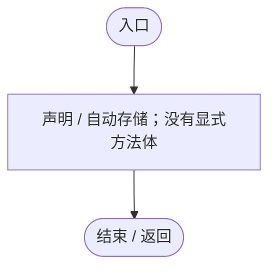
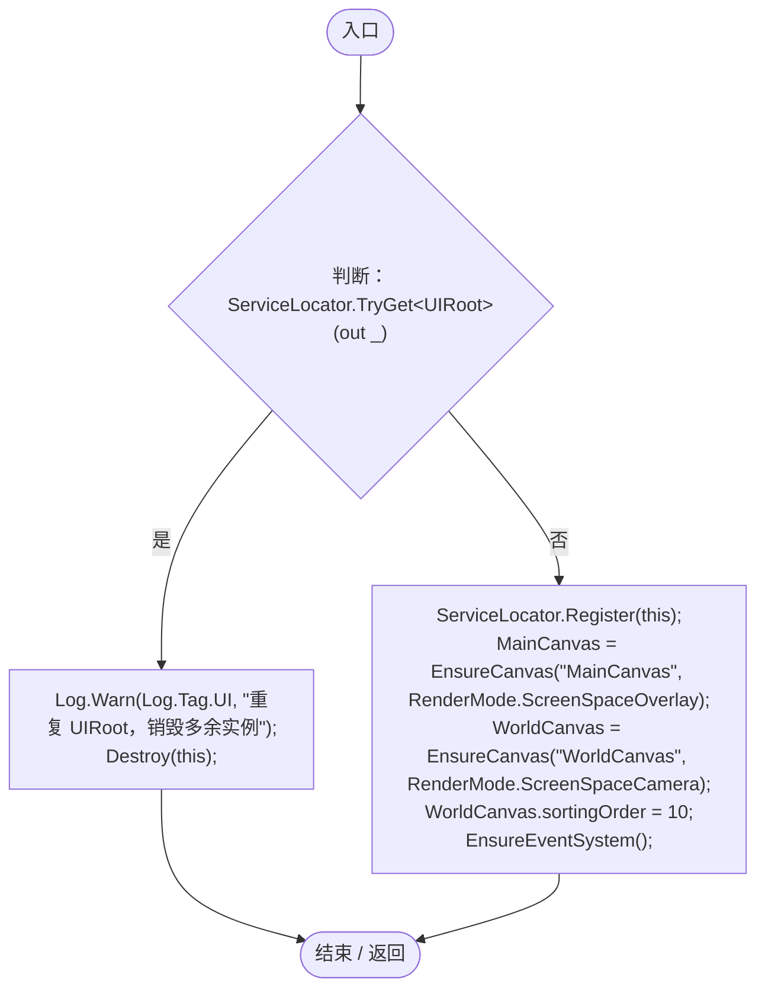
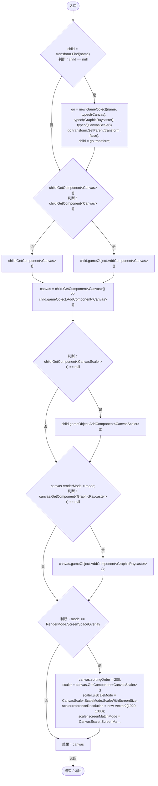
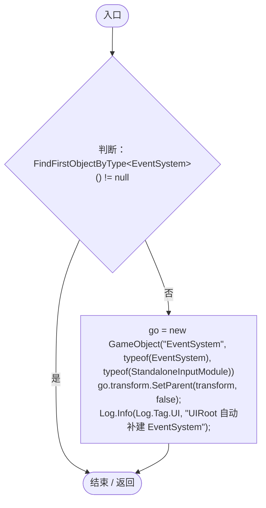
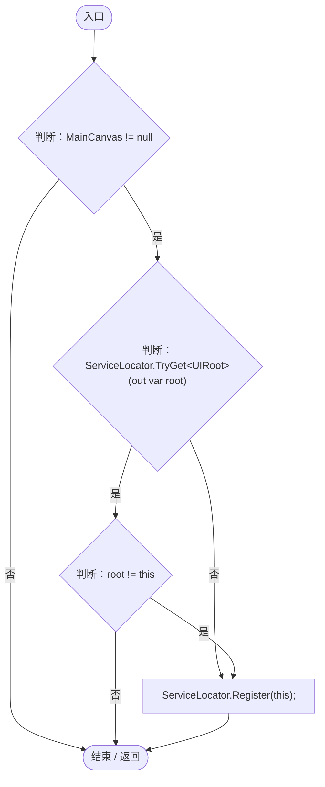
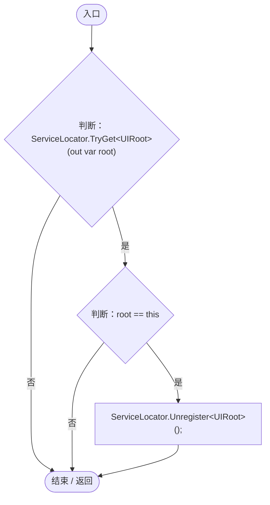

# UIRoot.cs

[返回总索引](../README.md) · `Runtime` · `Assets/DarwinPark/Core/UI/UIRoot.cs`

[源文件](../../../Assets/DarwinPark/Core/UI/UIRoot.cs) · 源码校验：`efa433a332ba2e183cee73f486e00494ca0e0d324943f6e8d0c0c4ac6e6af1c3`

方法按源文件位置排列。事件/回调引用不表示立即执行；分支与异常说明见总索引。完整源码与可点击关系图请打开离线手册。

## MainCanvas.get · L14

`get`

### Editor / Player · 语法控制结构 / 声明（非CFG）

## MainCanvas.set · L14

`private set`

### Editor / Player · 语法控制结构 / 声明（非CFG）

## WorldCanvas.get · L15

`get`

### Editor / Player · 语法控制结构 / 声明（非CFG）

## WorldCanvas.set · L15

`private set`

### Editor / Player · 语法控制结构 / 声明（非CFG）

## Awake · L17

`private void Awake()`

### Editor / Player · Roslyn编译器控制流

项目内调用/回调引用：

- [ServiceLocator.TryGet · L26](f2fdbe9f9ccd93cb.md#m143b24e6d58471b0)（方法）
- [Log.Warn · L37](735e5abf0df2bddc.md#m25a5d11252901de1)（方法）
- [ServiceLocator.Register · L16](f2fdbe9f9ccd93cb.md#m26753aeca74b231e)（方法）
- [UIRoot.MainCanvas.set · L14](9c1421378791f0e0.md#m83397e63d7f90cc3)（访问器）
- [UIRoot.EnsureCanvas · L34](9c1421378791f0e0.md#m60a9eb444e5f1c06)（方法）
- [UIRoot.WorldCanvas.set · L15](9c1421378791f0e0.md#mf39266fd7034eb03)（访问器）
- [UIRoot.WorldCanvas.get · L15](9c1421378791f0e0.md#mf389c1a94092ec8a)（访问器）
- [UIRoot.EnsureEventSystem · L65](9c1421378791f0e0.md#m7ebe3dad44e34e04)（方法）

## EnsureCanvas · L34

`private Canvas EnsureCanvas(string name, RenderMode mode)`

### Editor / Player · Roslyn编译器控制流

## EnsureEventSystem · L65

`private void EnsureEventSystem()`

### Editor / Player · Roslyn编译器控制流

项目内调用/回调引用：

- [Log.Info · L31](735e5abf0df2bddc.md#md1fe08215a3ce4d3)（方法）

## OnEnable · L74

`private void OnEnable()`

★ 修复（防Bug回归）：禁用再启用必须重新注册；重复根节点销毁时不能注销真正的根。

### Editor / Player · Roslyn编译器控制流

项目内调用/回调引用：

- [UIRoot.MainCanvas.get · L14](9c1421378791f0e0.md#maa2cc9baf1248477)（访问器）
- [ServiceLocator.TryGet · L26](f2fdbe9f9ccd93cb.md#m143b24e6d58471b0)（方法）
- [ServiceLocator.Register · L16](f2fdbe9f9ccd93cb.md#m26753aeca74b231e)（方法）

## OnDisable · L80

`private void OnDisable()`

### Editor / Player · Roslyn编译器控制流

项目内调用/回调引用：

- [ServiceLocator.TryGet · L26](f2fdbe9f9ccd93cb.md#m143b24e6d58471b0)（方法）
- [ServiceLocator.Unregister · L24](f2fdbe9f9ccd93cb.md#m24b4fe5c1600b5cf)（方法）
