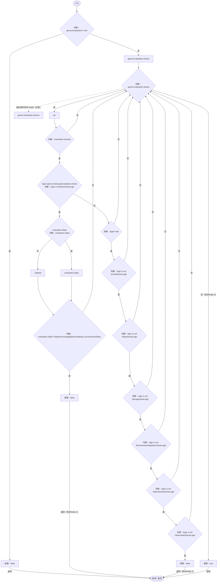
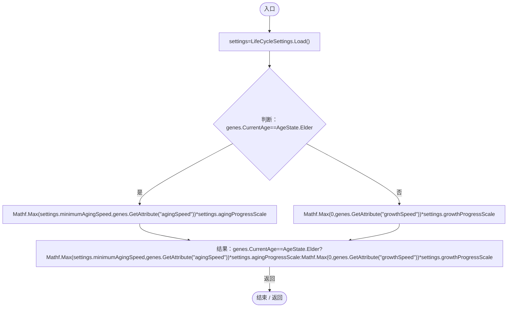
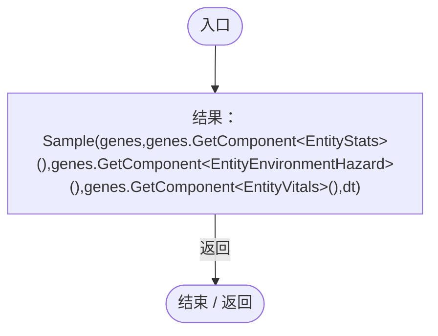
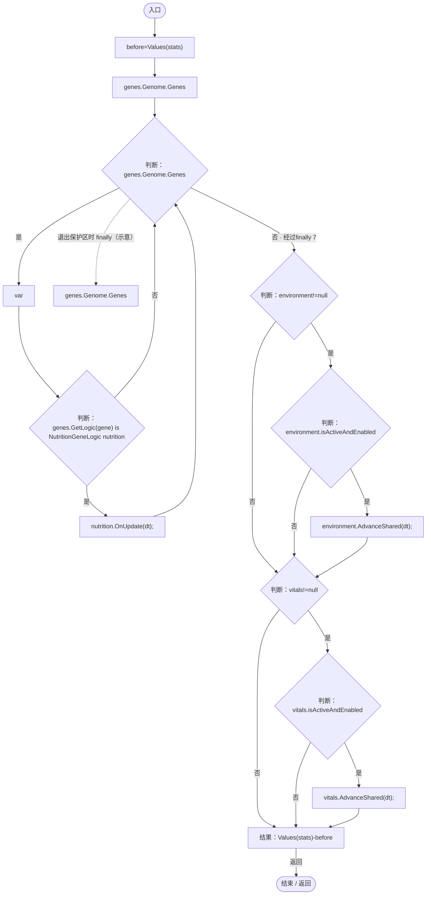
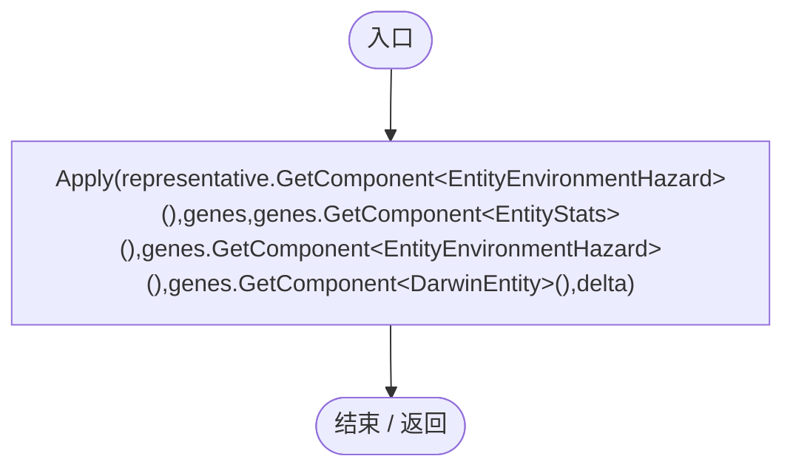
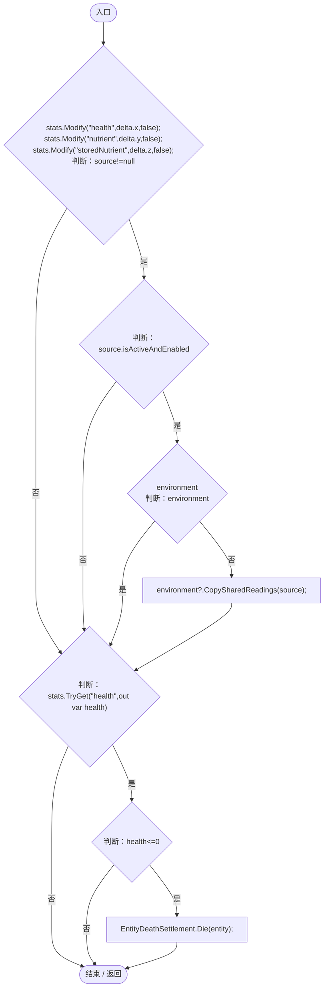
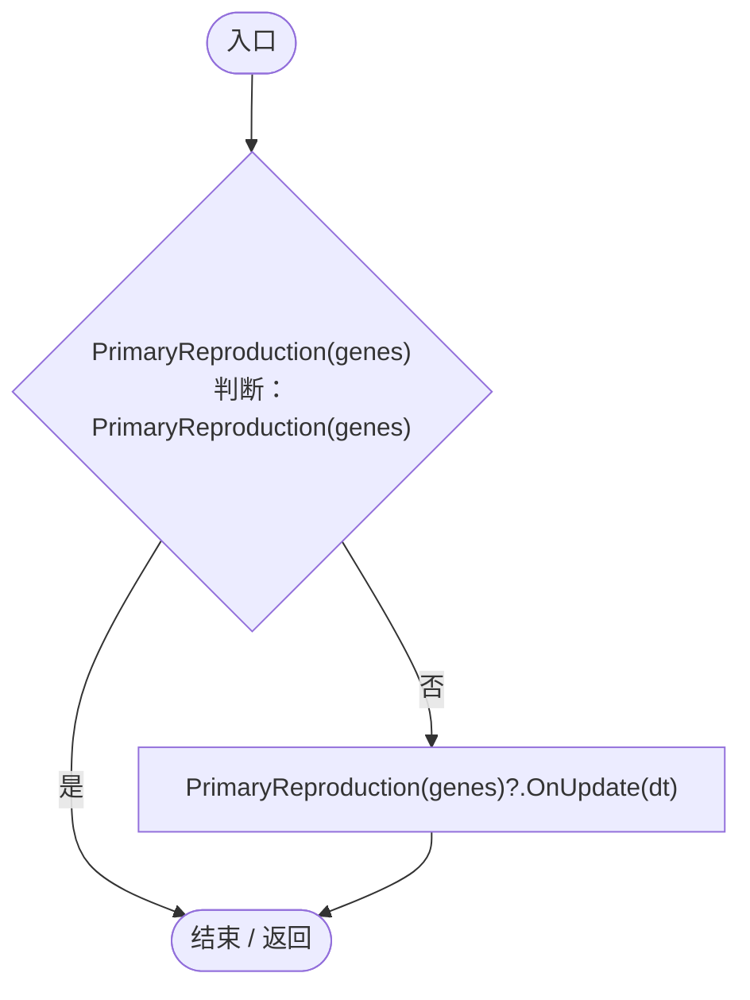
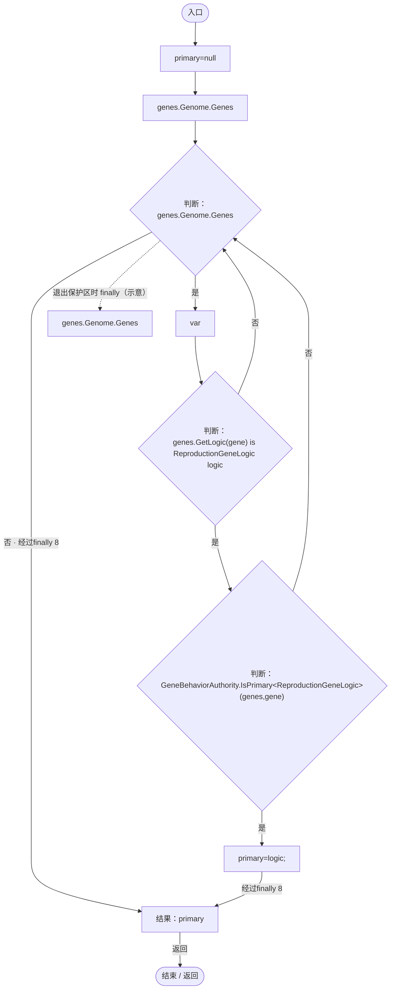

# StationaryCohortKernel.cs

[返回总索引](../README.md) · `Runtime` · `Assets/DarwinPark/Entities/Simulation/StationaryCohortKernel.cs`

[源文件](../../../Assets/DarwinPark/Entities/Simulation/StationaryCohortKernel.cs) · 源码校验：`a3cbbe2e1137283fdbcc0a2fb0fbd6f7cb526d9766601c2a56eed1bd9542b03c`

方法按源文件位置排列。事件/回调引用不表示立即执行；分支与异常说明见总索引。完整源码与可点击关系图请打开离线手册。

## Supported · L12

`public static bool Supported(EntityGeneController genes)`

### Editor / Player · Roslyn编译器控制流

项目内调用/回调引用：

- [EntityGeneController.Evaluation.get · L18](7494d53178552f0e.md#mc0039c100a31b455)（访问器）
- [EntityGeneController.GetLogic · L221](7494d53178552f0e.md#macce520f213fa6c4)（方法）
- [EcologyBalanceSettings.Current.get · L29](5a37bc79f15f6238.md#md33d4c4b8f82540b)（访问器）

## LifeSpeed · L25

`public static float LifeSpeed(EntityGeneController genes)`

### Editor / Player · Roslyn编译器控制流

项目内调用/回调引用：

- [LifeCycleSettings.Load · L16](ace76969fe8f61de.md#mbd2925785484f343)（方法）
- [EntityGeneController.CurrentAge.get · L37](7494d53178552f0e.md#md08823d8f9a2fa16)（访问器）
- [EntityGeneController.GetAttribute · L267](7494d53178552f0e.md#mfd8d6d35f485440c)（方法）

## Sample · L30

`public static Vector3 Sample(EntityGeneController genes,float dt)`

### Editor / Player · Roslyn编译器控制流

项目内调用/回调引用：

- [StationaryCohortKernel.Sample · L33](9d3f50e550ab5beb.md#mf4245e22058e4dde)（方法）

## Sample · L33

`internal static Vector3 Sample(EntityGeneController genes,EntityStats stats,EntityEnvironmentHazard environment,EntityVitals vitals,float dt)`

★ 适配：调度已有生命周期内组件引用，代表和成员的小步不能再重复查询同一组件。

### Editor / Player · Roslyn编译器控制流

项目内调用/回调引用：

- [StationaryCohortKernel.Values · L48](9d3f50e550ab5beb.md#m64d9e1c81e81d203)（方法）
- [EntityGeneController.GetLogic · L221](7494d53178552f0e.md#macce520f213fa6c4)（方法）
- [NutritionGeneLogic.OnUpdate · L19](abc9633044732d73.md#m6802e59f8c25c174)（方法）
- [EntityEnvironmentHazard.AdvanceShared · L74](5c434d0ba85333b1.md#mbfde8d0e75da3c35)（方法）
- [EntityVitals.AdvanceShared · L47](7f68ee05c2ac84bc.md#m891aed9a6cea7c6d)（方法）

## AdvanceCore · L43

`public static void AdvanceCore(EntityGeneController genes,float dt)`

★ 修复（防Bug回归）：共享、拆组补算均尊重组件启停，不能把已关闭的环境/代谢重新运行。

### Editor / Player · Roslyn编译器控制流

项目内调用/回调引用：

- [EntityEnvironmentHazard.AdvanceShared · L74](5c434d0ba85333b1.md#mbfde8d0e75da3c35)（方法）
- [EntityVitals.AdvanceShared · L47](7f68ee05c2ac84bc.md#m891aed9a6cea7c6d)（方法）

## Values · L48

`public static Vector3 Values(EntityStats stats)`

### Editor / Player · Roslyn编译器控制流

项目内调用/回调引用：

- [EntityStats.TryGet · L90](75aa86a368efdf24.md#m24ee1433e4a70d94)（方法）

## Apply · L50

`public static void Apply(EntityGeneController representative,EntityGeneController genes,Vector3 delta)`

### Editor / Player · Roslyn编译器控制流

项目内调用/回调引用：

- [StationaryCohortKernel.Apply · L52](9d3f50e550ab5beb.md#mff43eda308e9aa23)（方法）

## Apply · L52

`internal static void Apply(EntityEnvironmentHazard source,EntityGeneController genes,EntityStats stats,EntityEnvironmentHazard environment,DarwinEntity entity,Vector3 delta)`

### Editor / Player · Roslyn编译器控制流

项目内调用/回调引用：

- [EntityStats.Modify · L111](75aa86a368efdf24.md#m9c837be197158240)（方法）
- [EntityEnvironmentHazard.CopySharedReadings · L69](5c434d0ba85333b1.md#mde6babe1d07e4627)（方法）
- [EntityStats.TryGet · L90](75aa86a368efdf24.md#m24ee1433e4a70d94)（方法）
- [EntityDeathSettlement.Die · L11](07fa6bdaadf50796.md#m700276963777d0a6)（方法）

## Reproduce · L58

`public static void Reproduce(EntityGeneController genes,float dt)`

### Editor / Player · Roslyn编译器控制流

项目内调用/回调引用：

- [StationaryCohortKernel.PrimaryReproduction · L59](9d3f50e550ab5beb.md#mcf6814b936ea6fab)（方法）
- [ReproductionGeneLogic.OnUpdate · L38](ac319ea70bd8b723.md#m51f778c34785d192)（方法）

## PrimaryReproduction · L59

`internal static ReproductionGeneLogic PrimaryReproduction(EntityGeneController genes)`

### Editor / Player · Roslyn编译器控制流

项目内调用/回调引用：

- [EntityGeneController.GetLogic · L221](7494d53178552f0e.md#macce520f213fa6c4)（方法）
- [GeneBehaviorAuthority.IsPrimary · L10](be83fa896bbe02ae.md#me2fc1f2e16fcd073)（方法）
